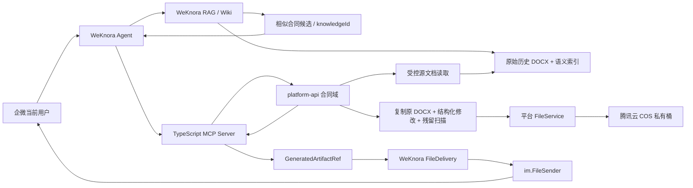

# WeKnora 智能文件生成与合同 MVP Coding Plan

> 状态：源文档派生 POC、三份拟真源 DOCX 结构回归与本地 MySQL 迁移验证已通过，待逐页视觉验收及真实历史样本复核
> 日期：2026-08-14
> 需求来源：`C:\Users\admin\Desktop\基于 WeKnora、MCP 与企业微信智能机器人的合同智能生成系统需求分析.md`  
> 本计划覆盖：云平台通用智能文件成果交付底座 + 第一类合同生成 MVP

## 1. 计划目标

在已经打通的企业微信原生文件出站链路上，继续完成“智能生成文件可被平台各业务模块安全复用”的公共能力，并以“软件技术服务框架协议”作为首个端到端业务样板。

最终目标链路：

```text
企微当前用户提出业务需求
  -> WeKnora Agent 检索 RAG / Wiki，返回相似历史合同候选
  -> 用户 / Agent 选定可派生的历史 DOCX，锁定原文件哈希与结构清单版本
  -> Agent 补齐字段，生成结构化修改指令
  -> MCP 调用云平台受控业务 API
  -> platform-api 创建异步生成任务
  -> 受控读取并复制原始 DOCX，保留结构与版式执行确定性修改
  -> 扫描旧字段残留、空占位符与结构异常，生成 DOCX / PDF
  -> 文件进入腾讯云 COS，数据库只保存文件元数据
  -> MCP 返回文件产物引用，不返回大二进制
  -> WeKnora 校验产物引用并写入文件交付任务
  -> 复用现有 im.FileSender
  -> 当前企微会话收到原生文件消息
  -> 平台保存版本、来源、权限、确认和发送审计
```

本计划不是把合同业务写进 WeKnora。职责必须保持：

- WeKnora：对话、RAG、Wiki、历史合同候选检索、Agent 编排、MCP 调用、当前会话绑定、渠道交付；同时保留知识文档的原始 DOCX，不只保留文本分块。
- `platform-api`：合同业务主状态、权限、源文档选择记录、结构清单、条款、草稿、版本、原 DOCX 派生渲染、文件元数据和审计。
- `mcp-server`：将平台受控 API 暴露为 MCP 工具，不直连数据库和 COS。
- 平台文件模块：统一管理 local/COS 存储，不让合同代码直接依赖腾讯云 SDK。

## 2. 已完成基线

### 2.1 WeKnora 与文件交付基线

- 服务器目录：`/opt/guoyu-platform/WeKnora`。
- 2026-08-11 已完成真实 DOCX 的 `platform-api -> MCP -> WeKnora -> 企微原生 file 消息` 端到端验收。
- 2026-08-12 已验证 UTF-8 中文文件名可原样交付。
- 详细安全与交付契约见 `docs/05_decisions/WeKnora_Artifact_Delivery_Contract.md`。

已完成能力：

- `im.FileSender`：`ReplyFileBytes`、`SendFileBytes`。
- 企微临时素材 init/chunk/finish。
- 512KB 分片、20MB 上限、100 分片上限、上传限流和有限重试。
- 长连接单读循环按 `req_id` 分发响应，避免并发读取 WebSocket。
- 原生 `file` 消息发送至当前会话。
- 命令层 `CommandResult.File` 文件结果。
- MCP `structuredContent` 保留和 `guoyu.generated-artifacts/v1` 严格解析。
- `BotActorContext` 的企微用户、会话、租户与 requestId 受控透传。
- `im_file_deliveries` 持久化交付、幂等、重试与重启恢复。
- `platform-file` 元数据/二进制内部桥接，以及 ID、大小和 SHA-256 复核。

### 2.2 云平台仓库现有基线

- `platform-api` 已有多租户、权限、审计和 `FileApplicationService`。
- 文件模块已有 local/COS 适配、SHA-256、文件元数据、字节读取和下载能力。
- `mcp-server` 已使用 TypeScript MCP SDK，并能通过受控平台账号调用 `platform-api`。
- WeKnora 已支持 MCP Tool、Agent ToolResult、IM ChannelSession 和 Agent 完成事件。
- `contract.generatePreview` 已作为 E2E 联调桩返回可交付 DOCX，但其内容仍是空白文档上的硬编码段落。

### 2.3 POC 编码前关键缺口

1. 当前 `ContractPreviewGenerationService` 只是从空白 `XWPFDocument` 生成的 E2E 联调桩，没有复用 RAG 命中的历史 DOCX 结构与样式。
2. 还没有把 WeKnora `knowledgeId` 解析为平台受控、私有、不可变的 source snapshot。
3. 历史 DOCX 的结构清单、稳定锚点、`derivable` 治理状态和原文件哈希锁定尚未实现。
4. `contract.generatePreview` 尚未接受 `guoyu.contract-derivation-request/v1`，也没有执行跨 run、表格、页眉页脚和内容控件的保样式替换。
5. 合同领域模型、草稿、源文档关系、版本差异、残留扫描和正式确认尚未实现。

### 2.4 2026-08-14 POC 实施进度

已完成：

- 新增 `biz_contract_source_snapshot` 与 `biz_contract_source_manifest` 迁移、Entity 和 Mapper。
- 新增 `POST /contract/mcp/source/resolve`：从 WeKnora 受控读取原 DOCX，校验知识库归属、格式、解析/启用状态、大小与哈希，固化平台私有快照并生成结构清单。
- `contract.generatePreview` 已改为接受 `guoyu.contract-derivation-request/v1`，并交叉校验快照、知识文档、源哈希和 manifest 版本。
- POC 支持甲方、乙方、金额、项目名和服务范围；支持跨 run、正文、表格、页眉和页脚替换，并执行旧值残留扫描。
- MCP 已增加 `contract.resolveSourceDocument`，旧的简单生成参数已替换为受控派生 Schema。
- platform-api 编译、4 个定向单元测试、mcp-server TypeScript 构建和 MCP Schema 注册冒烟均通过。
- `V20260816_002` 已在一次性本地 MySQL 8.4 空库中连续执行两次并通过；未连接共享数据库。
- 已生成三份完整拟真合同源文档，覆盖跨 run、表格字段、多页、多 section、横向附件、页眉页脚和签署区；源/派生文档拓扑断言通过。

尚未执行：

- 未对共享数据库应用 `V20260816_002`，未部署或重启服务。
- 原仓库没有 3 份合适的脱敏历史合同；现有两个合同/需求类 `.docx` 归档不是可读 OOXML ZIP。现已用三份拟真源文档完成技术回归，但正式上线前仍需真实历史样本复核。
- 当前机器未安装 LibreOffice/Word 渲染引擎，标准 `render_docx.py` 无法生成逐页 PNG；结构检查已通过，但未宣称视觉验收通过。
- 章节级编辑、内容控件专用锚点、草稿水印、异步任务、PDF、完整合同版本/审计领域和管理端仍属于后续 P3-P8。

## 3. 必须先确认的架构决策

Review 时应对以下决策给出同意或调整意见；未确认前不开始生产代码。

### AD-01：合同核心业务归属 platform-api

合同实体、状态、权限、模板、条款、版本和审计放入：

```text
services/platform-api/src/main/java/com/guoyu/platform/contract/
```

不新建 `contract-service` 微服务，不把合同业务数据库逻辑放进 WeKnora 或 MCP Server。

### AD-02：MCP 只返回文件引用

生成工具返回标准 `GeneratedArtifactRef`，不返回 DOCX/PDF Base64，不把二进制注入模型上下文。

建议结构：

```json
{
  "schema": "guoyu.generated-artifacts/v1",
  "businessType": "contract",
  "businessId": "2084569567062556674",
  "taskId": "2084569567062556675",
  "artifacts": [
    {
      "provider": "platform-file",
      "documentId": "2084569567062556676",
      "fileId": "2084569567062556677",
      "filename": "软件技术服务框架协议-草稿.docx",
      "mimeType": "application/vnd.openxmlformats-officedocument.wordprocessingml.document",
      "size": 328476,
      "sha256": "...",
      "version": 1,
      "draft": true
    }
  ]
}
```

所有雪花 ID 在跨 JavaScript/JSON 边界时必须使用字符串。

### AD-03：发送目标不能成为模型参数

MCP 工具只接受 `contractId/documentId` 等业务 ID，不接受 `chatId/userId/receiver`。

实际接收人必须由 WeKnora 当前认证会话或已持久化的可信 `sessionRef` 注入。任何模型输出中的接收人字段都应忽略或拒绝。

第一阶段合同文件只允许交付到当前企微私聊会话。群聊中的合同生成请求可以回答说明或生成任务，但不得直接发送敏感合同文件，避免群成员共同可见。

### AD-04：文件生成与文件发送解耦

- platform-api 负责生成、版本和存储。
- WeKnora 负责 IM 交付。
- 中间通过持久化 artifact/delivery 引用衔接。
- 生成成功但企微发送失败时，合同文件仍然存在，可单独重发。

### AD-05：慢任务必须异步

DOCX 渲染、PDF 转换和多文件生成采用“快速返回 taskId + Worker 异步执行 + 状态查询”。

异步线程必须显式传递 `tenantId/userId`，每条 Worker 线程设置并在 `finally` 清理 `TenantContextHolder`，整个异步调用链不得读取 `SecurityContext`。

### AD-06：MVP 只支持一种合同和受控源文档

第一阶段固定为“软件技术服务框架协议”。生成时不从空白 Word 新建结构，而是从 WeKnora RAG 检索结果中选择一份“可派生”的历史 DOCX，复制原文件后执行受控修改。

历史文档只有在原始 DOCX 可读、租户与权限有效、未作废、已生成结构清单且经人工标记为 `derivable` 后才能成为源文档。标准模板是候选源之一，不再是唯一生成来源。

暂不包含：电子签章、自动法务审批、对外发送、批量生成、复杂审批流和自动正式合同编号。

### AD-07：知识文档采用“语义索引 + 原始文件”双轨模型

- RAG 文本分块、摘要和向量只用于检索、对比和生成修改建议，不作为 Word 版式的恢复来源。
- 原始 DOCX 作为不可变源文件保留，派生时通过受控接口按 `knowledgeId + fileHash` 取得。
- 字体、字号、行距、编号、表格、页眉页脚、分页和签章区从原 DOCX 继承，模型不直接输出 OOXML 或最终排版。
- 每份派生文档必须记录源知识文档 ID、源文件哈希、结构清单版本、字段来源和修改差异。

### AD-08：MVP 以 Bot 可用范围作为授权边界

第一阶段不强制建立“企微用户 -> 云平台登录账号”的一对一绑定，采用以下边界：

- 企业微信管理员通过 Bot 可用范围决定哪些内部人员可以使用该能力。
- Bot 对应一个最小权限的平台服务账号，只能调用合同草稿、文件读取和交付所需 API。
- WeKnora 使用 `bot_id + wecom_user_id + chat_id + channel_session_id` 记录实际发起人和会话审计。
- 平台业务权限按 Bot 的能力范围裁决，不假设每位企微用户都拥有云平台账号。
- 如果后续要求同一 Bot 内按部门、岗位或个人区分合同数据权限，再增加企微用户与平台用户绑定；该能力不阻塞 MVP。

## 4. 总体实现结构



## 5. 分阶段 Coding Plan

## Phase 0：开发前基线与工作区隔离

> 状态：持续性前置检查，每次进入新的编码切片前重新执行。

### P0-01 保护现有修改

当前云平台工作区已有未提交修改，且包含 `services/mcp-server`。编码前必须：

1. 确认这些修改的负责人和用途。
2. 将已有修改提交到原分支或创建明确的临时保存点。
3. 新工作使用独立分支 `feat/contract-001-smart-file-mvp`。
4. 禁止覆盖或混入现有竞赛、培训和 MCP 配置修改。

服务器 WeKnora 新建分支：

```text
feat/weknora-artifact-delivery
```

基于 `1f603f2` 创建，并继续保留 `docker-compose.yml`、`frontend/nginx.conf` 的既有未提交修改，不纳入功能提交。

### P0-02 数据库和环境基线

- 查询生产/测试数据库 `flyway_schema_history` 的实际最大版本，再确定新迁移版本号。
- 检查 `sys_file`、用户、租户、角色、权限和审计表真实字段。
- 确认腾讯云 COS 私有桶配置、生命周期和跨服务内网访问方式。
- 确认 LibreOffice/PDF 转换运行方式和服务器可用资源。

验收：输出只读基线报告，不改数据库、不部署。

## Phase 1：Bot 授权上下文和实际发起人审计

> 状态：已完成并进入现有企微文件交付基线。

第一阶段以企业微信管理员配置的 Bot 可用范围作为人员准入控制，不要求企微用户必须先拥有或绑定云平台账号。

### P1-01 Bot 业务身份最小授权

为当前 Bot 配置独立的平台服务账号：

- 只授予合同查询、草稿生成、文件读取和当前会话交付所需权限。
- 不授予系统管理、跨租户、任意文件读取或其他业务模块管理权限。
- Bot 可访问的数据范围与企业微信管理端配置的使用人群保持一致。
- 平台审计同时记录服务账号和外部实际发起人，不能只记录服务账号。

### P1-02 WeKnora BotActorContext

建议扩展 Agent Tool 执行上下文，增加由 WeKnora 服务端注入的 `BotActorContext`：

```text
tenant_id
bot_id / im_channel_id
wecom_user_id
chat_id
chat_type
channel_session_id
weknora_session_id
request_id
```

处理要求：

1. 数据必须来自已验证的企微长连接消息和 WeKnora ChannelSession，不能来自模型参数。
2. `wecom_user_id` 用于记录“谁发起了操作”，服务账号用于 platform-api 系统间鉴权。
3. 企微 UserID、Bot ID、业务 taskId 和 requestId 必须能够在审计日志中串联。
4. 敏感合同交付检测 `chat_type`，群聊直接拒绝文件发送。

### P1-03 MCP 隐藏审计上下文透传

修改 WeKnora MCP 客户端和 `mcp-server`：

- WeKnora 使用 MCP `CallToolParams._meta` 注入 BotActorContext。
- 调用前删除模型参数中所有保留字段，防止模型伪造 `_meta`。
- MCP Server 将 BotActorContext 转换为受控审计 Header 透传给 platform-api。
- platform-api 使用服务账号做权限裁决，并将外部实际发起人写入业务审计详情。
- BotActorContext 不进入模型 Prompt、普通回答和可复制的错误信息。

验收：

- 企业微信管理端未授权人员无法使用 Bot，由企业微信侧拦截。
- 已授权用户调用测试工具成功。
- 张三、李四共用同一个 Bot 服务账号时，平台仍能在审计详情中区分实际企微发起人。
- Prompt 或工具参数伪造其他 userId/chatId 不会改变审计和发送目标。
- 群聊请求不能直接收到合同文件。

## Phase 2：平台通用 Generated Artifact 与文件交付桥

> 状态：已完成并通过真实 DOCX 与中文文件名验收。

本阶段完成后，合同以外的报表、题库、证书、课件等模块也能复用。

### P2-01 保留 MCP 结构化结果

WeKnora 修改建议：

- `internal/mcp/types.go`
- `internal/mcp/client.go`
- `internal/agent/tools/mcp_tool.go`
- `internal/types/agent.go`

实现：

1. 保留 MCP `structuredContent` 和 `resource_link`，不再只保留 text/image。
2. 增加 `types.GeneratedArtifactRef` 和 `ToolResult.Artifacts`。
3. 只解析 schema 为 `guoyu.generated-artifacts/v1` 的结构化结果。
4. 校验 provider、文件名、大小、MIME、ID格式和 artifact 数量。
5. 大文件字节不进入 `ToolResult.Output`、日志、SSE 或模型上下文。

### P2-02 WeKnora 持久化交付任务

新增建议：

- `internal/im/file_delivery.go`
- `internal/im/file_delivery_worker.go`
- `internal/im/file_delivery_repository.go`
- 新增 WeKnora migration：`im_file_deliveries`

建议字段：

- `id`
- `tenant_id`
- `session_id`
- `channel_session_id`
- `im_channel_id`
- `platform`
- `provider`
- `business_type/business_id`
- `document_id/file_id`
- `filename/mime_type/size/sha256`
- `status`：pending/sending/sent/retry_wait/failed/cancelled
- `attempt_count/next_retry_at/last_error`
- `created_at/updated_at/sent_at`

只保存文件引用，不保存文件二进制和企微 `media_id` 作为永久文件标识。

### P2-03 Artifact Resolver

新增 provider 注册机制：

```text
GeneratedArtifactRef
  -> ArtifactResolver(provider=platform-file)
  -> 受控调用 platform-api 读取文件元数据和字节
  -> 校验 size/sha256/tenant/permission
  -> im.FileSender
```

第一阶段只实现 `platform-file` provider。

platform-api 增加仅供受控 Bot 服务账号调用的文件内容接口：

- 输入：文件 ID；BotActorContext 由 MCP/WeKnora 通过受控 Header 注入。
- 输出：流式二进制和可信文件元数据 Header。
- 必须重新执行租户、文件归属和 Bot 服务账号业务权限校验。
- 不能复用无权限检查的 `readFileBytesById` 直接对外暴露。

### P2-04 交付 Worker 与重试

- 即时场景优先尝试发送，但先落交付任务。
- 异步 Worker 从数据库领取 pending/retry_wait 任务。
- 只由持有对应长连接 Adapter 的实例发送。
- 指数退避并设置最大次数，幂等键为 `channelSessionId + documentId + version + deliveryPurpose`。
- 服务重启后继续处理未完成任务。
- 超过重试次数后标记 failed，并预留安全下载链接降级接口。

### P2-05 通用交付验收工具

将 `/sendfile` 保留为底层 bytes 冒烟测试，新增仅限管理员/测试环境的 artifact 冒烟流程：

1. platform-api 创建一个受控测试文件。
2. MCP 返回 artifact ref。
3. WeKnora 自动解析并写入交付任务。
4. 当前企微会话收到文件。
5. 双方审计记录可按 requestId 对齐。

## Phase 3：合同领域模型、权限和 API

> 状态：源快照/manifest POC 子集已实现；完整领域模型仍待后续扩展。

### P3-01 Flyway 与实体

建议新增表：

- `biz_contract_type`
- `biz_contract_template`
- `biz_contract_clause`
- `biz_contract_task`
- `biz_contract_draft`
- `biz_contract_version`
- `biz_contract_document`
- `biz_contract_reference`
- `biz_contract_source_snapshot`
- `biz_contract_source_manifest`
- `biz_contract_delivery`
- `biz_contract_audit_event`

约束：

- 所有 Entity 继承 `BaseEntity`。
- DDL 包含 `tenant_id/deleted/created_by/updated_by/created_at/updated_at`。
- 所有雪花主键为 BIGINT，API以字符串输出。
- 草稿结构、字段来源、风险项可用 MySQL JSON，但常用查询状态必须独立列和索引。
- 不修改任何已应用 Flyway 文件。

### P3-02 权限码和管理员授权

至少增加：

- `contract:view`
- `contract:create`
- `contract:edit`
- `contract:generate`
- `contract:finalize`
- `contract:deliver`
- `contract:template:manage`
- `contract:clause:manage`
- `contract:audit:view`

迁移必须同时完成菜单、权限和目标管理员角色授权，不能只创建权限码。

### P3-03 合同基础 API

按 Controller/Application/Domain/Repository/Entity/DTO/VO/Converter 分层实现：

- 合同类型查询。
- 历史合同候选查询，返回 WeKnora `knowledgeId`、原文件哈希、业务元数据、可派生状态和结构清单版本。
- 源文档登记、结构扫描、可派生标记、作废和版本锁定。
- 标准模板上传、版本、启停和占位符检查；标准模板与历史合同统一抽象为可选源文档。
- 标准条款查询，第一阶段固定种子条款，只允许管理员启停。
- 合同任务创建和状态查询。
- 草稿创建、读取、更新。
- 版本列表和版本差异。
- 文档元数据查询。
- 审计详情查询。

## Phase 4：合同规则、异步渲染和版本

### P4-01 结构化草稿 Schema

为“软件技术服务框架协议”定义稳定 JSON Schema，至少包含：

- 源知识库、源知识文档、原文件名和 SHA-256
- 源文档选择原因、用户确认状态、结构清单 ID / 版本
- 双方主体
- 合同名称和类型
- 合作背景/范围
- 任务单机制
- 协议期限
- 费用与结算
- 交付和验收
- 知识产权
- 数据安全与保密
- 违约、解除和争议解决
- 参考文档
- 字段替换指令和章节编辑指令
- 版式保留策略
- 字段来源
- 未确认项
- 风险项

每个重要字段保存 `value/source/sourceDocumentId/confirmed`。模型不得提交文件路径、下载 URL、OOXML 片段或企微接收人。详细接口以 `guoyu.contract-derivation-request/v1` Schema 为准。

### P4-02 校验服务

实现：

- 必填字段和人工确认字段。
- 主体名称前后一致。
- 日期和期限范围。
- 金额格式及大小写金额。
- 付款比例合计 100%。
- 旧公司名、旧日期、旧项目名残留检测。
- 源 `knowledgeId`、租户、读权限、DOCX MIME、原文件 SHA-256 和 `derivable` 状态校验。
- 结构清单版本、结构锚点存在性和修改操作白名单校验。
- 空占位符检测。
- 模板和条款状态校验。
- 条款互斥/必选规则。

校验返回 error/warning/risk 三类结果；warning 不得被静默忽略。

### P4-03 DOCX 确定性渲染

- `resolveSourceDocument` 先通过 WeKnora 受控文档读取能力，按已选定的 `knowledgeId` 取得原始 DOCX，校验后固化为平台私有不可变 source snapshot；不允许模型传入任意 URL 或存储路径。
- 生成 Worker 按 `sourceSnapshotId + sourceFileHash + manifestId/version` 读取已锁定源文档，不在异步阶段重新执行 RAG 检索或临时下载。
- 先复制原 DOCX，再按结构清单中的 content control、bookmark、标题或表格单元格锚点执行受控替换。
- 默认保留源文档字体、字号、行距、段落样式、编号、表格、页眉页脚、分页和签章区。
- 替换实现必须覆盖跨 `run` 文本、表格、页眉页脚和内容控件，不得只对 `paragraph.getText()` 做简单字符串替换。
- 模型只输出结构化字段、章节编辑与条款 ID，不直接生成最终 Word 排版或 OOXML。
- 草稿加入“草稿／未经审核不得签署”水印。
- 渲染后执行占位符、旧主体/旧金额/旧日期残留扫描和文档结构检查。
- 文件通过 `FileApplicationService` 进入 COS，并保存 SHA-256。

### P4-04 PDF 转换 Worker

- 使用 LibreOffice headless，单独的低并发 Worker/sidecar。
- DOCX 成功后再生成 PDF。
- PDF 失败不回滚已成功的 DOCX。
- 每个转换任务有超时、退出码、临时目录隔离和清理。
- 线程池使用专用 `ThreadPoolTaskExecutor + @Qualifier + AbortPolicy`。

### P4-05 版本与正式确认

- 每次修改产生不可覆盖的新版本。
- 记录字段和条款差异、修改人和修改原因。
- 预览生成草稿版本。
- 正式生成前要求单独确认 token/确认记录，并重新校验。
- 正式版本锁定模板和条款版本、去水印、保存确认人与文件哈希。

## Phase 5：Contract MCP Tools

在现有 `services/mcp-server` 中扩展，不新建第二套 MCP 工程。

### P5-01 查询和校验工具

- `contract.findSimilarContracts`
- `contract.getRequirements`
- `contract.resolveSourceDocument`
- `contract.validateDraft`

说明：历史内容检索仍以 WeKnora RAG 为主；`findSimilarContracts` 负责受控元数据过滤、同企业/同类型优先级、作废排除和参考关系，不复制另一套向量库。`resolveSourceDocument` 将 RAG 候选解析为受控源文档，返回 `knowledgeId`、`sourceFileHash`、`manifestId/version`、可用锚点和可派生状态。

### P5-02 生成和交付工具

- `contract.generatePreview`
- `contract.getGenerationStatus`
- `contract.finalizeDocument`
- `contract.deliverDocuments`

规则：

- `generatePreview` 接受 `guoyu.contract-derivation-request/v1`，必须包含已锁定的 `sourceSnapshotId`、源知识文档、原文件哈希、结构清单版本和结构化修改；快速返回 taskId，完成后返回 artifact envelope。
- 工具不接受原文件 URL / 路径、DOCX Base64、OOXML、未登记锚点或任意接收人。
- `finalizeDocument` 必须经过 MCP Human Approval 和平台确认记录双重校验。
- `deliverDocuments` 输入只接受合同/文档 ID，不接受接收人。
- 工具调用全部带 requestId、BotActorContext，并写平台审计。

### P5-03 MCP Server 重构

现有 Server 名称和工具注册以 certification 为中心，应重构为模块化注册：

```text
src/tools/certification.ts
src/tools/contract.ts
src/clients/platformClient.ts
src/context/botActorContext.ts
src/artifacts/schema.ts
```

保留现有认定工具行为和接口兼容性。

## Phase 6：WeKnora 合同 Agent 与知识准备

### P6-01 合同 Agent 配置

创建专用“合同辅助起草 Agent”：

- 绑定合同 RAG 知识库。
- 绑定合同 Wiki。
- 仅启用必要合同 MCP 工具。
- 固定生成流程：检索 -> 候选对比 -> 源 DOCX 选择/确认 -> 字段提取 -> 缺失确认 -> 结构化修改 -> 校验 -> 预览 -> 用户确认 -> 正式生成。
- 禁止跳过确认、自由创建正式法律条款、指定任意接收人。

### P6-02 RAG 元数据治理

历史合同至少补充：

- 企业、合同类型、业务类型、年份、状态、是否签署。
- 主合同/补充协议关系。
- 模板版本、保密级别、所属部门。
- 原文件 MIME、SHA-256、文件版本、结构清单版本和 `derivable` 状态。
- 可替换字段、内容控件/书签/章节锚点和已知版式异常。
- 作废和失效标记。

检索排序：同企业同类型 > 同企业相似类型 > 同行业同类型 > 标准模板；补充协议和新版本优先。

RAG 入库必须同时保留原始 DOCX。只有解析文本而无法受控读取原文件的记录，可用于问答和内容参考，不能用于合同派生。

### P6-03 Wiki 规则

建立软件技术服务框架协议 Wiki：

- 字段定义和必填规则。
- 章节结构。
- 标准条款和触发条件。
- 冲突规则。
- 生成、确认、归档流程。

## Phase 7：最小管理端

第一阶段只实现业务闭环必需页面：

- 合同任务列表/详情。
- 草稿结构、缺失项和风险项查看。
- 合同版本和文件列表。
- 模板上传、占位符检查、启停和版本。
- 发送状态与重新发送。
- 审计时间线。

完整条款编辑器、复杂模板设计器和审批流程推迟到后续阶段。

## Phase 8：测试、部署和验收

### P8-01 自动化测试

platform-api：

- Domain/Service 单元测试。
- 权限失败、跨租户、作废源文档、非 DOCX、哈希变更、非 `derivable`、未确认正式生成。
- Flyway 空库迁移。
- 异步 Worker 不读取 SecurityContext。
- DOCX 跨 run 替换、表格、页眉页脚、内容控件、原样式保留、占位符、旧字段残留、水印、版本和 SHA-256。
- PDF 成功/失败不影响 DOCX。

mcp-server：

- Zod 输入校验。
- `guoyu.contract-derivation-request/v1` 与 JSON Schema 一致性测试。
- 拒绝 URL、文件路径、Base64、OOXML、未登记锚点和伪造源文档哈希。
- BotActorContext 缺失/伪造。
- platform-api 401刷新与业务403不重试。
- artifact structuredContent 合同。
- 不接受 receiver/chatId。
- `npm run build` 和工具集成测试。

WeKnora：

- structuredContent/resource_link 保留。
- artifact schema、数量、大小和 MIME 校验。
- 交付任务幂等、重试和服务重启恢复。
- 当前会话绑定和跨租户拒绝。
- Adapter 不支持 FileSender 时的降级。
- `go test` 和 `go test -race` 覆盖关键并发代码。

### P8-02 真实 E2E

验收用例：

1. 企业微信管理端已获权用户请求生成软件技术服务框架协议。
2. Agent 检索历史合同和 Wiki，展示符合权限且可派生的候选文档。
3. 用户选定或确认一份源 DOCX，系统锁定 `knowledgeId + sourceFileHash + manifestVersion`。
4. Agent 询问缺失字段。
5. 用户补充后生成结构化草稿与修改指令。
6. 校验通过，异步复制并编辑源 DOCX，版式与结构保持，再生成 PDF。
7. 两个文件发送到当前企微会话。
8. 用户修改付款比例，系统生成 V2，V1 保留。
9. 未确认时禁止正式生成。
10. 确认后生成无草稿水印的正式版本并发送。
11. 平台可查看源知识文档、原文件哈希、结构清单版本、字段来源、修改差异、版本和发送审计。

安全用例：

- 企业微信管理端未授权人员不能使用 Bot。
- Bot 服务账号不能读取超出其授权范围的合同和文件。
- Prompt 指定他人 userId/chatId 无效。
- 群聊不能直接交付合同 DOCX/PDF。
- 作废模板和条款不能使用。
- 跨租户文件 ID 无法读取。
- 文件发送失败保留生成结果并可重试。

### P8-03 部署顺序

1. 备份数据库和当前镜像标签。
2. 应用向后兼容的新增迁移。
3. 部署 platform-api。
4. 部署 mcp-server 并在 WeKnora 配置合同工具。
5. 部署 WeKnora artifact delivery 版本。
6. 创建合同 Agent、RAG 元数据和 Wiki。
7. 先测试租户冒烟，再开放正式用户。

构建新镜像时保持旧服务运行；只有新镜像和自动化测试通过后才切换。不得再次边编译边停止生产服务。

## 6. 第一批建议实施范围

公共基础闭环已完成并通过真实企微 DOCX 验收：BotActorContext、MCP `structuredContent`、`guoyu.generated-artifacts/v1`、持久化交付、`platform-file` resolver 和当前私聊会话交付均已具备。

下一批不并行开发完整合同系统，先用最小范围验证“历史 DOCX 派生”能否稳定保留真实文档结构和版式。

合同业务的第一个纵向切片不直接实现完整合同域，而是完成“源文档派生 POC”：

1. 准备 3 份脱敏且结构不同的历史 DOCX。
2. 实现 `resolveSourceDocument`，固化 source snapshot 并生成 manifest。
3. 只支持甲方、乙方、金额、项目名和服务范围五类变量。
4. 生成后验证跨 run、表格、页眉页脚与原样式保留，并扫描旧字段残留。
5. POC 通过后再扩展章节级编辑、PDF、完整版本和管理端。

## 7. Review Gate

请重点 Review：

1. 是否同意合同核心业务进入 `platform-api/contract`，不单独拆微服务。
2. 是否同意 MCP 只返回 artifact 引用，文件字节由 WeKnora 后台受控读取。
3. 是否同意 MVP 以企业微信 Bot 可用范围作为人员授权边界，不强制绑定云平台个人账号。
4. 是否同意第一阶段只支持“软件技术服务框架协议”。
5. 是否同意“语义索引 + 原始 DOCX”双轨存储，RAG 负责选源，platform-api 负责复制原 DOCX 并确定性编辑。
6. 是否同意只有锁定原文件哈希、具备结构清单并经人工标记为 `derivable` 的历史 DOCX 才可用于自动派生。
7. 是否同意正式合同必须人工确认，第一阶段禁止发给非当前会话。
8. 是否同意在已验收的 P0-P2 公共底座上，先实施源文档派生 POC，通过后再扩展完整 P3-P8 合同业务。
9. 是否同意第一阶段合同文件只发送到当前私聊会话，群聊不直接发送敏感文件。

Review 结果记录为：

```text
状态：通过
确认人：需求方（当前对话用户）
确认时间：2026-08-14 17:22:50 +08:00
调整项：无，Review Gate 第 1-9 项全部同意。
```

## 8. 当前执行边界

本轮已进入 POC 编码，已修改 `platform-api`、`mcp-server`，并创建新的 Flyway 迁移；仍保持以下边界：

- 未修改或部署服务器 WeKnora 代码。
- 未对共享数据库应用新迁移。
- 未构建或发布生产镜像。
- 未重启或停止任何生产容器。
- 未触碰工作区中与本需求无关的既有修改和测试产物。
