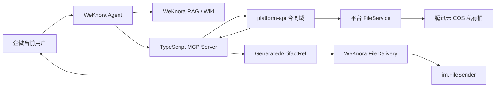

# WeKnora 智能文件生成与合同 MVP Coding Plan

> 状态：Draft，等待 Review，未授权进入编码阶段  
> 日期：2026-08-10  
> 需求来源：`C:\Users\admin\Desktop\基于 WeKnora、MCP 与企业微信智能机器人的合同智能生成系统需求分析.md`  
> 本计划覆盖：云平台通用智能文件成果交付底座 + 第一类合同生成 MVP

## 1. 计划目标

在已经打通的企业微信原生文件出站链路上，继续完成“智能生成文件可被平台各业务模块安全复用”的公共能力，并以“软件技术服务框架协议”作为首个端到端业务样板。

最终目标链路：

```text
企微当前用户提出业务需求
  -> WeKnora Agent 检索 RAG / Wiki 并补齐信息
  -> MCP 调用云平台受控业务 API
  -> platform-api 创建异步生成任务
  -> 确定性生成 DOCX / PDF
  -> 文件进入腾讯云 COS，数据库只保存文件元数据
  -> MCP 返回文件产物引用，不返回大二进制
  -> WeKnora 校验产物引用并写入文件交付任务
  -> 复用现有 im.FileSender
  -> 当前企微会话收到原生文件消息
  -> 平台保存版本、来源、权限、确认和发送审计
```

本计划不是把合同业务写进 WeKnora。职责必须保持：

- WeKnora：对话、RAG、Wiki、Agent 编排、MCP 调用、当前会话绑定、渠道交付。
- `platform-api`：合同业务主状态、权限、模板、条款、草稿、版本、文件元数据和审计。
- `mcp-server`：将平台受控 API 暴露为 MCP 工具，不直连数据库和 COS。
- 平台文件模块：统一管理 local/COS 存储，不让合同代码直接依赖腾讯云 SDK。

## 2. 已完成基线

### 2.1 WeKnora 服务器基线

- 服务器目录：`/opt/guoyu-platform/WeKnora`
- 当前功能分支：`feat/weknora-file-reply`
- 当前提交：`1f603f2 feat(wecom): support websocket file replies`
- 已部署镜像：`wechatopenai/weknora-app:file-reply-20260810`
- 回滚镜像：`wechatopenai/weknora-app:rollback-20260810-163453`
- `/sendfile` 真实企微会话验收通过。

已完成能力：

- `im.FileSender`：`ReplyFileBytes`、`SendFileBytes`。
- 企微临时素材 init/chunk/finish。
- 512KB 分片、20MB 上限、100 分片上限、上传限流和有限重试。
- 长连接单读循环按 `req_id` 分发响应，避免并发读取 WebSocket。
- 原生 `file` 消息发送至当前会话。
- 命令层 `CommandResult.File` 文件结果。

### 2.2 云平台仓库现有基线

- `platform-api` 已有多租户、权限、审计和 `FileApplicationService`。
- 文件模块已有 local/COS 适配、SHA-256、文件元数据、字节读取和下载能力。
- `mcp-server` 已使用 TypeScript MCP SDK，并能通过受控平台账号调用 `platform-api`。
- WeKnora 已支持 MCP Tool、Agent ToolResult、IM ChannelSession 和 Agent 完成事件。

### 2.3 当前关键缺口

1. 企微入站请求在 WeKnora 中仍使用 `system-{tenantID}` 合成用户，无法直接作为合同权限主体。
2. MCP Server 当前主要使用固定平台服务账号，缺少“当前企微用户”的可信委托身份。
3. WeKnora Go MCP Client 当前只保留 text/image，丢弃 `structuredContent` 和 `resource_link`。
4. `ToolResult` 没有通用文件产物引用，Agent 结果无法自动进入文件交付链路。
5. 当前文件发送仅由 slash command 触发，没有持久化交付任务、状态、审计和服务重启恢复。
6. 合同领域模型、模板、条款、草稿、版本、生成任务和文档渲染尚未实现。

## 3. 必须先确认的架构决策

Review 时应对以下决策给出同意或调整意见；未确认前不开始生产代码。

### AD-01：合同核心业务归属 platform-api

合同实体、状态、权限、模板、条款、版本和审计放入：

```text
services/platform-api/src/main/java/com/guoyu/platform/contract/
```

不新建 `contract-service` 微服务，不把合同业务数据库逻辑放进 WeKnora 或 MCP Server。

### AD-02：MCP 只返回文件引用

生成工具返回标准 `GeneratedArtifactRef`，不返回 DOCX/PDF Base64，不把二进制注入模型上下文。

建议结构：

```json
{
  "schema": "guoyu.generated-artifacts/v1",
  "businessType": "contract",
  "businessId": "2084569567062556674",
  "taskId": "2084569567062556675",
  "artifacts": [
    {
      "provider": "platform-file",
      "documentId": "2084569567062556676",
      "fileId": "2084569567062556677",
      "filename": "软件技术服务框架协议-草稿.docx",
      "mimeType": "application/vnd.openxmlformats-officedocument.wordprocessingml.document",
      "size": 328476,
      "sha256": "...",
      "version": 1,
      "draft": true
    }
  ]
}
```

所有雪花 ID 在跨 JavaScript/JSON 边界时必须使用字符串。

### AD-03：发送目标不能成为模型参数

MCP 工具只接受 `contractId/documentId` 等业务 ID，不接受 `chatId/userId/receiver`。

实际接收人必须由 WeKnora 当前认证会话或已持久化的可信 `sessionRef` 注入。任何模型输出中的接收人字段都应忽略或拒绝。

### AD-04：文件生成与文件发送解耦

- platform-api 负责生成、版本和存储。
- WeKnora 负责 IM 交付。
- 中间通过持久化 artifact/delivery 引用衔接。
- 生成成功但企微发送失败时，合同文件仍然存在，可单独重发。

### AD-05：慢任务必须异步

DOCX 渲染、PDF 转换和多文件生成采用“快速返回 taskId + Worker 异步执行 + 状态查询”。

异步线程必须显式传递 `tenantId/userId`，每条 Worker 线程设置并在 `finally` 清理 `TenantContextHolder`，整个异步调用链不得读取 `SecurityContext`。

### AD-06：MVP 只支持一种合同

第一阶段固定为“软件技术服务框架协议”，使用一份审批通过的 DOCX 模板和一组已审核标准条款。

暂不包含：电子签章、自动法务审批、对外发送、批量生成、复杂审批流和自动正式合同编号。

## 4. 总体实现结构



## 5. 分阶段 Coding Plan

## Phase 0：开发前基线与工作区隔离

### P0-01 保护现有修改

当前云平台工作区已有未提交修改，且包含 `services/mcp-server`。编码前必须：

1. 确认这些修改的负责人和用途。
2. 将已有修改提交到原分支或创建明确的临时保存点。
3. 新工作使用独立分支 `feat/contract-001-smart-file-mvp`。
4. 禁止覆盖或混入现有竞赛、培训和 MCP 配置修改。

服务器 WeKnora 新建分支：

```text
feat/weknora-artifact-delivery
```

基于 `1f603f2` 创建，并继续保留 `docker-compose.yml`、`frontend/nginx.conf` 的既有未提交修改，不纳入功能提交。

### P0-02 数据库和环境基线

- 查询生产/测试数据库 `flyway_schema_history` 的实际最大版本，再确定新迁移版本号。
- 检查 `sys_file`、用户、租户、角色、权限和审计表真实字段。
- 确认腾讯云 COS 私有桶配置、生命周期和跨服务内网访问方式。
- 确认 LibreOffice/PDF 转换运行方式和服务器可用资源。

验收：输出只读基线报告，不改数据库、不部署。

## Phase 1：可信用户身份和调用上下文

这是合同权限、文件权限和审计的前置条件，必须先于合同生成开发。

### P1-01 平台外部身份绑定

在 `platform-api/integration/` 增加通用外部身份绑定，而不是合同专用绑定。

建议表：`sys_external_identity_binding`

核心字段：

- `tenant_id`
- `provider`：第一阶段 `wecom`
- `external_tenant_key`
- `external_bot_key`
- `external_user_id`
- `platform_user_id`
- `status`
- BaseEntity 全部字段

接口：

- 管理端绑定/解绑/查询。
- 内部接口：根据 bot + 企微用户解析平台用户。
- 返回短期签名的 `actorContextToken`，包含租户、平台用户、外部身份、会话引用、签发和过期时间。

安全要求：

- 内部接口使用独立 S2S 凭证和时间戳/重放保护。
- 不允许调用方直接声明任意 `platformUserId`。
- 未绑定、停用、跨租户均拒绝合同工具调用。

### P1-02 WeKnora IM 身份解析

建议修改：

- `internal/im/service.go`
- 新增 `internal/im/external_identity.go`
- 扩展 Agent Tool 执行上下文。

处理流程：

1. 收到企微消息后，用 `IMChannel.BotIdentity + IncomingMessage.UserID` 调用平台身份解析接口。
2. 成功时将平台用户、平台租户、`actorContextToken` 和当前 `ChannelSession.ID` 注入请求 Context。
3. 未绑定时允许普通知识问答，但合同写工具返回清晰的“账号未绑定”错误。
4. 禁止把 `actorContextToken` 写入普通日志、模型 Prompt 或消息历史。

### P1-03 MCP 隐藏上下文透传

修改 WeKnora MCP 客户端和 `mcp-server`：

- WeKnora 使用 MCP `CallToolParams._meta` 注入 actor token、sessionRef、requestId。
- 调用前删除模型参数中所有保留字段，防止模型伪造 `_meta`。
- MCP Server 从协议元数据读取可信上下文，并透传给 platform-api。
- platform-api 验证 token 后构建真实 `SecurityContext/TenantContext`，做最终权限裁决。

验收：

- 已绑定用户调用只读测试工具成功，审计记录真实平台用户。
- 未绑定用户失败。
- 用户尝试在 Prompt 或工具参数伪造他人 ID 失败。
- 跨租户 token 失败。

## Phase 2：平台通用 Generated Artifact 与文件交付桥

本阶段完成后，合同以外的报表、题库、证书、课件等模块也能复用。

### P2-01 保留 MCP 结构化结果

WeKnora 修改建议：

- `internal/mcp/types.go`
- `internal/mcp/client.go`
- `internal/agent/tools/mcp_tool.go`
- `internal/types/agent.go`

实现：

1. 保留 MCP `structuredContent` 和 `resource_link`，不再只保留 text/image。
2. 增加 `types.GeneratedArtifactRef` 和 `ToolResult.Artifacts`。
3. 只解析 schema 为 `guoyu.generated-artifacts/v1` 的结构化结果。
4. 校验 provider、文件名、大小、MIME、ID格式和 artifact 数量。
5. 大文件字节不进入 `ToolResult.Output`、日志、SSE 或模型上下文。

### P2-02 WeKnora 持久化交付任务

新增建议：

- `internal/im/file_delivery.go`
- `internal/im/file_delivery_worker.go`
- `internal/im/file_delivery_repository.go`
- 新增 WeKnora migration：`im_file_deliveries`

建议字段：

- `id`
- `tenant_id`
- `session_id`
- `channel_session_id`
- `im_channel_id`
- `platform`
- `provider`
- `business_type/business_id`
- `document_id/file_id`
- `filename/mime_type/size/sha256`
- `status`：pending/sending/sent/retry_wait/failed/cancelled
- `attempt_count/next_retry_at/last_error`
- `created_at/updated_at/sent_at`

只保存文件引用，不保存文件二进制和企微 `media_id` 作为永久文件标识。

### P2-03 Artifact Resolver

新增 provider 注册机制：

```text
GeneratedArtifactRef
  -> ArtifactResolver(provider=platform-file)
  -> 受控调用 platform-api 读取文件元数据和字节
  -> 校验 size/sha256/tenant/permission
  -> im.FileSender
```

第一阶段只实现 `platform-file` provider。

platform-api 增加仅供受控服务调用的文件内容接口：

- 输入：文件 ID + actor context。
- 输出：流式二进制和可信文件元数据 Header。
- 必须重新执行文件归属和业务权限校验。
- 不能复用无权限检查的 `readFileBytesById` 直接对外暴露。

### P2-04 交付 Worker 与重试

- 即时场景优先尝试发送，但先落交付任务。
- 异步 Worker 从数据库领取 pending/retry_wait 任务。
- 只由持有对应长连接 Adapter 的实例发送。
- 指数退避并设置最大次数，幂等键为 `channelSessionId + documentId + version + deliveryPurpose`。
- 服务重启后继续处理未完成任务。
- 超过重试次数后标记 failed，并预留安全下载链接降级接口。

### P2-05 通用交付验收工具

将 `/sendfile` 保留为底层 bytes 冒烟测试，新增仅限管理员/测试环境的 artifact 冒烟流程：

1. platform-api 创建一个受控测试文件。
2. MCP 返回 artifact ref。
3. WeKnora 自动解析并写入交付任务。
4. 当前企微会话收到文件。
5. 双方审计记录可按 requestId 对齐。

## Phase 3：合同领域模型、权限和 API

### P3-01 Flyway 与实体

建议新增表：

- `biz_contract_type`
- `biz_contract_template`
- `biz_contract_clause`
- `biz_contract_task`
- `biz_contract_draft`
- `biz_contract_version`
- `biz_contract_document`
- `biz_contract_reference`
- `biz_contract_delivery`
- `biz_contract_audit_event`

约束：

- 所有 Entity 继承 `BaseEntity`。
- DDL 包含 `tenant_id/deleted/created_by/updated_by/created_at/updated_at`。
- 所有雪花主键为 BIGINT，API以字符串输出。
- 草稿结构、字段来源、风险项可用 MySQL JSON，但常用查询状态必须独立列和索引。
- 不修改任何已应用 Flyway 文件。

### P3-02 权限码和管理员授权

至少增加：

- `contract:view`
- `contract:create`
- `contract:edit`
- `contract:generate`
- `contract:finalize`
- `contract:deliver`
- `contract:template:manage`
- `contract:clause:manage`
- `contract:audit:view`

迁移必须同时完成菜单、权限和目标管理员角色授权，不能只创建权限码。

### P3-03 合同基础 API

按 Controller/Application/Domain/Repository/Entity/DTO/VO/Converter 分层实现：

- 合同类型查询。
- 模板上传、版本、启停和占位符检查。
- 标准条款查询，第一阶段固定种子条款，只允许管理员启停。
- 合同任务创建和状态查询。
- 草稿创建、读取、更新。
- 版本列表和版本差异。
- 文档元数据查询。
- 审计详情查询。

## Phase 4：合同规则、异步渲染和版本

### P4-01 结构化草稿 Schema

为“软件技术服务框架协议”定义稳定 JSON Schema，至少包含：

- 双方主体
- 合同名称和类型
- 合作背景/范围
- 任务单机制
- 协议期限
- 费用与结算
- 交付和验收
- 知识产权
- 数据安全与保密
- 违约、解除和争议解决
- 参考文档
- 字段来源
- 未确认项
- 风险项

每个重要字段保存 `value/source/sourceDocumentId/confirmed`。

### P4-02 校验服务

实现：

- 必填字段和人工确认字段。
- 主体名称前后一致。
- 日期和期限范围。
- 金额格式及大小写金额。
- 付款比例合计 100%。
- 旧公司名、旧日期、旧项目名残留检测。
- 空占位符检测。
- 模板和条款状态校验。
- 条款互斥/必选规则。

校验返回 error/warning/risk 三类结果；warning 不得被静默忽略。

### P4-03 DOCX 确定性渲染

- 使用 Apache POI 填充审批通过的固定 DOCX 模板。
- 模型只输出结构化字段和条款 ID，不直接生成最终 Word 排版。
- 草稿加入“草稿／未经审核不得签署”水印。
- 渲染后执行占位符扫描和文档结构检查。
- 文件通过 `FileApplicationService` 进入 COS，并保存 SHA-256。

### P4-04 PDF 转换 Worker

- 使用 LibreOffice headless，单独的低并发 Worker/sidecar。
- DOCX 成功后再生成 PDF。
- PDF 失败不回滚已成功的 DOCX。
- 每个转换任务有超时、退出码、临时目录隔离和清理。
- 线程池使用专用 `ThreadPoolTaskExecutor + @Qualifier + AbortPolicy`。

### P4-05 版本与正式确认

- 每次修改产生不可覆盖的新版本。
- 记录字段和条款差异、修改人和修改原因。
- 预览生成草稿版本。
- 正式生成前要求单独确认 token/确认记录，并重新校验。
- 正式版本锁定模板和条款版本、去水印、保存确认人与文件哈希。

## Phase 5：Contract MCP Tools

在现有 `services/mcp-server` 中扩展，不新建第二套 MCP 工程。

### P5-01 查询和校验工具

- `contract.findSimilarContracts`
- `contract.getRequirements`
- `contract.resolveTemplate`
- `contract.validateDraft`

说明：历史内容检索仍以 WeKnora RAG 为主；`findSimilarContracts` 负责受控元数据过滤、同企业/同类型优先级、作废排除和参考关系，不复制另一套向量库。

### P5-02 生成和交付工具

- `contract.generatePreview`
- `contract.getGenerationStatus`
- `contract.finalizeDocument`
- `contract.deliverDocuments`

规则：

- `generatePreview` 快速返回 taskId；完成后返回 artifact envelope。
- `finalizeDocument` 必须经过 MCP Human Approval 和平台确认记录双重校验。
- `deliverDocuments` 输入只接受合同/文档 ID，不接受接收人。
- 工具调用全部带 requestId、actor context，并写平台审计。

### P5-03 MCP Server 重构

现有 Server 名称和工具注册以 certification 为中心，应重构为模块化注册：

```text
src/tools/certification.ts
src/tools/contract.ts
src/clients/platformClient.ts
src/context/actorContext.ts
src/artifacts/schema.ts
```

保留现有认定工具行为和接口兼容性。

## Phase 6：WeKnora 合同 Agent 与知识准备

### P6-01 合同 Agent 配置

创建专用“合同辅助起草 Agent”：

- 绑定合同 RAG 知识库。
- 绑定合同 Wiki。
- 仅启用必要合同 MCP 工具。
- 固定生成流程：检索 -> 字段提取 -> 缺失确认 -> 校验 -> 预览 -> 用户确认 -> 正式生成。
- 禁止跳过确认、自由创建正式法律条款、指定任意接收人。

### P6-02 RAG 元数据治理

历史合同至少补充：

- 企业、合同类型、业务类型、年份、状态、是否签署。
- 主合同/补充协议关系。
- 模板版本、保密级别、所属部门。
- 作废和失效标记。

检索排序：同企业同类型 > 同企业相似类型 > 同行业同类型 > 标准模板；补充协议和新版本优先。

### P6-03 Wiki 规则

建立软件技术服务框架协议 Wiki：

- 字段定义和必填规则。
- 章节结构。
- 标准条款和触发条件。
- 冲突规则。
- 生成、确认、归档流程。

## Phase 7：最小管理端

第一阶段只实现业务闭环必需页面：

- 合同任务列表/详情。
- 草稿结构、缺失项和风险项查看。
- 合同版本和文件列表。
- 模板上传、占位符检查、启停和版本。
- 发送状态与重新发送。
- 审计时间线。

完整条款编辑器、复杂模板设计器和审批流程推迟到后续阶段。

## Phase 8：测试、部署和验收

### P8-01 自动化测试

platform-api：

- Domain/Service 单元测试。
- 权限失败、跨租户、作废模板、未确认正式生成。
- Flyway 空库迁移。
- 异步 Worker 不读取 SecurityContext。
- DOCX 占位符、水印、版本和 SHA-256。
- PDF 成功/失败不影响 DOCX。

mcp-server：

- Zod 输入校验。
- actor context 缺失/伪造。
- platform-api 401刷新与业务403不重试。
- artifact structuredContent 合同。
- 不接受 receiver/chatId。
- `npm run build` 和工具集成测试。

WeKnora：

- structuredContent/resource_link 保留。
- artifact schema、数量、大小和 MIME 校验。
- 交付任务幂等、重试和服务重启恢复。
- 当前会话绑定和跨租户拒绝。
- Adapter 不支持 FileSender 时的降级。
- `go test` 和 `go test -race` 覆盖关键并发代码。

### P8-02 真实 E2E

验收用例：

1. 已绑定企微用户请求生成软件技术服务框架协议。
2. Agent 检索历史合同和 Wiki。
3. Agent 询问缺失字段。
4. 用户补充后生成结构化草稿。
5. 校验通过，异步生成 DOCX/PDF。
6. 两个文件发送到当前企微会话。
7. 用户修改付款比例，系统生成 V2，V1 保留。
8. 未确认时禁止正式生成。
9. 确认后生成无草稿水印的正式版本并发送。
10. 平台可查看来源、模板、条款、版本、哈希和发送审计。

安全用例：

- 未绑定企微用户不能生成合同。
- 无权限用户不能读取或交付其他部门合同。
- Prompt 指定他人 userId/chatId 无效。
- 作废模板和条款不能使用。
- 跨租户文件 ID 无法读取。
- 文件发送失败保留生成结果并可重试。

### P8-03 部署顺序

1. 备份数据库和当前镜像标签。
2. 应用向后兼容的新增迁移。
3. 部署 platform-api。
4. 部署 mcp-server 并在 WeKnora 配置合同工具。
5. 部署 WeKnora artifact delivery 版本。
6. 创建合同 Agent、RAG 元数据和 Wiki。
7. 先测试租户冒烟，再开放正式用户。

构建新镜像时保持旧服务运行；只有新镜像和自动化测试通过后才切换。不得再次边编译边停止生产服务。

## 6. 第一批建议实施范围

Review 通过后，不建议立即并行开发完整合同系统。第一批只做公共基础闭环：

1. P0：工作区和数据库基线。
2. P1：企微用户与平台用户绑定、可信 actor context。
3. P2：MCP structuredContent/artifact ref、持久化交付和 platform-file resolver。
4. 用一个平台生成的测试 TXT/PDF 验证“业务文件 ID -> MCP -> WeKnora -> 当前企微会话”。

第一批验收通过后再进入合同表结构、模板和渲染开发。这样可以确保后续合同、报表、题库、证书等模块都使用同一个公共交付机制。

## 7. Review Gate

请重点 Review：

1. 是否同意合同核心业务进入 `platform-api/contract`，不单独拆微服务。
2. 是否同意 MCP 只返回 artifact 引用，文件字节由 WeKnora 后台受控读取。
3. 是否同意优先实现企微用户与平台用户绑定，未绑定用户不能执行合同工具。
4. 是否同意第一阶段只支持“软件技术服务框架协议”。
5. 是否同意正式合同必须人工确认，第一阶段禁止发给非当前会话。
6. 是否同意先完成 P0-P2 公共底座，再开始 P3-P8 合同业务。

Review 结果记录为：

```text
状态：待确认 / 通过 / 调整后通过 / 拒绝
确认人：
确认时间：
调整项：
```

## 8. 本轮不执行事项

本轮仅产出 Coding Plan。未执行：

- 未修改服务器 WeKnora 代码。
- 未修改 platform-api、mcp-server 或前端生产代码。
- 未创建数据库迁移。
- 未构建镜像。
- 未重启或停止任何生产容器。

