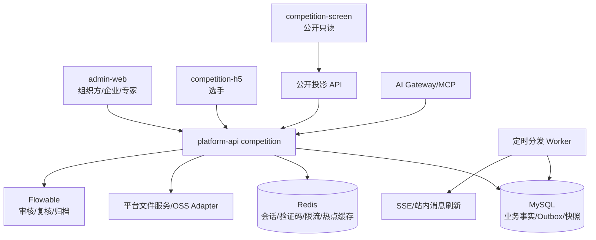
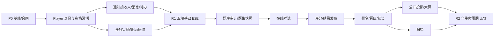

# 竞赛模块完整落地执行方案

> 版本：V1.0（执行规划稿）  
> 日期：2026-07-16  
> 用途：作为后续拆分 ChatGPT Luna / Codex 开发提示词、排期、验收和上线的统一母方案。  
> 当前代码基线：`dev` 分支工作区中的竞赛基础链路，尚未形成独立提交，真实 MySQL/Flyway/HTTP 全链路仍需补验。

## 1. 执行结论

当前仓库已完成的是组织方后台的第一段基础链路：赛事、参与企业、赛段、任务模板、企业名单导入、资格审核、赛事公告草稿与发布。它能够支撑组织者配置并发布赛事，但还没有形成选手、企业、专家和公开端共同参与的完整赛事生命周期。

完整落地应继续沿用现有技术路线：

- 核心业务保留在 `services/platform-api` 的 `competition` 领域，不拆独立竞赛微服务。
- 组织方、企业管理员和专家优先使用 `apps/admin-web` 的不同角色视图，不复制三套 PC 后台。
- 新建独立 `apps/competition-h5`，承载选手身份、消息、任务、考试、成绩和个人中心。
- 新建独立只读 `apps/competition-screen`，只消费已发布、脱敏的公开投影。
- 通知采用“通知主表 + 接收人表 + 独立待办投影 + Outbox”的可靠站内消息架构；第一期不引入 MQ。
- 赛事题目复用现有题库受控能力，但必须生成赛事题集/试卷快照并锁定；竞赛考试会话、答卷、成绩、排行和晋级使用竞赛上下文模型。
- 核心状态由 MySQL 和受控状态机/Flowable 管理；n8n 只负责提醒、同步和低风险自动化。

建议把完整建设拆成两个可上线里程碑：

1. **R1 可运营参赛闭环**：组织方配置赛事 → 企业导入名单 → 资格审核 → 选手激活 → 接收通知 → 完成基础任务 → 组织方验收。
2. **R2 完整竞赛执行闭环**：技术研讨/专家/题库 → 初赛考试 → 成绩复核 → 晋级 → 决赛评分 → 结果发布 → 企业/选手/大屏联动 → 归档复盘。

AI、复杂预算报销、供应商采购、实时协同编辑不是 R1/R2 的上线前置条件，建议作为 R3 增强能力。

## 2. 当前实现基线

### 2.1 已落地

| 层 | 已实现能力 | 当前证据 |
|---|---|---|
| 数据库 | `competition_event`、`competition_event_org`、`competition_stage`、`competition_task_template`、`competition_roster_import`、`competition_roster_item`、`competition_registration`、`competition_notice` 共 8 张表 | `V20260715_005__create_competition_foundation_tables.sql` |
| 后端 | 7 个 Controller、约 25 个接口映射，覆盖赛事、参与企业、赛段、任务模板、名单、资格、公告 | `services/platform-api/.../competition/` |
| 权限 | 竞赛赛事、参与企业、赛段、任务模板、名单、资格、通知的权限码和平台管理员授权 | 竞赛权限 Flyway 迁移 |
| 管理端 | 赛事列表/详情、参与企业、赛段与模板、名单导入、资格审核、通知管理 6 类页面 | `apps/admin-web/src/pages/competition/` |
| 规则 | 草稿发布、发布后禁止编辑、企业内部赛组织范围、名单确认、资格审核状态约束 | Service 与专项测试 |
| 测试 | 当前后端编译成功；竞赛专项 102 tests 全通过；管理端 TypeScript/Vite 构建通过 | 2026-07-16 本地复核 |

### 2.2 只做了一半或尚未落地

| 能力 | 当前缺口 |
|---|---|
| 赛事发布 | 当前是基础 `draft → published`；缺少运行、取消、结束、结果发布、归档的完整生命周期和变更版本控制 |
| 赛事公告 | 当前发布只更新 `competition_notice.status`；没有接收人、已读、撤回、定时发布、附件、范围冻结和选手查询 |
| 参赛资格 | 已有企业名单和审核；没有身份证匹配、手机号绑定、隐私同意、Player Token、资格激活和选手会话 |
| 任务 | 只有任务模板；没有任务实例、接收人、提交、签到、验收、补正、逾期和提醒 |
| 企业端 | 管理端已有部分企业范围逻辑；没有完整企业工作台、内部初赛、推荐、企业统计和企业任务中心 |
| 选手端 | `apps/competition-h5` 不存在；所有选手功能未实现 |
| 专家端 | 竞赛专家任务、研讨、命题、审题、裁判评分未实现 |
| 题库/考试 | 现有平台存在题库、试卷和部分考试/专家/实操能力，但尚未完成竞赛上下文适配、快照锁定和安全考试会话 |
| 结果 | 成绩、复核、排名、晋级、获奖、申诉、公开发布投影均未实现 |
| 大屏 | 只有静态原型；没有公开 API、脱敏投影、缓存和媒体审核 |
| 流程/资源/预算/档案 | 静态原型有完整设计，正式代码未落地 |
| 联调验收 | 真实空库 Flyway、真实登录、真实文件上传、真实 HTTP 和五端 E2E 尚未完成 |

### 2.3 当前完成度的正确口径

当前不是“竞赛模块基本完成”，而是完成了完整生命周期中的组织方后台基础底座。可视为 FND-00～FND-05 代码完成、FND-06 静态/单测验收完成，尚未进入“基础链路 B（选手身份、消息接收、任务实例、H5）”。

## 3. 最终业务范围与五端职责


| 端 | 正式实现位置 | 最终职责 |
|---|---|---|
| 组织方后台 | `apps/admin-web/src/pages/competition/` | 计划、流程、报名、通知、专家、题库、考试运营、资源、任务、预算、成绩、晋级、获奖、档案、公开范围和审计 |
| 企业竞赛中心 | `apps/admin-web` 企业角色视图 | 本企业参赛、人员名单、资格补正、企业任务、内部初赛、成绩、推荐、资料和企业统计 |
| 选手移动端 | 新建 `apps/competition-h5` | 身份注册/登录、我的赛事状态、通知、待办、任务、学习、考试、成绩、排名、晋级、个人资料与隐私 |
| 专家工作台 | `apps/admin-web` 专家角色视图；必要时后续拆独立轻应用 | 接受/拒绝/回避任务、技术研讨、命题、审题、终审、裁判评分、成果和履职记录 |
| 外部公开端 | 新建 `apps/competition-screen` | 只读展示已发布赛事、阶段、聚合阵容、动态、排名、获奖和媒体；不直读业务表 |

## 4. 产品决策清单

以下决策应在相应阶段开工前冻结。没有业务答复时，执行方案使用“默认建议”，但不能在代码里无说明地固化争议规则。

| 决策 | 方案 A | 方案 B | 默认建议/冻结时间 |
|---|---|---|---|
| 报名来源 | 仅企业导入 | 企业导入 + 个人报名 | R1 仅企业导入；个人报名另立需求 |
| 企业办赛权限 | 仅参与平台赛事 | 可创建企业内部赛 | 保留当前已实现的企业内部赛，严格 `owner_org_id` |
| 选手身份 | 独立竞赛 Player | 复用后台 `sys_user` | 独立 Player，R1-SEC 开工前冻结 |
| 选手前端 | React H5 | uni-app/小程序 | React H5；如明确要求微信小程序再改选 uni-app |
| 复赛 | 必选标准阶段 | 按赛事启用 | 按赛事启用，阶段模板化 |
| 企业初赛题库 | 平台统一 | 企业自有 | R2 支持统一/企业/混合，先做统一题库 |
| 专家角色重叠 | 允许但提示 | 强制回避 | 命题人与审题人强制分离；裁判冲突按规则配置 |
| 在线/线下决赛 | 两种都支持 | 首期只线下 | 数据模型同时支持；实施时先交付业务确认的主场景 |
| 成绩公开 | 全量排名 | 仅本人/Top N/脱敏 | 赛事级公开策略，默认本人 + 脱敏 Top N |
| 大屏访问 | 账号 | 游客二维码 | 公开只读游客模式 + 可选访问码 |
| 预算范围 | 预算与实际对比 | 扩展报销支付 | R2 只做预算/实际对比，不做支付 |
| 技术文件协作 | 批注+版本 | 实时多人编辑 | 批注+版本，不自研在线 Office |
| AI 入口 | 一个统一入口 | 流程/专业两个入口 | 两个逻辑入口，共用技术底座和独立 ACL |
| 短信供应商 | 单供应商硬编码 | Provider Adapter | Provider Adapter，开发/测试使用 Mock |

## 5. 技术选型方案

### 5.1 选手认证与账号体系

| 方案 | 优点 | 缺点 | 适用性 |
|---|---|---|---|
| A. 独立 `competition_player` + Sa-Token 独立 loginType | 主体边界清楚；不会把参赛者变成后台用户；可独立会话、风控和失效 | 需新增 Principal、过滤器、登录/刷新/注销链路 | **推荐** |
| B. 复用 `sys_user` 并分配 PLAYER 角色 | 复用现有登录和权限 | 后台账号与选手档案耦合；企业批量导入会污染系统用户；数据范围复杂 | 不推荐 |
| C. 外部统一身份/SSO | 集团统一账号体验好 | 当前没有明确 IdP；接入和租户映射成本高 | 后续扩展 |

推荐实现：企业名单有效后，选手使用“身份要素匹配 → 手机验证码 → 隐私同意 → 激活资格”，Sa-Token 使用独立主体类型；token 只保存 `playerId/tenantId/subjectType` 等最小信息，赛事资格每次由数据库或受控缓存校验。

### 5.2 选手端前端

| 方案 | 优点 | 缺点 | 结论 |
|---|---|---|---|
| React 18 + Vite + TypeScript H5 | 与 `admin-web` 技术统一；可复用 Query/Zustand/类型规范；适合 WebView | 原生推送和小程序能力需后续适配 | **当前推荐** |
| uni-app | H5/小程序/App 多端输出 | 团队需要 Vue/uni-app 技能；与现有 React 生态分裂 | 明确要小程序时选择 |
| 直接接入历史培训 App | 上线入口快 | 旧认证、领域和多租户边界不适合竞赛 | 禁止直接复用业务代码 |

### 5.3 通知、消息与待办

#### 存储方式

| 方案 | 优点 | 缺点 | 结论 |
|---|---|---|---|
| 写扩散：每位选手复制完整正文 | 查询简单 | 正文重复，修订和审计成本高 | 不采用 |
| 读扩散：只存范围，查询时计算 | 发布快 | 历史接收范围漂移；未读统计复杂 | 不采用 |
| 主通知 + 接收人轻表 | 正文一次存储，接收范围冻结，可精确已读统计 | 发布需批量生成接收人 | **推荐** |

推荐表：`competition_notice`、`competition_notice_audience`、`competition_notice_recipient`、`competition_todo`、`competition_reminder_schedule`。普通通知的已读状态与待办完成状态必须分离。

#### 事件可靠性

| 方案 | 优点 | 缺点 | 结论 |
|---|---|---|---|
| Service 直接调用通知服务 | 简单 | 业务耦合，失败重试和追踪困难 | 仅非关键提示 |
| Spring 内存事件 | 开发快 | 重启可能丢失，提交后失败难恢复 | 不用于关键消息 |
| MySQL Outbox + 定时分发 | 同事务可靠、可追踪、无需新基础设施 | 有轮询延迟和事件表维护 | **R1 推荐** |
| RabbitMQ/Kafka | 高吞吐、服务解耦 | 运维和一致性复杂 | 量级明显增长后迁移 |

#### 前端实时方式

| 方案 | 优点 | 缺点 | 结论 |
|---|---|---|---|
| 30 秒轮询未读数 | 最稳、开发快 | 有延迟和重复请求 | R1 首版 |
| SSE | 单向通知简单、自动重连 | 需连接管理和网关超时配置 | R1 稳定后启用 |
| WebSocket | 双向、高频 | 对普通消息过重 | 仅考试监控等双向实时场景 |

### 5.4 赛事流程与任务

| 方案 | 优点 | 缺点 | 结论 |
|---|---|---|---|
| 全部自研状态机 | 规则直观、开发快 | 复杂审批/回退/并行扩展困难 | 基础状态适用 |
| 全部使用 Flowable | 流程留痕、审批能力强 | 简单任务也进入引擎会过重，调试门槛高 | 不全量使用 |
| 混合：领域状态机 + Flowable | 业务事实清楚，复杂审批可配置 | 需定义状态同步边界 | **推荐** |

推荐边界：赛事、赛段、考试会话、成绩发布使用领域状态机；资格多级审核、结果复核、重大流程变更和归档审批可接 Flowable；任务实例仍以竞赛任务表为事实源。

### 5.5 题库与考试引擎

| 方案 | 优点 | 缺点 | 结论 |
|---|---|---|---|
| 直接复用现有题库/试卷/考试表 | 工作量小 | 现有多个考试模型并存；竞赛安全、快照和 Player 主体未验证 | 不可直接复用 |
| 复用题库受控 API + 竞赛题集快照 + 竞赛考试会话 | 避免题库孤岛；竞赛规则和会话清晰 | 需建设适配层与快照模型 | **推荐** |
| 全新竞赛题库和考试引擎 | 边界最独立 | 重复建设、数据割裂、维护成本高 | 不推荐 |
| 外部考试 SaaS | 上线快 | 数据、身份、费用、合规和集成受控性差 | 特殊项目评估 |

实施前必须先做现有 `question/exam/training/certification` 能力审计，确认可复用实体和 API。默认只复用工种、科目、题目和试卷编制能力；赛事题集、试卷版本、开考会话、答卷、自动交卷和竞赛成绩使用新模型。

### 5.6 专家端与公开端

| 主题 | 方案 | 优缺点 | 推荐 |
|---|---|---|---|
| 专家工作台 | `admin-web` 角色视图 / 独立应用 | 前者复用账号权限和组件；后者移动/极简体验更好但重复工程 | R2 先在 `admin-web`，有移动评分需求再拆 |
| 公开大屏 | `admin-web` 公共路由 / 独立只读应用 | 前者省工程但容易带入后台依赖；后者安全、缓存、部署边界清楚 | 独立 `competition-screen` |
| 公共数据 | 实时查业务表 / 发布快照 | 实时简单但可能泄露未发布数据；快照可审计、可缓存 | 发布快照 |

### 5.7 定时任务和提醒

| 方案 | 优点 | 缺点 | 推荐阶段 |
|---|---|---|---|
| `@Scheduled` + 数据库条件抢占 | 不引入新组件，适合 Outbox、提醒、过期扫描 | 复杂日历/暂停/恢复能力有限 | **R1** |
| Quartz JDBC | 持久化调度、集群支持较好 | Job 管理复杂，需增加依赖和表 | R2 复杂排期 |
| Redis ZSet/延迟队列 | 到期查询快 | Redis 一致性和取消重排复杂 | 大规模提醒 |
| MQ 延迟消息 | 扩展性好 | 基础设施和取消复杂 | 后续平台化 |

异步 Worker 必须由 HTTP 线程提前传入 `tenantId/userId/playerId/requestId`，整条异步调用链禁止读取 `SecurityContext`。

## 6. 推荐目标架构



后端建议在现有 `competition` 包内继续按子域分包：

```text
competition/
  event/          # 赛事、参与企业、赛段、发布版本
  roster/         # 名单、资格、选手激活
  player/         # Player 主体、会话、隐私
  notice/         # 通知、接收人、已读、Outbox
  task/           # 模板、实例、提交、签到、验收、待办
  workflow/       # 流程模板、节点、运行与变更
  document/       # 技术文件、研讨、批注、版本
  expert/         # 专家分配、接受/拒绝/回避、履职
  question/       # 赛事题集、快照、命题审题、组卷适配
  contestexam/    # 场次、会话、答卷、监控、自动交卷
  scoring/        # 理论/实操成绩、复核、版本
  promotion/      # 排名、晋级、获奖与发布快照
  resource/       # 人员、场地、设备、物料、费用标准
  archive/        # 归档检查、导出、复盘
  publicview/     # 公开范围、发布投影、媒体
  ai/             # AI 业务记录和受控调用入口
```

## 7. 核心状态机

### 7.1 赛事

保持兼容现有状态并增加取消能力：

```text
draft → published → closed → archived
draft/published → cancelled
```

报名开放、比赛进行、成绩发布不继续堆进赛事主状态，分别由报名窗口、赛段状态和结果发布状态表达。已发布赛事的关键字段变更必须生成版本和影响评估，不得直接覆盖后静默生效。

### 7.2 资格与选手激活

```text
imported_pending_confirm
  → pending_audit（可选）
  → eligible_unactivated
  → activated

旁路：supplement_required / rejected / withdrawn / expired
```

`activated` 只能由身份匹配、验证码、隐私同意和资格有效性同时满足后产生。Worker 不得自行调用 SecurityContext；过期由明确规则和事件驱动。

### 7.3 任务与待办

```text
not_started → in_progress → submitted → accepted
                          ↘ overdue
submitted → rejected_for_supplement → submitted
任意未完成状态 → cancelled
```

阅读确认、自动签到可由服务端直接 `accepted`；文件成果必须经过业务验收。通知 `READ` 不等于待办 `COMPLETED`。

### 7.4 通知

```text
draft → scheduled/publishing → published → withdrawn
recipient: unread → read
delivery: pending → delivered/failed
```

发布时冻结接收人；撤回保留审计，不物理删除。修正内容通过新版本重新发布。

### 7.5 考试与成绩

```text
考试场次：draft → published → running → ended → archived
考试会话：not_started → started → submitted/auto_submitted → graded
成绩版本：calculated → pending_review → confirmed → published → superseded
晋级：candidate → confirmed → published / not_promoted
```

服务端时间是唯一计时口径；提交、自动交卷、评分和发布均需幂等键/版本号。公开端和选手端只读取 `published` 快照。

## 8. 全周期开发任务

### 8.0 任务拆分规则

本节每一行是一个“父任务”。交给 Luna 执行时，父任务还应拆成 1～4 个 producer 子任务，每个子任务以一次可编译、可验证的纵向改动为界。Flyway、公共 `pom.xml`、公共 `main.tsx`、认证过滤器等冲突文件必须串行。

每个任务交付必须包含：代码/迁移/文档清单、权限码、审计点、正常/异常测试、构建结果、已知遗留。不能只交页面或只交表而没有真实 API 链路。

### 8.1 P0：基线收敛与合同冻结

| ID | 开发任务 | 主要交付 | 依赖 | 验收门槛 |
|---|---|---|---|---|
| P0-001 | 收敛当前竞赛工作区 | 盘点未跟踪的竞赛代码、迁移、页面、测试和文档；隔离无关认定模块改动；形成可审查提交边界 | 无 | `git diff --check`、BOM 扫描、竞赛专项编译/测试、前端构建通过 |
| P0-002 | 补跑真实基础链路 | 可用 MySQL 8.4 空库执行全量 Flyway；启动后端/管理端；真实登录执行赛事→企业→名单→审核→公告发布 | P0-001 | 记录真实对象 ID、HTTP 状态、Flyway history、401/403/409/422 拒绝证据 |
| P0-003 | 冻结 R1 产品合同 | 冻结报名来源、资格激活、隐私文案、短信策略、通知接收范围、任务三种类型和验收责任 | 无 | 形成字段字典、状态机、权限矩阵、产品签字项；无待定字段进入开发 |
| P0-004 | 冻结 R2 产品合同 | 冻结复赛、题库来源、考试规则、评分公式、并列、晋级、申诉、公开字段和大屏范围 | P0-003 | 每个争议项有默认值、可配置项和禁止项 |
| P0-005 | OpenAPI 与错误码基线 | 管理端、Player、Expert、Public API 分组；ID 字符串口径；分页、幂等键、版本号、错误码和 traceId | P0-003 | 合同测试能发现 DTO/VO/权限/路径漂移 |
| P0-006 | 数据模型与迁移策略 | ER 图、索引、唯一键、BaseEntity 列核对、敏感字段分类、历史迁移兼容计划 | P0-003 | 新迁移前查询真实 Flyway 最大版本；不修改历史迁移；空库/升级库都可执行 |
| P0-007 | 测试数据和角色矩阵 | 建立平台运营、企业 A/B、选手甲乙、命题/审题/裁判、公开游客的脱敏测试数据 | P0-005 | 可重复种子；角色、组织、赛事范围和公开范围可被自动化测试使用 |

### 8.2 R1 后端：选手身份、通知与基础任务

#### 8.2.1 赛事与资格补全

| ID | 开发任务 | 主要交付 | 依赖 | 验收门槛 |
|---|---|---|---|---|
| R1-EVT-001 | 赛事完整基础字段 | 扩充主办/承办、对象、工种/等级、报名窗口、比赛时间地点、参赛条件、奖项、联系人、附件 fileIds、公开摘要 | P0-006 | DTO/VO/实体/DDL 一致；已发布关键字段变更受限制；附件权限正确 |
| R1-EVT-002 | 赛事版本与变更记录 | 发布版本、变更原因、影响字段、当前生效版本、撤回/取消规则 | R1-EVT-001 | 发布后不静默覆盖；版本对比和审计可查询；并发更新返回 409 |
| R1-EVT-003 | 赛段运行口径 | 完善 stage 类型、状态、窗口、排序、公开说明、解锁规则；支持可选复赛 | R1-EVT-001 | 时间冲突、重复顺序、越权更新和已发布赛事变更有测试 |
| R1-ROS-001 | 名单导入敏感字段升级 | 在新迁移中增加手机号、身份密文、不可逆检索摘要、脱敏值、隐私来源和保留期限；完善 Excel 模板 | P0-006 | 身份证不进日志/token/错误报告；重复身份、格式、名额和跨企业逐行校验 |
| R1-ROS-002 | 名单批次异步化 | HTTP 创建批次后由 Worker 解析；批次进度、重试、取消、失败报告 fileId；tenantId/userId 参数透传 | R1-ROS-001 | 大文件不阻塞请求；Worker 全调用链不读 SecurityContext；重复批次幂等 |
| R1-REG-001 | 资格状态机升级 | 增加 `activated`、激活时间、隐私版本、撤销/过期原因、历史记录；兼容现有状态 | R1-ROS-001 | 只有合法前态可迁移；审核、补正、撤销、过期、重复激活全部覆盖 |
| R1-REG-002 | 资格补正闭环 | 企业/组织方发起补正、选手或企业提交修正、重新审核、通知联动 | R1-REG-001、R1-NOT-003 | 补正材料只存 fileId；驳回原因和完整轨迹可查；通知失败不丢业务事件 |

#### 8.2.2 Player 身份与安全

| ID | 开发任务 | 主要交付 | 依赖 | 验收门槛 |
|---|---|---|---|---|
| R1-AUTH-001 | Player 数据模型 | `competition_player`、身份绑定、手机号、状态、最后登录、隐私同意；资格与 Player 关联 | R1-ROS-001、P0-006 | BaseEntity 列完整；同租户身份摘要/手机号唯一策略明确；跨租户不可匹配 |
| R1-AUTH-002 | 敏感字段加密组件 | 可轮换加密密钥、HMAC/摘要检索、手机号/身份证脱敏、日志过滤和导出策略 | R1-AUTH-001 | 密钥只来自环境配置；错误日志无明文；轮换/解密失败有监控和测试 |
| R1-AUTH-003 | 身份预匹配接口 | 姓名/身份证等最小要素匹配有效名单，返回脱敏手机号和下一步挑战，不暴露“人员是否存在”的可枚举信息 | R1-AUTH-002 | 频控、防枚举、无效资格、重复名单和跨赛事场景测试通过 |
| R1-AUTH-004 | 短信 Provider Adapter | `SmsProvider` 接口、Mock Provider、供应商实现占位、模板、发送记录、成本字段、失败重试策略 | R1-AUTH-003 | 测试环境零真实费用；验证码不落明文；供应商错误可识别、可重试 |
| R1-AUTH-005 | 验证码与风控 | Redis 验证码、TTL、一次性消费、手机号/身份/设备/IP 频控、日配额和冷却 | R1-AUTH-004 | 过期、重放、并发、超限、Redis 不可用和时钟边界测试通过 |
| R1-AUTH-006 | Player 登录会话 | Sa-Token 独立 loginType、PlayerPrincipal、登录/刷新/退出/me、会话撤销、并发登录策略 | R1-AUTH-005 | Player token 不能访问 admin API；admin token 不能访问 Player API；401/403 正确 |
| R1-AUTH-007 | 资格激活 | 验证身份挑战、验证码、隐私同意、资格状态后绑定 Player 并激活；操作审计和 Outbox | R1-AUTH-006、R1-REG-001 | 同一请求幂等；失败不生成半绑定账号；合法资格才能激活 |
| R1-AUTH-008 | Player 赛事范围守卫 | 每个 Player API 统一校验 tenant/player/registration/event/stage/time/status；缓存只做加速 | R1-AUTH-007 | 伪造 tenantId/eventId/playerId、撤销资格、过期资格全部拒绝并记 warn |

#### 8.2.3 通知、消息和待办

| ID | 开发任务 | 主要交付 | 依赖 | 验收门槛 |
|---|---|---|---|---|
| R1-NOT-001 | 通知模型升级 | 通知类别、类型、重要级别、业务引用、action、附件、版本、定时/撤回状态；audience/recipient 表 | P0-006 | 发布范围支持赛事/赛段/企业/资格状态/指定选手；接收人发布时冻结 |
| R1-NOT-002 | 通知后台 API 升级 | 草稿、编辑、预览接收范围、定时发布、发布、撤回、复制版本、接收人/阅读统计 | R1-NOT-001 | 只有草稿可编辑；发布/撤回二次确认；范围越权拒绝；大批量分页查看 |
| R1-NOT-003 | 业务 Outbox | `competition_outbox_event`、事件写入 API、状态/重试/死信、幂等键、批量抢占 Worker | P0-006 | 业务更新和事件同事务；重复消费不重复生成消息；Worker 不读 SecurityContext |
| R1-NOT-004 | 公共通知接收人展开 | 发布事件解析 audience，按 500～1000 批次插入 recipient，发布状态 `publishing→published/failed` | R1-NOT-002、R1-NOT-003 | 并发发布只有一个 Worker 成功；部分失败可恢复；接收人数可审计 |
| R1-NOT-005 | 个人状态通知 | 审核通过/补正/驳回/激活/撤销等事件模板、快照和业务跳转 | R1-NOT-003、R1-REG-002 | 通知不反向决定业务状态；同一事件+接收人唯一；敏感内容最小化 |
| R1-NOT-006 | Player 消息 API | 消息分页、详情、未读数、单条已读、全部已读；仅当前 Player recipient | R1-AUTH-008、R1-NOT-004 | 读取他人 messageId 返回 404/403；已读幂等；撤回消息按规则展示 |
| R1-TODO-001 | 独立待办模型 | `competition_todo` 状态、来源、截止、优先级、action；与通知关联但状态独立 | R1-NOT-003 | 业务唯一键防重复；读通知不会完成待办；不能提供任意手工完成接口 |
| R1-TODO-002 | 待办投影消费者 | 补资料、阅读确认、签到、成果提交等事件创建/更新/关闭待办 | R1-TODO-001 | 源业务完成事件才关闭待办；重复/乱序事件可处理 |
| R1-TODO-003 | 提醒计划 | `reminder_schedule`、截止前 24h/2h/到期计划、扫描、重试和取消 | R1-TODO-002 | 时间修改会重排；已完成待办不提醒；多实例不重复发送 |
| R1-NOT-007 | 实时提醒 | 首版轮询未读数；稳定后增加 SSE ticket/stream，仅推“有新消息/未读数” | R1-NOT-006 | 断线重连、token 过期、代理超时、同一 Player 多端连接有测试 |

#### 8.2.4 任务实例与成果

| ID | 开发任务 | 主要交付 | 依赖 | 验收门槛 |
|---|---|---|---|---|
| R1-TSK-001 | 任务实例模型 | `competition_task`、assignee 类型/ID、状态、deadline、completion rule、版本、来源模板/节点 | P0-006、R1-REG-001 | 本人/企业/专家/赛务任务都能表达；状态唯一；高频索引完整 |
| R1-TSK-002 | 任务生成器 | 从模板按赛事/赛段/资格/企业生成任务；预览、覆盖/追加策略、批次和幂等 | R1-TSK-001 | 预览数量与实际一致；重复生成不复制；已进行任务不被覆盖 |
| R1-TSK-003 | 阅读确认任务 | 关联通知、查看须知、明确确认动作和完成记录 | R1-TSK-002、R1-NOT-006 | 仅打开详情不算完成；明确确认后 accepted；记录时间/方式/requestId |
| R1-TSK-004 | 签到任务 | 签到窗口、服务端规则、普通确认/二维码 token 适配、重复签到幂等 | R1-TSK-002 | 过早/过期/其他赛事二维码/重放全部拒绝；管理员补签留理由 |
| R1-TSK-005 | 文件成果提交 | 文件类型/大小/访问校验、submission 版本、提交/撤回/补正 | R1-TSK-002 | 文件先由平台文件服务授权；截止、重复、替换 fileId、跨租户拒绝 |
| R1-TSK-006 | 运营验收 | 提交列表、详情、证据预览、通过、驳回补正、批量结果和审计 | R1-TSK-005 | `submitted` 与 `accepted` 分开统计；批量操作逐条返回结果 |
| R1-TSK-007 | 企业任务 | 名单、补正、内部组织等企业 assignee 任务和完成记录 | R1-TSK-002 | 企业 A 不能查看/完成企业 B 任务；完成动作由对应业务 API 驱动 |
| R1-TSK-008 | 任务聚合与统计 | Player/企业/运营待办数量、逾期、异常、完成率聚合接口 | R1-TSK-003～007 | 统计口径文档化；分页与聚合性能测试；未验收不计完成 |

### 8.3 R1 管理端：组织方与企业基础闭环

#### 8.3.1 组织方后台

| ID | 页面/模块 | 开发内容 | 依赖 | 验收门槛 |
|---|---|---|---|---|
| R1-ADM-001 | 竞赛菜单与路由 | 动态菜单、pageMap、权限码、赛事上下文、按需加载和无权限页 | P0-005 | 菜单/按钮/API 权限一致；无硬编码侧栏；企业/平台视图正确 |
| R1-ADM-002 | 赛事计划列表 | ProTable 查询、状态、平台/企业内部赛、复制、发布、取消、版本入口 | R1-EVT-002 | 行操作随状态变化；危险操作确认；并发 409 可恢复 |
| R1-ADM-003 | 赛事创建/编辑向导 | 基础信息、阶段模板、报名/比赛时间、奖项、附件、预览发布 | R1-EVT-003 | 步骤校验、未保存提醒、时间冲突、发布前置校验完整 |
| R1-ADM-004 | 赛事详情与版本 | 基本信息、阶段、参与企业、名单、资格、通知、任务、变更日志聚合 | R1-EVT-002 | 各入口按权限显示；聚合加载失败可局部重试；版本可对比 |
| R1-ADM-005 | 参与企业管理 | 邀请、名额、导入权限、状态、企业范围检查 | 现有基础 API/R1-EVT-002 | 企业内部赛不能添加外部企业；名额影响可见；跨企业测试 |
| R1-ADM-006 | 赛段与任务模板 | 赛段排序/窗口/公开说明；三类基础任务模板与完成条件 | R1-EVT-003、R1-TSK-001 | 已发布变更有影响确认；任务模板不是任务完成事实 |
| R1-ADM-007 | 名单批次中心 | 上传、异步进度、错误下载、批次详情、确认、重试、取消 | R1-ROS-002 | 只接受 Excel；失败可恢复；PII 默认脱敏；跨企业拒绝 |
| R1-ADM-008 | 资格审核中心 | 条件筛选、详情、材料、通过/补正/驳回、批量操作、轨迹 | R1-REG-002 | 驳回/补正原因必填；批量逐条结果；状态非法返回明确提示 |
| R1-ADM-009 | 通知管理 | 通知草稿、范围选择、接收人预览、版本、附件、定时、发布、撤回、统计 | R1-NOT-002 | 发布前范围和人数可确认；已发布不可原地修改；撤回留痕 |
| R1-ADM-010 | 任务中心 | 列表/看板、详情、成果预览、验收/驳回、催办、超期 | R1-TSK-006、R1-TSK-008 | 提交和验收分栏；催办生成通知；企业/选手数据范围正确 |
| R1-ADM-011 | R1 驾驶舱 | 赛事、企业、资格、激活、通知阅读、任务完成/逾期指标 | R1-TSK-008 | 指标可追溯到列表；口径说明；无权限数据不进入聚合 |

#### 8.3.2 企业竞赛中心（admin-web 企业角色）

| ID | 页面/模块 | 开发内容 | 依赖 | 验收门槛 |
|---|---|---|---|---|
| R1-ENT-001 | 企业首页 | 本企业赛事、待办、名单、资格和任务指标 | R1-TSK-008 | 只统计当前企业；企业 B 数据绝不出现 |
| R1-ENT-002 | 我的竞赛 | 受邀平台赛事和本企业内部赛列表/详情；只读规则和通知 | R1-EVT-002 | 企业不能修改平台赛事规则；内部赛事按权限可管理 |
| R1-ENT-003 | 企业人员/导入 | 人员选择、Excel 上传、进度、错误行、批次确认和修正 | R1-ROS-002 | 只能使用本企业组织；敏感字段最小展示和下载审计 |
| R1-ENT-004 | 企业报名名单 | 名额、资格状态、补正、撤回、审核结果和历史 | R1-REG-002 | 不能直接将资格改成通过；补正走业务接口和审计 |
| R1-ENT-005 | 企业任务中心 | 名单/补正/组织任务详情、成果提交和状态 | R1-TSK-007 | 任务完成必须由实际业务动作产生；逾期/驳回可恢复 |
| R1-ENT-006 | 通知与资料 | 赛事通知、附件、已读/确认和企业相关资料 | R1-NOT-006、R1-TSK-003 | 企业接收人与选手接收人分开；权限/附件策略正确 |

### 8.4 R1 选手端：competition-h5

| ID | 页面/模块 | 开发内容 | 依赖 | 验收门槛 |
|---|---|---|---|---|
| R1-H5-001 | 工程骨架 | React/Vite/TS、React Router、TanStack Query、Zustand、移动样式 token、错误边界、环境配置 | P0-005 | 独立构建和部署；不复用 admin token/localStorage key；390px 无横向溢出 |
| R1-H5-002 | Player API Client | Player token、requestId、401 清会话、403 业务页、重试/取消、BigInt ID 字符串解析 | R1-H5-001、R1-AUTH-006 | 401/403/409/422/500 展示正确；不会发送任意 X-Tenant-Id 绕过 token |
| R1-H5-003 | 身份匹配页 | 姓名/身份要素输入、脱敏手机号确认、频控/枚举保护提示、隐私入口 | R1-AUTH-003 | 无效身份不给出可枚举详情；表单和服务端错误一致 |
| R1-H5-004 | 验证码与激活 | 发送验证码、倒计时、验证码登录、隐私同意、资格激活、恢复/失败指引 | R1-AUTH-007 | 重发冷却、过期、错误、超限、重复激活和资格失效路径完整 |
| R1-H5-005 | 会话恢复与退出 | `/me`、启动屏、路由守卫、刷新恢复、退出、会话失效和多设备提示 | R1-H5-002 | 刷新不闪入受保护页；退出撤销服务端会话；admin 登录态不受影响 |
| R1-H5-006 | 首页聚合 | 当前赛事/赛段、我的状态、未读、待办、最近任务、空态 | R1-AUTH-008、R1-TSK-008 | 单聚合 API；无赛事/待审核/资格撤销等状态均有明确 UI |
| R1-H5-007 | 我的赛事 | 当前/历史赛事、状态筛选、详情、公开赛段和可用动作 | R1-EVT-003、R1-AUTH-008 | 只能显示本人有效/历史资格；动作由后端返回，不由前端猜 |
| R1-H5-008 | 我的参赛状态 | 企业来源、资格审核、当前赛段、当前任务、下一时间点和状态轨迹 | R1-REG-001、R1-H5-007 | 状态来自业务接口，不从消息推断；驳回/补正原因按权限展示 |
| R1-H5-009 | 消息中心 | 全部/待办/公告 Tab、未读角标、详情、附件、业务跳转、全部已读 | R1-NOT-006、R1-TODO-002 | 已读不完成待办；撤回/过期/无权限跳转有兜底 |
| R1-H5-010 | 我的任务 | 任务列表、筛选、详情、截止、完成规则、状态轨迹和 action | R1-TSK-008 | 只显示本人任务；逾期、未解锁、已取消状态不可误操作 |
| R1-H5-011 | 阅读确认 | 通知详情、明确“我已阅读”确认、结果页 | R1-TSK-003 | 打开不完成；确认幂等；断网重试不重复 |
| R1-H5-012 | 签到 | 普通/扫码入口、扫码 token 解析、位置/相机权限可选适配、签到结果 | R1-TSK-004 | 非本赛事、过期、重复、离线场景有明确结果；不靠前端时间 |
| R1-H5-013 | 成果提交 | 文件选择/上传、进度、类型大小校验、提交、撤回、补正重提 | R1-TSK-005 | 上传失败不产生提交；fileId 绑定正确；重复点击幂等 |
| R1-H5-014 | 我的资料与隐私 | 最小档案、手机号脱敏、隐私授权版本、公开昵称设置、退出登录 | R1-AUTH-007 | 身份证不回显；不可编辑字段明确；隐私变更有审计 |
| R1-H5-015 | 通知实时刷新 | 首版未读轮询；SSE 启用后刷新 Query cache 和轻提示 | R1-NOT-007 | 后台切换、断线重连、重复事件、token 失效处理正确 |
| R1-H5-016 | 移动端质量 | 加载骨架、空态/异常态、可访问性、弱网、重复提交保护、WebView 兼容 | R1-H5-003～015 | Chrome/Android WebView 主版本、390px/430px、弱网和恢复测试 |

### 8.5 R1 集成、测试和上线

| ID | 任务 | 范围 | 依赖 | 验收门槛 |
|---|---|---|---|---|
| R1-QA-001 | 后端单元/MockMvc | Player auth、资格、通知、Outbox、待办、任务、权限、幂等、异步线程边界 | R1 后端全部 | 关键状态、null mapper、防越权、并发冲突、日志脱敏覆盖 |
| R1-QA-002 | 数据库集成 | 空库全迁移、旧库升级、唯一键/检查约束、批量插入、Outbox 抢占 | R1 后端全部 | Testcontainers MySQL 8.4 通过；DDL 与 Entity getter 对齐 |
| R1-QA-003 | 前端组件测试 | admin 企业/组织方页面和 H5 登录、消息、任务、错误态 | R1 前端全部 | Vitest/RTL + MSW；关键表单、权限按钮和重复提交覆盖 |
| R1-QA-004 | Playwright E2E | 运营创建→企业导入→审核→公告发布→选手激活→已读→任务提交→运营验收 | R1-QA-001～003 | 正向链路和企业 B/选手乙越权、验证码失败、文件失败、超期路径通过 |
| R1-QA-005 | 安全专项 | PII、日志/token、枚举、验证码暴力、租户/IDOR、文件访问、XSS/富文本 | R1-QA-004 | 无高危；所有拒绝路径有审计；安全扫描结果归档 |
| R1-QA-006 | 性能与容量 | 名单批次、10k 接收人通知、未读统计、任务列表、首页聚合 | R1-QA-004 | 定义并达到 P95、并发和批量处理目标；慢 SQL/索引证据齐全 |
| R1-OPS-001 | 环境与配置 | 短信 Mock/生产 Provider、加密密钥、Redis、文件存储、SSE、定时 Worker 配置 | R1-QA-005 | dev/test/prod 分离；无真实密钥入库；健康检查和配置校验 |
| R1-OPS-002 | 可观测性 | 登录/短信/Outbox/任务指标、结构化日志、traceId、失败告警和运营查询 | R1-OPS-001 | 消息堆积、短信异常、任务扫描失败、SSE 连接异常能告警 |
| R1-OPS-003 | 灰度与回滚 | Flyway 升级备份、功能开关、H5 灰度、短信开关、回滚步骤和应急联系人 | R1-OPS-002 | 演练升级/回滚；已写入新业务数据的兼容策略明确 |
| R1-REL-001 | R1 上线验收 | 业务 UAT、数据安全确认、培训材料、运维手册、发布清单 | R1 全部 | R1 主链路可真实运行，阻断级缺陷为 0 |

### 8.6 R2 后端：流程、专家、题库、考试与结果

#### 8.6.1 流程、资源和技术文件

| ID | 开发任务 | 主要交付 | 依赖 | 验收门槛 |
|---|---|---|---|---|
| R2-WF-001 | 流程模板与节点模型 | 流程模板、版本、节点、前置/并行/可跳过、完成条件、公开说明 | R1-REL-001、P0-004 | DAG 无环校验；版本冻结；运行赛事不直接改历史模板 |
| R2-WF-002 | 流程实例与任务联动 | 发布赛事实例化流程和节点，按节点生成任务；节点完成由可验证条件驱动 | R2-WF-001、R1-TSK-002 | 任务完成/验收推动节点；节点不能由前端任意改完成 |
| R2-WF-003 | 流程变更 | 运行中变更草稿、影响分析、审批、迁移/取消任务和版本记录 | R2-WF-002 | 影响人员/任务/通知/时间可预览；失败可恢复；全程审计 |
| R2-WF-004 | Flowable 审批接入 | 资格多级审核、重大变更、结果复核/发布、归档审批的 BPMN 和业务关联 | R2-WF-002 | Flowable 不成为成绩/任务事实源；回调幂等；驳回/撤销路径通过 |
| R2-RES-001 | 资源基础库 | 人员/专家、场地、设备、物料、费用标准、供应商候选、状态和权限 | P0-006 | 多租户、停用、档期、数量和历史引用不受删除破坏 |
| R2-RES-002 | 节点资源配置 | 节点引用资源、数量/单价/天数、冲突校验、负责人和参与人 | R2-WF-001、R2-RES-001 | 场地/人员档期冲突；赛事调整不污染标准库 |
| R2-DOC-001 | 技术文件与版本 | 文件主档、版本、状态、fileId、工种/赛事、正式版唯一约束 | P0-006 | 草稿/正式版严格区分；历史版本不可覆盖；下载权限/审计正确 |
| R2-DOC-002 | 线上研讨与批注 | 研讨任务、专家分配、章节/段落批注、回复、汇总、终稿签认 | R2-DOC-001、R2-EXP-001 | 仅分配专家可见；批注/回复/版本可追溯；不实现伪实时协同 |
| R2-DOC-003 | 线下研讨 | 会议、参会人、二维码签到、纪要、照片/视频/成果归档 | R2-DOC-001、R1-TSK-004 | 签到与资料权限正确；肖像/媒体授权字段完整 |

#### 8.6.2 专家、命题、审题和题集

| ID | 开发任务 | 主要交付 | 依赖 | 验收门槛 |
|---|---|---|---|---|
| R2-EXP-001 | 竞赛专家身份和任务 | 复用平台用户/现有专家资料，新增赛事角色、分配、接受/拒绝、回避、截止和履职记录 | R1-TSK-001、P0-004 | 只见已分配赛事/资料；拒绝原因必填；角色冲突可阻断或警告 |
| R2-QST-001 | 现有题库能力审计 | 对 `question/exam/training/certification` 表、服务、权限、版本和 Player 适配做可复用清单 | R1-REL-001 | 输出“直接复用/适配复用/禁止复用”矩阵和迁移风险，不先写重复题库 |
| R2-QST-002 | 赛事题集与快照 | 题集、题目来源、题目版本快照、赛事/赛段、状态、锁定和校验 | R2-QST-001 | 源题修改不影响已锁定赛事题集；题干/选项/答案/解析完整快照 |
| R2-QST-003 | 选题中心适配 | 通过受控 Application API 查询授权课程/认定/历史竞赛题；批量加入和来源追踪 | R2-QST-002 | 不直调其他领域 Mapper；跨工种/权限/未审核题拒绝 |
| R2-QST-004 | 命题任务 | 数量、题型、难度、知识点要求；专家选题/新建/草稿/提交 | R2-EXP-001、R2-QST-002 | 其他命题专家默认不可见；截止和配额校验；草稿不进入组卷 |
| R2-QST-005 | 审题与终审 | 匿名/非匿名策略、通过、退回、意见、终审、审核轨迹 | R2-QST-004 | 命题人不能审核本人题；退回原因；状态并发/重复提交测试 |
| R2-QST-006 | 赛事题库版本 | 批次生成、差异、锁定、解锁审批、使用记录 | R2-QST-005 | 使用中的版本不能直接覆盖；解锁需权限/原因/影响确认 |
| R2-PAP-001 | 组卷 | 固定/随机策略、题型/难度/知识点、分值、预览、试卷版本和发布 | R2-QST-006 | 只用审核通过且已锁定题；总分/数量校验；答案不泄露到公开 VO |

#### 8.6.3 初赛在线考试

| ID | 开发任务 | 主要交付 | 依赖 | 验收门槛 |
|---|---|---|---|---|
| R2-EXM-001 | 考试场次 | 赛事/赛段/试卷、时间、时长、次数、准入、自动交卷、发布和监考配置 | R2-PAP-001、R1-AUTH-008 | 时间冲突、资格、未锁定试卷、发布后变更受控 |
| R2-EXM-002 | 考试准入与一次性开考凭证 | Player/资格/任务/窗口/设备检查、一次性 token、尝试次数 | R2-EXM-001 | 伪造/重放/超次数/非本人/过期全部拒绝 |
| R2-EXM-003 | 考试会话 | serverNow/endAt、状态、心跳、断线恢复、幂等开始、异常轨迹 | R2-EXM-002 | 客户端改时间无效；同一 attempt 并发开始只有一个会话 |
| R2-EXM-004 | 题目安全投影 | 按试卷快照下发题目，不下发标准答案/解析；题序/选项随机策略 | R2-EXM-003 | 浏览器网络响应无答案；越权 question/session 拒绝 |
| R2-EXM-005 | 作答暂存与提交 | 单题/批量暂存、版本号、答题卡、手工交卷、未答提醒、幂等提交 | R2-EXM-004 | 乱序/重复请求不覆盖新答案；提交后锁定；容量压测通过 |
| R2-EXM-006 | 自动交卷 | 到期扫描、状态抢占、最终答案固化、重复执行幂等 | R2-EXM-005 | 多实例不重复；Worker 传入 tenantId/playerId；到期边界测试 |
| R2-EXM-007 | 客观题评分 | 按快照答案评分、评分版本、人工复核标记和异常处理 | R2-EXM-006 | 可重算但不覆盖发布版本；评分规则可追溯 |
| R2-EXM-008 | 监考与异常 | 待考/进行/掉线/已交/异常列表、强制交卷受控操作和审计 | R2-EXM-003 | 强制操作二次确认；只能管理授权场次；WebSocket/SSE 只作状态刷新 |

#### 8.6.4 实操评分、成绩、晋级和获奖

| ID | 开发任务 | 主要交付 | 依赖 | 验收门槛 |
|---|---|---|---|---|
| R2-SCR-001 | 评分规则版本 | 理论/实操/加扣分权重、精度、并列、最低分、版本和生效范围 | P0-004 | 权重/总分校验；规则变化不重写历史成绩 |
| R2-SCR-002 | 实操评分任务 | 场次/选手/裁判分配、评分项、暂存、提交、锁定和回避 | R2-EXP-001、R2-SCR-001 | 裁判只能评分分配对象；角色冲突；提交后修改需授权和理由 |
| R2-SCR-003 | 多裁判汇总与异常 | 平均/去极值/组长确认等可配置策略、分差阈值、异常复核 | R2-SCR-002 | 算法以产品合同为准；分差异常阻止确认；每个原始分保留 |
| R2-SCR-004 | 成绩汇总版本 | 理论、实操、加扣分、总分、来源、计算版本、状态和批次 | R2-EXM-007、R2-SCR-003 | 重算生成新版本；异常/缺项清单；小数精度一致 |
| R2-SCR-005 | 成绩复核与发布 | 复核任务、修改理由、确认、发布、撤回/更正版本、Outbox | R2-SCR-004、R2-WF-004 | 未确认不可发布；发布后只读快照；更正生成新版本和通知 |
| R2-RNK-001 | 排名快照 | 按赛事/赛段/企业/组别计算，处理并列，生成内部和公开快照 | R2-SCR-005 | 只基于已确认/发布成绩；排序稳定；公开字段脱敏 |
| R2-PRM-001 | 晋级规则与预览 | 前 N、企业前 N、分数线、组合规则、候选预览和规则版本 | R2-RNK-001、P0-004 | 同规则重算可复现；超额/并列处理明确 |
| R2-PRM-002 | 晋级确认与发布 | 人工调整、原因、确认、发布、下一赛段资格/任务生成、通知 | R2-PRM-001 | 调整留痕；发布幂等；未发布选手不可见 |
| R2-AWD-001 | 奖项与获奖 | 奖项配置、名额、候选匹配、人工调整、确认、发布和证书关联预留 | R2-RNK-001 | 奖项来自赛事计划；重复获奖/名额/公开范围校验 |
| R2-APL-001 | 成绩申诉（可选） | 申诉窗口、理由/附件、受理、复核、结果和消息 | R2-SCR-005 | 超期、重复、非本人拒绝；申诉不直接修改成绩 |

### 8.7 R2 五端功能落地

#### 8.7.1 组织方后台

| ID | 页面/模块 | 开发内容 | 依赖 | 验收门槛 |
|---|---|---|---|---|
| R2-ADM-001 | 单场赛事驾驶舱 | 赛段进度、任务、异常、报名、考试、成绩、预算摘要和钻取 | R2-WF-002、R2-SCR-005 | 指标可下钻；权限过滤前置；内部指标不进入公开 API |
| R2-ADM-002 | 流程模板库 | 模板列表、复制、版本、启停、适用赛事类型和预览 | R2-WF-001 | 复制形成新版本；被引用模板不可物理删除 |
| R2-ADM-003 | 流程设计器 | 阶段/节点编排、前置/并行、完成条件、角色/资源页签、校验和发布 | R2-WF-001、R2-RES-002 | 环检测、必填、时间/资源冲突；保存草稿和发布版本分离 |
| R2-ADM-004 | 流程运行监控 | 节点状态、任务、成果、异常、催办、跳过/回退申请和日志 | R2-WF-002～004 | 跳过/回退受权限和审批控制；不能直接改事实状态 |
| R2-ADM-005 | 流程变更记录 | 版本对比、影响任务/人员/时间、审批和迁移结果 | R2-WF-003 | 变更前后可追溯；失败显示恢复方案 |
| R2-ADM-006 | 技术研讨中心 | 线上/线下研讨列表、详情、专家、进度和成果 | R2-DOC-002～003 | 文件版本、意见、签到、纪要和成果链路完整 |
| R2-ADM-007 | 技术文件库 | 工种/年度/赛事筛选、上传、复制、版本对比、正式版签认 | R2-DOC-001 | 草稿不对选手公开；正式版唯一；文件下载审计 |
| R2-ADM-008 | 专家任务分配 | 研讨、命题、审题、终审、裁判任务配置和专家选择 | R2-EXP-001 | 冲突/回避可见；无权限专家不可被分配敏感任务 |
| R2-ADM-009 | 专家任务监控 | 接受/拒绝/进度/逾期/成果/重派/催办 | R2-EXP-001 | 重派影响和历史可查；催办生成消息但不改变任务状态 |
| R2-ADM-010 | 赛事题库 | 题目列表、来源、详情、导入、新建、审核状态、版本和使用情况 | R2-QST-002～006 | 答案权限受控；已锁定/已使用题不可静默修改 |
| R2-ADM-011 | 选题中心 | 来源库筛选、题目预览、批量加入、来源和冲突提示 | R2-QST-003 | 只显示有权题；加入形成赛事快照，不移动源题 |
| R2-ADM-012 | 命题/审题中心 | 命题任务、审题任务、意见、退回、终审和统计 | R2-QST-004～005 | 命题/审题角色隔离；状态和审计完整 |
| R2-ADM-013 | 赛事题库版本 | 生成、差异、锁定、解锁审批和历史版本 | R2-QST-006 | 使用影响可预览；解锁受权限控制 |
| R2-ADM-014 | 组卷管理 | 规则配置、固定/随机选题、分值、预览、版本、发布和复制 | R2-PAP-001 | 题量/总分/规则校验；发布版本冻结 |
| R2-ADM-015 | 初赛场次 | 场次列表、新建、绑定试卷、准入、时间、监考和发布 | R2-EXM-001 | 场次发布前置校验；已发布关键字段修改需变更流程 |
| R2-ADM-016 | 初赛实时监控 | 待考/进行/掉线/已交/异常、详情、强制交卷和导出 | R2-EXM-008 | 实时刷新不扩大权限；强制动作二次确认和审计 |
| R2-ADM-017 | 初赛成绩 | 评分状态、成绩详情、异常、复核、排名预览和导出 | R2-SCR-004 | 发布前仅内部可见；导出脱敏和水印策略 |
| R2-ADM-018 | 晋级规则与名单 | 规则配置、预览、人工调整、确认、发布和下一赛段联动 | R2-PRM-002 | 调整理由必填；发布后通知和任务生成一致 |
| R2-ADM-019 | 决赛赛程与分组 | 线上/线下类型、排期、分组、场地/设备、裁判和冲突 | R2-RES-002、R2-SCR-002 | 人员/场地冲突；裁判回避；只读发布版本 |
| R2-ADM-020 | 实操评分监控 | 评分进度、裁判原始分、分差异常、退回和组长确认 | R2-SCR-003 | 原始评分不覆盖；异常未处理不能完成考试 |
| R2-ADM-021 | 成绩复核与发布 | 成绩版本、差异、复核任务、确认、发布、更正和通知 | R2-SCR-005 | 外部联动只发生在发布成功后；更正生成新版本 |
| R2-ADM-022 | 获奖名单 | 奖项匹配、调整、确认、发布、证书预留和公开设置 | R2-AWD-001 | 名额和重复校验；敏感字段不可公开 |
| R2-ADM-023 | 资源中心 | 人员/专家、场地、设备、物料、费用标准、供应商候选 CRUD | R2-RES-001 | 停用/引用/档期/库存边界正确；删除用逻辑删除 API |
| R2-ADM-024 | 节点资源和预算 | 来源资源、数量/单价/天数、预计/实际、差异和调整原因 | R2-RES-002、R2-BUD-001 | 计算可复现；调整留痕；不扩展为报销支付 |
| R2-ADM-025 | 全部任务/看板/甘特 | 角色/节点/状态筛选、看板、时间线、详情和异常处理 | R2-WF-002、R1-TSK-008 | 三种视图同一数据源；拖动不能绕过状态机 |
| R2-ADM-026 | 公开范围管理 | 赛事字段、阶段、排名、获奖、动态和媒体的公开策略与预览 | R2-PUB-001 | PII/预算/题库/未发布成绩不可勾选；发布二次确认 |
| R2-ADM-027 | 赛事档案 | 档案列表、详情、检查清单、缺失跳转、归档审批、导出 | R2-ARC-001～003 | 缺失必需材料时阻断或明确强制理由；归档后只读 |
| R2-ADM-028 | 统计分析 | 报名、企业、考试、成绩、任务、专家、预算趋势和导出 | R2-ANA-001 | 指标口径、权限、分页/聚合性能、导出审计通过 |

#### 8.7.2 企业竞赛中心

| ID | 页面/模块 | 开发内容 | 依赖 | 验收门槛 |
|---|---|---|---|---|
| R2-ENT-001 | 企业内部赛事 | 创建/编辑本企业内部赛、阶段、人员和通知；平台赛事规则只读 | R1-EVT-002、R2-WF-001 | 强制 `scope=enterprise_internal` 和当前 org；不能升级为平台赛 |
| R2-ENT-002 | 企业赛事详情 | 公开流程、任务、通知、规则、报名和成绩入口 | R2-WF-002、R2-SCR-005 | 只返回企业有权信息；内部流程配置不可见 |
| R2-ENT-003 | 企业人员管理 | 本企业人员、导入历史、可参赛资格、状态和最小敏感信息 | R1-ROS-002 | 不能作为通用 HR 系统；数据保留和下载审计明确 |
| R2-ENT-004 | 企业内部初赛配置 | 题库来源、试卷、时间、人员、发布和规则 | R2-PAP-001、R2-EXM-001 | 只使用被授权题集；不能访问平台保密题目答案 |
| R2-ENT-005 | 企业初赛监控 | 本企业考生状态、异常、交卷和成绩 | R2-EXM-008 | 严格当前企业范围；强制操作权限单独控制 |
| R2-ENT-006 | 企业成绩排名 | 已发布的本企业成绩、详情、排名和导出 | R2-RNK-001 | 未发布数据不可见；导出最小字段 |
| R2-ENT-007 | 晋级推荐 | 符合规则人员、推荐名额、提交、撤回和审核结果 | R2-PRM-001 | 只可选本企业合格人员；超额/重复/截止后提交拒绝 |
| R2-ENT-008 | 企业任务与成果 | 初赛组织、名单、补正、推荐、资料提交和驳回补正 | R2-WF-002 | 业务动作驱动任务完成；证据 fileId 可追溯 |
| R2-ENT-009 | 企业竞赛数据 | 报名、激活、任务、成绩、晋级、历年趋势和脱敏导出 | R2-ANA-001 | 只聚合当前企业；小样本隐私保护策略 |
| R2-ENT-010 | 企业资料中心 | 通知、技术文件公开版、赛程、企业成果、历史归档 | R2-DOC-001、R2-ARC-001 | 草稿技术文件和其他企业成果不可见 |

#### 8.7.3 选手移动端

| ID | 页面/模块 | 开发内容 | 依赖 | 验收门槛 |
|---|---|---|---|---|
| R2-H5-001 | 赛前学习 | 赛事学习任务、课程/章节、资源、学习进度和完成条件 | R2-LRN-001 | 通过受控学习 API；只显示授权资源；进度由服务端记录 |
| R2-H5-002 | 竞赛流程 | 当前阶段、公开节点、时间线、已完成/待解锁和公开说明 | R2-WF-002 | 不暴露内部负责人、预算、隐藏节点和他人任务 |
| R2-H5-003 | 开考说明 | 规则、时长、题量、次数、设备/网络检查、资格和开始确认 | R2-EXM-002 | 服务端返回准入结果；未达条件不能生成会话 |
| R2-H5-004 | 在线答题 | 单选/多选/判断等题型、答题卡、暂存、剩余时间、断线恢复 | R2-EXM-003～005 | 不下发答案；服务端计时；重复/乱序保存正确 |
| R2-H5-005 | 交卷与超时 | 未答提醒、手工交卷、自动交卷状态、处理中/成功/失败恢复 | R2-EXM-006 | 交卷幂等；关闭页面后服务端仍能自动交卷 |
| R2-H5-006 | 我的成绩 | 已发布分项成绩、规则、复核说明、历史版本更正提示 | R2-SCR-005 | 只显示本人已发布成绩；未发布显示明确状态 |
| R2-H5-007 | 排行榜 | 赛事/赛段切换、本人定位、Top N、单位/昵称脱敏和规则 | R2-RNK-001 | 遵循赛事公开策略；不通过接口返回隐藏排行明细 |
| R2-H5-008 | 晋级状态 | 晋级/未晋级、下一阶段、确认事项、原因/规则和消息跳转 | R2-PRM-002 | 只读取发布结果；候选状态不提前泄露 |
| R2-H5-009 | 申诉中心（可选） | 申诉窗口、理由/附件、提交、进度、处理结果 | R2-APL-001 | 本人、时限、重复、附件权限正确 |
| R2-H5-010 | 获奖与证书入口 | 已发布奖项、获奖说明、证书状态/下载预留 | R2-AWD-001 | 未发布/他人信息不可见；证书文件授权下载 |
| R2-H5-011 | 消息增强 | 开考、交卷、成绩、更正、晋级、获奖等个人消息和跳转 | R2 各业务 Outbox | 跳转目标状态变化时有兜底；消息不作为业务真相 |
| R2-H5-012 | WebView/扫码发布 | Android WebView 接入 URL、深链、扫码、下载、相机和回退策略 | R2-H5-001～011 | 壳不承载业务状态；H5 可独立浏览器运行 |

#### 8.7.4 专家工作台

| ID | 页面/模块 | 开发内容 | 依赖 | 验收门槛 |
|---|---|---|---|---|
| R2-XPT-001 | 专家首页 | 待接受、进行中、逾期、研讨、命题、审题、裁判任务摘要 | R2-EXP-001 | 只展示本人任务；不同身份和截止时间清楚 |
| R2-XPT-002 | 我的任务 | 任务列表/详情、接受、拒绝、回避、成果、日志和消息跳转 | R2-EXP-001 | 拒绝/回避原因；不可通过前端更改分配范围 |
| R2-XPT-003 | 在线文件研讨 | 被分配文件、章节定位、批注、回复、版本对比和终稿签认 | R2-DOC-002 | 未分配版本不可访问；意见和版本留痕 |
| R2-XPT-004 | 线下研讨 | 任务、二维码签到、纪要/照片/视频/成果上传 | R2-DOC-003 | 文件授权和媒体合规；签到重放防护 |
| R2-XPT-005 | 命题中心 | 要求、来源选题、新建/编辑题、草稿、配额进度和提交 | R2-QST-004 | 其他专家保密题不可见；题型/数量/难度校验 |
| R2-XPT-006 | 审题/终审 | 题目、来源、意见、通过/退回、版本和批量处理 | R2-QST-005 | 不能审核本人题；批量逐条结果；答案权限控制 |
| R2-XPT-007 | 裁判任务 | 场次/分组/选手、接受/回避、规则和开始状态 | R2-SCR-002 | 只见被分配对象；冲突警告/阻断正确 |
| R2-XPT-008 | 现场评分 | 评分项、扣分、备注、暂存、提交、异常和授权修正 | R2-SCR-002～003 | 断网/重复提交/小数精度/锁定/修正审计通过 |
| R2-XPT-009 | 我的履职记录 | 研讨、命题、审题、裁判历史、成果和统计 | R2-EXP-001 | 不能借历史记录访问已撤销权限的敏感内容 |
| R2-XPT-010 | 专家消息 | 新任务、退回、变更、催办、评分异常和结果消息 | R1-NOT-006、R2 各事件 | 消息与任务互跳；任务撤销后安全兜底 |

#### 8.7.5 外部公开大屏

| ID | 页面/模块 | 开发内容 | 依赖 | 验收门槛 |
|---|---|---|---|---|
| R2-PUB-001 | 公开策略与投影模型 | 公开字段配置、发布批次、赛事/阶段/统计/排名/获奖/动态/媒体快照 | R2-ADM-026 | 公开数据只来自发布快照；每批次可追溯和撤回 |
| R2-PUB-002 | 公开 API | 无后台 token 的只读接口、event slug/access code、限流、ETag/缓存和数据时间 | R2-PUB-001 | 无 IDOR/SQL 注入/内部字段；未发布/撤回立即失效 |
| R2-SCN-001 | 工程骨架 | 独立 React/Vite 只读应用、主题、路由、全屏、自适应和错误态 | R2-PUB-002 | 不打包 admin 权限/菜单代码；1920×1080 和常见宽屏可用 |
| R2-SCN-002 | 赛事概览 | 简介、进度、统计、当前阶段、数据更新时间 | R2-SCN-001 | 指标口径说明；无内部任务个人信息 |
| R2-SCN-003 | 阶段与赛程 | 已公开阶段、时间、状态和说明 | R2-PUB-001 | 隐藏节点/负责人不返回 |
| R2-SCN-004 | 参赛阵容统计 | 企业数、选手数、地区/工种分布和聚合 | R2-PUB-001 | 不返回报名明细、联系方式；小样本保护 |
| R2-SCN-005 | 实时动态 | 审核发布的图文动态、轮播、详情和刷新 | R2-MED-001 | 未审核/撤回内容不可见；富文本净化 |
| R2-SCN-006 | 成绩排名 | 已发布排行、团体/个人切换、规则、更新时间 | R2-RNK-001、R2-PUB-001 | 仅公开快照；脱敏字段；并列展示一致 |
| R2-SCN-007 | 获奖名单 | 奖项、获奖者脱敏单位和发布信息 | R2-AWD-001 | 未发布/撤回数据不可见 |
| R2-SCN-008 | 精彩媒体 | 图集/视频、灯箱、授权说明和加载降级 | R2-MED-001 | 媒体授权和 CDN/OSS 访问策略正确 |
| R2-SCN-009 | 缓存和实时刷新 | CDN/网关缓存、版本轮询或 SSE 刷新、降级到最近发布快照 | R2-SCN-002～008 | 业务库异常不导致泄露；撤回缓存可主动失效 |

### 8.8 R2 支撑域：学习、预算、媒体、分析和归档

| ID | 开发任务 | 主要交付 | 依赖 | 验收门槛 |
|---|---|---|---|---|
| R2-LRN-001 | 赛事学习适配 | 赛事学习任务与现有课程/课件的受控关联、授权、进度投影和完成事件 | R1-TSK-001、现有 course/training 审计 | 不复制课程表；不直连其他领域 Mapper；撤销资格后停止授权 |
| R2-BUD-001 | 预算与实际费用 | 节点预算项、标准来源、数量/单价/天数、预计/实际、调整和差异 | R2-RES-002 | 金额精度统一；调整原因/操作者；明确不含报销支付 |
| R2-MED-001 | 赛事动态与媒体 | 动态草稿、富文本/图片/视频 fileId、审核、发布、撤回、肖像/版权授权 | R2-PUB-001 | 富文本净化；媒体访问策略；未审核素材不进公开投影 |
| R2-ANA-001 | 分析投影 | 报名、激活、任务、考试、成绩、企业、专家、预算的聚合查询/快照 | R2 各业务域 | 聚合不绕过租户/组织；指标口径可追溯；慢查询受控 |
| R2-ARC-001 | 档案模型与清单 | 赛事档案、归档版本、必需资料清单、来源对象/fileId 和完整性状态 | R2 各业务域 | 归档引用不因源对象逻辑删除失效；BaseEntity 列完整 |
| R2-ARC-002 | 归档检查与审批 | 缺失检查、来源跳转、强制归档理由、Flowable 审批和锁定 | R2-ARC-001、R2-WF-004 | 缺失必需项默认阻断；强制归档有权限/理由/审计 |
| R2-ARC-003 | 归档导出 | 按清单生成异步导出包/目录清单，文件权限、水印、下载有效期 | R2-ARC-002 | 大文件不进内存；异步链路参数传 tenantId/userId；下载审计 |
| R2-TPL-001 | 历史赛事复用 | 复制计划、流程、通知模板、资源配置、文件和题集引用范围选择 | R2-ARC-001 | 复制生成新对象/新版本；不覆盖历史归档或复用锁定试卷 |

### 8.9 R3 增强能力

#### 8.9.1 AI 与 MCP

| ID | 开发任务 | 主要交付 | 依赖 | 验收门槛 |
|---|---|---|---|---|
| R3-AI-001 | AI 场景与 ACL 合同 | 流程助手/专业知识助手两个场景、知识范围、禁答策略、引用和审计字段 | R2-REL-001 | 未公开题目/答案/成绩/预算/他企数据形成硬性禁区 |
| R3-AI-002 | 流程助手 | 只检索当前用户有权赛事的规则、通知、公开流程、本人任务/结果 | R3-AI-001、AI Gateway | 每次回答有来源、模型、生成时间、操作人/requestId；越权测试 |
| R3-AI-003 | 专业知识助手 | 按工种和资料 ACL 检索正式技术文件/课程知识，不读取保密题答案 | R3-AI-001、R2-DOC-001 | 引用可追踪；检索过滤在服务端；敏感问题拒答 |
| R3-AI-004 | 运营 AI 草稿 | 竞赛计划、通知、任务、总结、复盘草稿；人工确认后才能落业务草稿 | R3-AI-001 | AI 不自动发布/审核/晋级/删除；来源和确认记录完整 |
| R3-MCP-001 | 竞赛查询工具 | 赛事、任务、通知、统计、档案缺项等只读 MCP Tool | R3-AI-001、MCP Server | 工具 schema、权限、租户、用户、requestId 和审计完整 |
| R3-MCP-002 | 低风险写工具 | 创建通知草稿、任务草稿、归档缺项报告；Plan/Execute 人工确认 | R3-MCP-001 | 未确认不能执行；MCP 不直连数据库或 Mapper |
| R3-AI-005 | AI 使用记录 | 会话、提示场景、引用、模型、token/费用、反馈、风险和操作人查询 | R3-AI-002～004 | PII 最小化；租户隔离；可追溯到业务对象和请求 ID |

#### 8.9.2 多渠道、运营和体验增强

| ID | 开发任务 | 主要交付 | 依赖 | 验收门槛 |
|---|---|---|---|---|
| R3-CHN-001 | 多渠道适配 | APP Push/短信/邮件/企微等 Delivery Adapter，按通知级别和用户同意选择渠道 | R1-NOT-003 | 站内消息始终为事实记录；外部渠道失败不回滚业务状态 |
| R3-CHN-002 | 渠道重试与成本 | 渠道发送记录、状态、错误、退避、配额、费用和运营统计 | R3-CHN-001 | 幂等、防重复付费、供应商故障降级和告警 |
| R3-COL-001 | 实时协作增强（可选） | 技术文件在线预览、锚点稳定、批注通知；第三方 Office 集成评估 | R2-DOC-002 | 不自研 Office；权限和版本映射可靠 |
| R3-RPT-001 | 高级报表 | 多赛事/年度/工种/企业趋势，异步报表、模板和下载中心 | R2-ANA-001 | 大报表异步；查询权限/水印/下载审计；不阻塞 API |
| R3-OPS-001 | 运营配置中心 | 通知模板、提醒策略、短信模板/配额、公开样式、功能开关 | R3-CHN-001 | 高风险配置权限、版本、审计和回滚完整 |
| R3-MOB-001 | 小程序/App 评估 | 根据真实使用数据评估 uni-app/小程序或原生推送，不改变业务 API | R2-H5-012 | 输出成本、合规、登录和发布策略；不重复业务规则 |

### 8.10 R2/R3 集成、测试和上线

| ID | 任务 | 范围 | 依赖 | 验收门槛 |
|---|---|---|---|---|
| R2-QA-001 | 题库与保密测试 | 题目来源、快照、命题/审题隔离、答案泄露、锁定/解锁和版本 | R2-QST/PAP | 无未授权题目/答案；源题变化不影响锁定试卷 |
| R2-QA-002 | 考试可靠性测试 | 并发开考、乱序保存、弱网恢复、客户端改时、自动交卷、强制交卷 | R2-EXM | 服务端时间/状态唯一；压测和故障恢复达标 |
| R2-QA-003 | 评分结果测试 | 精度、权重、分差、复核、更正、并列、晋级、获奖和发布 | R2-SCR/RNK/PRM/AWD | 固定数据集可重复计算；发布前后可见性严格 |
| R2-QA-004 | 五端权限 E2E | 组织方、企业 A/B、选手甲乙、专家角色、大屏游客完整链路 | R2 五端 | 跨企业/他人/未分配/未发布/隐藏字段全部拒绝 |
| R2-QA-005 | 性能与容量 | 同时在线考试、答题暂存、监控刷新、排行发布、大屏访问、导出 | R2 全部 | 明确容量模型；热点接口 P95；无全表/无界查询 |
| R2-QA-006 | 安全与隐私 | 考试答案、PII、文件、富文本、公开 API、缓存、日志、导出和 AI 前置检查 | R2 全部 | 无高危；公开响应 schema 白名单；敏感下载审计 |
| R2-OPS-001 | 可观测性与告警 | 考试会话、自动交卷、评分、发布、排行、大屏快照、归档任务指标 | R2 全部 | 核心失败在 SLA 内告警；可按 traceId/业务 ID 追踪 |
| R2-OPS-002 | 容灾与恢复 | MySQL/Redis/对象存储故障、考试期间服务重启、Worker 重试和快照恢复 | R2-QA-002～005 | 演练有证据；不丢答卷/成绩/发布版本 |
| R2-UAT-001 | 全生命周期 UAT | 创建→企业→选手→专家→题库→考试→评分→晋级→获奖→大屏→归档 | R2 全部 | 业务签字；P0/P1 缺陷清零；运营/专家/企业培训完成 |
| R2-REL-001 | R2 上线 | 数据迁移、灰度、考试保障、应急预案、回滚、值守和验收报告 | R2-UAT-001 | 真实赛事演练通过；发布清单和责任人明确 |
| R3-QA-001 | AI/MCP 安全验收 | 越权、Prompt 注入、敏感题答案、人工确认、工具参数和审计 | R3-AI/MCP | AI/MCP 不能扩大原权限；高风险动作不能自动执行 |
| R3-REL-001 | 增强能力灰度 | AI、多渠道、报表、运营配置逐项功能开关和灰度 | R3 全部 | 任一增强关闭不影响 R1/R2 主链路 |

## 9. 实施顺序、依赖和并行策略

### 9.1 关键路径



### 9.2 可并行工作流

- Player 身份完成数据合同后，H5 工程骨架和管理端通知页面可并行，但 API 类型必须来自同一合同。
- 通知 Outbox、任务实例和企业角色页面可由不同 producer 并行，Flyway 主干和公共 Controller 不得并发修改。
- R1 验收后，流程/资源/技术文件可以与题库审计并行。
- 题集快照完成后，专家命题审题和考试场次可分支并行；在线答题必须等待试卷版本和准入合同稳定。
- 成绩发布后，选手成绩、企业成绩、公开排行和归档可并行，均只消费同一发布快照。
- AI/MCP 只能在被消费业务 API 和 ACL 稳定后开始，不能反向驱动核心模型设计。

### 9.3 推荐里程碑与工期

以下是“1 产品/架构、2 后端、2 前端、1 测试、0.5 运维、UI 支持”的团队估算。若主要依靠串行 AI producer，日历时间会明显增加。

| 里程碑 | 范围 | 预计日历时间 | 预计工作量 |
|---|---|---:|---:|
| M0 基线与合同 | P0 全部 | 2～3 周 | 30～45 人日 |
| M1 选手身份和通知 | 资格激活、Player auth、通知接收人、H5 登录/消息 | 5～7 周 | 130～180 人日 |
| M2 基础任务闭环 | 任务实例、签到/成果、组织方/企业/H5、R1 E2E | 5～7 周 | 170～240 人日 |
| **R1 上线** | 可运营参赛闭环 | 累计 12～17 周 | 累计 330～465 人日 |
| M3 流程/文件/专家/题库 | 流程、资源、研讨、专家、题集、组卷 | 8～11 周 | 260～360 人日 |
| M4 考试和评分 | 在线考试、实操评分、成绩复核 | 7～10 周 | 230～330 人日 |
| M5 结果和五端 | 排名晋级获奖、企业/选手、公开大屏、归档 | 6～8 周 | 180～260 人日 |
| **R2 上线** | 完整竞赛执行闭环 | 累计 33～46 周 | 累计约 1,000～1,415 人日 |
| R3 增强 | AI/MCP、多渠道、高级报表等 | 6～10 周 | 160～260 人日 |

工期不应以 102 个静态视图平均分配。身份安全、考试会话、成绩发布、权限隔离和真实 E2E 是主要风险和关键路径。

## 10. 每阶段质量门禁

### 10.1 代码和数据库门禁

1. 后端 `mvn compile -DskipTests` 和专项测试零失败。
2. 管理端、H5、大屏分别执行 TypeScript 检查和生产构建。
3. 新表 Entity 必须 `extends BaseEntity`；DDL 必须包含 `tenant_id/deleted/created_by/updated_by/created_at/updated_at`。
4. 新建迁移前查询真实 `flyway_schema_history` 最大版本；只新增迁移，不修改已应用迁移。
5. 空库全迁移、旧库升级和回滚兼容检查全部通过。
6. MyBatis Mapper 返回值判空；逻辑删除使用 `deleteById/deleteBatchIds`。
7. UTF-8 without BOM、`git diff --check` 和中文 diff 检查通过。

### 10.2 安全和权限门禁

1. 平台运营、企业 A、企业 B、选手甲、选手乙、命题、审题、裁判、游客均有正向和拒绝测试。
2. 前端隐藏按钮不作为权限；每个写 API 有后端权限和数据范围裁决。
3. Player token 与 admin token 完全隔离；token、日志和 URL 不含身份证、验证码或答案。
4. 文件下载、导出、媒体和通知附件均校验租户、主体、业务范围和访问策略。
5. 题目答案、未发布成绩、候选晋级、预算和 PII 不能进入公开/Player 未授权响应。
6. AI/MCP 不扩大调用人已有权限，关键动作必须人工确认。

### 10.3 可靠性门禁

1. 所有关键写操作支持幂等键或状态/版本条件更新。
2. Outbox、通知展开、提醒、自动交卷、异步导出支持重试、抢占和死信/失败查询。
3. 异步入口显式传递 `tenantId/userId/playerId/requestId`；Worker 调用链禁止 `SecurityContext.currentUser()`。
4. 通知失败不回滚已成功的业务状态；业务事件可补偿重放。
5. 客户端时间不决定签到、截止或交卷；MySQL/服务端时间是唯一业务口径。
6. Redis 失效不导致业务事实丢失；可降级或返回可重试错误。

### 10.4 产品验收门禁

1. 每个页面有加载、空、无权限、业务失败、网络失败和成功状态。
2. 发布、撤回、审核、评分、晋级、获奖、归档等高风险操作有影响说明和二次确认。
3. 统计指标能下钻到事实数据并有口径说明。
4. 原型中的模拟上传、倒计时、AI、实时刷新全部替换为真实服务端能力或明确移出范围。
5. R1/R2 的正向与关键拒绝链路必须用真实数据库、真实 token、真实文件和 HTTP 运行，不用 Mock 代替最终验收。

## 11. Luna/Codex 提示词拆分方法

### 11.1 单个 producer 提示词必须包含

```text
任务 ID：例如 R1-NOT-001
目标：一句话描述本任务完成后的可验证业务结果
前置依赖：必须已完成的任务 ID、接口和迁移
允许修改目录：精确到领域目录；声明不可修改的共享文件
必读文件：AGENTS.md、相关设计、现有 Controller/Entity/迁移/测试
业务合同：状态、权限、数据范围、幂等、审计、错误码
数据合同：新增/修改表和 BaseEntity 字段、索引、唯一键
API 合同：路径、请求、响应、分页、错误场景
实现要求：Controller/Application/Domain/Mapper/DTO/VO/Converter 分层
测试要求：正常、401、403、409、422、跨租户、并发/幂等、null mapper
验证命令：mvn/npm/专项测试/编码检查
交付记录：文件清单、测试关键行、遗留、不得自行判 PASS
禁止事项：不改历史 Flyway、不手写 tenant_id、不暴露 Entity/PII、不在 Worker 读 SecurityContext
```

### 11.2 父任务拆子任务示例

以 `R1-NOT-001 通知模型升级` 为例，建议拆为：

1. `R1-NOT-001A`：冻结通知状态、Audience/Recipient 字段、唯一键和 API DTO 草案，只改文档/合同。
2. `R1-NOT-001B`：新增 Flyway、Entity、Mapper、枚举和迁移集成测试；Flyway 文件独占。
3. `R1-NOT-001C`：新增 Domain/Application 规则、Converter、VO/DTO 和单元测试。
4. `R1-NOT-001D`：新增 Controller、权限、审计、MockMvc 和拒绝测试。

以 `R2-EXM-005 作答暂存与提交` 为例，建议拆为：

1. 答案/答卷 DDL 与版本唯一键。
2. 暂存服务、乱序版本控制和单元测试。
3. 提交/锁定/幂等服务和并发测试。
4. Player API、MockMvc 和 H5 API 类型。
5. H5 作答交互、弱网恢复和组件测试。

### 11.3 推荐首批提示词顺序

1. P0-001 当前竞赛工作区收敛与独立验收。
2. P0-002 真实数据库/Flyway/HTTP 基础链路补验。
3. P0-003 R1 产品合同与状态机冻结。
4. P0-005 Player/通知/任务 OpenAPI 合同。
5. P0-006 R1 ER 图和迁移策略。
6. R1-ROS-001 名单敏感字段与隐私模型。
7. R1-REG-001 资格状态机升级。
8. R1-AUTH-001～003 Player 模型、加密和身份预匹配。
9. R1-AUTH-004～007 短信、风控、会话和激活。
10. R1-NOT-001～004 通知模型、后台发布、Outbox 和接收人展开。
11. R1-NOT-005～007 个人消息、Player API 和实时刷新。
12. R1-TSK-001～008 任务、提交、签到、验收和统计。
13. R1-H5-001～016 选手端按 API 稳定顺序实施。
14. R1-ADM/ENT 对应页面按后端纵向切片接入。
15. R1-QA/OPS/REL 完成真实上线门禁后再启动 R2。

## 12. 风险登记与控制

| 风险 | 后果 | 控制措施 |
|---|---|---|
| 当前竞赛代码未提交且混有无关改动 | 后续 Luna 覆盖或误提交他人代码 | P0-001 先收敛；按目录/文件所有权执行；禁止 reset/checkout 用户改动 |
| 现有多个题库/考试模型边界不清 | 重复建设或错误复用导致数据混乱 | R2-QST-001 强制能力审计，竞赛通过受控 API 和快照适配 |
| 选手身份采集涉及高敏信息 | 合规、泄漏和枚举攻击 | 加密+摘要、最小化、隐私授权、保留期限、日志脱敏、频控和专项测试 |
| 通知被当业务状态源 | 已读/撤回导致状态不一致 | 状态接口读取业务表；通知只记录变化；待办单独投影 |
| 异步线程使用 SecurityContext | Worker 无用户上下文导致运行失败 | 参数透传 tenant/user/player/requestId；完整调用链审查和测试 |
| 在线考试依赖客户端时间 | 修改时间、断网和刷新导致作弊/丢卷 | 服务端会话、serverNow/endAt、自动交卷 Worker 和幂等提交 |
| 成绩/排行提前泄露 | 严重业务事故 | 版本和发布快照；Player/企业/公开只读 published；契约白名单测试 |
| 公共大屏直连业务查询 | 缓存污染、性能和隐私泄漏 | 独立公开投影/API/应用，发布和撤回控制缓存失效 |
| 一次建设五端 102 视图 | 周期失控、核心链路未完成 | R1/R2 两个上线里程碑；按生命周期纵向切片，不按页面平均排期 |
| AI/MCP 过早进入主链路 | 权限和质量风险扩大 | R3 后置；只读/草稿优先；人工确认和全量审计 |

## 13. 完整落地判定

### R1 完成定义

- 组织方可以创建/发布赛事、配置参与企业、赛段、基础任务和通知范围。
- 企业可以只为本企业导入名单、处理补正并完成企业任务。
- 选手可以从有效名单完成身份匹配、验证码、隐私同意和资格激活。
- 选手可以看到实时业务状态、公告、个人状态消息、待办和本人任务。
- 阅读确认、签到、文件成果提交和组织方验收闭环真实可跑。
- 通知接收人、已读、待办、提醒、Outbox、审计和越权拒绝可追溯。
- 真实 MySQL、真实 token、真实文件、真实 HTTP 的 E2E 通过。

### R2 完成定义

- 组织方可完成流程配置、资源分配、技术研讨、专家任务、命题审题、题集锁定和组卷。
- 选手可安全参加在线初赛，服务端计时、暂存、恢复、手动/自动交卷可靠。
- 裁判可按分配范围完成实操评分，成绩汇总、异常复核、版本发布可追溯。
- 排名、晋级、获奖经确认发布后，企业、选手和公开大屏按各自范围一致展示。
- 赛事资料可检查、审批、归档、导出和历史复用。
- 五端权限、安全、性能、容灾和完整生命周期 UAT 通过。

### R3 完成定义

- AI、MCP、多渠道和高级报表在功能开关下灰度，不影响 R1/R2 主链路。
- AI 回答和工具调用不扩大原用户权限；所有写操作仅产生草稿/待办并经人工确认。

本方案的默认实施优先级是：先把“选手能安全收到、理解并完成赛事事项”做成真实闭环，再建设考试、成绩、晋级和公开传播，最后增加 AI 和多渠道。这样可以最大限度复用当前后台基础成果，同时避免静态原型先行造成的假完成。
