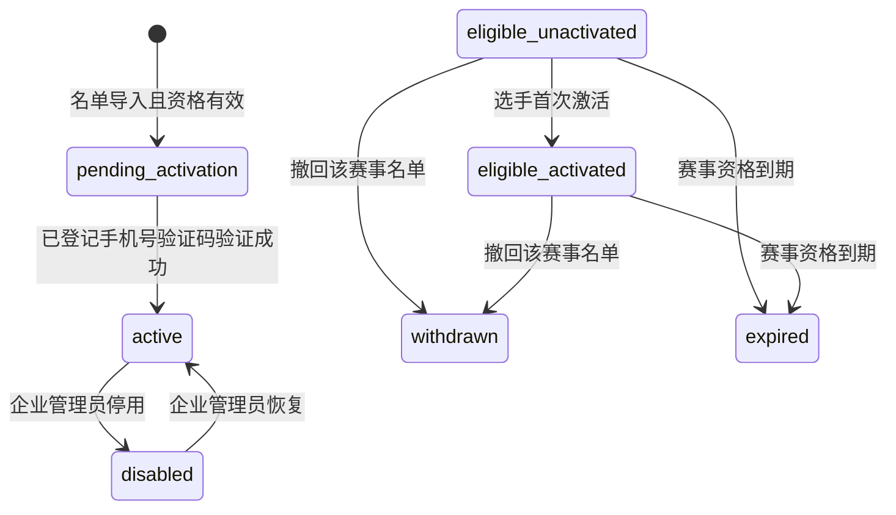

# 企业内部竞赛选手激活与登录鉴权合同

> 状态：已确认，进入实现设计阶段  
> 日期：2026-07-21  
> 适用范围：企业内部竞赛 R1；仅支持企业名单导入的选手，不开放个人报名。  
> 前端载体：`D:\qianlvguoyu\qianlvguoyu_saas-dev\gjjd_appnext` 的 uni-app H5 选手端。  
> 后端载体：`services/platform-api` 的 `competition` 领域。

## 1. 本合同的作用与覆盖关系

本合同是“企业导入名单 → 选手手机验证激活 → 选手端登录 → 接收赛事公告”的唯一业务依据，后续 Flyway、接口、MQ、H5 页面和测试均必须遵循。

它是 `docs/competition/competition-foundation-contract.md` 的后续扩展：该基础合同中“暂不包含选手、手机号、身份证、验证码、token”的限制仅适用于基础链路 FND-00；本合同为 R1 选手激活链路新增受控的敏感数据模型与能力，不能修改既有已应用 Flyway。

本合同同时覆盖 `docs/04_requirements/competition-full-delivery-execution-plan.md` 的两处实现口径：

- 选手端不新建 `apps/competition-h5`，而是在既有 `gjjd_appnext` 中完成 uni-app H5 页面与 API 接入；不复用其历史培训业务页面、鉴权状态或业务接口。
- 公告发布采用“事务 Outbox + MQ + 选手消息收件箱”。H5 不直接消费 MQ，而是调用受控 API 查询收件箱；实时提醒属于后续增强。

## 2. 业务范围与排除项

### 2.1 本期实现

1. 企业管理员通过竞赛计划对应的名单导入模板或单个录入入口，导入选手工号、姓名、身份证号、手机号与赛事字段。
2. 系统基于身份证号与手机号建立或复用选手身份；同一选手可关联多场赛事。
3. 管理端在已发布赛事的计划总览生成赛事二维码；选手从预装选手端 App 首页扫码，输入企业已登记手机号并完成短信验证。
4. 验证成功后完成激活并生成“身份证号后 6 位”的初始密码哈希；选手随后使用手机号和初始密码登录。选手登录后可在选手端“我的”输入身份证号核验本人并更换全局登录手机号；手机号更换后所有赛事仍关联原选手身份，使用新手机号和原密码登录。
5. 管理员可停用选手身份；被停用选手立即不能继续访问选手端。
6. 后台发布赛事公告后，使用 Outbox 可靠投递 MQ，并向有资格且已激活的选手创建站内消息收件箱记录。

### 2.2 明确不实现

- 成绩计算、排名、并列规则、晋级名单、考试、答题、评分、PK。
- 个人自助报名、身份证识别/OCR、第三方企业 SSO、App Push、邮件和微信通知。
- 选手直接访问 MQ、由 Token 静态决定赛事资格、通过前端状态模拟资格或未读数。

## 3. 核心业务不变量

1. 在同一租户内，手机号与身份证号为一对一绑定：一个手机号不能绑定多个身份证号，一个身份证号不能绑定多个手机号。
2. 同一选手可拥有多条赛事资格；赛事资格必须带 `event_id`，不能因另一场赛事名单撤回而被一并撤销。
3. 首次激活时，短信只能发送至企业名单已登记的手机号；客户端不得自行提交一个新手机号完成激活。
4. Token 只表示选手身份与会话，不保存可长期信任的赛事资格；后端每次访问赛事资源都实时校验选手状态、租户、赛事资格和资源归属。
5. 身份证号、手机号、验证码均不得以明文出现在日志、审计内容、URL、导入错误文件或常规列表响应中。
6. 对同一身份证号再次导入另一场赛事时，若手机号一致则复用已有选手身份；若手机号不同则拒绝导入并返回脱敏的“身份联系方式冲突”。

当前企业内部竞赛按租户隔离处理上述唯一性。跨租户复用同一自然人身份不在本期范围；若后续存在该需求，须另行设计全局身份主数据与跨租户授权，不能绕过现有多租户隔离。

## 4. 数据模型合同

所有新增业务实体必须继承 `BaseEntity`，DDL 包含 `tenant_id`、`deleted`、`created_by`、`updated_by`、`created_at`、`updated_at`。

### 4.1 `competition_player_identity`

选手在租户内的唯一身份主记录。

| 字段 | 说明 |
| --- | --- |
| `id` | 选手 ID，后续 MQ 收件人与 H5 鉴权的主体标识 |
| `tenant_id` | 租户隔离字段 |
| `id` | 同时作为选手端独立登录主体 ID；不复用或关联后台 `sys_user`、历史 `platform_user` 账号 |
| `id_card_ciphertext` / `id_card_lookup_hash` | 身份证号密文与用于唯一匹配的 HMAC 摘要 |
| `mobile_ciphertext` / `mobile_lookup_hash` | 手机号密文与用于唯一匹配的 HMAC 摘要 |
| `status` | `pending_activation` / `active` / `disabled` |
| `activated_at` / `disabled_at` / `disabled_reason` | 激活与停用审计信息 |

唯一约束：`(tenant_id, id_card_lookup_hash, deleted)` 与 `(tenant_id, mobile_lookup_hash, deleted)`。

### 4.2 赛事报名资格扩展

在 `competition_registration` 新增可空 `player_id`，导入时关联对应选手身份。历史名单行可以继续保留员工编号列以兼容旧数据，但当前代码不再读取或写入该列。

参赛资格状态扩展为：

```text
imported_pending_confirm
→ pending_audit（仅需审核的赛事）
→ eligible_unactivated
→ eligible_activated
→ withdrawn / expired
```

非审核赛事由 `imported_pending_confirm -> eligible_unactivated`。同一选手首次激活成功后，系统只将其所有有效赛事资格更新为 `eligible_activated`；`player` 被停用时不改写历史资格状态，访问由选手身份状态统一阻断。

### 4.3 `competition_sms_challenge`

记录激活和找回密码（预留）用途的短信挑战；验证码只存不可逆摘要。日常登录与当前手机号更换流程不发送短信。历史 `change_mobile_old` / `change_mobile_new` 用途值仅兼容已存在的挑战记录。

| 字段 | 说明 |
| --- | --- |
| `purpose` | `activation` / `login`；历史 `change_mobile_old` / `change_mobile_new` 仅用于兼容旧记录 |
| `player_id` | 激活前可为空，验证后必须关联选手 |
| `mobile_lookup_hash` | 用于频控与验证目标匹配 |
| `code_digest` | 验证码摘要，禁止存明文 |
| `expires_at` / `verified_at` | 有效与核验时间 |
| `failed_attempts` / `send_attempts` | 风控计数 |
| `request_ip_hash` / `device_id_hash` | 仅存脱敏/哈希后的风控标识 |

### 4.4 消息模型

后续公告链路新增 Outbox 与选手收件箱。公告正文仍由 `competition_notice` 保存，收件箱只存接收人与已读状态。

| 对象 | 最小职责 |
| --- | --- |
| `competition_outbox_event` | 与公告发布同事务落库、可重试投递 MQ |
| `competition_player_message` | `notice_id + player_id` 唯一、未读/已读时间、事件跳转信息 |

## 5. 名单导入与单个录入

### 5.1 导入模板

当前模板列固定为：

```text
org_name, name, id_card_no, mobile, work_type, level
```

`org_name`、`name`、`id_card_no`、`mobile`、`work_type`、`level` 为必填；企业仅由 `org_name` 匹配，赛事由 URL 路径确定。

导入预检必须校验身份证格式、手机号格式、文件内重复、与本租户既有身份的一对一冲突、企业/赛事工种/等级匹配、赛事组织范围及名额。错误报告只显示行号和脱敏原因，不导出完整手机号或身份证号。

选手确认报名时还必须校验其与其他有效赛事的时间范围；存在重叠时拒绝整批报名。具体规则以
`docs/04_requirements/competition-player-registration-employee-no-and-time-conflict.md` 为准。

### 5.2 单个选手录入

新增“单个录入”表单，使用与模板导入相同的请求 DTO、领域校验、幂等与审计逻辑。禁止单个录入绕开批量导入的身份冲突、名额和组织范围校验。

## 6. 激活、登录、停用和撤回状态机



### 6.1 首次激活

1. 选手在预装选手端 App 首页扫描管理端生成的赛事二维码；二维码只包含赛事入口码，不包含选手个人信息。服务端以入口码、手机号摘要定位该赛事下有效且待激活的报名资格。
2. 服务端向该资格关联的选手身份所登记手机号发送验证码；响应不返回该手机号是否存在或完整/脱敏手机号。
3. 选手提交一次性挑战标识与验证码；校验通过后创建或激活独立 App 选手主体，选手身份改为 `active`，所有有效资格变为 `eligible_activated`。服务端解密身份证号、取后 6 位生成 BCrypt 初始密码哈希；不签发会话。
4. 若该选手已因另一场赛事激活，则本场有效资格直接关联该选手，无需重复激活。

### 6.2 日常登录与会话

已激活选手使用手机号与密码登录；首次密码为身份证号后 6 位，仅以 BCrypt 哈希存储，不能返回或明文存储。认证采用独立的选手主体类型，不能获得管理后台权限；会话使用项目既有 Sa-Token 能力的独立 loginType。Token 最小声明仅包含 `playerId`、`tenantId`、主体类型与会话 ID。

激活成功后必须使用手机号与初始密码登录。选手端启动时调用 `/me` 验证会话；返回 401 或选手已停用时清除本地会话并回到扫码首页。

### 6.3 更换手机号

1. 已登录选手在“我的-更换登录手机号”输入身份证号和新手机号。
2. 后端从当前选手会话确定选手身份，校验身份证号格式和校验位，并将身份证号查找摘要与当前身份摘要比对；客户端不提交选手 ID。
3. 身份核验通过后检查新手机号格式及全局唯一性，在同一事务中更新选手身份的手机号和查找摘要并记录审计；审计详情不写入身份证号、手机号或会话令牌。
4. 撤销该选手原有会话并为当前请求签发新会话。手机号是选手全局登录账号，关联的所有赛事资格不变；原密码保留，新手机号成为登录账号。

旧手机号不可用时不提供自助绕过入口；选手管理编辑页也不修改全局登录手机号。需要人工纠正时应通过独立的审批流程记录原因、操作者和核验依据，并撤销全部现存会话。

### 6.4 停用与名单撤回

- **停用选手身份**：`player.status -> disabled`，立即撤销该选手全部会话，禁止进入选手端。
- **撤回某场赛事名单**：仅对应 `competition_registration.status -> withdrawn`；该选手不再能读该赛事公告、任务与详情，但其他赛事资格与登录身份不受影响。
- **所有赛事资格被撤回**：选手仍可登录，展示“暂无有效赛事”；只有显式停用身份时才禁止进入 App。

## 7. 敏感数据与验证码安全要求

### 7.1 加密与脱敏

1. 手机号和身份证号以 AES-256-GCM 在应用层加密，密文应包含随机 nonce 和密钥版本。
2. 查询与唯一校验使用规范化值的 HMAC-SHA-256 摘要，不以可被离线猜测的普通 SHA-256 代替。
3. 加密主密钥不得提交到仓库或写入 Flyway；生产环境由密钥管理服务或受控环境变量提供，并支持按密钥版本轮换。
4. 所有传输使用 HTTPS；管理端、日志、审计与异常响应只出现脱敏手机号，禁止回显身份证号和验证码。

### 7.2 验证码与频控

为避免短信到达延迟造成频繁失败，“30 秒”定义为重发间隔而不是验证码有效期。规则冻结为：

| 项目 | 规则 |
| --- | --- |
| 验证码有效期 | 5 分钟 |
| 重发间隔 | 同手机号、选手、用途 60 秒 |
| 日发送上限 | 同手机号 5 次/日；同选手 5 次/日 |
| IP/设备频控 | 超过阈值触发图形验证码并拒绝高频请求 |
| 验证失败 | 单挑战最多 5 次；达到阈值立即失效 |
| 累积失败 | 同手机号/选手达到阈值后锁定 30 分钟 |
| 验证码生成 | 加密安全随机 6 位数字；仅保存摘要 |

风控判断必须在服务端完成，所有发送、验证、拒绝、锁定、人工重置和会话撤销动作都要记录审计日志；日志不保存验证码和明文身份信息。

短信供应商必须通过 Provider Adapter 隔离，接入前核对供应商文档、签名模板、频率限制、回执语义和失败码，不假设任何 OpenAPI 兼容能力。

## 8. API 合同草案

### 8.1 后台名单与身份管理

| 方法 | 路径 | 权限 | 说明 |
| --- | --- | --- | --- |
| `GET` | `/competition/events/{eventId}/roster-template` | `competition:roster:import` | 下载敏感字段说明与导入模板 |
| `POST` | `/competition/events/{eventId}/roster-imports/precheck` | `competition:roster:import` | 预检并返回脱敏错误报告 |
| `POST` | `/competition/events/{eventId}/registrations/single-import` | `competition:roster:import` | 单个选手录入，复用导入校验 |
| `POST` | `/competition/players/{playerId}/disable` | 待新增 `competition:player:disable` | 停用并撤销会话 |
| `POST` | `/competition/players/{playerId}/enable` | 待新增 `competition:player:enable` | 恢复选手身份 |
| `POST` | `/competition/players/{playerId}/mobile-reset` | 待新增 `competition:player:mobile-reset` | 受控人工重置手机号 |

### 8.2 选手端

| 方法 | 路径 | 说明 |
| --- | --- | --- |
| `GET` | `/competition/player/entry/resolve` | 按全局选手入口码解析租户与赛事 |
| `POST` | `/competition/player/activation/send-code` | 入口码与企业登记手机号匹配后，向预绑定手机号发送激活码 |
| `POST` | `/competition/player/activation/verify` | 核验激活码，激活身份并生成初始密码哈希 |
| `POST` | `/competition/player/auth/login` | 校验手机号与密码并创建会话 |
| `GET` | `/competition/player/auth/me` | 当前选手、有效赛事摘要与账号状态 |
| `POST` | `/competition/player/auth/logout` | 注销当前会话 |
| `POST` | `/competition/player/auth/change-mobile/verify` | 提交身份证号和新手机号；核验当前选手身份、更新全局登录手机号、撤销旧会话并签发新会话 |

所有响应遵守 `{ code, message, data }`；401、403、409、422、429、503 进入统一错误结构。请求参数、路径、错误提示均不得携带身份证号、验证码或完整手机号。

## 9. 公告消息与 MQ 衔接

公告发布事务完成后，必须同时写入版本化事件 `competition.notice.published.v1` 的 Outbox 记录。事件载荷仅包含 `tenantId`、`eventId`、`noticeId`、`publishedAt`。Outbox 发布器在事务提交后通过 Publisher Confirm 投递 MQ；消费者按 `event_id` 查询报名资格为 `eligible_activated` 且选手身份为 `active` 的 `player_id`，创建唯一收件箱记录。

收件箱唯一键：`(tenant_id, notice_id, player_id, deleted)`。MQ 消费必须幂等；失败进入重试与死信处理，不回滚已成功发布的公告。H5 通过选手端消息接口查询自己的收件箱和未读数，不能连接 MQ 或按事件 ID 直接读取其他人的公告。

## 10. 开发顺序与验收门槛

1. **合同与迁移设计**：以本合同为基准完成 ER 图、Flyway 新迁移编号、字段字典、短信 Provider Adapter 合同和接口 DTO 草案。
2. **名单能力升级**：实现模板下载、敏感字段预检、批量导入与单个录入；验证一对一冲突、企业范围、名额和脱敏错误报告。
3. **选手身份与鉴权**：实现加密、独立选手主体、激活、登录、换绑、停用、会话撤销和权限实时校验。
4. **消息链路**：已实现公告 Outbox、MQ 发布/消费、收件箱、未读/已读 API 与死信队列；真实 MQ 连通、故障重试和死信监控在 P9 部署联调验收。
5. **H5 接入**：在 `gjjd_appnext/pages/competition-app/` 实现扫码首页、激活、密码登录、赛事、任务、消息、我的入口，首页不展示未定义的积分、排名和晋级结果。
6. **真实 E2E**：企业 A 导入 → 选手激活 → 登录 → 后台发布公告 → MQ 分发 → H5 读取；覆盖企业 B 越权、重复投递、名单撤回、停用、验证码超限和手机号冲突。

验收前必须完成后端编译与专项 MockMvc/单元测试、空库 Flyway、H5 构建，并证明日志、错误响应、导入报告和数据库查询路径未泄露明文手机号、身份证或验证码。
