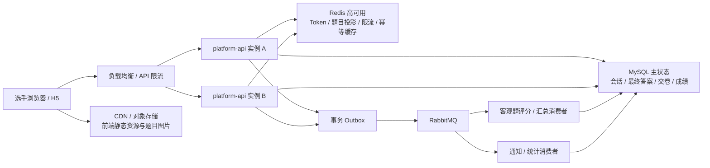

# 竞赛成绩、排名与晋级专项：可行性评估及业务补充清单

> 评估日期：2026-07-27
> 业务输入：`C:/Users/pc/Desktop/竞赛（业务）.docx`
> 适用范围：竞赛模块下一阶段的成绩、排名、晋级、发布与申诉能力；不替代已有赛事、名单、选手身份和通知的基础链路合同。

## 1. 结论

**该业务描述有直接帮助，建议作为“COMP-SCORE-00：成绩规则合同冻结”的输入材料。**

它明确了两种赛制、成绩来源、同分排序、达标线、晋级/获奖、异常处理及发布要求，补足了现有竞赛规划中尚未冻结的“成绩、排名、晋级专项”规则。因此可以据此开始产品合同、数据模型和接口设计；但不建议立即开发页面或直接建表。

原因是文档仍有若干会改变计算结果、裁判权限和申诉结论的未决规则，尤其是赛制 B 的具体权重、实操评分细则、外部仿真系统的成绩回传、并列名次与奖项配额。它们必须由业务部门书面确认并版本化；系统不得在发布后的赛事上静默修改规则。

## 2. 业务输入摘要

| 范畴 | 已给出的规则 |
| --- | --- |
| 赛制 | A：理论 + 仿真；B：理论 + 仿真 + 现场实操。均为不分组、统一比赛。 |
| 成绩来源 | 理论题自动判分；仿真环境自动评分；赛制 B 的实操通常由 3 名现场裁判按细则评分，取平均分。 |
| 合成成绩 | A 为理论、仿真按权重合成；B 为理论与“仿真 + 实操均分”按权重合成。 |
| 实操均分 | 当前补充口径为 3 名裁判有效评分取平均分；精度、缺评分与回避处理待规则合同 P0 确认。 |
| 排名 | 不设置 60 分及格线；正常完赛选手按总分降序及同分排序键排名，完整并列使用 1334 占位法。 |
| 结果处理 | 可按前 N 名晋级，或按排名确定一、二、三等奖和优胜奖；选手仅看本人明细和名次。 |
| 异常与申诉 | 覆盖断网/设备故障、违纪、裁判偏差预警及赛后 30 分钟申诉。 |
| 发布 | 锁分后站内信 + 短信通知；名单公示 3 个工作日；支持带电子签章/防伪二维码的 PDF 成绩单或证书；多轮赛事成绩独立归档。 |

## 3. 当前模块进展与差距

### 3.0 补充决策：竞赛按“认定考试能力复用”建设

竞赛可以在业务上理解为一次认定考试：同样需要人员准入、试卷/题目、开考、客观题判分、实操评分、成绩确认和结果发布。因此后续不应重新建设两套考试和实操评分页面，而应以认定模块的成熟能力为优先复用对象。

但“复用”不等于让竞赛直接读写认定业务表，或修改认定已经上线的规则。现有认定实操评分强绑定认定任务、工种、等级和考试日期，并固定为**恰好 3 名考评员**、三人全部提交后按平均值并以 `HALF_UP` 取整数。竞赛业务要求 3–5 名裁判、去一个最高/最低、保留两位小数，二者不能共用同一条聚合规则。

建议的边界是：

1. 复用或提炼认定已有的评分细则模板、评分任务生成、服务端逐项汇总、平板评分、草稿/提交/退回、统一开考、进度查询和审计能力。
2. 由竞赛领域保存赛事/赛段、参赛选手、裁判角色与回避关系、规则版本、原始评分、聚合成绩、排名及晋级快照。
3. 将“裁判人数、有效评分判定、去极值、取整精度、偏差预警阈值”做成按业务域选择的聚合策略：认定保持既有“三人平均取整”，竞赛使用“3–5 人去极值均分保留两位”。
4. 若后续提炼为通用评分内核，先以认定现有自动化测试锁住行为，再让竞赛接入；不得为支持竞赛而改变认定已经生效的结果。

### 3.1 已具备、可复用的基础

1. **赛事、赛段、参与企业、名单导入、资格审核、站内通知后台链路已验收。**已有验收记录覆盖创建/发布赛事、导入名单、资格审核、通知发布、租户与组织数据范围校验。
2. **竞赛人员角色模型已开始具备。**当前代码中已出现选手、专家、裁判、赛事管理员、工作人员的赛事内角色，以及裁判/专家赛段授权和回避单位模型。这为赛制 B 的裁判分配与回避校验提供了正确的底座。
3. **选手身份与消息能力正在接入。**当前工作区包含选手激活/登录、短信验证码、站内消息和通知投递相关代码；其中短信实际供应商默认关闭，尚不能把“成绩短信已可生产发送”作为验收结论。
4. **现有架构满足实施前提。**`platform-api` 的 Spring Boot、MySQL/Flyway、统一权限、操作审计、多租户隔离和后台 React 管理端都适合承载本专项；不需要为成绩/排名单独拆服务。

### 3.2 尚未实现，且是本需求的主体

当前竞赛领域没有成绩、排名、考试会话、仿真成绩接收、裁判打分、晋级、奖项、申诉或公开成绩投影的实现文件；`apps/competition-h5` 目录也没有可交付的选手端页面。`competition_contestant_profile.total_score` 只能视作预留汇总字段，不能代替可审计的成绩明细和发布快照。

因此，本需求不是小改动，而是竞赛基础链路之后的**一个独立纵向专项**。建议先实现“成绩与排名闭环”，再根据实际比赛方式实施在线理论考试、仿真平台对接、实操裁判端、公开大屏和证书。

### 3.3 需求与现状的对应关系

| 需求点 | 现状 | 下一步 |
| --- | --- | --- |
| 赛事、赛段、参赛资格 | 已有基础模型与后台链路 | 作为成绩计算的准入条件。 |
| 赛制 A/B 与权重 | 未建模 | 建立版本化的赛制规则与校验。 |
| 理论自动评分 | 题库具备单选、多选、判断等客观题结构；尚无竞赛考试会话/题集快照 | 按题型定义判分策略，先完成赛事题集快照、服务端考试计时和自动判分。 |
| 仿真自动评分、耗时 | 未实现外部对接 | 先冻结仿真平台 API、回调签名、重试和成绩确认。 |
| 现场裁判评分 | 认定已具备三人独立评分、平板评分和统一开考；竞赛已有裁判角色、授权和回避底座 | 复用评分内核和交互，增加竞赛 3–5 人去极值聚合、赛段与排名适配。 |
| 总分、排名、晋级、奖项 | 未实现 | 建立可重算但不可覆盖历史的成绩版本和排名快照。 |
| 申诉、仲裁 | 未实现 | 建立申诉时限、证据、仲裁结论及成绩重发版流程。 |
| 站内信 | 已有通知/消息方向 | 接入成绩发布事件；短信需完成供应商配置和投递回执。 |
| 公示、PDF、电子签章/二维码 | 未实现 | 在成绩发布后，以脱敏只读快照和独立证书/成绩单任务实施。 |

## 4. 可实施方案与边界

### 4.1 建议冻结的业务对象

所有对象按租户、赛事、赛段进行数据范围校验，并继承 `BaseEntity` 审计字段；新增表使用新的 Flyway 迁移，不修改已有迁移。

| 对象 | 用途 | 关键要求 |
| --- | --- | --- |
| 赛制规则版本 | 记录 A/B、分项、权重、及格线、同分规则、取整方式、生效范围 | 赛事发布后锁定；变更必须新版本并留下操作人与原因。 |
| 评分细则版本 | 记录实操评分维度、每项满分、扣分项、是否必评 | 赛制 B 必须绑定；评分开始后锁定。 |
| 成绩来源记录 | 保存理论、仿真、实操原始分、来源流水号、取得时间、确认状态 | 外部成绩必须幂等接收、可追溯且不可由前端直接写入。 |
| 裁判打分单 | 保存裁判、选手、评分细则项、草稿/提交/锁定/作废状态 | 强制赛段授权和回避校验；保留评分版本。 |
| 成绩计算版本 | 保存各分项、去极值过程、总分、未达标原因、计算规则版本 | 支持重算生成新版本，不能覆盖已发布版本。 |
| 排名快照 | 保存参与排名范围、排序键、名次、并列/人工裁决标识 | 只读、可发布；选手和公开端只能读已发布投影。 |
| 晋级/奖项快照 | 保存规则、候选名单、人工确认、撤销/补发记录 | 与排名快照关联，关键动作需人工确认和审计。 |
| 申诉与仲裁 | 保存申诉对象、时限、证据 fileId、处理人、结论、重发版关联 | 申诉不直接修改成绩；结论触发受控重算/重新发布。 |

### 4.2 推荐计算与发布流程

```text
赛事/赛段发布并锁定赛制规则
  → 理论考试、仿真平台、裁判打分分别产生已确认成绩来源
  → 校验每位选手的成绩来源完整性、裁判人数和回避情况
  → 生成“待复核”的成绩计算版本（含去极值明细）
  → 运营/裁判长复核并锁分
  → 生成排名快照、晋级/奖项候选
  → 人工确认晋级/奖项并发布成绩版本
  → 选手端读取本人发布成绩；公开端读取脱敏名单
  → 公示/申诉期结束后归档；如仲裁改分，生成新版本并留痕重发
```

线上理论考试、仿真回调、裁判打分可以并行开发，但不得绕过上述“来源确认 → 计算 → 复核锁分 → 快照发布”的唯一状态链。所有异步导入、回调和通知任务都必须在 HTTP 线程预先传入 `tenantId`/操作者信息；工作线程设置并清理租户上下文，且完整调用链不得直接读取 `SecurityContext`。

### 4.3 对业务输入的关键技术说明

- 理论成绩不是一项人工“录入分数”动作，而是一次**按题型自动判分**：试卷发布时冻结题目、标准答案、每题分值和判分规则；选手提交/服务端自动交卷后，由服务端逐题计算，再写入“理论成绩来源记录”。单选、判断通常是完全匹配计分；多选必须由业务确认是全对得分、漏选部分得分、错选倒扣，还是其他规则。若竞赛包含填空、简答或主观题，也必须明确人工评分角色和进入总分的方式。
- 认定实操评分应优先复用，但应通过竞赛适配层扩展，不能直接把竞赛数据塞进 `certification_*` 表。认定当前的“恰好三人、三人平均、整数分”与竞赛文档的“3–5 人、去极值、两位小数”是明确的规则差异；此外竞赛还需要赛事内裁判回避、成绩排名、晋级和公开发布快照。
- “每 30 秒本地缓存、断网恢复后续考”不是普通网页表单能力。理论考试需要服务端计时、答题幂等同步、断线策略和客户端兼容性专项；仿真考试则应由仿真平台明确其断点续作与数据回传责任。
- “切屏/远程控制检测后强制交卷”受浏览器、操作系统、监考方式限制，不能承诺为通用能力。应先由业务选择现场机房受控、专用客户端、第三方监考，或仅记录风险事件；不同方式的成本与可实现性不同。
- “电子签章/防伪二维码 PDF 证书”应独立为证书/成绩单交付物。需明确是可查询成绩单还是获奖证书、签章主体与法律效力，不能把普通二维码 PDF 误表述为具备电子签章法律效力的证书。

## 5. 业务部门需补充并书面确认的内容

以下问题会影响数据模型和验收，建议按优先级先确认 P0，再启动开发。

### P0：必须在设计冻结前确认

1. **赛制 B 的具体参数。**已确认理论、仿真、实操均为 100 分，仿真与实操先取平均后按组合权重合成；仍需确认理论权重、组合权重、权重精度、四舍五入时点和总分精度。
2. **计算范围。**成绩、排名、及格线、晋级和奖项按“赛事总榜”还是按“赛段/工种/等级/组别/企业”分别计算？本期是否真的完全不分组？
3. **理论和仿真来源。**理论使用现有题库/考试能力还是第三方平台？仿真系统名称、接口文档、选手唯一标识、分数/耗时字段、回调签名、重传规则、成绩最终确认人和异常时人工补录权限分别是什么？
4. **实操评分细则。**每个赛段的评分维度、满分、扣分规则、是否允许 0 分/弃赛/缺考、3–5 名裁判的具体人数、未提交/无效/回避裁判是否计入、去极值后只剩一名裁判（3 人时）是否接受。
5. **裁判权限与回避。**谁可以绑定裁判，裁判能否修改已提交评分，裁判长的复核权限、回避规则、偏差大于 20% 的比较口径（与其他裁判均值还是中位数；按总分还是评分项）及处理结果是什么？
6. **排名与并列。**确认每种赛制全部排序字段、耗时单位和取值来源；若人工裁决后仍决定并列，名次如何占位（例如并列第一后下一名是第二还是第三），奖项和晋级名额如何处理。
7. **达标与特殊状态。**默认 60 分是否适用于所有满分值？缺考、弃赛、违纪、申诉中、成绩缺失、裁判未齐等状态是否进入计算、排名和公示？
8. **晋级/奖项规则。**前 N 名是否包含并列；每个奖项的数量、比例、最低达标条件、无合格人员时的处理、人工确认人与可撤销条件。

### P1：进入发布、申诉与运营设计前确认

1. 成绩锁定、发布、公示、申诉、仲裁、归档的具体时间点和角色；“赛后 30 分钟”以哪个系统时间和哪个赛段结束时间为准。
2. 申诉可提交的理由、证据类型、仲裁组成员、处理时限、是否收费、是否允许二次申诉；处理后是重算全榜还是仅更正单人记录。
3. 选手、企业、裁判、平台管理员、公众分别能看到哪些字段；公开名单的姓名/单位脱敏规则，是否允许下载。
4. 成绩通知的短信模板、签名、发送时点、失败重试与人工补发规则；短信供应商、预算和上线环境配置由谁提供。
5. 公示“3 个工作日”的节假日口径、异议反馈渠道与页面归属；是否需要公开首页/大屏，还是仅选手端与后台导出。
6. 成绩单与获奖证书的样式、编号、签章方、二维码查询页、撤销/重发与保存年限；是否必须使用第三方合法电子签章服务。
7. 多轮/赛季的定义、赛段之间是否继承资格/成绩、重置权限、历史查询与归档保留期限。

### P2：实施防作弊与现场保障前确认

1. 比赛场景是统一机房、远程浏览器、专用客户端还是仿真设备；各场景支持的监考、录像、切屏和远控检测能力。
2. 断电、断网、设备故障的举证和审批流程；补偿时长上限、重考次数、备用工位以及谁有权操作。
3. 违纪类型、证据要求、扣分公式、强制交卷/取消资格的授权角色和申诉关系。
4. 实操录像、操作日志、截图的存储位置、访问权限、保留期限和个人信息告知方式。

## 6. 建议的下一步开发任务

> 当前执行决策：**COMP-SCORE-00 规则合同已形成 V1.0 开发基线**。代码链路核对发现赛事工种、选手工种归属、赛段/资格审核入口和规则版本尚未闭合，因此先执行 COMP-SCORE-01 赛前编排桥接，再进入成绩数据内核。并发考试与赛前刷题容量专项排在当前成绩闭环完成后的下一优先级。

> 完整链路定位、已实现能力与前置缺口见：[竞赛模块全链路现状与成绩专项衔接缺口](competition-end-to-end-chain-gap-assessment.md)。

| 顺序 | 任务 | 交付物与验收要点 |
| --- | --- | --- |
| 1 | COMP-SCORE-00：规则合同冻结 | 已形成 V1.0 开发基线：固定 3 名裁判取平均值、赛制 B 百分制公式、理论模板、多选全对得分、缺考和 1334 排名规则。 |
| 2 | COMP-SCORE-01：赛前编排与成绩域桥接 | 补齐赛事工种、选手工种归属、赛段/资格审核 API、赛制 B 规则版本和成绩域就绪检查。 |
| 3 | COMP-SCORE-02：成绩数据底座与纯业务内核 | 建立成绩来源、实操评分修订、解锁、计算和排名快照；实现多选、固定 3 人平均、赛制 B 与 1334 的领域测试。 |
| 4 | COMP-SCORE-03：理论试卷与考试执行 | 赛事题集/标准答案/分值/判分规则快照、90/120 模板、A/B 卷、分时场次、答题、交卷和自动判分。 |
| 5 | COMP-SCORE-04：认定实操评分复用与竞赛适配 | 复用认定评分细则、任务和平板能力；新增竞赛裁判绑定、正式/备用、禁评、固定 3 人评分、提交锁定和解锁重评，不改变认定既有规则。 |
| 6 | COMP-SCORE-05：总分与排名应用链路 | 汇总已确认来源，生成不可变计算和按工种排名快照；实现缺考过滤、1334 并列、内部复核和版本重算。 |
| 7 | COMP-SCORE-06：管理端与基础 E2E | 补齐赛段、工种、规则、裁判、评分监控、成绩与排名页面；从有效资格到排名快照完成权限和审计验收。 |
| 8 | COMP-PERF-00～05：并发容量专项 | 当前成绩闭环完成后立即进入答题幂等、批量保存、缓存限流、监控、压测和全规模模拟赛。 |
| 9 | 后置业务专项 | P0-05 奖项、P0-07 公示仲裁与撤销重排、P0-08 仿真接口继续等待业务或外部接口条件，不插入当前成绩闭环与并发专项之间。 |

## 7. 建议的验收样例

在业务确认公式后，应将下列样例固化为自动化测试和业务验收用例：

1. 赛制 A：理论/仿真权重为 40%/60%，总分和耗时同分排序结果正确。
2. 赛制 B：理论、仿真、实操均为 100 分；仿真与实操平均后按组合权重计算总分正确；3 名裁判平均、裁判回避与缺评分分别有明确结果。
3. 总分相同但分项不同、全部字段相同、允许并列、人工裁决四种排名结果均可复现。
4. 未达标、缺考、违纪、申诉中、成绩来源未确认的选手不会被错误纳入榜单或获奖名单。
5. 成绩锁定后不能被普通运营人员覆盖；仲裁改分产生新版本，旧发布快照仍可审计。
6. 选手只能查看本人已发布明细；企业、裁判、公众均不能越权读取未发布成绩或其他选手敏感信息。
7. 仿真平台重复回调、乱序回调或签名失败不会生成重复成绩；通知发送失败可追踪、重试且不改变成绩发布状态。

## 8. 排期建议

在 P0 规则一次性确认、理论/仿真外部依赖文档可用的前提下，可按“规则与数据底座 → 裁判/成绩计算 → 排名发布 → 外部考试和仿真对接 → 申诉/证书/大屏”的顺序交付。不要把线上考试、防作弊、公开大屏和电子签章与首个成绩计算版本绑定到同一发布批次；它们分别需要安全、供应商和合规验收。

## 9. 延后专项：并发考试与赛前刷题容量设计

> 当前阶段不实施容量改造。完整的容量模型、运行架构、限流、压测和模拟赛要求独立维护于[竞赛考试并发与赛前刷题容量设计](../05_decisions/competition-exam-concurrency-capacity-design.md)。该专项已确定为当前 COMP-SCORE-01～06 完成后的下一开发优先级，无须再次进行优先级评审。

### 9.1 总体结论与当前风险评级

数百名选手同时进行理论答题在现有 **Spring Boot + MySQL + Redis + RabbitMQ** 技术路线上可以实现，暂时不需要为此拆分新的考试微服务。但这项结论有三个前提：

1. 答案保存必须采用合并提交、幂等写入和短事务，不能把每一次点击都直接转换为一条数据库写操作。
2. 正式考试与赛前练习必须采用不同的可靠性等级和资源优先级；考试答题与交卷永远优先于练习、通知、导出、PDF 和 AI。
3. 容量只能通过生产同等规格压测确认，不能凭“Java 理论上支持并发”或开发环境手工操作得出。

当前项目的风险判断如下：

| 风险点 | 当前情况 | 风险等级 | 影响 |
| --- | --- | --- | --- |
| 竞赛考试运行时 | 尚无考试会话、答题、交卷和自动判分 API | 高 | 无法验证并发、幂等和断线恢复。 |
| 数据库连接 | Druid 默认 `max-active=20`，且开发默认可连接远程数据库 | 高 | 慢 SQL、长事务或网络抖动会迅速占满连接。 |
| Redis | 已有 Redis 与 Lettuce 连接池，默认最大活动连接数为 8 | 中 | 可用于会话、题目投影、限流和幂等缓存，但尚未进行考试峰值验证。 |
| 消息队列 | 已有 RabbitMQ 和竞赛消息 outbox 方向 | 中 | 可承载评分、通知等异步任务，但答题成功不能只依赖消息队列而不落 MySQL。 |
| 多实例 | `platform-api` 代码方向可无状态化，但当前开发 Compose 未体现正式 API 多实例和负载均衡 | 高 | 单实例故障会中断考试，JVM 本地锁/本地会话也无法跨实例。 |
| 流量保护 | 当前仅有短信等局部频控，没有竞赛答题/练习接口的统一限流 | 高 | 重复点击、脚本请求或客户端重试可能放大流量。 |
| 可观测性 | Actuator 当前只暴露 `health/info` | 高 | 无法实时观察接口延迟、连接池、Redis、消息积压和答题成功率。 |
| 容量验收 | 尚无竞赛考试压测模型与脚本 | 高 | 无法对“支持 300/500/1000 人”作出可信承诺。 |

因此，当前架构方向可行，但**当前运行配置尚不具备正式比赛容量承诺条件**。

### 9.2 正式考试与赛前练习的可靠性分级

两种场景都使用题库和判分规则，但不能使用同一套保存策略。

| 维度 | 正式理论考试 | 赛前集中刷题 |
| --- | --- | --- |
| 核心目标 | 不丢答案、不可重复交卷、服务端计时、结果可追溯 | 快速反馈、连续刷题、错题与进度可用 |
| 数据一致性 | 强一致；服务器返回“已保存”前，答案必须提交到 MySQL | 最终一致；即时判分可读取缓存，进度按批次落 MySQL |
| 点击处理 | 本地立即更新，3–5 秒或切题时合并保存 | 本地立即更新；答案检查可高频，学习进度合并保存 |
| 失败处理 | 客户端保留未确认队列，明确显示“未同步”，恢复后幂等补传 | 可退避重试；短时进度允许稍后同步 |
| 交卷 | 唯一、幂等、服务端锁定，优先级最高 | 通常没有不可逆交卷；只结束练习会话 |
| 标准答案 | 考试过程中绝不返回 | 可按业务规则在作答后返回解析 |
| 审计 | 保存会话、最终答案、交卷、自动交卷、异常轨迹 | 默认保存最新进度和错题；是否保存每次作答由业务确认 |
| 降级顺序 | 最后降级；练习和非关键后台先限流 | 系统压力大时可暂停新练习或降低保存频率 |

### 9.3 容量计算模型

容量不能只看报名人数，至少需要区分以下变量：

| 变量 | 含义 |
| --- | --- |
| `C_exam` | 正式考试峰值同时在线人数 |
| `C_practice` | 赛前练习峰值同时在线人数 |
| `T_save` | 正式考试答案合并保存间隔（秒） |
| `A_batch` | 每个保存批次平均包含的变更题目数 |
| `F_practice` | 每名选手每秒练习答题/取消次数 |
| `P_submit` | 在同一交卷窗口内提交的选手比例 |
| `T_submit` | 集中交卷窗口长度（秒） |

正式考试暂存请求量可先按以下公式估算：

```text
暂存请求 QPS ≈ C_exam ÷ T_save
答案行写入/秒 ≈ C_exam × A_batch ÷ T_save
集中交卷 QPS ≈ C_exam × P_submit ÷ T_submit
```

假设保存间隔为 5 秒、每批平均修改 2 题，仅作为初步估算：

| 同时在线 | 暂存请求 QPS | 答案行更新/秒 | 20 分钟产生的保存请求 |
| ---: | ---: | ---: | ---: |
| 300 | 60 | 120 | 72,000 |
| 500 | 100 | 200 | 120,000 |
| 1,000 | 200 | 400 | 240,000 |

这里的“答案行更新”应是带唯一键和序列号的批量 upsert，而不是先查询、再逐条 insert/update。若 500 人在最后 30 秒内有 80% 主动交卷，交卷入口平均约为 13.3 QPS；但如果所有客户端在结束时同一秒触发，瞬时峰值可能接近 500 QPS，因此自动交卷和客户端交卷仍需幂等及削峰。

赛前练习的原始动作量可能更高。例如 1,000 人、每人每秒平均 1.5 次选择/取消，客户端动作达到 1,500 次/秒。若每个动作都请求并落库，压力明显高于正式考试；若客户端合并状态、学习进度每 5 秒保存一次，请求量可降为约 200 QPS。是否保存“每次历史动作”会决定数据库写入量是否仍接近 1,500 行/秒。

以上数字只用于建立压测模型，不是现有系统已经达到的容量。

### 9.4 推荐运行链路



运行边界：

1. `platform-api` 继续作为核心业务主服务，在 `competition` 包内按考试会话、答题、评分分包，不因为数百人并发就拆成独立微服务。
2. 应用实例不保存本地会话、答案或分布式锁状态；任一请求可由任一实例处理。
3. MySQL 是会话、答案、交卷和成绩的最终主状态。正式考试的答案保存只有在 MySQL 提交成功后才能向客户端返回 `synced=true`。
4. Redis 用于登录会话、只读题目投影、限流计数、短期幂等结果和热点状态，不作为正式答案的唯一存储。
5. RabbitMQ 用于交卷后的评分、成绩汇总、通知和统计削峰。不得先返回“答案已保存”，再仅依赖 RabbitMQ 异步落答案。
6. 图片、音视频和前端静态文件不穿透 `platform-api`；通过对象存储/CDN 提供，数据库只保存文件 ID、访问策略和引用关系。

### 9.5 正式考试 API 与幂等合同

建议的逻辑 API 如下，最终路径在 OpenAPI 冻结阶段确定：

| API | 用途 | 并发与一致性要求 |
| --- | --- | --- |
| `POST /player/exam-sessions` | 创建/恢复本人考试会话 | 同一选手、赛事、赛段、尝试次数唯一；重复请求返回已有会话。 |
| `GET /player/exam-sessions/{id}` | 获取服务端时间、会话状态、剩余时间和同步摘要 | 可短时缓存，但必须实时校验本人、赛事资格和会话状态。 |
| `GET /player/exam-sessions/{id}/questions` | 获取冻结后的题目投影 | 不含标准答案；同一会话题序稳定；题目图片走受控 CDN。 |
| `PUT /player/exam-sessions/{id}/answers` | 批量暂存改选/取消 | 请求携带 `clientBatchId`；每项携带 `questionId/clientSequence/answer`；服务器只接受更新序列更大的状态。 |
| `POST /player/exam-sessions/{id}/submit` | 主动交卷 | 携带 `Idempotency-Key`；第一次成功后锁定，重复提交返回同一提交编号和状态。 |
| `GET /player/exam-sessions/{id}/submission` | 查询交卷/评分状态 | 只返回本人；成绩未发布前不返回标准答案或最终排名。 |

批量保存建议：

- 客户端每 3–5 秒、切换题目、切换页面或累计 10–20 个变更时提交一个小批次。
- 同一题在批次内多次改选只发送最终状态；取消答案用显式 `answer=null` 或 `cleared=true`，不执行物理删除。
- 单批题目数量、请求体大小和答案长度必须设置上限；禁止每次保存都上传整份试卷。
- 服务器返回每个题目的 `acceptedSequence`、服务端版本和保存时间，客户端据此清理本地待同步队列。
- 乱序到达时，较小 `clientSequence` 返回“已被更新版本覆盖”，不能把旧答案覆盖新答案。
- 客户端时间只用于诊断，不用于判断是否超时；是否接受答案由服务器接收时间、会话状态和补偿规则决定。

### 9.6 推荐数据结构与索引

以下为设计方向，不代表已冻结的表名：

| 表 | 主要内容 | 核心唯一约束/索引 |
| --- | --- | --- |
| `competition_exam_session` | 选手、赛事、赛段、试卷快照、开始/结束时间、状态、尝试次数 | 唯一 `(tenant_id,event_id,stage_id,player_id,attempt_no,deleted)`；索引 `(tenant_id,status,end_at,deleted)`。 |
| `competition_exam_question_snapshot` | 会话或试卷版本对应的题目投影、题序、分值、题型 | 唯一 `(tenant_id,paper_version_id,question_id,deleted)`；按版本和题序查询索引。 |
| `competition_exam_answer` | 每道题的最新答案、客户端序列、服务端版本、保存时间 | 唯一 `(tenant_id,session_id,question_id,deleted)`；使用条件 upsert 防止旧序列覆盖。 |
| `competition_exam_submission` | 交卷编号、幂等键、提交方式、答案摘要、评分状态 | 唯一 `(tenant_id,session_id,deleted)` 和 `(tenant_id,idempotency_key,deleted)`。 |
| `competition_practice_session` | 练习题集、模式、开始/结束和最新进度 | 索引 `(tenant_id,player_id,status,updated_at,deleted)`。 |
| `competition_practice_progress` | 每题最新练习状态、累计次数、对错、最近作答 | 唯一 `(tenant_id,player_id,question_id,scope_id,deleted)`。 |
| `competition_practice_attempt_log`（可选） | 每次作答事件，用于完整学习分析 | 按租户/选手/时间索引；批量写入并制定归档期限。 |

所有实体继续继承 `BaseEntity`，DDL 包含完整审计列。考试答案和提交记录原则上不做业务物理删除；作废、重考和仲裁通过状态与新版本表达。

数据库写入必须避免以下模式：

- 每次点击执行“先 select 是否存在，再 insert/update”。
- 保存一个答案时连带查询整张试卷、全部答案和完整选手资料。
- 在数据库事务中调用短信、文件、AI、仿真或其他网络 API。
- 交卷事务中同步生成 PDF、排名、通知和大型统计。
- 为每名选手启动常驻线程或 JVM 定时器等待考试结束。

### 9.7 正式交卷与自动交卷

主动交卷建议使用以下短事务：

```text
校验本人、资格、服务器时间和会话状态
  → 按 sessionId 条件更新 status: started → submitting
  → 刷新/确认本批尚未同步的最终答案
  → 生成 submissionId、答案摘要和幂等记录
  → 同事务写入 score-requested outbox
  → 提交事务并返回“交卷已受理”
```

评分消费者按 `submissionId` 幂等处理：

```text
读取冻结题目与最终答案
  → 按题型计算理论分
  → 保存逐题判分和理论成绩来源
  → 更新 submission: scoring → scored
  → 后续进入成绩汇总/复核，不直接发布排名
```

自动交卷不能为每名选手创建一个长时间定时任务。应按 `status=started AND end_at<=now` 分页扫描，使用条件更新或 `FOR UPDATE SKIP LOCKED` 由多个 Worker 安全领取。扫描任务应小批量、可重试、可观测；暂停或服务器重启后仍可从 MySQL 状态恢复。

若评分队列暂时不可用，交卷事务仍可成功生成 `submission + outbox`，选手看到“已交卷，等待评分”；队列恢复后继续处理。若 MySQL 不可用，则不能虚假返回“交卷成功”。

### 9.8 赛前刷题的具体处理

赛前练习应拆成两个层次：

1. **即时答案检查。**选手提交单题答案，服务端使用冻结的练习题目版本和服务端标准答案即时判定，返回对错、得分和按业务允许展示的解析。计算通常不需要写整份答卷。
2. **学习进度沉淀。**客户端将多次作答结果按 5–10 秒或累计若干题目合并为进度批次，服务端批量更新最新掌握状态、错题和统计。

业务需要在以下两种模式中选择：

| 模式 | 保存内容 | 优点 | 代价 |
| --- | --- | --- | --- |
| 轻量进度模式（推荐一期） | 最新答案、累计次数、最近对错、错题、知识点汇总 | 写入量低，足以支持继续练习和错题本 | 不能完整还原每一次改选过程。 |
| 全量作答轨迹模式 | 每一次提交/取消、时间、设备和结果 | 可做精细学习分析和反作弊回放 | 数据量和写入量显著增加，需要批量事件表、归档和更高数据库规格。 |

练习接口初始保护值可采用以下建议，最终以压测和产品体验调整：

| 接口 | 每名选手建议持续频率 | 建议突发容量 | 说明 |
| --- | ---: | ---: | --- |
| 加载练习题集 | 每分钟 1–2 次 | 3 次 | 同一题集优先复用缓存，避免反复抽题。 |
| 单题答案检查 | 每秒 1–2 次 | 5 次 | 超过正常人工操作频率时返回 429。 |
| 练习进度批量保存 | 每 5–10 秒 1 次 | 3 次 | 同一题多次变化只保存批次内最终状态。 |
| 结束练习 | 每分钟 1 次 | 2 次 | 幂等返回同一汇总结果。 |

限流键使用 `tenantId + playerId + endpoint`，同时配置赛事/租户级总量保护，避免大量合法单用户共同压垮系统。不能只按 IP 限流，因为同一机房可能共享公网 IP。

### 9.9 Redis 使用边界与建议键

Redis 只承担可恢复或短期状态：

| 用途 | 建议键维度 | TTL/处理 |
| --- | --- | --- |
| 只读题目投影 | `tenant + paperVersion` | 版本锁定后缓存至赛后；不含对客户端可泄露的标准答案。 |
| 服务端判分规则缓存 | `tenant + paperVersion` | 仅后端可访问；变更版本即换键。 |
| 接口限流 | `tenant + player + endpoint` | 秒/分钟级滑动窗口或令牌桶。 |
| 请求幂等结果 | `tenant + player + idempotencyKey` | 至少覆盖考试时长和重试窗口；MySQL 仍保留最终交卷幂等记录。 |
| 会话热点摘要 | `tenant + sessionId` | 用于减少重复查询；MySQL 为主状态。 |
| 练习临时状态 | `tenant + player + practiceSession` | 定期 checkpoint 到 MySQL；TTL 到期前必须有持久化策略。 |

Redis 不得成为正式考试答案的唯一存储。Redis 故障时不能从缓存“猜测”会话或答案；生产环境应使用高可用 Redis。若限流组件短时不可用，可降级为单实例的保守限流并告警，但考试答案保存仍直接以 MySQL 结果为准。

### 9.10 限流、背压和服务降级

系统应按业务优先级分配资源：

| 优先级 | 流量 | 降级策略 |
| --- | --- | --- |
| P0 | 正式考试答案保存、主动/自动交卷 | 最后限流；优先保留线程、连接和数据库能力。 |
| P1 | 考试登录恢复、会话状态、题目投影 | 读取缓存、限制重复刷新；不能影响已进入考试的选手。 |
| P2 | 赛前练习、排行榜刷新、普通后台查询 | 压力升高时降低频率、返回 429/503 并提示稍后重试。 |
| P3 | 导出、PDF、短信、通知、AI、统计大屏 | 开考窗口暂停、排队或显著降速。 |

建议的初始保护动作：

- 数据库连接池持续使用率达到约 70% 或答题 P95 明显恶化时，先暂停 P3、降低排行榜/后台刷新频率，并把练习保存间隔提高到 10 秒。
- 连接池持续超过约 85%、数据库锁等待或 5xx 快速上升时，暂停新练习会话和非必要后台写操作，保留正式考试答案与交卷。
- 队列积压时，不阻塞答案保存；延迟评分、通知和统计，并向选手明确显示“已交卷，评分处理中”。
- 客户端收到 429 时读取 `Retry-After`，保留本地待同步队列并退避；不得丢弃答案或无限立即重试。
- 客户端断网或服务器不可达时显示“本地已记录、尚未同步”的题数和最后成功同步时间；网络恢复后按 `clientSequence` 补传。

上述 70%/85% 是建议的初始告警线，不是未经压测即可采用的最终生产阈值。

### 9.11 多实例、连接池与资源隔离

正式赛事建议至少：

1. 两个 `platform-api` 实例置于负载均衡之后，不依赖粘性会话；任一实例退出时客户端可重试到另一实例。
2. MySQL、Redis、RabbitMQ 使用同地域内网连接和高可用部署，避免正式考试依赖公网远程数据库链路。
3. 数据库连接池按全局容量规划。建议满足：

```text
应用实例数 × 每实例 max-active
+ 消费者/定时任务连接
+ 管理与运维保留连接
≤ MySQL max_connections 的 60%–70%
```

4. 当前每实例 Druid `max-active=20` 和 Redis 活动连接上限 8 只能作为开发默认值；是否调整必须结合实例数、SQL 耗时、Redis 命令数和压测结果，不能单纯加大连接池掩盖慢查询。
5. 答题 HTTP 请求、评分消费者、通知、PDF、AI、导入导出使用不同的有界执行资源。队列满时采用 `AbortPolicy` 或明确的 503/排队状态，禁止 `CallerRunsPolicy` 把后台任务退回 HTTP 线程导致选手请求卡死。
6. 应用优雅下线时先从负载均衡摘除，停止接收新请求，等待正在执行的短事务完成；答案同步请求由客户端幂等重试。

### 9.12 故障场景与恢复规则

| 故障 | 系统行为 | 选手端表现 |
| --- | --- | --- |
| 单个应用实例退出 | 负载均衡转发到其他实例；请求按幂等键重试 | 短暂重试，不重新开考、不丢已确认答案。 |
| Redis 短时故障 | 高可用切换；题目投影回源 MySQL；限流进入保守降级 | 已登录会话尽量保持；若 Token 存储不可用则明确提示恢复中。 |
| MySQL 短时故障 | 停止返回“已同步/已交卷”；客户端本地排队 | 显示未同步题数，恢复后补传；不得显示虚假成功。 |
| RabbitMQ 故障 | submission/outbox 保留，评分和通知延迟 | 显示“已交卷，等待评分”，不要求重复交卷。 |
| CDN/图片故障 | 文本题继续；图片题按规则标记异常并上报 | 不得把图片加载失败直接当作错误答案。 |
| 客户端断网 | 本地保存待同步答案和序列 | 恢复后自动补传；服务端按序列拒绝旧状态覆盖。 |
| 大面积机房断网 | 根据业务审批进行统一补时、暂停或重考 | 所有补偿动作产生赛事、赛段和操作者审计记录。 |

对客户端本地草稿必须明确安全边界：不保存标准答案；敏感内容设置过期时间；交卷后清除；共享设备需防止下一位选手读取前一人的草稿。

### 9.13 监控指标和赛事运行看板

当前只暴露 `health/info` 不足以支撑正式比赛。需要接入 Micrometer/Prometheus 或等价监控，并建立以下指标：

| 类别 | 必须监控 |
| --- | --- |
| HTTP | 按接口的 RPS、P50/P95/P99、2xx/4xx/429/5xx、请求体大小、超时数。 |
| 考试业务 | 已进入/进行中/待同步/已交卷/评分中会话数，每分钟答案批次数、拒绝旧序列数、自动交卷积压、未评分 submission 数。 |
| 数据库 | Druid 活跃/空闲/等待连接、获取连接耗时、MySQL QPS、慢 SQL、锁等待、死锁、CPU、IO、连接数。 |
| Redis | 命令 QPS、P95 延迟、连接池等待、内存、淘汰、命中率、主从切换。 |
| RabbitMQ | 发布失败、确认延迟、队列深度、最老消息年龄、消费速率、重试和死信数量。 |
| JVM/容器 | CPU、堆内存、GC 暂停、线程数、Tomcat 活跃线程、容器重启。 |
| 客户端体验 | 最后同步时间、待同步题数、重试次数、题目/图片加载失败、客户端版本。 |

指标标签不得包含 `playerId/sessionId` 等高基数字段；按赛事、赛段、接口和实例聚合。详细个人问题通过请求 ID 和审计日志查询。

正式比赛应有独立运行看板和告警值班，至少显示：在线人数、答题保存成功率、P95、数据库连接池、Redis 状态、未交卷人数、自动交卷积压和评分队列积压。

### 9.14 压测场景与验收标准

压测环境需与生产的实例数、CPU/内存、MySQL/Redis/RabbitMQ规格和网络链路一致。测试人数以业务确认峰值 `N` 为基线，正式上线前至少验证 `2N`；如果生产资源无法按 `2N` 配置，则必须明确降级为实际可验证容量。

| 场景 | 流量模型 | 验证重点 |
| --- | --- | --- |
| 预登录 | `2N` 用户在 10 分钟内登录并恢复赛事资格 | Token、Redis、身份查询和短信不得与开考高峰重叠。 |
| 同时入场 | `2N` 用户在 30–60 秒内创建/恢复会话并加载题目 | 题目缓存、会话唯一键、无重复试卷。 |
| 稳态答题 | `2N` 持续 60–120 分钟，每 5 秒提交批次 | 答案零丢失、无旧版本覆盖、连接池和磁盘稳定。 |
| 重复/乱序 | 10% 请求重复，5% 延迟乱序 | 幂等结果一致，旧序列不覆盖新答案。 |
| 断网恢复 | 20% 用户中断 1–5 分钟后批量补传 | 补传不造成写入风暴，不丢答案。 |
| 集中交卷 | 80% 用户在 30 秒内提交，其余由服务端自动交卷 | 交卷唯一、短事务、评分削峰。 |
| 集中刷题 | `2N` 用户连续 3–4 小时，每秒 1–2 次答案检查 | 缓存命中、练习进度批量落库、限流体验。 |
| 资源竞争 | 同时执行后台查询、导出、通知和评分 | P2/P3 被限制，P0 答题与交卷保持稳定。 |
| 故障注入 | 下线一个 API 实例、制造 Redis/队列延迟 | 可恢复、无已确认答案丢失。 |
| 浸泡测试 | 目标峰值持续 4 小时以上 | 无内存泄漏、连接泄漏、队列持续增长。 |

建议初始验收线如下，最终由业务、研发和运维签字冻结：

| 指标 | 建议初始目标 |
| --- | --- |
| 已确认答案丢失 | 0 |
| 重复交卷产生多份有效结果 | 0 |
| 答案暂存 API | P95 ≤ 500 ms，P99 ≤ 1 s |
| 交卷受理 API | P95 ≤ 1 s，不包含异步评分完成时间 |
| 题目投影加载 | 缓存命中时 P95 ≤ 1 s |
| 服务器 5xx | 稳态低于 0.1%；任何影响答案正确性的错误必须为 0 |
| 评分完成延迟 | 高峰交卷后建议 30 秒内完成客观题评分，具体由业务确认 |
| 单实例下线 | 不丢已提交事务；客户端可幂等恢复 |
| 数据一致性核对 | 客户端最终同步摘要、MySQL答案、判分输入三者一致 |

压测结束必须执行自动对账：以压测客户端最终答案为基准，对比数据库最终答案、submission 答案摘要和评分明细，不能只看接口“返回 200”。

### 9.15 业务部门必须补充的容量输入

1. 单场报名人数、峰值同时在线人数、预计同时开考比例，以及是否存在多个赛事/赛场同时开考。
2. 是否必须所有选手同一秒看到题目；是否接受提前 10–30 分钟登录、到点由服务端统一解锁。
3. 理论试卷题数、题型分布、题目平均大小、图片/音视频占比、考试时长和允许尝试次数。
4. 正式考试希望多长时间自动保存一次，以及可接受的最大“未同步答案窗口”。
5. 断网后是否允许继续本地答题、最多允许离线多久、恢复后是否接受补传，以及比赛结束后的补传截止规则。
6. 赛前练习是否保存每次作答/取消历史，还是只保存最新进度、累计次数、错题和知识点汇总。
7. 练习即时反馈是否展示标准答案和解析，是否随机抽题，以及同一道题是否允许无限重复。
8. 成绩需要在交卷后立即显示，还是可以先显示“评分中”，统一复核后发布。
9. 生产环境实例规格、MySQL/Redis/RabbitMQ规格、是否高可用、网络带宽、CDN和比赛期间运维值守安排。
10. 计划正式赛事日期及至少一次全规模模拟赛时间；模拟赛必须使用与正式赛相同的客户端版本和部署拓扑。

### 9.16 建议新增的性能专项任务

| 任务 | 内容 | 完成门槛 |
| --- | --- | --- |
| COMP-PERF-00：容量合同冻结 | 确认本节 9.15 的输入，冻结 `N/2N`、延迟、错误率、断网和成绩时效 | 业务、研发、运维共同确认。 |
| COMP-PERF-01：答题幂等与批量保存 | 会话、题目投影、答案批次、序列号、交卷幂等、自动交卷 | 并发/重放/乱序/断线单测与集成测试通过。 |
| COMP-PERF-02：缓存、限流与资源优先级 | Redis 题目缓存、选手/赛事限流、P0–P3 降级和客户端退避 | Redis 故障、429、练习降级不影响正式答题。 |
| COMP-PERF-03：监控与运行看板 | HTTP、业务、Druid、Redis、RabbitMQ、JVM 指标和告警 | 可在模拟赛实时定位瓶颈。 |
| COMP-PERF-04：容量压测与调优 | 编写可重复压测脚本，执行 9.14 全场景并自动对账 | 达到冻结的 `2N`，答案零丢失、零重复有效交卷。 |
| COMP-PERF-05：全规模模拟赛 | 真实终端、真实网络、正式拓扑和值守流程演练 | 输出演练报告、问题关闭清单和最终容量结论。 |
