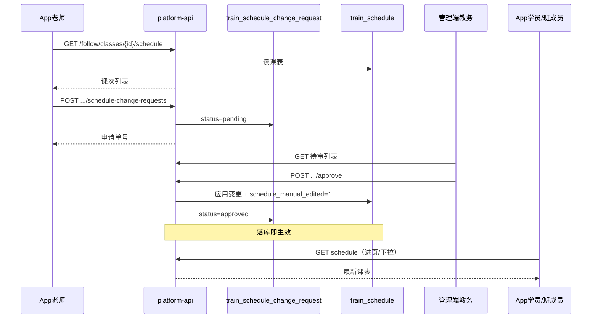

# App 课表查看与老师调课审批实现方案

> **状态**：S1 已落地（App 课表只读）；**S2 调课审批已落地**  
> **日期**：2026-08-10  
> **工程**：`gjjd_appnext` + `platform-api` + `admin-web`  
> **对齐**：  
> - [培训模块_App端实现方案.md](./培训模块_App端实现方案.md)（我的班级通道；现网零回归）  
> - [培训班级五角色落地实现方案.md](./培训班级五角色落地实现方案.md)（角色控权）  
> - [跟班模块功能实现方案.md](./跟班模块功能实现方案.md)（`train_schedule` 双源约定）  
> - [培训模块_对外售卖介绍与功能需求说明.md](./培训模块_对外售卖介绍与功能需求说明.md) §3.4 / §3.7  

---

## 0. 需求与结论

### 0.1 要做的事

| # | 能力 | 说明 |
|---|------|------|
| 1 | App 看课表 | 「我的班级」内按班查看结构化课表（日期/时段/课程/教师/教室） |
| 2 | 老师申请调课 | 授课老师（主讲/助教）在 App 提交调课申请，**不能直接改** `train_schedule` |
| 3 | 管理员审批 | 管理端审批通过/驳回；通过后落库改课表 |
| 4 | 课表及时更新 | 审批通过后权威数据立刻变更；App/管理端下次拉取即见新表 |

### 0.2 现状（避免重复造轮子）

| 已有 | 缺口 |
|------|------|
| 表 `train_schedule` + 管理端跟班「调课」= **直接 PUT 全量保存** | App 无课表读接口/页面 |
| 开班 Excel `kcbiao_file` ↔ 结构化课表双源 | **无**调课申请表、无审批流 |
| App A1：我的班级 + 五角色骨架 | **无**老师申请入口；**无**课表变更推送 |

> 原则：**管理端紧急直接改课保留**；App 老师侧走「申请→审批→生效」。两套入口写同一张 `train_schedule`，审批通过等同一次受控保存。

### 0.3 产品决策（建议锁定）

| 项 | 决策 |
|----|------|
| 权威课表 | 仍为 `train_schedule`（与跟班双源约定一致；不回写 Excel） |
| 谁可看课表 | 本班任一活跃角色 + 在册学员（`assertClassMember`） |
| 谁可申请调课 | 默认：`lead_teacher` / `assistant`；可选扩展 `head_teacher`（班级协调） |
| 谁审批 | **仅管理端**机构操作员（`train:info-class:update` 或新权限 `train:schedule:approve`）；App 不做审批台 |
| 老师能否直接改课 | **否**（App）；管理端保留直接调课（应急） |
| 「实时」含义（首期） | **审批落库即时生效 + 客户端进入/下拉刷新**；不做强依赖 WebSocket。二期再加站内信/推送「课表已更新」 |
| 与现网 | 遵守 App 方案 §0.4：增量页面；不改 promote |

---

## 1. 业务流程



状态机：

```text
pending → approved（生效写课表）
pending → rejected（不写课表）
pending → cancelled（申请人撤销，仅 pending 可撤）
```

---

## 2. 数据模型

### 2.1 新表 `train_schedule_change_request`

| 字段 | 类型 | 说明 |
|------|------|------|
| `id` | BIGINT | 雪花/自增 |
| `class_id` | BIGINT | 班级 |
| `schedule_id` | BIGINT NULL | 改哪一节；新增课次可空 |
| `change_type` | VARCHAR(32) | `reschedule` 改时间地点 / `replace_teacher` 换老师 / `cancel` 停课 / `add` 加课 |
| `before_snapshot` | JSON | 原课次快照（审批对照、审计） |
| `after_payload` | JSON | 申请目标字段（日期、起止、教室、教师、课程名等） |
| `reason` | VARCHAR(500) | 申请原因 |
| `status` | VARCHAR(16) | `pending` / `approved` / `rejected` / `cancelled` |
| `applicant_platform_user_id` | BIGINT | 申请人 |
| `applicant_role_code` | VARCHAR(32) | 申请时班级角色 |
| `reviewer_user_id` | BIGINT NULL | 管理端审批人（sys user） |
| `reviewed_at` | DATETIME NULL | |
| `reject_reason` | VARCHAR(500) NULL | |
| `tenant_id` / `deleted` / 审计字段 | | 与现网一致 |

索引建议：`(class_id, status, deleted)`、`(applicant_platform_user_id, status)`、`(status, created_at)`。

### 2.2 与现表关系

- **读**：一律读 `train_schedule`。  
- **写（审批通过）**：按 `change_type` 更新/插入/逻辑删除对应课次；置 `train_info_class.schedule_manual_edited = 1`（与现跟班调课一致）。  
- **写（管理端直接调课）**：继续走现有 `PUT .../schedule`；可选写一条 `source=admin_direct` 审计（二期）。  
- **冲突**：审批前复用 `checkConflicts`；冲突时默认拦截，管理员可勾选「强制通过」（产品确认）。

---

## 3. 权限矩阵

| 能力 | 学员 | 班长 | 班主任 | 跟班教务 | 主讲/助教 | 管理端 |
|------|:----:|:----:|:------:|:--------:|:---------:|:------:|
| 查看本班课表 | ✓ | ✓ | ✓ | ✓ | ✓ | ✓ |
| 提交调课申请 | — | — | △可选 | — | ✓ | —（直接改） |
| 撤销本人 pending 申请 | — | — | △ | — | ✓ | ✓ |
| 审批申请 | — | — | — | — | — | ✓ |
| 直接改课表 | — | — | — | — | — | ✓ |

App 接口：`assertClassMember` + 申请接口再 `requireRole(lead_teacher, assistant[, head_teacher])`。

---

## 4. API 清单

### 4.1 App（前缀 `/training/follow`，Bearer itoken）

| 方法 | 路径 | 说明 | 阶段 |
|------|------|------|------|
| GET | `/classes/{classId}/schedule` | 本班课表列表（按日期/时间排序）；班成员可读 | S1 |
| GET | `/classes/{classId}/schedule/day?date=` | 可选：单日课次 | S1 |
| POST | `/classes/{classId}/schedule-change-requests` | 提交调课申请 | S2 |
| GET | `/classes/{classId}/schedule-change-requests/mine` | 我的申请列表 | S2 |
| POST | `/schedule-change-requests/{id}/cancel` | 撤销 pending | S2 |

**禁止** App 调用管理端 `PUT /training/info-classes/{id}/schedule`。

响应风格：与现有 follow API 一致用 `ApiResponse`（`code==='0'`）。

### 4.2 管理端（JWT + 菜单权限）

| 方法 | 路径 | 说明 | 阶段 |
|------|------|------|------|
| GET | `/training/schedule-change-requests` | 待审/已审列表（筛 classId、status） | S2 |
| GET | `/training/schedule-change-requests/{id}` | 详情（before/after） | S2 |
| POST | `/training/schedule-change-requests/{id}/approve` | 通过并应用 | S2 |
| POST | `/training/schedule-change-requests/{id}/reject` | 驳回 | S2 |
| 现有 | `PUT /info-classes/{id}/schedule` | 直接调课保留 | 已有 |

---

## 5. 前端页面

### 5.1 App（`gjjd_appnext`，增量）

| 页面 | 说明 |
|------|------|
| `pages/class/schedule.vue` | 课表页：按日分组列表；下拉刷新；进页 `onShow` 重拉 |
| 各角色台入口 | 学员/班长/班主任/教务/主讲台增加「查看课表」→ 同上页 |
| `pages/class/scheduleChangeApply.vue` | 老师：选课次 → 填变更（时间/教室/教师）+ 原因 → 提交 |
| `pages/class/scheduleChangeMine.vue` | 我的调课申请（状态：待审/通过/驳回） |

`api/class-follow.js` 扩展：`getClassSchedule`、`submitScheduleChange`、`listMyScheduleChanges`、`cancelScheduleChange`。  
**不改** `pages/promote/*`。

### 5.2 管理端（`admin-web`）

| 改造点 | 说明 |
|--------|------|
| 跟班工作台或排课页旁 | Tab/入口「调课审批」：待审角标 |
| 审批抽屉 | 展示 before/after diff、冲突提示、通过/驳回 |
| 通过后 | `invalidateQueries` 课表；列表移除该 pending |

文案区分：

- 管理端原「调课」按钮 → 建议改为「直接改课」或保留并旁注「应急，不经申请」。  
- 新入口：「调课审批」。

---

## 6. 「实时更新」落地策略

| 阶段 | 做法 | 用户体感 |
|------|------|----------|
| **S1–S2（必做）** | 审批事务内写完 `train_schedule` 再返回；App `onShow` + 下拉刷新；管理端缓存失效 | 打开课表即最新；通常秒级 |
| **S3（可选）** | 审批通过后发站内信/推送：`classId` +「课表已更新」；App 点通知进课表页并强制刷新 | 不必守在页面也能知悉 |
| **不做首期** | 课表页长连接 WebSocket 推送每一行变更（成本高、现网无统一课表通道） | — |

> 对外可称「审批通过后课表即时生效」；对内验收口径是 **落库即时 + 客户端主动刷新**，不是强制推送像素级同步。

并发：同一 `schedule_id` 同时只允许 **一条 pending**；新申请前须结束旧单。

---

## 7. 分期与验收

| 阶段 | 目标 | 交付 | 验收 |
|------|------|------|------|
| **S0** | 方案锁定 | 本文；角色/冲突/直接改课口径确认 | 评审通过 |
| **S1** | App 看课表 | follow schedule GET；`schedule.vue`；角色台入口 | 班成员可见；非成员 403；现网回归过 |
| **S2** | 申请 + 审批 | 申请表 Flyway；App 申请/我的；管理端审批；通过写课表 | 老师改不了真表；通过后双方刷新见新数据；驳回不改表 |
| **S3** | 通知增强 | 推送/站内信（可选） | 不阻塞 S1/S2 |

建议工期（估）：S1 2～3 人日；S2 5～8 人日；S3 2～3 人日。

---

## 8. 任务拆解（实施用）

### S1

- [x] `GET /training/follow/classes/{classId}/schedule`（`getByClassIdForApp` + `assertClassMember`）  
- [x] App：`getClassSchedule` + `pages/class/schedule.vue`  
- [x] 各角色台挂「查看课表」  
- [ ] 回归：提升 / 同步学 / 我的班级骨架不受影响  

### S2

- [x] Flyway：`train_schedule_change_request`  
- [x] Entity/Mapper/Service/Controller（App + Admin）  
- [x] 审批应用逻辑：冲突校验 → 写 `train_schedule` → `schedule_manual_edited=1`  
- [x] App 申请页 / 我的申请  
- [x] 管理端审批列表 + 详情  
- [x] 权限字：复用 `train:info-class:view` / `train:info-class:update`（未新开权限）  
- [ ] 联调：主讲申请 → 教务通过 → 学员课表刷新  

### S3（可选）

- [ ] 审批通过消息通知班成员  

---

## 9. 风险与缓解

| 风险 | 缓解 |
|------|------|
| 老师无 PHP 账号登不进 App | 沿用五角色指派 ensure |
| 管理端直接改与申请并发 | pending 锁 schedule_id；直接改课后关闭相关 pending 或提示冲突 |
| 全量 PUT 与单课次申请模型不一致 | 审批应用做成「单课次补丁」，避免老师申请触发整表覆盖 |
| 「实时」预期过高 | 方案书与验收写清：落库即时 + 刷新；推送为增强 |
| 课表姓名与主讲角色不一致 | 申请换老师时尽量选师资库并校验本班 `lead_teacher`（可二期强制） |

---

## 10. 文档索引

| 文档 | 关系 |
|------|------|
| 本文 | 课表查看 + 调课审批权威实现方案 |
| 培训模块_App端实现方案 | 挂载点：我的班级 / 角色台；零回归 |
| 跟班模块功能实现方案 | `train_schedule` 双源与直接调课 |
| 培训班级五角色落地实现方案 | 谁可看、谁可申请 |

---

## 11. 待确认（开工前勾选）

- [x] 班主任是否允许提交调课申请 → **首期允许**（与主讲/助教同权）  
- [x] 审批权限用现有 `train:info-class:update` 还是新权限 → **复用** `train:info-class:update`  
- [x] 冲突时默认拦截还是允许管理员强制通过 → **默认拦截**；审批抽屉可勾选「强制通过」  
- [x] 首期 change_type → **reschedule / replace_teacher / cancel**（`add` 接口已支持，App 首期未放开入口）  
- [ ] S3 推送是否进本期合同  

---

*S0 完成标志：本文入库并交叉引用；待确认项关闭后开 S1。*  
*开 S1 标志：follow schedule 读接口排期；不依赖调课申请表。*
