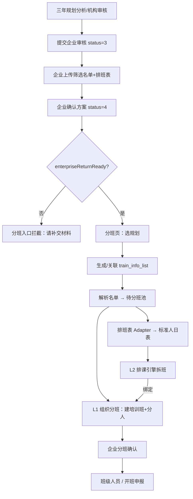
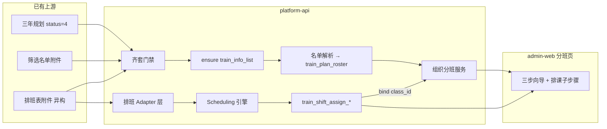

# 三年规划确认后 · 分班功能实现方案  
（复用 Scheduling 分班排课 + 异构排班表适配）

> 文档版本：v1.1  
> 编写日期：2026-07-16  
> v1.1：补充「对照现网 SaaS 的可行性分析」  

> 目标系统：`qianlvguoyu_saas`（platform-api + admin-web）  
> 复用源：`Scheduling classes` 分班排课系统  
> 上游基线：  
> - `三年规划企业审核名单回传与排班表上传方案.md`  
> - `企业确认与回传补交解耦方案.md`  
> 入口菜单：运营流程「分班」`fen_ban` → `TrainingClassDivisionPage`

---

## 一、需求与结论

### 1.1 要解决的问题

```
三年规划 → 企业确认（status=4）
         → 企业回传「筛选人员名单」+「人员排班表」
         → 机构在 SaaS「分班」流程中自动/半自动分班
```

约束：

1. **每家企业排班表格式不一样**（一人一行×日期 / 班组日历+人员备注班组 / 多 Sheet 车间等）。  
2. 希望复用 **Scheduling classes** 已验证的「可上课判断 + 按人数拆班」能力。  
3. 分班结果要进入 SaaS 现有开班域（培训班级 → 企业分班确认 → 班级人员 → 开班申报）。

### 1.2 结论（先看）

| 问题 | 答案 |
|------|------|
| 能否复用 Scheduling？ | **能**，复用**算法引擎**，不整站搬 Vue2/JPA |
| 能否直接塞进分班菜单？ | **不能原样嵌入**；在 SaaS 分班页编排，引擎作服务 |
| 异构排班表怎么处理？ | **Adapter 层**：各企业格式 → 统一「人×日」中间表 → 再进引擎 |
| 推荐落地方式 | **三期**：组织分班 → 标准排课分班 → 多企业 Adapter |

**一句话：**  
上游回传材料当输入；Scheduling 只贡献「谁哪天能上课、怎么拆 30～50 人班」；SaaS 负责流程、租户、培训班级与企业确认；排班表异构用适配器解决。

---

## 二、Scheduling 可复用边界

### 2.1 高价值复用（迁入 platform-api 纯 Java 模块）

| 能力 | 源位置（Scheduling） | 作用 |
|------|----------------------|------|
| Excel 标准人日表解析 | `ExcelScheduleParseService` | 姓名+日期列 → `PersonDaySlot` |
| 班次规则 | `ShiftTimeParser` | 白/中/夜/休、夜班次日不排 |
| 分班算法 | `ScheduleAlgorithmService` | 可上课 → 集中 → 课时封顶 → 拆班 |
| 老师排课（可选） | 同服务 `runTeacherSchedule` | 二期后按需 |
| 单测与样例表 | `scheduling-backend/src/test` | 回归 |

### 2.2 不复用

| 项 | 原因 |
|----|------|
| Vue2 Task/Result 页 | SaaS 为 React + Ant Design |
| Ruoyi/JPA 实体与 `/scheduling` 整站 | 栈与多租户模型不同 |
| 考勤全量 | SaaS 开班后再对接 |

### 2.3 引擎对外契约（建议）

```
parse(标准人日Excel/中间表, 班次配置) → ScheduleParseResult
assign(parseResult, 排课配置)       → ClassAssignResult
  // 每人每日上午/下午 → 上午1班、下午2班…
bind(algoClassName, trainClassId)   → 挂到 SaaS 培训班级
```

---

## 三、业务主流程（必须遵守）

### 3.1 端到端链路



### 3.2 与「确认解耦」对齐

- 计划确认（status=4）**不强制**名单/排班齐套（见解耦方案）。  
- **进入分班**必须 `enterpriseReturnReady = 名单文件 + 排班文件均已上传`。  
- 缺材料：分班页 Alert，禁止生成。

### 3.3 双层「分班」含义（产品必须拆开）

| 层级 | 名称 | 输入 | 输出 | 是否用 Scheduling |
|------|------|------|------|-------------------|
| **L1** | 组织分班 | 确认名单（工种/等级/车间） | `train_info_class` + `train_people_list` | 否 |
| **L2** | 排课分班 | 标准化后的人×日排班 | 算法班（上午1班…）绑定到 L1 | **是** |

企业「分班确认」确认的是 **L1 培训班级**，不是「上午1班」字符串。

### 3.4 与现网数据模型对齐（关键）

班级必须挂开班信息：

```
train_three_year_plan
    → train_info_list（three_year_plan_id）
        → train_info_class（train_info_id）
            → train_people_list（train_id + train_class_id）
```

禁止「计划直接建班、绕过培训信息」。

---

## 四、异构排班表方案（核心难点）

### 4.1 原则

1. **引擎只认一种标准中间格式**（人×日）。  
2. **每种企业格式 = 一个 Adapter**（可配置，不写死一家）。  
3. 无法自动识别时：运营选「企业模板」→ 预览转换结果 → 确认后再跑算法。

### 4.2 标准中间表（逻辑）

| 字段 | 说明 |
|------|------|
| person_key / id_card / name | 人员主键优先身份证 |
| dept / workshop / shift_team | 工段、车间、生产班组 |
| year, month | 排课月（系统按月任务） |
| day_1 … day_31 | 班次：白/早、中、夜、休（归一后） |

### 4.3 Adapter 类型

| 类型 | 特征 | 示例 | 适配思路 |
|------|------|------|----------|
| **T0** 标准人日表 | 含「姓名」+ 1～31 日列 | Scheduling 模板 | 直接走现有解析器 |
| **T1** 班组日历 + 人员班组 | 倒班表按一～四班排日；名单备注「1班/四班」 | 来铝倒班表 | 名单 join 班组日历展开成人日表 |
| **T2** 多 Sheet 车间 | 电解一 / 电解二等 | 同上 | 按车间路由到对应日历 Sheet |
| **T3** 配置映射 | 列名、月份块、夜班符号不同 | 后续企业 | `train_shift_template` JSON 映射 |

### 4.4 班次与上课时段（建议默认，可租户配）

倒班（企业常见三段）：

| 班次 | 时段 |
|------|------|
| 早/白 | 08:00–16:00 |
| 中 | 16:00–24:00 |
| 夜 | 00:00–08:00 |

上课（与 Scheduling 一致）：

| 时段 | 时间 |
|------|------|
| 上午课 | 08:00–12:00 |
| 下午课 | 14:00–18:00 |

可排课规则（与上班重叠则可排）：

| 倒班 | 上午课 | 下午课 | 次日 |
|------|--------|--------|------|
| 早/白 | ✓ | ✓ | 无 |
| 中 | ✗ | ✓ | 无 |
| 夜 | ✗ | ✗ | 全天禁排 |

Excel 中 `0` 建议映射为夜班（与 Scheduling 约定一致）。

### 4.5 预检（强烈建议）

转换/解析后、正式生成前输出：

- 未识别班次  
- 名单有、排班无 / 排班有、名单无  
- 办公室等无班组日历人员  
- 预估可排人数、未排入人数  

用户确认后再「一键生成」。

---

## 五、目标架构



### 5.1 模块划分

| 模块 | 职责 |
|------|------|
| `trainingdepartment.division` | 门禁、计划列表、桥接培训信息、组织分班 |
| `trainingdepartment.schedule.adapter` | 异构排班 → 标准人日 |
| `trainingdepartment.schedule.engine` | 迁入的 Scheduling 纯算法 |
| `trainingdepartment.schedule.task` | 排课任务落库、调课、绑定、导出 |

前端：只做 `TrainingClassDivisionPage`（及子组件），不新开并列一级业务菜单。

---

## 六、数据设计

### 6.1 一期必补

| 变更 | 说明 |
|------|------|
| `train_three_year_plan.enterprise_*` | 回传文件指针（若 Flyway 仍为空操作需补真实 DDL） |
| `train_info_list.three_year_plan_id` | 计划 ↔ 培训信息 |
| `train_plan_roster` | 待分班池（姓名、身份证、工种、车间、班组、assign_status…） |

### 6.2 二期新建（勿与 `train_schedule` 课表表混名）

| 表 | 说明 |
|----|------|
| `train_shift_assign_task` | 排课任务：plan_id、train_info_id、年月、源文件、adapter_type |
| `train_shift_assign_record` | 明细：人、日、上/下午、algo_class_name、train_class_id |

### 6.3 三期

| 表 | 说明 |
|----|------|
| `train_shift_template` | 企业 Adapter：sheet 规则、列映射、班次别名、样例文件 |

### 6.4 复用现有表

| 表 | 用途 |
|----|------|
| `train_info_class` | L1 培训班 + `company_confirm_status` |
| `train_people_list` | 班级学员（瘦表，车间等放 roster） |
| `train_schedule` | **仅**开班后课表行，不存 Scheduling 任务 |

---

## 七、分班页交互（SaaS）

菜单：`fen_ban` → `TrainingClassDivisionPage`（当前为占位，需按本方案实现）。

建议 **三步向导**：

| 步骤 | 内容 |
|------|------|
| 1 选来源 | `status=4` 计划列表；Tag 显示材料齐套；未齐套禁用 |
| 2 培训信息 | `ensure-train-info`；下载名单/排班附件 |
| 3 组织分班 | 解析名单 → 待分池 → 建班分配 → 提交企业确认 |

二期在步骤 3 增加子步骤「排课分班」：选月 → 选模板/Adapter → 预检 → 生成 → 课表预览 → 绑定培训班。

---

## 八、接口草案

前缀：`/training`（与现网一致；网关再加 `/api`）。

### 8.1 组织分班（一期）

```
GET  /training/division/plans
GET  /training/division/plans/{planId}/ready
POST /training/division/plans/{planId}/ensure-train-info
POST /training/division/roster/parse
GET  /training/division/roster
POST /training/division/org-split
GET  /training/division/train-info/{id}/summary
```

### 8.2 排课分班（二期）

```
POST /training/shift-assign/adapters/preview   # 异构 → 标准表预览
POST /training/shift-assign/precheck
POST /training/shift-assign/generate
GET  /training/shift-assign/tasks/{id}
POST /training/shift-assign/tasks/{id}/patch
POST /training/shift-assign/tasks/{id}/bind-class
```

企业确认仍走现有：`POST /training/info-classes/{id}/company-confirm|reject`。

> 说明：前端 `training.ts` 中已有部分 division API 封装，后端与页面向导需按本方案补齐落地。

---

## 九、分期实施计划

### 一期：组织分班闭环（约 2 周）— 先打通企业确认

| 内容 | 说明 |
|------|------|
| 门禁 | `enterpriseReturnReady` |
| 桥接 | 计划 → `train_info_list` |
| 名单 | 解析企业筛选名单 → `train_plan_roster`（失败可回退规划明细） |
| 分班 | 写 `train_info_class` + `train_people_list` |
| 页面 | 三步向导替换占位 Empty |
| 排班表 | **仅附件下载，不解析** |

**验收：** 齐套计划 → 分班页建班分人 → 企业「分班确认」可见并可确认/驳回。

### 二期：复用 Scheduling 引擎（约 2～3 周）

| 内容 | 说明 |
|------|------|
| 引擎迁入 | 改包名、去 JPA，配置注入 |
| 标准格式 T0 | 运营可先把排班转成标准表再上传 |
| 落库绑定 | `train_shift_assign_*` → 绑定培训班 |
| UI | 分班页「排课分班」子步骤 |

**验收：** 标准人日排班可生成上午/下午班，并绑定到一期班级。

### 三期：多企业 Adapter（滚动）

| 内容 | 说明 |
|------|------|
| T1/T2 | 来铝类班组日历优先 |
| 模板配置 | `train_shift_template` |
| 预检 diff | 名单 ∩ 排班 |
| 可选 | 老师排课、导出统计 |

---

## 十、关键规则摘要

1. 人员匹配主键：**身份证**；姓名仅展示。  
2. `target_org_id`（规划）→ `company_id`（培训信息/班级）统一经 `sys_org`。  
3. 1 计划可对应 **N** 个培训信息（按年/工种拆）。  
4. 排班解析失败时：**允许只做 L1 组织分班**，标记「未做排课分班」，不堵开班准备。  
5. 企业驳回班级：只改班级确认状态，不回滚计划 `status=4`。  
6. 分班只做一次主生成；事后用调课/补排，不提供「再次全量分班」除非明确重跑任务。

---

## 十一、风险与对策

| 风险 | 对策 |
|------|------|
| 排班表格式发散 | Adapter + 模板库；首批只保 T0+来铝 T1 |
| 回传列 Flyway 空操作 | 一期开工前补真实幂等迁移 |
| 菜单 `fen_ban` / `train_class-list` 双轨 | 统一指向 `TrainingClassDivisionPage` |
| 与 `train_schedule` 命名冲突 | 排课任务用 `train_shift_assign_*` |
| 中班是否排上午 | 默认不排（与上班重叠策略一致）；可配置 |

---

## 十二、待产品拍板

1. 一期是否隐藏「排课分班」入口？（推荐：**是**）  
2. 名单解析失败是否默认用规划明细灌池？（推荐：**是**）  
3. 首批 Adapter 企业名单？（推荐：标准模板 + 来铝班组日历）  
4. `company_id` 是否恒等于 `sys_org.id`？  

---

## 十三、对照现网 SaaS 的可行性分析（v1.1）

### 13.1 总判定

| 维度 | 判定 | 说明 |
|------|------|------|
| 业务方案是否合理 | **可行** | 与现网「培训信息→班级→企业确认」模型一致；双层 L1/L2 拆分正确 |
| 一期（组织分班） | **可行，缺口明确** | 下游表与企业确认 UI 已齐；缺桥接字段、roster 表、分班 API/页 |
| 二期（Scheduling 引擎） | **可行，从零建设** | 源算法可抽；SaaS 侧尚无排课任务表与引擎代码 |
| 三期（异构 Adapter） | **可行，风险在运营** | 技术路径通；需逐企业建模板，工期随企业数增长 |
| 最大硬风险 | **中高** | 回传列 Flyway 为空操作；新环境实体有字段、库可能无列 |

**结论：方案在 SaaS 上可落地；应按三期推进，一期先打通组织分班闭环，勿一期同时啃异构排课。**

### 13.2 现网锚点矩阵

| 锚点 | 现网状态 | 对方案影响 |
|------|----------|------------|
| 三年规划 `status=4` + 回传文件实体字段 | ✅ 实体/VO/上传下载 API 有 | 上游输入可用 |
| 回传列真实 DDL（`V20260715_008`） | ⚠️ **仅 `SELECT 1` 空操作** | 新库/严格 Flyway 环境会炸 → **P0 补幂等 ALTER** |
| `train_info_class.train_info_id` + `company_confirm_*` | ✅ | L1 落库目标就绪 |
| `train_people_list`（train_id/class/姓名/身份证） | ✅ | L1 学员落库就绪 |
| `EnterpriseClassConfirmPanel` + company-confirm API | ✅ | 下游消费就绪 |
| 菜单 `fen_ban` → pageMap | ✅ 指向分班页 | 入口可用 |
| `TrainingClassDivisionPage` | ❌ 占位 Empty | 一期须重做向导 |
| `train_info_list.three_year_plan_id` | ❌ 无 | 一期必补桥接 |
| `train_plan_roster` | ❌ 无 | 一期必建 |
| `/training/division/*` 后端 | ❌ 无 | 一期必建 |
| 前端 `training.ts` division 方法 | ⚠️ 有调用封装 | 需补 types + 对齐后端 |
| `train_shift_assign_*` / 引擎迁入 | ❌ 无 | 二期 |
| 已有 `train_schedule`（课表） | ✅ 存在 | **必须**用 `train_shift_assign_*`，勿混名 |

### 13.3 分期可行性细评

#### 一期：组织分班 — **推荐立刻做**

| 项 | 评估 |
|----|------|
| 依赖 | 上游回传 + 班级/人员表 + 企业确认（均已有或存在已知 DDL 坑） |
| 工作量 | 约 2 周（含 P0 DDL、API、三步向导） |
| 技术风险 | 低～中（名单 Excel 解析、org→company 映射） |
| 业务价值 | 高：打通「确认→分班→企业确认班级」闭环 |
| 是否依赖 Scheduling | **否** |

阻塞清单（做完即可验收）：

1. 真实 Flyway：企业回传列 + `three_year_plan_id` + `train_plan_roster`  
2. `TrainDivision*` 后端服务与 Controller  
3. 分班页三步向导替换占位  
4. 统一 `fen_ban` 菜单可见且不指到班级人员页  

#### 二期：排课引擎 — **可行，一期后再开**

| 项 | 评估 |
|----|------|
| 依赖 | 一期培训班已存在；标准人日表或转换结果 |
| 工作量 | 约 2～3 周（引擎迁入 Boot3 + 任务表 + UI 子步骤） |
| 技术风险 | 中（Java 8→21、去 JPA、班次配置租户化） |
| 与现网冲突 | `train_schedule` 已占用「课表」语义 → 方案表名正确 |

#### 三期：异构 Adapter — **可行，滚动交付**

| 项 | 评估 |
|----|------|
| 依赖 | 二期引擎稳定 |
| 工作量 | 每多一家企业模板约 0.5～2 周 |
| 风险 | 高在业务：格式变更、备注不规范、办公室无班组 |
| 缓解 | 预检 diff + 允许仅 L1 开班 |

### 13.4 方案设计与现网匹配度

| 方案要点 | 是否匹配现网 | 说明 |
|----------|--------------|------|
| 计划→培训信息→班级 | ✅ 必须 | 与 `train_info_id` 外键一致 |
| 确认与齐套解耦、分班门禁齐套 | ✅ | 与解耦方案一致 |
| L1/L2 拆分 | ✅ | 企业确认只认培训班 |
| 引擎复用而非整站搬迁 | ✅ | 栈：Boot3/MyBatis vs Boot2/JPA/Vue2 |
| Adapter 解决异构排班 | ✅ | 唯一可持续路径 |
| 一期不解析排班 | ✅ 务实 | 降低首期风险 |

### 13.5 不可行 / 需改方案的点

| 点 | 说明 | 处理 |
|----|------|------|
| 「一期就吃掉所有企业排班格式」 | 不可行 | 坚持三期；首批 T0+1～2 家 |
| 「计划直接建班」 | 与现网 FK 冲突 | 方案已禁止，保持 |
| 「用 train_schedule 存排课任务」 | 与现课表冲突 | 用 `train_shift_assign_*` |
| 共享库已手工加回传列、Flyway 空操作 | 新环境不一致 | P0 幂等补列 |

### 13.6 建议落地顺序（可行性最优）

```
P0  DDL 可信（回传列 + bridge + roster + 菜单）
 → 一期  组织分班闭环（分班页 + division API）
 → 二期  Scheduling 引擎 + 标准表
 → 三期  企业 Adapter 滚动
```

---

## 十四、关联路径


| 说明 | 路径 |
|------|------|
| 本方案 | `docs/04_requirements/phase2-training/三年规划确认后分班功能实现方案.md` |
| **开发文档（落地）** | `docs/04_requirements/phase2-training/三年规划确认后分班功能开发文档.md` |
| 企业回传 | `docs/04_requirements/phase2-training/三年规划企业审核名单回传与排班表上传方案.md` |
| 确认解耦 | `docs/04_requirements/phase2-training/企业确认与回传补交解耦方案.md` |
| 分班页 | `apps/admin-web/src/pages/training/TrainingClassDivisionPage.tsx` |
| 企业分班确认 | `apps/admin-web/src/pages/training/EnterpriseClassConfirmPanel.tsx` |
| Scheduling 算法 | `Scheduling classes/.../ScheduleAlgorithmService.java` |
| Scheduling 说明 | `Scheduling classes/.../算法说明.md` |

---

## 十五、修订记录

| 版本 | 日期 | 说明 |
|------|------|------|
| v1.0 | 2026-07-16 | 首版：确认后分班 + Scheduling 引擎复用 + 异构排班 Adapter 三期方案 |
| v1.1 | 2026-07-16 | 对照现网锚点补充 §十三可行性分析；明确一期/二期阻塞与落地顺序 |
