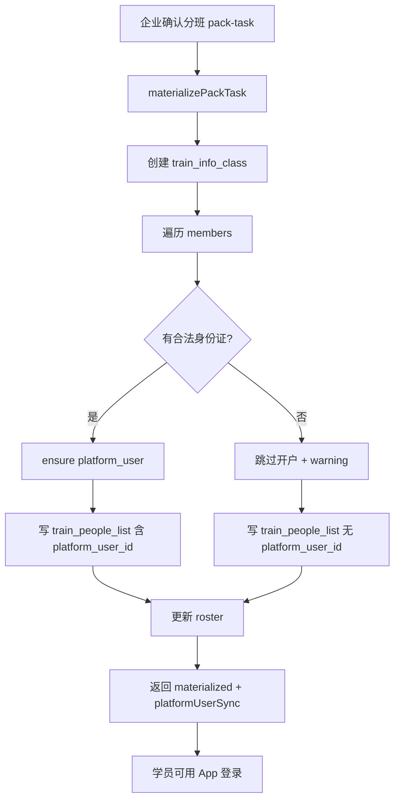

# 企业确认分班后 · 班级人员同步学员信息方案

> 文档版本：v1.0  
> 编写日期：2026-08-03  
> 目标系统：`qianlvguoyu_saas`（platform-api + admin-web + App）  
> 上游基线：  
> - `三年规划确认后分班功能实现方案.md`  
> - `名单排班自动分班方案.md` / `确认名单排班按工种等级分班方案.md`  
> 关联菜单：学员信息 `train_user-info` → `platform_user`；App 登录查同表  
> **可登录闭环补丁（2026-08-17）**：仅写 SaaS 不足以登 App；须按 [学员账号同步方案_确保App可登录.md](./学员账号同步方案_确保App可登录.md) 做 **PHP 优先双写**。  

---

## 一、问题与结论

### 1.1 现状断层

```
企业确认分班方案（pack-task company-confirm）
  → materializePackTask
  → 已写：train_info_class + train_people_list
  → 未写：platform_user（学员信息 / App 账号）
```

App 登录（`setLogin` / 手机号密码登录）均查 **`platform_user`**：

- 按身份证查不到 → 返回「您还没在平台创建账号」  
- 结果：人已进班级花名册，但 **装不上 App、登不进学习/考试**

### 1.2 结论（先看）

| 问题 | 答案 |
|------|------|
| 要不要同步？ | **要**，否则分班闭环断在 App |
| 何时同步？ | **企业确认分班物化成功时**（与写花名册同事务） |
| 同步到哪？ | **`platform_user`**（学员信息页同一张表）；并轻量同步 `platform_user_detail` |
| 主键？ | **身份证号** |
| 默认密码？ | 新建账号沿用现网学员信息页默认 **`123123`** |
| 完整申报资料？ | **不同步**；仍由开班准备「资料收集」承接 |

**一句话：**  
确认分班 = 建班 + 花名册 + **开 App 学员账号**；资料完善留给开班准备。

---

## 二、目标与非目标

### 2.1 目标

1. 企业确认分班后，班级成员可在「学员信息」页查到。  
2. 学员可用身份证/手机号按现有 App 协议登录。  
3. 花名册 `train_people_list.platform_user_id` 尽量回写，便于下游绑定。  
4. 已有账号不被误改密码、不被错误覆盖实名信息。  
5. 异常可观测：返回同步统计与跳过原因，不因个别脏数据拖垮整次确认。

### 2.2 非目标

| 不做 | 原因 |
|------|------|
| App 登录时「无账号自动注册」 | 权限边界乱、难审计、易被刷号 |
| 同步证件照/学历/合同等到 `platform_user_detail` 全量字段 | 名单无此数据；属开班准备资料收集 |
| 写入 `train_user_info` 为主档 | 该表偏扩展，且强依赖 userId；主档就是 `platform_user` |
| 改写 App 登录查花名册 | 破坏既有协议与多业务共用账号模型 |

---

## 三、概念对齐

| 名称 | 表 / 入口 | 职责 |
|------|-----------|------|
| 班级花名册 | `train_people_list` | 某班运营名单（班长/学委/平时分） |
| 学员信息 / App 账号 | `platform_user`（菜单 `train_user-info`） | 全局人员主档 + App 登录 |
| 学员详情 | `platform_user_detail` | 资料扩展；新建账号时可轻量建壳 |
| 分班名单池 | `train_plan_roster` | 确认前待分班人员 |
| 资料收集 | `train_sign_up_people_self`（`class_prep`） | 开班申报完整资料，与本方案解耦 |

---

## 四、触发时机与挂点

### 4.1 主触发（必做）

```
POST /training/division/pack-tasks/{id}/company-confirm
  → companyConfirmPackTask
  → materializePackTask
       ① 创建 train_info_class
       ② 插入 train_people_list（现有）
       ③ 【新增】ensurePlatformUser + 回写 platform_user_id
       ④ 更新 roster.assign_status
  → task.status = materialized
```

挂点：**每个学员 `peopleListMapper.insert` 成功之后**（或插入前先 ensure 再带 `platformUserId` 写入）。

推荐顺序：

1. `ensurePlatformUserFromPerson(...)` → 得到 `platformUserId`  
2. 写 `train_people_list`（带上 `platformUserId`）  
3. 更新 roster  

这样花名册一行即可带账号关联，避免二次 update。

### 4.2 不触发

| 场景 | 是否同步 |
|------|----------|
| 草稿编辑 / 提交企业审核（pending） | 否 |
| 企业驳回 | 否 |
| 仅打开开班准备、未确认 | 否 |
| 历史已物化班级（上线前数据） | 否（见 §八 补跑） |

### 4.3 事务

与物化 **同一事务**：账号创建失败若属硬错误可回滚；属「可跳过」脏数据则记 warning 继续，避免一人坏数据阻断整班确认。

---

## 五、同步规则

### 5.1 输入字段（来自 roster / members）

| 字段 | 必填 | 说明 |
|------|------|------|
| 身份证 `idCard` | **是**（否则跳过） | App `setLogin` 主键 |
| 姓名 `personName` / `realname` | 建议有 | 空则可用手机号占位 |
| 手机 `phone` | 强烈建议 | 无手机：见 §5.4 |
| 企业 `companyId` | 建议 | 取班级/培训信息/任务上的企业 |

### 5.2 Upsert 主逻辑

```
按 idCard（trim，建议大写 X）查 platform_user（deleted=0）

若不存在：
  → INSERT platform_user
       realname / idcard / phone / companyId / orgId
       password = md5("123123", randomStat)   // 与学员信息页一致
  → syncDetail 轻量壳（idcard/phone/realname）
  → 返回 id → created

若已存在：
  → 不改 password / stat
  → realname：目标空则补，有值不覆盖（或仅当现网为空）
  → phone：见 §5.3
  → companyId：为空则补
  → syncDetail 仅补空字段
  → 返回 id → updated / reused
```

### 5.3 手机号冲突

| 情况 | 处理 |
|------|------|
| 证号命中本人，手机与库不一致 | **更新为名单手机**（以便 App 用新号登录）；或「仅库为空才补」——**推荐前者并打 audit 日志** |
| 证号未命中，手机已被其他证号占用 | **跳过创建**，warning：`手机号已被其他学员占用` |
| 证号命中，手机被他人占用（数据脏） | **不改手机**，warning：`手机冲突，保留原手机`；仍回写 `platform_user_id` |

### 5.4 无身份证 / 无手机

| 情况 | 处理 |
|------|------|
| 无身份证 | **跳过**，warning：`缺少身份证，无法开 App 账号`；花名册仍写入 |
| 有身份证、无手机 | **允许创建**（phone 置空或占位策略二选一）；App 仅能用后续补手机后再 `setLogin`。**推荐：跳过并 warning**，强制运营补手机后再补跑（更安全） |
| 身份证非 18 位 | 跳过并 warning（与学员信息页校验对齐） |

> 产品若要求「无手机也要能登」，需另开 App 能力（仅身份证登录），本方案默认不改 App。

### 5.5 密码与告知

| 项 | 约定 |
|----|------|
| 新建默认密码 | `123123`（与 `PlatformUserApplicationService.save` 一致） |
| 已存在账号 | **永不重置密码** |
| 运营告知 | 确认成功 toast/详情展示：`新建账号 N 人，默认密码 123123` |
| 后续 | 可选要求 App 首次登录强制改密（独立需求） |

### 5.6 orgId

与学员信息页一致：取当前操作者所属培训机构 `orgId`（`PlatformUserApplicationService.resolveOrgId` 同源），保证学员信息列表能查到。

---

## 六、接口与返回

### 6.1 确认接口增强（兼容）

现有：

`POST /training/division/pack-tasks/{id}/company-confirm`

返回中增加（示例）：

```json
{
  "materialized": {
    "classCount": 2,
    "peopleCount": 56,
    "classes": [ ... ]
  },
  "platformUserSync": {
    "created": 40,
    "reused": 14,
    "updated": 2,
    "skipped": 0,
    "warnings": [
      { "name": "张三", "idCard": "....", "reason": "缺少身份证，无法开 App 账号" }
    ]
  }
}
```

### 6.2 可选：历史补跑

`POST /training/division/pack-tasks/{id}/sync-platform-users`  
或按 `trainInfoId` / `classId` 补跑：仅处理花名册中 `platform_user_id IS NULL` 的学员。

权限：`DIVISION_MANAGE` 或学员管理权限。

---

## 七、代码落点（实现指引）

| 位置 | 职责 |
|------|------|
| 新建 `PlatformUserEnsureService`（或挂在 `PlatformUserApplicationService`） | `ensureFromDivisionPerson(...)` 纯 upsert，供分班/补跑复用 |
| `TrainDivisionApplicationService.materializePackTask` | 物化时调用 ensure，写入花名册 `platformUserId` |
| `companyConfirmPackTask` 返回值 | 附带 `platformUserSync` 统计 |
| 前端 `EnterpriseClassConfirmPanel` | 成功提示展示新建数 + 默认密码提醒；warnings 可折叠列表 |

**复用：** 密码哈希、`syncDetail`、身份证/手机位数校验，对齐 `PlatformUserApplicationService`，避免两套规则。

**禁止：** 在 App `setLogin` 里偷偷 insert 用户。

---

## 八、历史数据补齐

上线后对已 `materialized` 且花名册无 `platform_user_id` 的班级：

1. 管理端「补开 App 账号」按钮（按班级 / 按 pack-task）。  
2. 或一次性运维脚本：扫 `train_people_list` where type=student and platform_user_id is null。  
3. 规则同 §五；跑完输出 CSV：created/skipped/warnings。

---

## 九、验收清单

1. 企业确认分班后，新建学员出现在「学员信息」列表。  
2. 该学员用身份证 + 手机走 App `setLogin` 成功拿到 token。  
   > **注意（方案 A）**：须 PHP `platform_user` 有同号；仅 SaaS 开户不算通过。见 [学员账号同步方案_确保App可登录.md](./学员账号同步方案_确保App可登录.md)。  
3. 新建账号默认密码 `123123` 可登录（手机号密码通道若启用）。  
4. 已存在 `platform_user` 的学员：密码不变；花名册 `platform_user_id` 正确。  
5. 无身份证人员：确认仍成功建班，但 sync warnings 有记录，App 仍不可登（符合预期）。  
6. 手机被其他身份证占用：不造脏账号，有 warning。  
7. 调研采集 / 开班资料收集路径不受影响。  
8. 同事务：物化中途硬失败时，不出现「班有了、账号半套」的脏提交（可跳过项除外）。

---

## 十、风险与对策

| 风险 | 对策 |
|------|------|
| 默认密码过弱 | 沿用现网；二期强制改密 / 短信下发临时码 |
| 名单手机错误导致顶掉老手机 | 打日志；可配置「仅空补全」策略开关 |
| 大批量确认超时 | 批量 ensure；单人异常隔离；必要时异步补跑 |
| 与资料收集重复建人 | 资料收集侧按身份证命中已有 `platform_user`，只挂 `platform_user_id` |

---

## 十一、流程示意



---

## 十二、实施排期建议

| 序号 | 项 | 预估 |
|------|----|------|
| 1 | `ensureFromDivisionPerson` + 单测（新建/复用/冲突/无证号） | 0.5～1d |
| 2 | 接入 `materializePackTask` + 返回统计 | 0.5d |
| 3 | 确认页提示与 warnings 展示 | 0.5d |
| 4 | 历史补跑接口/按钮 | 0.5d |
| 5 | 联调：确认 → 学员信息可见 → App setLogin | 0.5d |

---

## 十三、决策纪要（本方案已定）

1. 同步目标表：**`platform_user`**（不是 `train_user_info` 主路径）。  
2. 触发点：**企业确认分班物化时**。  
3. 主键：**身份证**；默认密码：**123123**；已存在不改密。  
4. 无证号：跳过开户，不阻断建班。  
5. 完整资料：仍归开班准备，本方案只开账号与主档。
