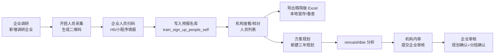

# 企业调研人员采集 × 预报名库 × 三年规划贯通开发方案

> 文档版本：v1.0  
> 编写日期：2026-07-09  
> 适用范围：qianlvguoyu_saas（Java platform-api + admin-web）与 rencaishibie（Python FastAPI）  
> 关联模板：`rencaishibie/需求文件/高命中率认定采集模板精简版.xlsx`（Sheet：`采集表`，16 列）  
> 延伸阅读：[培训管理三年规划与 rencaishibie 集成设计开发方案](./培训管理三年规划与rencaishibie集成设计开发方案.md)

---

## 一、需求摘要与可行性结论

### 1.1 业务目标

在企业调研页面新增调研企业后，能够：

1. **生成二维码**，供企业人员扫码填写个人信息；
2. 数据落入现有 **预报名库**（`train_sign_up_self` / `train_sign_up_people_self`）；
3. 机构端可 **一键导出** 已填数据到「高命中率认定采集模板精简版」并下载到本地；
4. 同一份人员数据在 **方案规划（三年规划）** 阶段直接复用，无需重复录入；
5. 贯通既有流程：**企业调研 → 方案规划 → 企业审核**。

### 1.2 可行性结论

**可以实现**，且应优先 **复用现有预报名 + 二维码 + 三年规划** 能力，而不是新建平行数据体系。

| 维度 | 现状 | 结论 |
|------|------|------|
| 预报名主表/明细 | `train_sign_up_self`、`train_sign_up_people_self` 已存在，字段覆盖精简版约 80% | **复用为主**，少量扩列 |
| 二维码/H5 收集 | `TrainSignUpCollectionApplicationService` + `collect-test.html` / 小程序报名页 | **复用生成逻辑**，扩展调研场景入口 |
| 模板导出 | `SignUpPeopleDefaultTemplatePackService` 已有 POI 填表模式（报名材料包） | **新建精简版专用导出服务**，不混入报名材料 ZIP |
| 三年规划 | `train_three_year_plan.research_org_id` 已关联调研企业；`createWithFile` 上传 Excel 给 rencaishibie | **增加「从预报名导出并创建规划」快捷路径** |
| rencaishibie 引擎 | `qualification_analyzer.py` 已适配精简版 16 列及多证换行解析 | **导出格式必须与引擎 STRICT 列对齐** |
| 企业审核 | `EnterprisePlanReviewPage`（规划审核 + 分班确认）已上线 | **本方案不改动审核逻辑，仅保证上游数据一致** |

---

## 二、端到端业务流程

### 2.1 主流程（机构视角）



### 2.2 数据血缘（单条人员记录）

```
train_research_org (调研企业)
    └── train_sign_up_self (预报名批次, research_org_id 关联)
            └── train_sign_up_people_self (人员明细, sign_up_id 关联)
                    ├── 导出 → 高命中率认定采集模板精简版.xlsx
                    └── 三年规划 → rencaishibie 输入文件 → train_three_year_plan_item
```

### 2.3 与三年规划状态机的关系

沿用已实施状态（`train_three_year_plan.status`）：

| 状态码 | 含义 | 本方案触点 |
|--------|------|------------|
| 0 | 草稿 | 可从预报名一键创建 |
| 1 | 分析中 | 上传/生成的精简版 Excel 进入 rencaishibie |
| 2 | 分析完成请审核 | 机构校对 matrix / item |
| 3 | 待机构审核（企业审核待办） | 提交时附带人员表与方案文档 |
| 4 | 企业已确认 | 企业审核通过 |
| 5 | 已驳回 | 可回到预报名修正后重新导出/重跑 |

人员采集发生在 **状态 0 之前**；企业审核发生在 **状态 3 之后**，与本次方案边界清晰。

---

## 三、模板字段与数据库映射

### 3.1 精简版模板列定义（Sheet：`采集表`）

| 列序 | 表头 | 是否引擎 STRICT 必填 | 预报名字段映射（现有） | 缺口 |
|------|------|---------------------|------------------------|------|
| 1 | 姓名 | ✓ | `name` | — |
| 2 | 身份证号码 | ✓ | `id_card_number` | — |
| 3 | 所在单位 | ✓ | `company_name` | 创建批次时默认带入调研企业名称 |
| 4 | 所学专业（初中、高中学历的填无） | ✓ | `major` | — |
| 5 | 学历层次 | ✓ | `education` | — |
| 6 | 参加工作时间 | ✓ | `work_time` | — |
| 7 | 原工种 | ✓ | `work_type_name` | 语义：当前/原持证工种 |
| 8 | 部门 | — | — | **新增 `department`** |
| 9 | 实际岗位名称 | ✓ | `job`（优先）/ `jog` | 统一写入 `job` |
| 10 | 已有证书等级 | ✓ | `level` + 等级文案转换 | 多证时 **换行拼接** |
| 11 | 证书编号 | ✓ | `paper_no` | 多证换行拼接 |
| 12 | 发证日期 | ✓ | — | **新增 `cert_issue_dates`**（多行文本） |
| 13 | 入职时间 | ✓ | `work_date_start` | — |
| 14 | 职称 | ✓ | `title_type` | 引擎 `FIELD_ALIASES` 将「职称」映射到「职级」 |
| 15 | 职称专业 | — | — | **新增 `title_major`** |
| 16 | 职称获证时间 | ✓ | — | **新增 `title_cert_date`** |

> 说明：精简版 **10–12 列支持一人多证**，同一单元格内多行（`\n`）分隔；与 `qualification_analyzer.py` 中「精简版采集模板」解析逻辑一致。

### 3.2 多证数据存储建议

**推荐方案（一期）**：在 `train_sign_up_people_self` 增加 `certificates_json`（TEXT），结构示例：

```json
[
  {"level": "高级工", "certNo": "xxx", "issueDate": "2020-05-01"},
  {"level": "技师", "certNo": "yyy", "issueDate": "2023-08-15"}
]
```

导出时序列化为三列换行文本；H5 表单提供「添加证书」动态行。  
若一人仅一证，可继续兼容现有 `level` / `paper_no` 单值字段。

### 3.3 不建议新建 `train_research_person` 的原因

早期草案曾考虑独立调研人员表。结合「落入预报名库」及培训流水线（人员名册、分班、材料包均引用 `train_sign_up_people_self`），**扩列 + 批次关联调研企业** 成本更低、下游复用更好。

---

## 四、数据库设计（Flyway 增量）

### 4.1 `train_sign_up_self` 扩展

```sql
ALTER TABLE train_sign_up_self
  ADD COLUMN research_org_id BIGINT NULL COMMENT '关联企业调研 train_research_org.id' AFTER org_id,
  ADD COLUMN collection_source VARCHAR(32) NOT NULL DEFAULT 'train_info'
    COMMENT 'train_info=培训信息收集 research=企业调研采集' AFTER research_org_id,
  ADD COLUMN qrcode_token VARCHAR(64) NULL COMMENT '公开采集 token（防枚举）' AFTER collection_source,
  ADD INDEX idx_sign_up_research (research_org_id, deleted);
```

- 每个 `train_research_org` 在开启采集时创建 **一条** `train_sign_up_self` 批次（或支持多次采集以 `title` + 时间区分）。
- `org_id` 写入目标企业 `sys_org.id`（调研企业若尚未入驻系统，需先建立 org 映射，见 §6.2）。

### 4.2 `train_sign_up_people_self` 扩展

```sql
ALTER TABLE train_sign_up_people_self
  ADD COLUMN department VARCHAR(128) NULL COMMENT '部门' AFTER company_name,
  ADD COLUMN title_major VARCHAR(128) NULL COMMENT '职称专业' AFTER title_type,
  ADD COLUMN title_cert_date VARCHAR(32) NULL COMMENT '职称获证时间' AFTER title_major,
  ADD COLUMN cert_issue_dates TEXT NULL COMMENT '发证日期（多证换行，与等级/编号列对齐）' AFTER paper_no,
  ADD COLUMN certificates_json TEXT NULL COMMENT '多证结构化 JSON' AFTER cert_issue_dates,
  ADD COLUMN data_source VARCHAR(32) NOT NULL DEFAULT 'h5'
    COMMENT 'h5/wxmini/import/admin' AFTER certificates_json;
```

### 4.3 `train_research_org` 扩展（可选，便于列表展示）

```sql
ALTER TABLE train_research_org
  ADD COLUMN target_org_id BIGINT NULL COMMENT '对应 sys_org.id' AFTER title,
  ADD COLUMN active_sign_up_id BIGINT NULL COMMENT '当前进行中的预报名批次' AFTER target_org_id,
  ADD COLUMN personnel_count INT NOT NULL DEFAULT 0 COMMENT '已采集人数（冗余）' AFTER active_sign_up_id;
```

### 4.4 三年规划关联（已有，无需改表）

- `train_three_year_plan.research_org_id` → 创建规划时自动带入；
- 建议新增 `train_three_year_plan.source_sign_up_id`（可选）记录人员来源批次，便于追溯与重导。

---

## 五、后端 API 设计（platform-api）

### 5.1 企业调研 · 人员采集

| 方法 | 路径 | 说明 |
|------|------|------|
| POST | `/training/research-orgs/{id}/collection/start` | 为调研企业创建/激活预报名批次，返回 `signUpId` |
| GET | `/training/research-orgs/{id}/collection` | 查询当前批次状态、人数、二维码信息 |
| POST | `/training/research-orgs/{id}/collection/qrcode` | 生成/刷新二维码（复用 `QrCodeGenerationService`） |
| GET | `/training/research-orgs/{id}/people` | 分页查询该调研下人员（join `sign_up_id`） |
| PUT | `/training/research-orgs/{id}/people/{peopleId}` | 机构端修正单条人员 |
| DELETE | `/training/research-orgs/{id}/people/{peopleId}` | 逻辑删除 |
| POST | `/training/research-orgs/{id}/people/import` | Excel 批量导入（表头对齐精简版） |
| GET | `/training/research-orgs/{id}/export-collection-template` | **下载填好的精简版 xlsx** |
| POST | `/training/research-orgs/{id}/create-three-year-plan` | 导出内存 Excel → 调用现有 `createWithFile` |

权限表达式建议：

- 机构操作员：`pxqiyediaoyan:manage`（或复用调研菜单已有权限）
- 企业扫码提交：**公开接口**（见 §5.2），仅 token + `signUpId` 校验

### 5.2 公开采集接口（H5 / 小程序）

| 方法 | 路径 | 说明 |
|------|------|------|
| GET | `/public/training/collection/{token}` | 获取批次标题、企业名、表单字段定义 |
| POST | `/public/training/collection/{token}/submit` | 提交/更新本人信息（身份证去重） |

安全要求：

- `qrcode_token` 随机 32+ 字符，二维码 URL 使用 token 而非裸 `signUpId`；
- 限流 + 身份证格式校验；
- 同一 `sign_up_id` + `id_card_number` 重复提交走 **更新** 而非新增。

实现可复用 `TrainSignUpCollectionApplicationService` 中二维码生成与 CDN 存储逻辑。

### 5.3 精简版模板导出服务（新建）

**类名建议**：`ResearchCollectionTemplateExportService`

职责：

1. 从 classpath 或 `platform.cdn.path/template/` 加载 `高命中率认定采集模板精简版.xlsx`；
2. 读取 Sheet `采集表`，自第 2 行起按 §3.1 映射写入；
3. 多证列使用 `\n` 连接（与 rencaishibie 一致）；
4. 返回 `application/vnd.openxmlformats-officedocument.spreadsheetml.sheet` 流。

**不要**与 `SignUpPeopleDefaultTemplatePackService`（报名材料 ZIP）耦合，避免模板路径与字段语义混淆。

等级字段转换复用常量：

```text
1→初级工  2→中级工  3→高级工  4→技师  5→高级技师
```

### 5.4 三年规划快捷创建

`POST /training/research-orgs/{id}/create-three-year-plan` 伪代码流程：

```
1. 校验 research_org 存在且有权
2. 查询 active sign_up 下所有未删除人员，人数 > 0
3. ResearchCollectionTemplateExportService.export(signUpId) → byte[]
4. 组装 MultipartFile，调用 TrainThreeYearPlanApplicationService.createWithFile(
     title = researchOrg.title + "三年规划",
     targetOrgId = researchOrg.targetOrgId,
     researchOrgId = id,
     file = 内存 Excel
   )
5. 回写 planId 到前端，跳转方案规划详情
```

这样 **无需用户手动下载再上传**，且保证进入 rencaishibie 的文件与导出模板格式一致。

---

## 六、前端设计（admin-web）

### 6.1 企业调研页 `EnterpriseResearchPage.tsx` 增强

在列表操作列增加：

| 操作 | 行为 |
|------|------|
| 人员采集 | 打开抽屉：显示二维码、已采集人数、复制链接 |
| 人员管理 | 表格 CRUD，字段对齐精简版 16 列（多证用子表单） |
| 导出精简版 | 调用 `export-collection-template`，浏览器下载 |
| 创建三年规划 | 确认人数后调用快捷 API，跳转 `SolutionPlanningPage` 详情 |

列表增加列：**采集状态**（未开启 / 采集中 / 已归档）、**已采集人数**。

### 6.2 调研企业 ↔ 系统企业映射

`train_research_org` 目前仅有 `title`、地区等元数据。创建采集批次前需明确 `target_org_id`（`sys_org.id`）：

- **方案 A**：新建调研时增加「关联系统企业」下拉（推荐）；
- **方案 B**：按企业名称模糊匹配 `sys_org`，匹配失败则禁止开启采集。

三年规划 `target_org_id`、企业审核权限范围均依赖 `sys_org`，此项为 **前置条件**。

### 6.3 H5 采集页（新建或扩展）

**路径建议**：`/collect/research.html?token=xxx`（与现有 `collect-test.html` 并列）

表单分区：

1. 基本信息：姓名、身份证、手机
2. 学历工作：专业、学历、参加工作时间、入职时间
3. 岗位组织：部门、岗位、所在单位（只读，来自批次）
4. 技能证书：动态列表（等级、编号、发证日期）
5. 职称信息：职称、职称专业、获证时间

提交成功页展示「已提交，可扫码修改」提示。

### 6.4 方案规划页联动

`SolutionPlanningPage` 新建规划弹窗：

- 「关联企业调研」选中后，若该调研已有人员，显示 **「使用调研采集数据（N 人）」** 勾选项；
- 勾选则走快捷创建 API，隐藏手动上传 Excel。

---

## 七、rencaishibie 侧要求（无需改核心算法）

### 7.1 输入文件格式

导出文件必须满足：

- Sheet 名：`采集表`（或与引擎 sheet 探测逻辑一致）；
- 表头第 1 行与模板完全一致；
- 数据从第 2 行起；
- 多证三列行数对齐、`\n` 分隔。

### 7.2 共库同步（已实施）

分析完成后 `platform_sync_service` 写入 `train_three_year_plan_item` / `matrix`；本方案只需保证 **输入 file_id 对应的内容** 与预报名导出一致。

### 7.3 校验前置（建议）

机构端「创建三年规划」前增加 Java 侧轻量校验：

- STRICT 必填列非空率；
- 身份证 18 位；
- 多证 JSON 行数与换行导出一致。

校验失败列表展示，避免进入 rencaishibie 后才报错。

---

## 八、权限与菜单

| 资源 | 建议权限码 | 角色 |
|------|------------|------|
| 企业调研列表 | `pxqiyediaoyan:view` | 机构培训员 |
| 开启采集/导出/建规划 | `pxqiyediaoyan:manage` | 机构培训员 |
| 公开提交 | 无（token） | 企业员工 |
| 三年规划 | 已有 `THREE_YEAR_PLAN_*` | 机构 |
| 企业审核 | `pxqiyeshenhe:view/confirm` | 企业管理员 |

---

## 九、实施分期建议

### Phase 1 — 数据贯通（约 3–4 人日）

- [ ] Flyway：`train_sign_up_self` / `train_sign_up_people_self` / `train_research_org` 扩列
- [ ] 后端：start collection、people CRUD、export 精简版
- [ ] 前端：企业调研页「人员采集」抽屉 + 人员列表 + 导出按钮
- [ ] 模板文件部署到 `platform.cdn.path/template/高命中率认定采集模板精简版.xlsx`

### Phase 2 — 扫码填报（约 3–4 人日）

- [ ] 公开 API + token 机制
- [ ] H5 表单（16 字段 + 多证）
- [ ] 二维码生成/刷新 UI
- [ ] 身份证去重更新策略

### Phase 3 — 三年规划一键创建（约 2 人日）

- [ ] `create-three-year-plan` 快捷接口
- [ ] `SolutionPlanningPage` 联动与校验提示
- [ ] 可选：`train_three_year_plan.source_sign_up_id`

### Phase 4 — 增强（可选）

- [ ] Excel 批量导入/导出双向
- [ ] 小程序报名页复用（`TrainingWxMiniQrcodeClient`）
- [ ] 采集截止、归档、版本快照
- [ ] 提交企业审核时自动附带「最新精简版导出」作为 `submit_personnel_file`

---

## 十、关键复用点与代码锚点

| 能力 | 现有实现 | 本方案用法 |
|------|----------|------------|
| 预报名主从表 | `V20260521_001` + 多次 extend migration | 扩列，不新建平行表 |
| 二维码 | `TrainSignUpCollectionApplicationService.resolveQrcode` | 抽公共方法，支持 research token URL |
| POI 填表 | `SignUpPeopleDefaultTemplatePackService` | 参考写法，新建精简版专用类 |
| 三年规划创建 | `TrainThreeYearPlanApplicationService.createWithFile` | 内存 Excel 直调 |
| 调研企业 CRUD | `TrainResearchOrgApplicationService` | 增加 collection 编排 |
| 引擎列定义 | `rencaishibie/python/qualification_analyzer.py` `STRICT_REQUIRED_COLUMNS` | 导出/校验对齐 |
| 企业审核 | `EnterprisePlanReviewPage` | 无改动，上游数据一致即可 |

---

## 十一、风险与对策

| 风险 | 影响 | 对策 |
|------|------|------|
| 调研企业未映射 `sys_org` | 无法创建三年规划、企业审核无权限 | 新建调研时强制或提示关联系统企业 |
| 预报名字段与精简版不完全一致 | 导出缺列、引擎分析失败 | 按 §3.1 扩列；导出前校验 |
| 多证数据录入复杂 | H5 体验差、导出错行 | `certificates_json` 结构化存储 + 导出单元测试 |
| 与培训信息收集共用 `train_sign_up_self` | 列表混淆 | `collection_source` 字段隔离；调研页只查 `research` |
| 人员修改后规划已分析 | 数据不一致 | 规划记录 `source_sign_up_id`；提示重新分析或锁定采集 |

---

## 十二、验收标准

1. 在企业调研页新增企业后，可生成二维码，扫码提交 ≥1 条人员进入 `train_sign_up_people_self`。
2. 机构端人员列表可查看、编辑、删除采集数据。
3. 点击「导出精简版」下载的 xlsx 可用 rencaishibie 本地脚本直接跑通分析。
4. 从调研页「创建三年规划」可自动进入分析，且 `research_org_id` 正确关联。
5. 三年规划走完提交企业审核 → 企业在「企业审核」页可见待办（沿用现有能力）。
6. 全流程同一人身份证号在预报名与规划明细中可追溯到同一来源批次。

---

## 十三、决策记录（待产品确认）

| 编号 | 议题 | 建议 | 备选 |
|------|------|------|------|
| D1 | 人员存储表 | 复用 `train_sign_up_people_self` | 新建 `train_research_person` |
| D2 | 每企业采集批次 | 一企业一活跃批次，支持「重新采集」归档旧批次 | 每次扫码新建批次 |
| D3 | H5 vs 小程序 | 一期 H5；二期复用小程序报名页 | 仅小程序 |
| D4 | 创建规划是否强制校验 | 强制 STRICT 校验 | 仅警告 |
| D5 | 提交企业审核附件 | Phase 4 自动附带最新导出 | 继续手动上传 |

---

**文档状态**：方案设计完成，**未实施代码变更**。确认决策项 D1–D5 后可按 Phase 1 启动开发。
