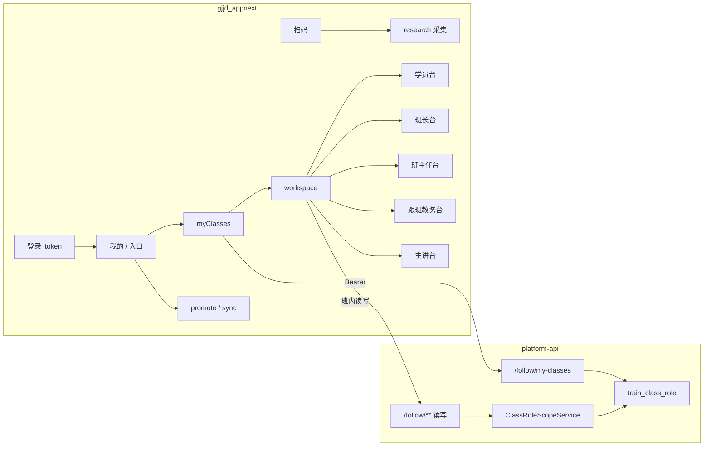
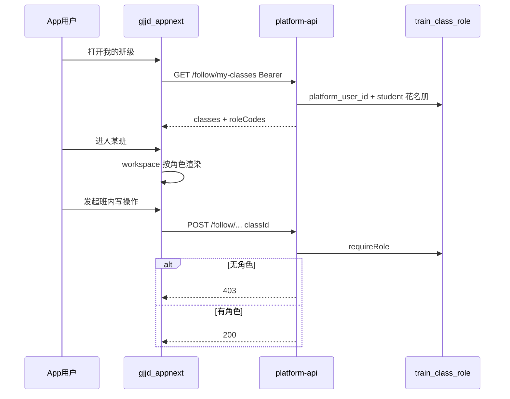

# 培训模块 · App 端实现方案（gjjd_appnext）

> **状态**：A1 开发中（我的班级入口 + 五工作台骨架 + `/training/follow/my-classes`）  
> **日期**：2026-08-07  
> **工程**：`gjjd_appnext`（主）+ `qianlvguoyu_saas/platform-api`（跟班/角色 API）  
> **硬约束**：**不得影响 App 现有功能的正常使用**（提升 / 同步学 / 扫码采集 / 登录 / Tab /「我的」原菜单等）。本方案只做增量；合入以 §0.4 与 §11.1 回归清单通过为准，未通过不得发版。  
> **对齐**：  
> - [培训模块_对外售卖介绍与功能需求说明.md](./培训模块_对外售卖介绍与功能需求说明.md) §1.2 / §3.6–3.8 / §4.2 / §5  
> - [培训班级五角色落地实现方案.md](./培训班级五角色落地实现方案.md) **R2–R3**（角色权威；本文专写 App 落地）  
> - [跟班模块功能实现方案.md](./跟班模块功能实现方案.md) M1–M3（能力挂载）  
> - [跟班作业与随堂练实现方案.md](./跟班作业与随堂练实现方案.md)（主讲台作业入口）  
> - [App同步学刷题作业_实现方案.md](./App同步学刷题作业_实现方案.md)（学习通道；语义隔离）  
> - [App课表与调课审批实现方案.md](./App课表与调课审批实现方案.md)（我的班级课表查看 / 老师调课申请 / 管理端审批）  
> - [方案A_App登录PHP签发与SaaS令牌镜像验票实现方案.md](./方案A_App登录PHP签发与SaaS令牌镜像验票实现方案.md)  

---

## 0. 范围与红线

### 0.1 做

| 范围 | 说明 |
|------|------|
| 我的班级 | 按 `train_class_role` + 在册学员拉取可见班级，进班后按角色进工作台 |
| 五角色工作台骨架 | 学员 / 班长 / 班主任 / 跟班教务 / 主讲·助教（同 App，不拆师资端） |
| 跟班读能力 | 概览、考勤摘要、课表查看（见 [App课表与调课审批实现方案.md](./App课表与调课审批实现方案.md) **S1**） |
| 跟班写能力（分期） | 签到、代签、影像、日志、作业等按五角色权限矩阵开放 |
| 通道隔离 | 「提升/同步学」与「我的班级/跟班」分入口、分路由、分文案 |

### 0.2 不做 / 红线

- **不**影响现有 App 功能正常使用（详见 §0.4；验收一票否决）。  
- **不**做独立师资 App。  
- **不**改 `pages/promote/*` 任何业务逻辑、请求、文案主语义；不把跟班控权接到 `/apppromote`。  
- **不**改 `pages/exam/sync*`、`api/saas-review.js`、`api/promote.js`、`api/sign-up-collect.js` 的既有行为。  
- **不**改登录协议与 `utils/auth.js` 核心流程；**不**改 `utils/saasRequest.js` 公共行为（401/租户头/重试等），新接口只新增调用方。  
- **不**调整 tabBar（发现 / 团队 / 提升 / 我的）项数与 pagePath。  
- **不**把班级角色塞进组织层 `sys_role`；班级权限只认 `train_class_role`。  
- **不**在 App 做开班准备指派、开班材料生成、补贴全流程（管理端）。  
- **不**用 SaaS 单开、未回写 PHP 的高位 `platform_user` 作为可登录验收账号（方案 A）。  
- 机构侧「跑调研→申报」的教务继续用 **管理端 Web**；App「教务」= 班级 `follow_staff`。

### 0.3 与售卖口径的关系

| 售卖表述 | App 承诺边界 |
|----------|--------------|
| 五角色「各有入口」 | 愿景；**首期**承诺学员填报+学习；角色门户按本方案 **A1–A2**（对应五角色 R2–R3）交付 |
| 管理端与 App 同数据源 | 跟班读写统一走 SaaS `/training/follow/**`；学习通道可继续 PHP promote / 同步学 SaaS |
| App 签到等 | 按开通范围；写入 A2，不进 A1 骨架验收 |

### 0.4 现网零回归硬约束（产品拍板）

**目标**：老用户不打开「我的班级」时，使用体验与发版前一致。

| # | 约束 | 强制做法 |
|---|------|----------|
| 1 | 增量优先 | 跟班能力全部落在新建 `pages/class/**`；禁止为跟班改写 promote / sync / research 内部实现 |
| 2 | 入口只许 F-A | **锁定**在「我的」页增加菜单项；**废弃默认采用 F-B**（不得改提升页顶栏）。若业务坚持 F-B，须书面批准并单列全量提升回归 |
| 3 | Store 隔离 | **必须**新建 `store/classRole.js`；禁止把 `myClasses` 塞进 `store/user.js` 的 `login`/`logout`/`token` 语义；登出时由 auth 钩子或 user.logout 末尾调用 `classRole.clear()`，不改 token 写入规则 |
| 4 | 公共层只读 | `saasRequest` / `auth` / `request`(PHP) **行为零变更**；新增 `api/class-follow.js` 即可 |
| 5 | 路由只增不改 | `pages.json` 只追加 class 路由；禁止改既有 path、tabBar、首页 |
| 6 | 失败降级 | `my-classes` 失败/空列表：仅「我的班级」页提示；**禁止**全局 Toast 打断、禁止影响提升 Tab 请求 |
| 7 | 合入门槛 | §11.1 回归清单全部通过；任一现网路径失败 → **不得合入/发版** |

---

## 1. 现状盘点（gjjd_appnext）

### 1.1 已有资产（可复用）

| 资产 | 路径 | 本方案用法 |
|------|------|------------|
| Tab「提升」 | `pages/promote/*` | **保持**为学习通道（培训任务/课件/课后作业入口） |
| 同步学 | `pages/exam/sync*` + `api/saas-review.js` | **保持**考前复习通道 C |
| 开班信息收集 | `pages/research/Saasdetail.vue` + `api/sign-up-collect.js` | 开班前填报；无角色亦可填 |
| 调研采集 | `pages/research/collect.vue` | 扫码调研；非跟班 |
| 登录与验票 | `utils/auth.js` + `utils/saasRequest.js` | **只调用不改行为**；跟班接口走 saasRequest |
| 用户 Store | `store/user.js` | **不改语义**；班级态见新建 `store/classRole.js`（§0.4 / §5） |

### 1.2 缺口

| 缺口 | 说明 |
|------|------|
| 我的班级 | 无页面、无列表 API 联调 |
| 五角色工作台 | 无班主任/教务/主讲/班长台；详情里的 `teacher` 仅为展示字段 |
| 跟班页 | 无考勤登记/代签/影像/日志路由 |
| 身份模型 | Store 无 `roles` / 班级层身份；`expert_id` 审核任务 ≠ 班级角色 |
| API 模块 | 无 `api/class-follow.js`（或同类）封装 `/follow/my-classes` 等 |

---

## 2. 产品结构：三通道

```text
┌─────────────────────────────────────────────────────────┐
│  gjjd_appnext（同一安装包）                                │
├───────────────┬──────────────────┬──────────────────────┤
│ 通道 L 学习    │ 通道 F 跟班       │ 通道 C 采集（开班前） │
│ Tab「提升」    │ 「我的班级」新建   │ 扫码/链接            │
│ promote/*     │ pages/class/*    │ research/*           │
│ exam/sync*    │ /training/follow │ sign-up / research   │
│ 语义：考前复习 │ 语义：在班履职     │ 语义：填报审核       │
└───────────────┴──────────────────┴──────────────────────┘
```

**入口（已锁定，服从 §0.4）：**

| 方案 | 做法 | 结论 |
|------|------|------|
| **F-A** | 「我的」页 `menus` **追加**「我的班级」一项，跳转 `pages/class/myClasses` | **唯一默认方案**；不改提升 Tab |
| F-B | 提升页顶部分区 | **默认否决**（易伤现网学习路径）；仅书面特批可用 |

进班路径统一：

```text
我的班级列表 → 选班 → workspace（按 roleCodes 渲染子台）→ 具体能力页
```

一人多角色：workspace 顶栏 **角色 Chip** 切换；权限取并集；默认优先 `monitor` > `head_teacher` > `follow_staff` > `lead_teacher`/`assistant` > `student`。

---

## 3. 五角色 ↔ App 工作台

| 售卖角色 | role_code | 进班首屏 | A1 骨架 | A2 能力（对齐五角色 §6.1） |
|----------|-----------|----------|---------|---------------------------|
| 学员 | `student`（花名册，不入角色表） | 课表摘要 + 学习入口 + 本人考勤 | 链到 promote/同步学 | 本人签到、确认代签、作业提交 |
| 班长 | `monitor` | 班出勤摘要 + 待办占位 | 摘要 + 空占位 | 代签提交、影像、督导上报 |
| 企业班主任 | `head_teacher` | 今日动态 / 待确认代签 / 日志 | 待办列表壳 | 确认代签、日志、影像 |
| 跟班教务 | `follow_staff` | 多班切换 + 抽查入口 | 班列表 + 概览只读 | 合规抽查、影像、日志 |
| 主讲/助教 | `lead_teacher` / `assistant` | 本节课 + 作业入口 | 课次列表壳 | 布置/批改（接作业方案） |

> 机构操作员全流程仍在管理端；不在 App 做「指派班级角色」。

---

## 4. 售卖阶段 → App 落点

| 售卖阶段 | App | 优先级 |
|----------|-----|--------|
| 企业调研 / 方案 / 分班 / 开班申报 | 基本不做（管理端）；调研扫码可复用 | — |
| 信息收集 | 已有 Saasdetail | P0 保持 |
| 开班准备（角色指派） | 不指派，只消费角色结果 | — |
| 跟班 | **本方案核心** | A1–A2 |
| 考试与考前辅导 | 复用 promote + 同步学 | P0 保持 |
| 认定与补贴收尾 | 弱：通知/进度查看（可选 A3） | P3 |

---

## 5. 身份、Store 与鉴权

### 5.1 登录

不变：PHP `/appauth/login` → `itoken` → SaaS `AppTokenAuthFilter`。  
非学员角色指派时必须 **ensure PHP `platform_user`**（见五角色方案 §7）；未绑定账号管理端可告警，App **不可进班履职**。

### 5.2 Store（强制独立，保护现网登录态）

```text
新建 store/classRole.js（禁止塞进 store/user.js 核心字段）
  myClasses: [{ classId, title, roleCodes[], primaryRole, unbound? }]
  currentClassId
  currentRoleCodes[]
  actions: loadMyClasses(), enterClass(classId), switchRole(code), clear()
```

- 进入「我的班级」时再调用 `GET /training/follow/my-classes`（**禁止**在 App 启动 / 打开提升 Tab 时强拉，以免拖慢或拖垮现网首屏）。  
- `user.logout` / `clearLocalCredentials` 末尾调用 `classRole.clear()`，不改动 token 校验与写入逻辑。  
- **不要**把班级角色写入本地假权限表；以后端 Scope 为准。

### 5.3 门禁

| 层 | 规则 |
|----|------|
| 前端 | 按 `currentRoleCodes` 显隐按钮与子路由 |
| 后端 | 写接口强制 `classId` + `ClassRoleScopeService.requireRole`；无角色 403 |
| 数据范围 | App 仅可见本人活跃角色班级；跟班教务支持多班集合 |

---

## 6. 页面与路由清单

### 6.1 新建（建议目录 `pages/class/`）

| 页面 | 说明 | 阶段 |
|------|------|------|
| `myClasses.vue` | 我的班级列表；卡片展示班名+角色标签 | A1 |
| `workspace.vue` | 进班壳：角色 Chip + 槽位渲染对应子台 | A1 |
| `roles/student.vue` | 学员台 | A1 |
| `roles/monitor.vue` | 班长台 | A1 |
| `roles/headTeacher.vue` | 班主任台 | A1 |
| `roles/followStaff.vue` | 跟班教务台（含多班入口可回列表） | A1 |
| `roles/leadTeacher.vue` | 主讲/助教台 | A1 |
| `attendance.vue` 等 | 考勤/代签/影像/日志具体页 | A2 |
| `homework/*` | 跟班作业（若与现有作业方案页面合并则改引用） | A2 |

`pages.json`：注册上述路由；**不**进 tabBar（入口走「我的」或提升分区）。

### 6.2 复用（禁止改语义）

| 页面 | 说明 |
|------|------|
| `pages/promote/*` | 学习通道 L |
| `pages/exam/sync*` | 同步学 |
| `pages/research/Saasdetail.vue` | 开班采集 |
| `pages/research/collect.vue` | 调研采集 |

### 6.3 API 模块（建议）

新建 `api/class-follow.js`（名称可微调，保持单一模块）：

| 方法 | 后端 | 阶段 |
|------|------|------|
| `listMyClasses()` | `GET /training/follow/my-classes` | A1 |
| `getRoleSummary(classId)` | `GET /training/follow/classes/{classId}/role-summary` | A1 |
| 概览/考勤/课表只读 | 跟班已有或待建只读 API | A1/A2 |
| 签到/代签/影像/日志写 | `/training/follow/**` 写接口 | A2 |

统一经 `saasRequest`；禁止页内散落硬编码 URL。

---

## 7. 后端依赖（App 联调前提）

| 依赖 | 状态 | 说明 |
|------|------|------|
| `train_class_role` + 指派 API | R1 已落地 | 管理端开班准备可指派 |
| `GET /follow/my-classes` | **待建（R2）** | App A1 阻塞项 |
| `ClassRoleScopeService` | **待建（R2）** | A2 写接口阻塞项 |
| 跟班概览/考勤读 API | 跟班方案部分已有 | A1 可只读挂载或占位 |
| 代签/影像/日志/作业写 API | 跟班 M2/M3 | A2 |
| 指派 ensure PHP 账号 | R1 部分 / 需补强 | 无账号则 App 验收失败 |

---

## 8. 架构示意





---

## 9. 分期与验收（App）

| 阶段 | 对应五角色 | 目标 | 交付 | 验收 |
|------|------------|------|------|------|
| **A0** | R0/R1 | 方案与入口定稿 | 本文；**入口锁定 F-A**；§0.4 硬约束确认 | 产品/研发评审通过 |
| **A1** | R2 | 入口与骨架 | `my-classes` 联调；`pages/class/*`；`store/classRole.js`；F-A 入口 | ① 有角色能进台 ② **§11.1 现网回归全过**（一票否决）③ 与 promote 文案不混 |
| **A2** | R3 | 职责能力 | 按矩阵挂签到/代签/影像/日志/作业 | 跟班能力验收 + **再次跑通 §11.1 现网回归** |
| **A3** | 可选 | 收尾弱入口 | 结课/补贴进度只读通知 | 不阻塞 A1/A2；不得改动现网主路径 |

**建议工期（人日，估）**：A1 约 5～8（含联调）；A2 随跟班接口 8～15。

---

## 10. 任务拆解清单（实施用）

### A1

- [x] 后端：`GET /training/follow/my-classes`（班级 + roleCodes）  
- [x] 后端：`GET /training/follow/classes/{classId}/role-summary`（班成员校验）  
- [x] App：`api/class-follow.js`（仅新增）  
- [x] App：新建 `store/classRole.js` + `loadMyClasses` / `clear`；user.logout / clearLocalCredentials 挂钩 clear  
- [x] App：入口 **仅 F-A**（`pages/user/index` 固定「我的班级」项，不受服务端 menus 覆盖）  
- [x] App：`myClasses` / `workspace` / 五个 `roles/*` 骨架组件  
- [x] App：`pages.json` **只追加** class 路由；tabBar 未改  
- [ ] 联调：学员 / 班长 / 班主任 / 教务 / 主讲各一账号走通进班  
- [ ] **现网回归必过（§11.1）**：提升→详情→课件；同步学；Saasdetail；登录/退出；审核任务；「我的」原菜单  

### A2

- [ ] 按五角色矩阵逐项开门（签到 → 代签 → 影像 → 日志 → 作业）  
- [x] 主讲台接作业方案路由（`pages/class/homework*`）  
- [ ] 错误码与 Toast：403「无本班权限」统一文案  
- [ ] 与管理端跟班工作台数据对照抽检  

---

## 11. 风险与缓解

| 风险 | 缓解 |
|------|------|
| 班主任/老师无 PHP 账号，登不进 | 指派 ensure；列表展示 unbound；验收账号必须 PHP 可登 |
| 与提升 Tab 入口混淆 | 通道分区 + 文案禁用「跟班作业」出现在 promote |
| A1 等后端 my-classes | 可先 Mock 列表联调 UI，合入前切真接口 |
| 一人多角色 UI 复杂 | Chip 切换 + 并集权限；默认优先级写死可配置 |
| 跟班写接口未就绪 | A1 只验收骨架与只读；写能力不进 A1 验收单 |

---

## 11.1 对现有 App 功能的影响面与零回归要求

> **产品要求**：本方案落地后，App 现有功能须能继续正常使用。  
> **工程要求**：只增量、不改公共层行为；合入/发版以本节约回归清单通过为硬门槛。

### 不影响（禁止改动主逻辑）

| 现有能力 | 路径 | 为何不受影响 |
|----------|------|--------------|
| Tab「提升」学习主链路 | `pages/promote/*`、`api/promote.js` | §0.2 / §0.4：零改业务逻辑 |
| 同步学 | `pages/exam/sync*`、`api/saas-review.js` | 通道隔离；请求路径不变 |
| 开班信息收集 / 调研采集 | `research/Saasdetail`、`research/collect` | 只复用不改 |
| 登录签发 | PHP `/appauth` + `utils/auth.js` | 协议与核心流程零变更 |
| Tab 结构 | 发现 / 团队 / 提升 / 我的 | class 页不进 tabBar |
| 专家审核任务 | `expert_id` → `pages/task/*` | 不复用、不改条件 |
| 「我的」原菜单 | `pages/user/index` 既有项 | 仅 **追加**「我的班级」，不改原 item |

### 允许的唯一现网触点

| 触点 | 允许改动 | 禁止 |
|------|----------|------|
| `pages/user/index.vue` | `menus`（或等价列表）**追加**一项「我的班级」 | 改布局大改、改原菜单 page/title、改登录/退出逻辑 |
| `pages.json` | **追加** `pages/class/*` | 改既有 path、改 tabBar |
| `user.logout` / `clearLocalCredentials` | 末尾多调一次 `classRole.clear()` | 改 token 校验、静默登录、踢下线逻辑 |
| 其它现网文件 | **无** | 包括 promote、sync、saasRequest、auth 核心 |

### 明确不会弄坏的场景

1. 老学员从不点「我的班级」：提升 / 同步学 / 采集与发版前一致。  
2. `my-classes` 失败：仅班级列表页错误态；提升 Tab 请求链路零影响。  
3. Scope 403：仅 `/training/follow/**`；不拦截 `/apppromote`、`/appreviewsync`。

### 合入前回归清单（一票否决）

- [ ] 未登录 → 登录 → 进提升：任务列表正常  
- [ ] 培训详情 → 课件 / 既有课后作业入口正常  
- [ ] 同步学 overview / 今日任务可进  
- [ ] 扫码或直达 Saasdetail：提交/查询不受影响  
- [ ] 「我的」原菜单逐项可点；审核任务（expert）仍按 `expert_id` 显示  
- [ ] 退出登录后再登录，token 与原流程一致；无异常全局弹窗  
- [ ] Diff 确认：无对 `pages/promote/**`、`exam/sync*`、`saasRequest.js`、`auth.js` 业务行为的修改（logout 挂钩 clear 除外且须 code review）  

---

## 12. 文档索引

| 文档 | 关系 |
|------|------|
| 本文 | App 端可执行实现方案（页面·Store·分期·验收） |
| 培训班级五角色落地实现方案 | 角色模型、权限矩阵、R1–R3 权威；App 细节以本文为准 |
| 跟班模块功能实现方案 | 跟班能力与 M 分期；App 挂载点 |
| App同步学刷题作业实现方案 | 通道 L/C 与作业通道边界 |
| 对外售卖介绍 | 商务口径；App「各有入口」以本文 §0.3 / 五角色 §12 为准 |

---

*A0 完成标志：本文入库；**§0.4 现网零回归**与入口 **F-A** 已锁定；交叉引用已加。*  
*开 A1 标志：`GET /follow/my-classes` 可联调或 Mock；实施须遵守 §0.4，合入须过 §11.1 回归清单。*
