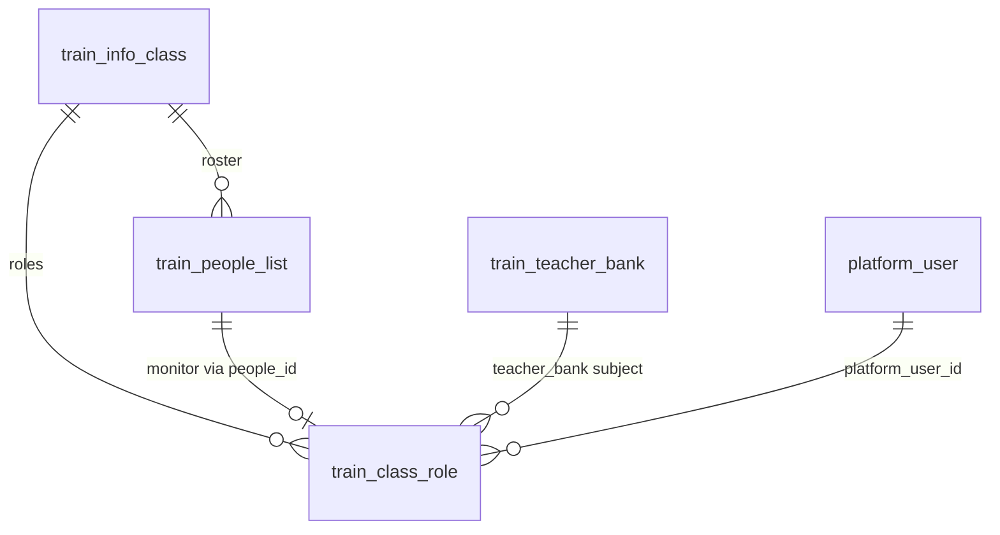
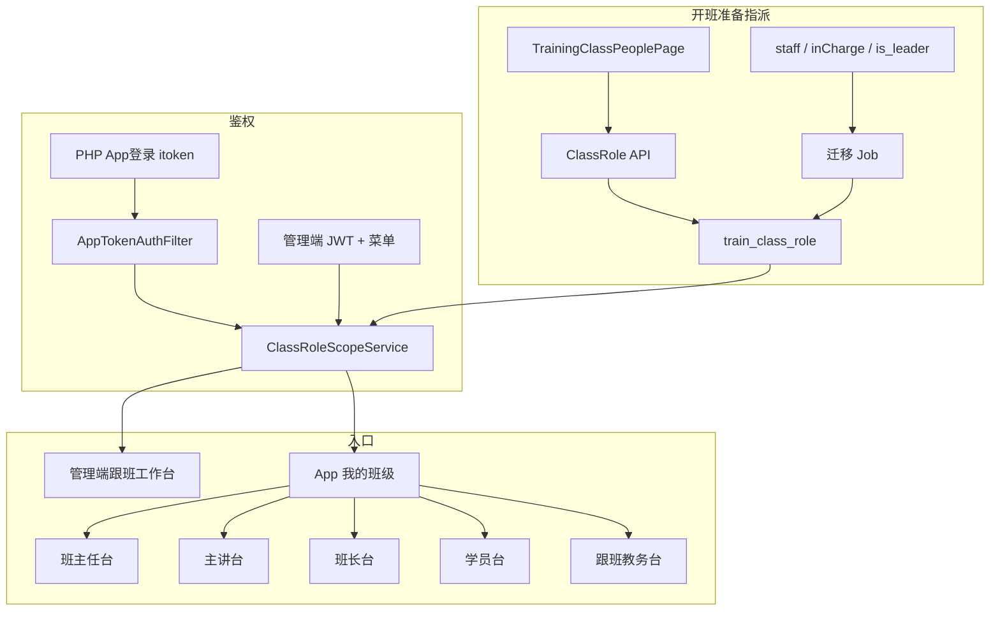
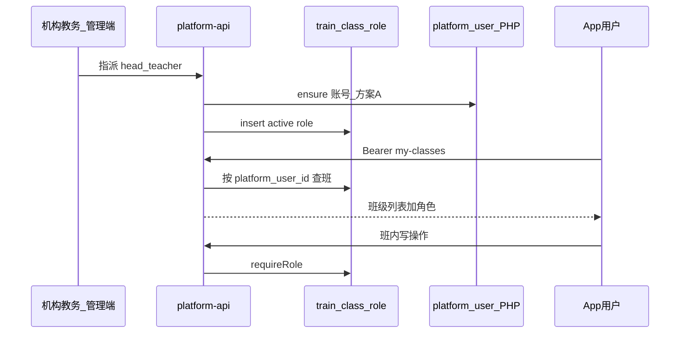

# 培训班级五角色落地实现方案

> **状态**：R1 开发中（角色底座：表 + API + 开班准备/跟班摘要已落地；R2 入口与控权待做）  
> **日期**：2026-08-07  
> **范围**：`qianlvguoyu_saas`（`platform-api` + `admin-web`）+ App `gjjd_appnext`  
> **对齐**：  
> - [培训模块_对外售卖介绍与功能需求说明.md](./培训模块_对外售卖介绍与功能需求说明.md) §1.2 / §3.4 / §4.1 / §5.2  
> - [SaaS云平台培训模块详细介绍与功能需求说明.md](./SaaS云平台培训模块详细介绍与功能需求说明.md) §1.3 / §3.4  
> - [跟班模块功能实现方案.md](./跟班模块功能实现方案.md) §4 / §6 / §9 M1  
> - [跟班作业与随堂练实现方案.md](./跟班作业与随堂练实现方案.md)（仅定义「谁可布置」）  
> - [方案A_App登录PHP签发与SaaS令牌镜像验票实现方案.md](./方案A_App登录PHP签发与SaaS令牌镜像验票实现方案.md)  

---

## 一、背景与目标

### 1.1 问题

售卖与需求材料要求一线角色「教务、企业班主任、授课老师、班长、学员**各有入口**」。现状评估结论：

| 售卖角色 | 现状支持度 | 说明 |
|----------|------------|------|
| 教务 | 部分 | 管理端机构操作员可跑全流程；班级 `type=staff` 仅为名单，不驱动权限 |
| 企业班主任 | 否 | 仅有 `type=inCharge`「负责人」代理，无独立控权与门户 |
| 授课老师 | 否 | 教师库 + 课表 `teacher_name` 字符串；无主讲账号绑定与老师工作台 |
| 班长 | 部分 | `is_leader` 标记，无职责能力 |
| 学员 | 基本有 | 花名册 + App；跟班「我的班级」与部分职责仍缺 |

正式班级角色表 `train_class_role`、按角色控权、App 非学员工作台均未落地（跟班工作台已有「待后端」占位）。

### 1.2 目标

1. 建立**班级层角色权威源**，使任意班级可回答：班主任 / 跟班教务 / 主讲 / 助教 / 班长 / 学员是谁。  
2. 管理端负责**指派与监管**；同一 App 按「我的班级 + 角色」进入工作台（不做独立师资 App）。  
3. 与跟班 M2/M3 能力解耦分期：本方案先打通「谁管哪个班」，职责能力按矩阵逐步开放。  
4. 兼容现有 `staff` / `inCharge` / `is_leader`，避免开班准备页一次性断裂。

### 1.3 非目标

- 重做全量 `sys_role` 菜单树。  
- 改造 App promote / 同步学通道语义。  
- 人社对接、补贴全流程、独立师资 App（补贴与人社见 [补贴与人社扩展实现方案.md](./补贴与人社扩展实现方案.md)；独立师资 App 仍不做）。  
- R2 App「我的班级」与 ClassRoleScope 门禁（另排期；App 落地见 [培训模块_App端实现方案.md](./培训模块_App端实现方案.md)）。  

> R1 已实现：`train_class_role` Flyway、指派/卸任 API、遗留数据迁移与双写、开班准备「班级角色」、跟班角色摘要。

---

## 二、已锁定产品决策

### 2.1 双层身份模型

| 层级 | 机制 | 用途 |
|------|------|------|
| **组织层** | 管理端 JWT + `loginRole=org\|company` + 菜单权限 `train:*` | 机构教务跑调研→开班全流程；企业账号审分班/看本企业班 |
| **班级层** | `train_class_role` | 决定「谁能进哪个班、在班内能做什么」 |

> 「教务」在对外口径中含两层：机构侧操作员（组织层，现状保留）+ 班级跟班教务 `follow_staff`（本方案主建）。对外介绍时应用文案区分，避免与「教务管理」师资库菜单混淆。

### 2.2 五角色 ↔ 角色码

| 售卖口径 | 角色码 | 主体来源 | 说明 |
|----------|--------|----------|------|
| 教务（跟班） | `follow_staff` | 师资库 / 手工录入 → 绑 `platform_user` | 培训部管合规抽查 |
| 企业班主任 | `head_teacher` | 企业侧指派 → 绑 `platform_user` | 企业管日常 |
| 授课老师 | `lead_teacher` | 师资库绑定 → 绑 `platform_user` | 主讲；可选 `assistant` 助教 |
| 班长 | `monitor` | 在册学员 `is_leader=1` 同步 | 学员兼任，权限并集 |
| 学员 | `student` | `train_people_list.type=student` | **不写入** `train_class_role`；花名册仍为在册底座 |

一人可多角色（如学员兼班长）；权限按「当前班级 + 所持角色」取**并集**。

### 2.3 入口策略

- **App**：`gjjd_appnext`，PHP `/appauth/login` 签发 `itoken`，SaaS `AppTokenAuthFilter` 验票；登录后「我的班级」按角色展示入口。  
- **管理端**：指派、多班监管、强制修正（审计 source=`admin`）。  
- **不做**独立师资 App。

### 2.4 数据权威

- **权威源**：`train_class_role`（班级岗位）。  
- **兼容**：R1 一次性迁移 + 过渡期双读；写操作新接口只写角色表，并回写必要旧字段（见 §5）。

---

## 三、现状差距与资产映射

### 3.1 已有资产

| 资产 | 路径/表 | 本方案用法 |
|------|---------|------------|
| 花名册学员 | `train_people_list` `type=student` | 学员底座；班长来源 |
| 教务人员名单 | `type=staff` | 迁入 `follow_staff` |
| 负责人名单 | `type=inCharge` | 迁入 `head_teacher` |
| 班长标记 | `is_leader` | 迁入/同步 `monitor` |
| 师资库 | `train_teacher_bank` | 主讲/助教/跟班教务选人源 |
| 课表讲师名 | `train_schedule.teacher_name` | 仅展示；**不自动**迁主讲 |
| 开班准备页 | `TrainingClassPeoplePage.tsx` | R1 扩展「班级角色」Tab |
| 跟班工作台 | `FollowClassWorkbench.tsx` | 角色摘要改读角色表 |
| 操作员范围 | `TrainingOperatorScopeService` | 组织层保留；班级层另加 Scope |
| App 登录 | 方案 A + `saasRequest` | 非学员角色同样依赖 PHP `platform_user` |

### 3.2 缺失

- `train_class_role` 表与 CRUD API  
- `ClassRoleScopeService`（班级角色门禁）  
- App「我的班级」与非学员工作台骨架  
- 主讲账号与课表姓名强制关联策略  
- 指派时 ensure PHP/SaaS 账号（防 App 登不进）

---

## 四、数据模型

### 4.1 表 `train_class_role`（建议 DDL 要点）

| 字段 | 类型 | 说明 |
|------|------|------|
| `id` | BIGINT | 雪花 ID |
| `class_id` | BIGINT | `train_info_class.id` |
| `role_code` | VARCHAR(32) | `head_teacher` / `follow_staff` / `lead_teacher` / `assistant` / `monitor` |
| `subject_type` | VARCHAR(16) | `platform_user` / `people` / `teacher_bank` |
| `subject_id` | BIGINT | 对应主体 ID |
| `platform_user_id` | BIGINT NULL | App 鉴权主键；绑定时回填 |
| `people_id` | BIGINT NULL | 关联花名册行（班长必填；其他可选） |
| `display_name` | VARCHAR(64) | 冗余展示名 |
| `phone` | VARCHAR(32) NULL | 冗余，便于催办 |
| `start_date` | DATE NULL | 起任 |
| `end_date` | DATE NULL | 卸任；空=长期 |
| `status` | VARCHAR(16) | `active` / `ended` |
| BaseEntity 列 | | `tenant_id` / `deleted` / `created_*` / `updated_*` |

**约束建议**：

- 活跃唯一：`(tenant_id, class_id, role_code, subject_type, subject_id)` where `status=active` and `deleted=0`（实现可用唯一索引 + 应用校验）。  
- 每班人数上限（应用层，字典可配）：`head_teacher` ≤ 2，`follow_staff` ≤ 2，`lead_teacher` ≤ 3，`assistant` ≤ 5，`monitor` ≤ 班额（通常 1～2）。  
- `monitor` 的 `people_id` 必须指向本班 `type=student` 且未删除。

### 4.2 与花名册关系



- **学员在册**：只认 `train_people_list.type=student`。  
- **岗位指派**：只认 `train_class_role.status=active`。  
- **班长**：花名册改 `is_leader` ↔ 同步写/结束 `monitor` 行（双向，见 §5.2）。

### 4.3 不迁入角色表的数据

- 全体学员行（避免角色表膨胀）。  
- 课表 `teacher_name`（无账号则无法鉴权）。  
- 项目级 `train_info_list.in_charge_*`（项目负责人 ≠ 班级班主任）。

---

## 五、迁移与兼容

### 5.1 一次性迁移（R1 Flyway/Job）

| 旧数据 | 迁入 `role_code` | `subject_*` 规则 | `platform_user_id` |
|--------|------------------|------------------|--------------------|
| `type=staff` | `follow_staff` | 优先 `teacher_bank`（`user_id`）否则 `people` | phone/id_card 匹配 `platform_user`，匹配不到则空并记告警清单 |
| `type=inCharge` | `head_teacher` | `people` | 同上 |
| `student` 且 `is_leader=1` | `monitor` | `people` + `people_id` | 用花名册已有 `platform_user_id` |
| 课表讲师名 | — | **不自动迁移** | R1 开班准备手工从师资库指派 `lead_teacher` |

迁移幂等：已存在同 `(class_id, role_code, subject_*)` 活跃行则跳过。

### 5.2 过渡期双读 / 回写（建议过渡 1～2 个迭代）

| 操作 | 读 | 写 |
|------|----|----|
| 角色摘要 / 门禁 | **只读** `train_class_role`（迁移完成后） | — |
| 开班准备「教务人员」旧 Tab | 可读角色表 `follow_staff` 投影为旧列表形态 | 新写走角色 API，并可选同步插/更 `type=staff`（兼容旧材料生成） |
| 「负责人」旧 Tab | 投影 `head_teacher` | 同步 `type=inCharge`（过渡） |
| 花名册「是否班长」 | `is_leader` 与是否存在活跃 `monitor` 应对齐 | 改班长：更新 `is_leader` **且** upsert/结束 `monitor` |

材料生成若仍读 `type=staff`：过渡期保持回写；稳定后改为读 `follow_staff`/`lead_teacher`，再停回写。

### 5.3 文案统一（防命名碰撞）

| 旧/易混文案 | 统一称呼 |
|-------------|----------|
| 教务人员（staff） | **跟班教务** |
| 教务管理菜单（teacher-bank） | **师资库 / 教务管理（档案）** — 非班级角色 |
| 负责人（inCharge） | **企业班主任**（指派后）/ 过渡 UI 可注「原负责人」 |
| 课表「老师」列 | 展示名；正式主讲以角色表为准 |

---

## 六、权限矩阵

### 6.1 能力 × 角色（跟班相关摘要）

| 能力 | 学员 | 班长 | 班主任 | 跟班教务 | 主讲/助教 | 管理端机构操作员 |
|------|:----:|:----:|:------:|:--------:|:---------:|:----------------:|
| 查看本班概览/考勤/课表 | ✓(本人相关) | ✓ | ✓ | ✓ | ✓ | ✓(全量按组织) |
| 本人签到 | ✓ | ✓ | — | — | — | 查看/强制修正 |
| 代签提交（待确认） | — | ✓ | ✓ | — | — | 查看 |
| 确认代签 | ✓(本人) | — | ✓ | — | — | 可强制 |
| 上传照片/视频 | — | ✓ | ✓ | ✓ | ✓ | 查看 |
| 写班主任/跟班日志 | — | — | ✓ | ✓ | — | 查看 |
| 布置/批改作业、随堂练 | — | — | — | — | ✓ | 监管 |
| 督导上报 | — | ✓ | — | — | — | 查看 |
| 督导处理/复核 | — | — | 处理 | 复核 | — | 抽查 |
| 多班抽查/合规标记 | — | — | — | ✓ | — | ✓ |
| 班级角色指派 | — | — | — | — | — | ✓（org） |

> 作业细则见《跟班作业与随堂练实现方案》；本表只定「谁可以」。R2 先上表中「查看 + 门禁骨架」；带 ✓ 的写能力随跟班 M2/M3（本方案 R3）开放。

### 6.2 数据范围规则

| 端 | 规则 |
|----|------|
| App | 仅可见自己担任**活跃角色**的班级；接口必须带 `classId` 并由 Scope 校验 |
| 管理端 org | 按租户 + 培训机构组织权限；**不受**班级角色限制；审计 `source=admin` |
| 管理端 company | 默认可**读**本企业班级；**写**跟班业务需具备该班 `head_teacher`（或产品另授企业人事只读） |
| 跟班教务 App | 可见其 `follow_staff` 班级集合，支持多班切换 |

### 6.3 Scope 服务（实现要点，R2）

建议 `ClassRoleScopeService`：

```text
requireRole(platformUserId, classId, roleCodes...)
  → 查 train_class_role active 且 platform_user_id 匹配且 role_code ∈ 所需
  → 管理端 org 操作员可短路放行（记 admin）
  → 否则 403
```

一人多角色：所需角色任一命中，或调用方声明 `anyOf`/`allOf`。

---

## 七、账号开通策略

| 角色 | 策略 |
|------|------|
| 学员 | 维持分班物化 `PlatformUserEnsureService`；须保证 PHP 侧可登录（方案 A / PHP 优先建号） |
| 班主任 / 跟班教务 / 主讲 / 助教 | 指派时若无 `platform_user_id`：按手机号/身份证 **ensure**（同学员规则），来源标记 `class_role`；**同步保证 PHP 库存在同 id 用户**，否则 App 无法登录 |
| 班长 | 必须已是在册学员且已有 `platform_user_id`；无账号则先走学员补开再设班长 |
| 机构教务操作员 | 不强制班级角色；继续管理端账号 |

指派 API 返回：`bound` / `ensured` / `unbound_warning`（仅名单无账号，管理端可看、App 不可进）。

---

## 八、API 与页面清单（R1–R2，只列不实现）

### 8.1 后端 API（建议前缀 `/training`）

| 方法 | 路径 | 说明 | 阶段 |
|------|------|------|------|
| GET | `/classes/{classId}/roles` | 本班活跃角色列表（含未绑定账号告警） | R1 |
| PUT | `/classes/{classId}/roles` | 批量覆盖或增量 upsert（按 role_code 分组） | R1 |
| POST | `/classes/{classId}/roles/assign` | 单条指派（含 ensure 账号） | R1 |
| POST | `/classes/{classId}/roles/{id}/end` | 卸任 | R1 |
| GET | `/follow/my-classes` | 当前用户可见班级 + 角色列表（管理端/App 共用语义） | R2 |
| GET | `/follow/classes/{classId}/role-summary` | 跟班角色摘要（替换占位） | R1 |

鉴权：管理端 `@PreAuthorize` 开班准备相关权限；App 走 Bearer，写接口叠加 `ClassRoleScopeService`。

### 8.2 管理端页面

| 页面 | 改造点 | 阶段 |
|------|--------|------|
| `TrainingClassPeoplePage` | 新增「班级角色」Tab：班主任 / 跟班教务 / 主讲 / 助教；班长仍可在学员表开关并同步 | R1 |
| `FollowClassWorkbench` 角色 Tab | 改读角色 API；去除「`train_class_role` 待后端」文案 | R1 |
| 跟班班级列表 | 可展示班主任/主讲摘要字段 | R2 |

### 8.3 App 页面

| 页面 | 说明 | 阶段 |
|------|------|------|
| 我的班级 | `GET /follow/my-classes`；按角色展示入口卡片 | R2 |
| 学员台 | 复用学习/刷题/同步学等已有通道 + 后续签到作业 | 已有 / R3 |
| 班长台 | 骨架：本班考勤摘要入口、影像上传占位 | R2 骨架 / R3 能力 |
| 班主任台 | 骨架：动态/待确认代签/日志入口 | R2 / R3 |
| 主讲台 | 骨架：作业与随堂练入口（能力接作业方案） | R2 / R3 |
| 跟班教务台 | 骨架：多班列表 + 抽查入口 | R2 / R3 |

入口文案与 promote「考前练习」分离，避免通道混淆。  
**App 路由、Store、分期 A0–A2、验收清单**以 [培训模块_App端实现方案.md](./培训模块_App端实现方案.md) 为准（对应本方案 R2–R3）。

---

## 九、架构示意





---

## 十、分期与验收

| 阶段 | 目标 | 交付 | 验收 |
|------|------|------|------|
| **R0** | 方案定稿 | 本文档；权限矩阵与口径共识 | 产品/研发评审通过 |
| **R1** | 角色底座 | Flyway 表；迁移；指派 API/UI；跟班角色摘要真数据 | 任意班能回答班主任/教务/主讲/班长是谁；未绑账号有告警 |
| **R2** | 入口与控权 | App 我的班级；Scope 挂到关键读/写接口；五类工作台骨架 | 班主任与跟班教务进同一班权限不同；无角色 403 |
| **R3** | 职责能力 | 接跟班 M2/M3：代签确认、影像、日志、作业等按 §6.1 开放 | 与跟班分期合并验收；补贴齐套自动项见《补贴与人社扩展实现方案》**S2** |

与跟班总方案映射：R1 ≈ 跟班 M1 角色切片；R3 ≈ M2/M3 按角色开门。

---

## 十一、风险与缓解

| 风险 | 缓解 |
|------|------|
| 班主任/老师无 PHP 账号，App 登不进 | 指派强制 ensure；清单暴露 `unbound`；复用「PHP 优先建号」教训 |
| `staff` / 师资库 / 跟班教务语义混淆 | §5.3 文案；UI 分组：「档案」vs「本班岗位」 |
| 课表姓名与主讲脱节 | R1 不自动迁移；主讲必须从师资库选人并写 `platform_user_id` |
| 企业账号误获写权限 | company 默认只读；写需 `head_teacher` |
| 迁移漏绑用户 | 迁移报告 + 开班准备告警条 |
| 与 promote 入口混淆 | App 文案分区；作业走 `/training/follow/**` |

---

## 十二、对外口径修订建议（售卖/方案书）

**不宜继续写死**：五角色「各有入口」（易被理解为均已上线）。

**建议表述**：

- **首期可承诺**：机构侧教务/管理员在管理端推进全流程；学员 App 填报与学习；开班准备可维护班级角色名单（班主任、跟班教务、主讲、班长等）。  
- **角色门户与控权**：随「正式班级角色权限深化」扩展包交付（对应本方案 R2–R3 / 售卖材料 §5.2）。  
- **双轨**：企业班主任管日常，培训部跟班教务管合规——权限与待办按角色拆分。

---

## 十三、评审清单（R0）

- [ ] 确认双层身份与五角色码映射  
- [ ] 确认 App 同一端、不拆师资 App  
- [ ] 确认迁移表与「课表不自动迁主讲」  
- [ ] 确认企业账号写权限规则（默认只读 + 班主任可写）  
- [ ] 确认每班角色人数上限  
- [ ] 确认账号 ensure 必须落 PHP（方案 A）  
- [ ] 评审通过后：开 R1 任务（Flyway + API + 开班准备 UI），另附《接口清单》细表  

---

## 十四、文档索引

| 文档 | 关系 |
|------|------|
| 本文 | 五角色权威实现方案 |
| 培训模块_App端实现方案 | App「我的班级」与五工作台落地（A0–A2 ↔ 本文 R2–R3） |
| 跟班模块功能实现方案 | 跟班能力与 M1–M4；角色细节以本文为准并回写交叉引用 |
| 跟班作业与随堂练实现方案 | 主讲/助教布置作业的任务模型 |
| 补贴与人社扩展实现方案 | 与本文 **R2–R3** 对齐的补贴台账/齐套/人社 L1–L3（原非目标项的产品化路径） |
| 方案 A 登录验票 | 所有 App 角色登录前提 |
| 对外售卖介绍 | 商务口径；§5.2 扩展项对齐本文 R2–R3 |

---

*R0 交付完成标志：本文入库且交叉引用已加；本阶段无 Java / 前端 / Flyway 代码变更。*
