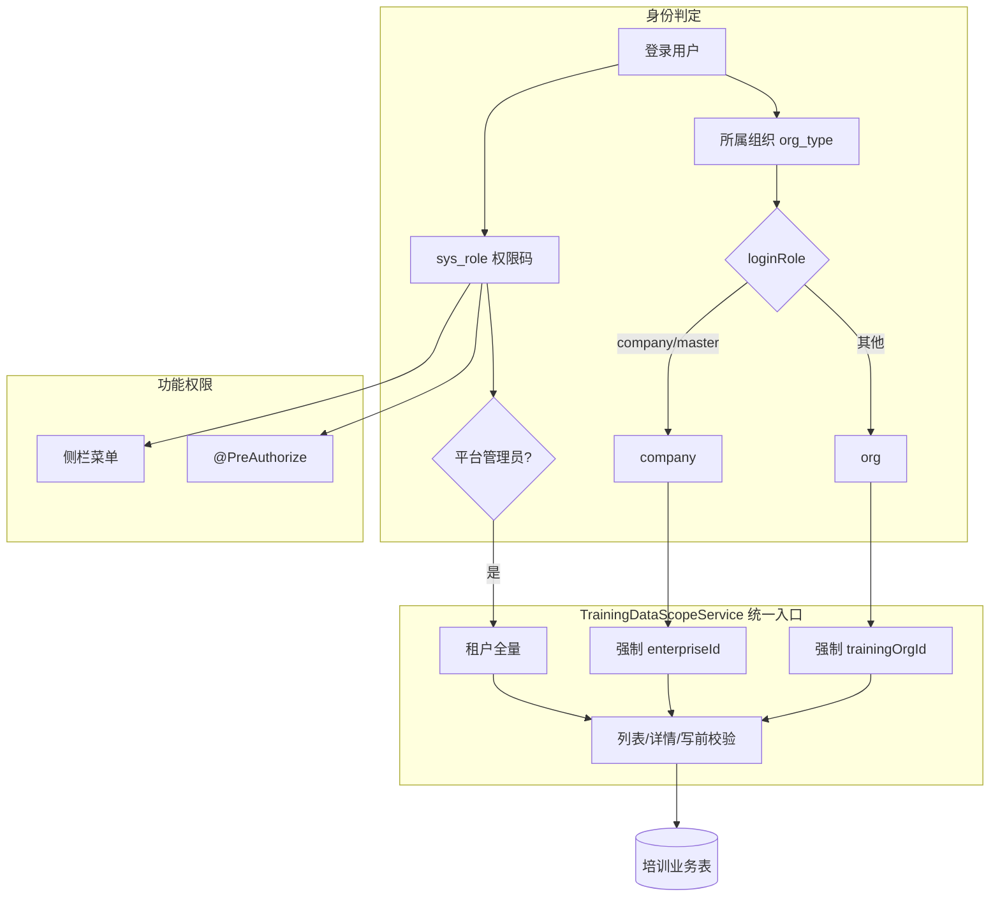

# 培训管理 · 组织层权限与数据范围改造方案

> **状态**：R1 开发中（P0 企业隔离补齐进行中；标准角色包 / 机构隔离待评审决策后继续）  
> **日期**：2026-09-10  
> **范围**：`qianlvguoyu_saas`（`platform-api` + `admin-web`）；班级层五角色仍以 [培训班级五角色落地实现方案.md](./培训班级五角色落地实现方案.md) 为准，本方案**不重做** `train_class_role`  
> **对齐**：  
> - 现状核查：角色权限页（`RolePage`）+ `TrainingOperatorScopeService` + 各 ApplicationService 数据过滤  
> - [跟班模块功能实现方案.md](./跟班模块功能实现方案.md)（管理端跟班与 `info-class` 权限耦合）  
> - [培训班级五角色落地实现方案.md](./培训班级五角色落地实现方案.md) §2.1 双层身份模型  

---

## 一、背景与问题

### 1.1 现状模型（双轴）

| 轴 | 机制 | 作用 |
|----|------|------|
| 功能权限 | `sys_role` → 菜单 / `sys_permission` → `@PreAuthorize` | 能否进页、调 API |
| 数据范围 | 用户所属组织 `org_type` → `loginRole=org\|company` | 企业强制本企业；机构多数**不收窄** |
| 旁路 | `PLATFORM_ADMIN` / `SUPER_ADMIN` / `userType=admin` | 跨企业、跨机构 |

班级岗位（理论老师 / 实操老师 / 班长 / 教务人员 / 学员）属于**班级层**，管理端组织层不按岗位过滤（App R2 另案）。

### 1.2 核心不足（摘要）

| 身份 | 主要不足 |
|------|----------|
| 平台管理员 | 权限过宽；业务培训管理员与平台超管未分离 |
| 机构 | 同租户多机构时数据互见；跟班 API 绑死 `train:info-class:*`；无标准角色包 |
| 企业 | 班级/规划/分班/需求 CRUD/报名隔离尚可；**人员列表、需求待办、调研、考勤、补贴、考试、毕业典礼**弱隔离或无隔离 |
| 共性 | 菜单码 ≠ API 码；Scope 接入不均；角色页只管 RBAC 不管数据范围 |

### 1.3 数据模型缺口（机构隔离前置）

当前班级 / 培训信息主数据以 **`companyId`（企业）** 为主，`train_company_name` 多为展示字符串，**缺少稳定的「承办培训机构 org_id」字段**。因此：

- **企业隔离**可立刻按现有 `companyId` / `targetOrgId` / 报名 `orgId` 补齐（P0）。  
- **机构隔离**需先补 `training_org_id`（或等价字段）并回填，再在 Scope 中生效（P1）。  

---

## 二、目标与非目标

### 2.1 目标

1. **统一数据范围服务**：所有培训管理端列表 / 详情 / 写操作走同一套 Scope 规则。  
2. **三类标准身份可预期**：平台监管、机构运营、企业审核/查看，行为可测、可验收。  
3. **标准角色包**：Flyway 种子 + 角色权限页可复用，减少现网手配出错。  
4. **菜单与 API 码对齐**：跟班 / 补贴等「勾了菜单就能调对应 API」。  
5. **最小破坏**：不推翻 `sys_role`；不把班级岗位塞进系统角色；兼容现有企业确认链路。

### 2.2 非目标

- 重做全量菜单树或权限码命名体系（仅做兼容映射与关键错配修复）。  
- 本方案交付 App 班级角色 R2 门禁（仍归五角色方案）。  
- 跨租户数据共享、细到字段的 ABAC。  
- 独立师资 App。

### 2.3 已锁定产品决策（建议评审确认）

| # | 决策 | 建议口径 |
|---|------|----------|
| D1 | 企业默认能力 | **读本企业 + 确认/驳回/回传**；默认**无**开班写、无补贴写、无师资库写 |
| D2 | 机构默认能力 | 本机构承办数据的全流程读写；同租户他机构数据默认不可见（补字段后） |
| D3 | 平台管理员 | 租户内全量监管；业务日常用「培训机构管理员」角色，少用平台超管 |
| D4 | 单机构租户过渡 | 未回填 `training_org_id` 前，机构侧保持「租户内可见全部企业班」兼容开关，避免现网空列表 |
| D5 | 跟班管理端权限 | 拆出 `train:follow:*` 写读，与 `info-class` 解耦；过渡期 OR 兼容 |

> 评审若否决 D2（机构不隔离），则 P1 机构字段与过滤可砍，仅做企业 P0 + 角色包 + 码对齐。

---

## 三、目标架构

### 3.1 扩展 `TrainingOperatorScopeService` → `TrainingDataScope` 契约

建议在现有 Service 上扩展（或薄包装），对外统一：

| 方法 | 行为 |
|------|------|
| `currentScope()` | 返回 `platformAdmin / loginRole / orgId / trainingOrgId / enterpriseId` |
| `applyEnterpriseFilter(...)` | 企业强制本企业；机构/管理员按请求可选筛 |
| `applyTrainingOrgFilter(...)` | 机构强制本机构承办（P1）；管理员旁路 |
| `assertEnterpriseResource(companyId)` | 详情/写前 |
| `assertClassAccessible(class)` | 企业：companyId；机构：trainingOrgId（P1）；管理员放行 |
| `requireOrgOperator()` | 保持：企业不可做机构写（确认类白名单除外） |
| `requireEnterpriseConfirmable(...)` | 企业确认专用 |

**规则优先级**：平台管理员 > 显式白名单接口 > loginRole 过滤。

### 3.2 功能权限与数据范围分工（不变）

- **角色权限页**：只配菜单 + 权限码。  
- **用户所属组织**：决定 org/company。  
- **禁止**用「只授 view 码」代替企业数据隔离；隔离必须在服务层强制。

---

## 四、标准角色包（组织层）

在「角色权限」中提供可勾选的标准角色（Flyway 种子 `sys_role` + `sys_role_menu` + `sys_role_permission`）。用户仍挂在对应类型组织下。

### 4.1 角色定义

| 角色编码 | 名称 | 适用组织 | 能力摘要 |
|----------|------|----------|----------|
| `TRAINING_PLATFORM_AUDITOR` | 培训平台监管 | 平台/租户中心 | 培训全模块只读 + 导出类；无业务写（可选） |
| `TRAINING_ORG_ADMIN` | 培训机构管理员 | 培训机构 | 战略→运营→支持保障全流程读写 |
| `TRAINING_ORG_FOLLOW` | 培训机构跟班 | 培训机构 | 跟班 / 考勤 / 考试查看与过程写；无战略规划写、无企业管理删 |
| `TRAINING_ENTERPRISE_REVIEWER` | 企业审核员 | 企业 / 大师工作室 | 方案/分班/班级确认、本企业只读；无开班写 |

> 现有 `PLATFORM_ADMIN` 保留为超管，不替代业务角色。历史 `train` / `TRAINING_MANAGER` 迁移时映射到 `TRAINING_ORG_ADMIN`。

### 4.2 权限包清单（原则）

**企业审核员（最小）**

- 菜单：战略规划（方案规划只读入口 / 企业审核）、运营流程中与确认相关的只读页（按现网入口收敛）。  
- 权限码：`pxqiyeshenhe:view|confirm`、`pxanfangguihua:view|enterprise_confirm`、`train:info-class:view`、`train:people-list:view`（仅本企业数据）、`train:demand-train:view` / `train:need:view`（仅本企业）、公共下拉所需 OR 码（通过 Expressions 已覆盖的尽量不重复灌）。  
- **不授**：`train:info-class:create|update|delete`、`train:subsidy:*` 写、`train:teacher-bank:*` 写、`train:company:*` 写、`pxanfangguihua:manage`。

**机构管理员**

- 培训管理目录下业务菜单全开（不含系统管理）。  
- 含 `train:info-class:*`、`train:follow:*`（改造后）、`train:follow-exam:*`、`train:subsidy:*`、`train:attendance:*`、`pxanfangguihua:manage`、`pxyanjiu:*` 等。

**机构跟班**

- 菜单：跟班、考试（过程）、考勤相关。  
- 码：`train:follow:view|update`、`train:attendance:*`、`train:follow-exam:view|update`、班级只读 `train:info-class:view`（无 class 人员写）。  
- **不授**：方案规划 manage、企业管理、补贴申报写（若业务要求跟班可看补贴则只授 view）。

### 4.3 角色权限页体验（可选增强）

- 抽屉增加「应用标准包」按钮（按角色 code 拉取推荐 menuIds/permissionIds）。  
- 保存时校验：企业角色若勾了机构写权限，警告提示（不强制拦截，或租户开关强制）。

---

## 五、菜单码与 API 码对齐

### 5.1 错配清单与改法

| 模块 | 菜单 / 现状 | API 现状 | 改法 |
|------|-------------|----------|------|
| 跟班 | `train:follow:view` | 大量 `train:info-class:view\|update` | 跟班 Admin Controller 改为 `train:follow:view\|update`；Expressions 过渡 `hasAnyAuthority(follow, info-class)` |
| 申报补贴 | `train:subsidy-declare:view` | `train:subsidy:*` | 菜单 permission_code 与按钮统一为 `train:subsidy:view`；或 API 增加 declare 别名 OR |
| 毕业典礼 | ceremony view | OR info-class | 保留 OR；企业角色勿授 info-class 写 |
| 企业调研 | 菜单有 | `train:research_org:*` 可能无种子 | 补 Flyway 权限行并挂菜单 |

### 5.2 `TrainingAuthorityExpressions` 策略

- **保留**跨步骤公共下拉 OR（避免四步流程拆角色后 403）。  
- **收紧**写操作 OR：写不得被「仅有他页 view」打开。  
- 新增 `FOLLOW_VIEW` / `FOLLOW_UPDATE` 常量，供跟班控制器使用。

---

## 六、分模块数据范围改造

### 6.1 P0 — 企业隔离补齐（不改表或微改）

| 模块 | 改造点 | 验收 |
|------|--------|------|
| 班级人员列表 `TrainPeopleList.page/getById` | 经班级 `companyId` join/子查询套 `resolveCompanyFilter`；无 class 条件时企业禁止裸扫全表 | 企业只能见本企业班学员 |
| 需求待办 `getPendings` | 套 `resolveCompanyFilter` | 企业只见本企业待办 |
| 企业调研 ResearchOrg | 列表/详情按企业 org 或调研对象 org 过滤；机构 P0 可暂租户可见 | 企业不可见他企调研 |
| 考勤 Attendance | 经 classId → class.companyId 校验 `assertClassAccessible` | 跨企业 classId 403 |
| 补贴 Subsidy | 经关联班级/企业字段过滤；无关联则企业不可列表 | 同上 |
| 考试 ExamList / 成绩相关列表 | 企业强制公司过滤；详情 assert | 同上 |
| 毕业典礼 Graduation | 经班级 assert | 同上 |
| 培训信息 InfoList | 企业按 `companyId` 过滤 | 同上 |

实现方式建议：抽取 `TrainingClassAccessGuard.requireClassId(classId)`，各过程模块复用，避免复制粘贴。

### 6.2 P1 — 机构隔离（需模型）

1. **字段**：`train_info_list.training_org_id`、`train_info_class.training_org_id`（可冗余便于列表）；创建/开班/分班写入时取当前机构 `scope.orgId`。  
2. **回填**：按历史操作者 org、或租户「默认培训机构」配置回填；无法判定的挂默认机构并出报表。  
3. **过滤**：机构账号列表/详情强制 `training_org_id = scope.orgId`；平台管理员旁路。  
4. **兼容开关**：`training.scope.institution-filter-enabled`（租户或全局），默认先 false，回填达标后打开。

### 6.3 P1 — 跟班权限解耦

| 项 | 内容 |
|----|------|
| 新增权限 | `train:follow:view`（已有）、`train:follow:update`（补种子） |
| Controller | `TrainFollow*AdminController` 从 `info-class` 改为 follow；过渡 OR |
| 角色包 | `TRAINING_ORG_FOLLOW` 只授 follow + attendance + exam 过程码 |
| 前端 | 跟班工作台按钮按 `train:follow:update` / `train:attendance:*` 显隐 |

### 6.4 P2 — 体验与治理

- 前端按 `loginRole` 统一隐藏企业不可用写按钮（不仅依赖 403）。  
- 角色页「标准包」与只读矩阵文档（权限清单附录）。  
- 审计：跨范围 403 打审计日志（可选）。  
- 与五角色 R2：管理端监管账号仍走组织层；一线老师走 App。

---

## 七、实施分期

| 阶段 | 周期建议 | 交付 | 风险 |
|------|----------|------|------|
| **R0 评审** | 0.5～1 天 | 锁定 D1～D5；确认是否做机构隔离 | 口径反复 |
| **R1 P0** | 3～5 天 | 企业隔离补齐 + research 种子 + 人员/待办修复 + ClassAccessGuard | 回归企业确认流 |
| **R2 角色包 + 码对齐** | 2～3 天 | 四类标准角色种子；跟班/补贴码对齐；Expressions 调整 | 现网角色需迁移说明 |
| **R3 P1 机构隔离** | 5～8 天 | 字段 + 回填 + 开关 + 列表过滤 | 历史数据脏；需运维窗口 |
| **R4 P2** | 2～3 天 | 前端 loginRole 显隐；文档；可选监管只读角色 | — |

每阶段独立可上线；R3 可因 D2 否决而取消。

---

## 八、兼容与迁移

1. **现网已授企业写权限的账号**：R1 上线后写接口仍可能 403（`requireOrgOperator`）或数据变少——发版说明要求改为机构账号或收缩角色包。  
2. **仅勾菜单未勾 API**：码对齐后「勾菜单自动带权限」已存在；跟班改码后需给已有角色**同步授予** `train:follow:update`（迁移 SQL：有 follow 菜单或有 info-class update 的角色补 follow update）。  
3. **单机构租户**：R3 开关关闭时行为与现网一致，降低空列表风险。  
4. **PLATFORM_ADMIN**：保持全量；引导新建业务账号用 `TRAINING_ORG_ADMIN`。

---

## 九、测试与验收

### 9.1 账号矩阵（最少）

| 账号 | 组织 | 角色包 |
|------|------|--------|
| A | 平台 | PLATFORM_ADMIN |
| B | 培训机构甲 | TRAINING_ORG_ADMIN |
| C | 培训机构乙 | TRAINING_ORG_ADMIN（R3 后） |
| D | 企业甲 | TRAINING_ENTERPRISE_REVIEWER |
| E | 企业乙 | TRAINING_ENTERPRISE_REVIEWER |
| F | 培训机构甲 | TRAINING_ORG_FOLLOW |

### 9.2 用例（P0 必过）

1. D 列表班级 / 人员 / 需求待办 / 报名：仅企业甲。  
2. D 用企业乙 `classId` 拉考勤/补贴/毕业：403。  
3. D 不能创建班级、不能改师资库（无码或 403）。  
4. B 可全流程写企业甲班级；企业确认仍仅 D 可 confirm。  
5. A 可见甲乙全部。  
6. F 可跟班写，不可方案规划 manage、不可删企业。

### 9.3 用例（R3 必过）

7. B 不可见机构乙承办班级；C 对称。  
8. 开关关闭时 B/C 行为回到租户可见（兼容）。

---

## 十、工程改动面（预估）

| 区域 | 文件/模块（示意） |
|------|-------------------|
| Scope | `TrainingOperatorScopeService` 扩展；新增 `TrainingClassAccessGuard` |
| P0 服务 | `TrainPeopleList*`、`DemandTrain*`、`TrainResearch*`、`TrainAttendance*`、`TrainSubsidy*`、`TrainExam*`、`TrainGraduation*`、`TrainInfoList*` |
| 跟班 | `TrainFollow*AdminController` + Expressions + Flyway 权限 |
| 种子 | 标准角色包 SQL；research_org 权限补齐；follow update；角色同步授予 |
| 前端 | `RolePage` 标准包（可选）；跟班/企业页 `loginRole` + `hasPermission` |
| 配置 | `training.scope.institution-filter-enabled` |

---

## 十一、开放问题（评审必答）

1. 同租户是否存在**多家培训机构**？若否，R3 可降级为「预留字段、默认关」。  
2. 企业是否需要「本企业培训数据只读仪表盘」（补贴进度、考试结果）？若需要，企业包增加对应 **view** 码并做 Scope。  
3. 机构跟班是否允许看补贴材料？默认否。  
4. 大师工作室（`org_type=master`）是否与企业完全同权？现网已按 company 处理，建议保持。

---

## 十二、附录：P0 模块 × 身份速查（目标态）

| 模块 | 平台管理员 | 机构 | 企业 |
|------|------------|------|------|
| 班级 / 规划 / 分班 | 全量 | 全量（R3 后本机构） | 本企业；确认可写 |
| 人员花名册 | 全量 | 同班级范围 | 本企业班 |
| 需求待办 | 全量 | 全量（R3 后本机构相关） | 本企业 |
| 报名 | 全量 | 同左 | 本企业 |
| 跟班 / 考勤 / 考试 / 补贴 / 毕业 | 全量 | 有码则本范围 | 有 view 则本企业只读；默认不授写 |
| 师资库 / 企业管理 | 全量 | 机构可维护 | 默认无 |

---

## 十三、下一步

1. 产品 / 研发评审本方案，锁定 §2.3 与 §十一。  
2. ~~通过后开 R1：先合 `TrainingClassAccessGuard` + 人员列表 + 需求待办~~ **已开工（见下）**。  
3. 并行起草标准角色包 SQL 清单（按现网菜单 id/权限 code 导出）。  

### R1 已落地（2026-09-10，决策未定时按建议默认）

| 项 | 说明 |
|----|------|
| `TrainingClassAccessGuard` | 班级加载 + 企业可达性 |
| `TrainingOperatorScopeService` | 收紧 `assertClassAccessible`；新增 `assertCompanyAccessible` / `isEnterpriseScoped` |
| 人员花名册 | 列表/详情企业过滤（含认定导入分页） |
| 需求待办 | `getPendings` 套 `resolveCompanyFilter` |
| 培训信息 / 企业调研 | 列表与详情企业过滤；调研写操作 `requireOrgOperator` |
| 考勤 / 补贴 / 考试 / 毕业典礼 | 列表企业过滤 + 班级/企业资源 assert |
| Flyway | `V20260910_001__seed_train_research_org_permissions.sql`；Controller 查看兼容 `pxyanjiu:view` |
| **考试页成绩导入（同日补丁）** | `EXAM_SCORE_IMPORT_UPDATE` 去掉纯 view；`public-data` 企业/培训信息 Scope；堵住 `companyId=0`；导入仅机构；前端按 update 显隐 + 隐藏零班噪声卡片 |

待决策确认后继续：R2 标准角色包与跟班码对齐；R3 机构 `training_org_id` 隔离。

**文档结束。**
