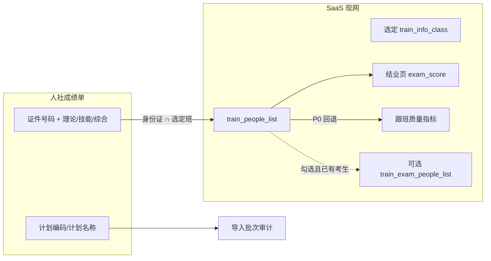
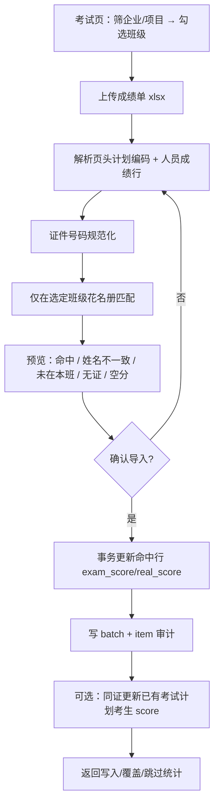

# 培训考试 · 成绩单导入匹配班级人员 · 实现方案

> **日期**：2026-08-18  
> **状态**：已按实表与现网修订（可拍板后开发）  
> **入口**：培训管理 → 考试页（`TrainingFollowExamPage`，现为空壳）  
> **样表**：人社《职业技能等级认定成绩花名册》（例：技师 17 人）；匹配目标为开班准备各班 `train_people_list`  
> **关联**：[培训考试流程实现方案.md](./培训考试流程实现方案.md)、[结业与毕业典礼实现方案.md](./结业与毕业典礼实现方案.md)  
> **原则**：不改认定主库、不改跟班模拟考、不写 PHP；一次上传成绩单，按身份证写入**已选定班级**的花名册成绩  

---

## 0. 结论（先看）

**产品一句话**：上传人社成绩花名册 → 解析本场（计划编码）人员成绩 → 按身份证匹配**指定班级**花名册 → 预览确认 → 写入该班学员成绩。

| 问题 | 定稿（相对旧稿变更） |
|------|----------------------|
| 导入范围 | **必选班级**（可多选）；企业/培训项目只用于筛班级，**禁止**默认扫该企业全部班 |
| 「同批次」含义 | 以成绩单页头 **计划编码 / 计划名称** 标识本场考试；写入审计。P0 **不强制**先建 `train_exam_list` |
| 匹配键 | **证件号码 ↔ `train_people_list.id_card`**（规范化后精确匹配）；姓名只做核对告警 |
| 候选池 | 仅选定班级、`type=student`、`deleted=0`、且花名册有身份证的行 |
| 主写 | `train_people_list`：`exam_score` / `real_score`（结业已读这些字段） |
| 跟班「考试通过率」 | 现网读 `train_exam_people_list.score`，**只写花名册时看板不变**。P0 质量指标改为：有考试计划考生分用考生表，否则回退花名册 `exam_score` |
| 不写 | 跟班模拟/刷题、PHP、认定实操主库 |

旧稿「整公司一次导入默认写所有班」与「扁平三列模板」**不能**覆盖本场人社花名册；以下按实表 + 现网重写。

---

## 1. 实表与现网对照

### 1.1 成绩单（人社认定成绩花名册）

样例页头：

| 项 | 样例 |
|----|------|
| 标题 | 职业技能等级认定成绩花名册 |
| 计划名称 | `20250726百色皓海炭极生产工二级技师-正考` |
| 计划编码 | `250717S0018450010030016` |
| 考试时间 | `2025-07-26 08:00 - 2025-07-27 17:30` |

人员区（合并表头「考核成绩」下分四列）：

| 列 | 用途 |
|----|------|
| 序号 | 忽略 |
| 准考证号 | 审计留存，P0 不参与匹配 |
| 姓名 | 与花名册核对，不一致标黄仍可按证写入 |
| 性别 | 忽略 |
| **证件号码** | **唯一匹配键** |
| 机构名称 | 培训机构名，**不是**班级 `company_id`，禁止用来滤班 |
| 职业工种 / 技能等级 | 预览展示；可选与班级工种核对告警 |
| 理论 / 技能 / 综合 / 工作业绩 | 见 §4 分数字段映射；`—` 视为空 |

布局特征：多行页头 + 合并单元格，**不是**首行即表头的扁平表。解析必须跳过页头、识别「姓名+证件号码」行（可复用 `TrainPlanRosterParseService` 的表头扫描思路）。

### 1.2 「各班花名册」= 系统开班花名册，不是企业报名 Excel

开班准备「学员列表」来自 `train_people_list`（`class-student-import` / 资料收集导入后）：

| 花名册字段 | 列表 API | 本功能用法 |
|------------|----------|------------|
| `id` | `id` | 写入主键 |
| `train_class_id` | `train_class_id` | 限定班级 |
| `train_id` | `train_id` | 所属培训项目 |
| `realname` | `realname` | 姓名核对 |
| **`id_card`** | **`id_card`** | **匹配键**（无证行无法导入） |
| `exam_score` | `exam_score` | 写入「综合」（结业主分） |
| `real_score` | `real_score` | 写入「技能」 |
| `normal_score` | `normal_score` | 本成绩单无对应列，P0 不改 |
| `graduate_status` | — | 不自动结业，只供结业页展示成绩 |

企业侧「报名汇总表 / 班组花名册」若无身份证，**不能**作为本功能匹配池；那些表只用于上游分班。导入成绩时一律读库内已分班学员。

### 1.3 现网代码锚点（实现必须复用）

| 能力 | 现网 | 本功能 |
|------|------|--------|
| 考试页空壳 | `TrainingFollowExamPage` + 路由 `train_follow_exam` | 做成导入工作台 |
| 班级列表 | `POST/GET .../info-classes`，项含 `id/title/work_type_id/company_id` | 班级多选 |
| 班花名册 | `TrainPeopleListApplicationService.page` / `listClassStudents`，已出 `id_card`、`exam_score` | 候选池 + 回写 |
| 改花名册分 | `PUT /people-lists/{id}` 已有 `examScore` | 批量走专用 commit，避免逐条权限噪声 |
| Excel 表头扫描 | `TrainPlanRosterParseService.findBestHeader` | 新建 `RensheScoreRosterParseService`，勿与分班解析混用 |
| 操作范围 | `TrainingOperatorScopeService` | 企业账号只能选本企业班 |
| 结业读分 | `TrainGraduationApplicationService` 读花名册三列 | 导入后结业页立即可见 |
| 跟班考试通过率 | `TrainFollowMetricsApplicationService.computeExamPassRate` 读 **`train_exam_people_list`** | P0 必须加花名册回退，否则运营会以为「没导上」 |
| 考试计划考生 | `train_exam_list` + `train_exam_people_list.score` | P0 可选同步：仅当该培训已有考试计划且考生同证存在时更新，**不新建计划/考生** |
| 权限 | `train:exam-list:*` / `train:people-list:update` | 建议 `train:exam-list:update` **或** 花名册 update；空壳页现无独立权限码 |



---

## 2. 产品流程



操作约束：

1. 未选班级不允许 preview。  
2. 成绩单里有、但不在选定班的人 → `UNMATCHED_NOT_IN_CLASS`，不写其它班。  
3. 选定班有、成绩单没有的人 → 预览「本班未出现在成绩单」，**不清空**原成绩。  
4. 二次导入同证：**覆盖**已有分，审计记录旧分。

---

## 3. 解析规则（针对本成绩单）

新建 `RensheScoreRosterParseService`（POI，可参考分班名单的 `findBestHeader`）：

1. 扫描前 30 行，抽取 `计划名称`、`计划编码`、`考试时间`（键值同行或「标签:值」）。  
2. 定位表头：同一行或相邻两行同时出现「姓名」且（「证件号码」或「身份证」）。合并单元格向下取值。  
3. 「考核成绩」子列按表头文字绑定：`理论` / `技能` / `综合` / `工作业绩`。  
4. 数据行：证件号码 18 位（末位 X 大写）；15 位 → 失败不升位。分数去空格，`—`/`/`/`无` → 空。  
5. 至少一列有效分数才进入匹配；全空分 → `EMPTY_SCORE`。  
6. 表内同一证件号码两行且分数不同 → `SHEET_DUP_CONFLICT` 整证失败；分数相同则合并。

列别名（防其它导出）：

| 标准 | 别名 |
|------|------|
| 证件号码 | 身份证、身份证号、证件号、证号 |
| 姓名 | 学员姓名、考生姓名 |
| 综合 | 综合成绩、总评、认定成绩 |
| 理论 | 理论成绩、笔试 |
| 技能 | 技能成绩、实操、操作 |

仍提供标准扁平模板下载（身份证 / 姓名 / 综合 / 理论 / 技能），与人社表二选一自动识别。

---

## 4. 分数字段映射（P0 冻结）

| 成绩单列 | 写入 `train_people_list` | 说明 |
|----------|-------------------------|------|
| **综合** | **`exam_score`** | 结业主分；有综合必须用综合，不用理论顶替 |
| 技能 | `real_score` | 实操/技能分；空则不改原值 |
| 理论 | **不单独落库**（无理论列） | 写入审计 JSON `theoryScore`；仅当综合为空时，用理论填 `exam_score` 并在预览标注「以理论代综合」 |
| 工作业绩 | 不写库 | 仅审计；`—` 忽略 |
| （无） | `normal_score` | P0 不动 |

可选同步考试计划（勾选且该 `train_id` 下已有 `train_exam_list` 考生）：

- `train_exam_people_list.score` ← 综合（或理论代综合）  
- `normal_score` 不改  
- 无考生行则跳过，**禁止 insert 考生**

---

## 5. 匹配规则

候选 SQL 语义：

```text
train_people_list
  WHERE type = 'student'
    AND deleted = 0
    AND train_class_id IN (:selectedClassIds)
    AND id_card IS NOT NULL AND id_card <> ''
```

| 情况 | 结果码 | 处理 |
|------|--------|------|
| 选定班中该证恰好 1 行 | `MATCHED` | 可写入 |
| 选定多班中同证多行 | `MULTI_CLASS` | 预览列出班名，默认全写所选班中的命中行，可取消某一班 |
| 选定班无此证 | `UNMATCHED_NOT_IN_CLASS` | 不写；失败清单 |
| 花名册无身份证 | 不进候选池 | 班内「缺证」单独统计 |
| 姓名与花名册不同 | `MATCHED_NAME_WARN` | 可写，预览黄标 |
| 工种/等级与班级不一致 | `MATCHED_JOB_WARN` | 可写，预览黄标（班级 `work_type_id` / `work_type_level`） |
| 成绩单无证 | `NO_ID_CARD` | 不写 |

权限：`TrainingOperatorScopeService` 校验每个 `classId` 可访问。

---

## 6. 数据落库

### 6.1 主写

批量 `UPDATE train_people_list SET exam_score=?, real_score=?, update… WHERE id=? AND train_class_id=? AND deleted=0`。  
不要循环调现有单条 `update` API（审计爆炸）；专用 ApplicationService + 事务。

### 6.2 新建审计表（Flyway）

`train_exam_score_import_batch`：

- tenant、操作人、文件名/存储路径、计划名称、计划编码、考试时间原文  
- 选定 `class_ids` JSON、可选 `train_info_id`、是否同步考试计划  
- 统计：total / matched / written / overwritten / skipped / unmatched  

`train_exam_score_import_item`：

- batch_id、Excel 行号、证件号码、姓名、准考证号  
- theory/skill/comprehensive 原值  
- people_id、class_id、结果码  
- old_exam_score / new_exam_score / old_real_score / new_real_score  

### 6.3 明确不写

- 跟班模拟考 / 作业 / 刷题  
- PHP `platform_user`  
- 认定模块成绩表  
- 未选班级的花名册行  

---

## 7. API

基路径：`/api/training/exam-score-imports`  
权限：`train:exam-list:update`（若考试页无码，与花名册 `train:people-list:update` 二选一，实现时与菜单对齐）

| 方法 | 路径 | 说明 |
|------|------|------|
| GET | `/template` | 扁平标准模板 |
| GET | `/classes` | 可选 class 列表（query: companyId、trainInfoId） |
| POST | `/preview` | multipart：`classIds`（必填, 逗号或重复字段）、file |
| POST | `/commit` | previewId + 勾选的 peopleId 列表（服务端再校验证号与班级） |
| GET | `/batches` | 导入历史 |
| GET | `/batches/{id}/items` | 明细；支持导出失败 Excel |

**Preview 摘要**：

```json
{
  "planName": "20250726百色皓海炭极生产工二级技师-正考",
  "planCode": "250717S0018450010030016",
  "examTimeText": "2025-07-26 08:00 - 2025-07-27 17:30",
  "layout": "RENSHE_ROSTER",
  "classIds": [101],
  "totalRows": 17,
  "matched": 15,
  "nameWarn": 1,
  "unmatched": 2,
  "classMissingOnSheet": 3,
  "items": [
    {
      "rowNo": 8,
      "idCard": "452631197706194818",
      "name": "陈朝永",
      "ticketNo": "2507184501…",
      "theoryScore": 76,
      "skillScore": 79.4,
      "examScore": 79.5,
      "status": "MATCHED",
      "targets": [
        {
          "peopleId": 9001,
          "classId": 101,
          "classTitle": "技师17人班",
          "rosterName": "陈朝永",
          "oldExamScore": null,
          "oldRealScore": null
        }
      ]
    }
  ]
}
```

`commit` 只接受 preview 返回且用户勾选的 `peopleId`；服务端用 preview 缓存的规范化身份证再查库，防改分篡改。

---

## 8. 前端（`TrainingFollowExamPage`）

替换 Empty，保留 `TrainingProcessSteps current={6}`：

1. 筛选：企业、培训项目 → 班级多选（必填）。  
2. 上传成绩单；识别为 `RENSHE_ROSTER` 时展示计划名称/编码。  
3. 预览 Tab：可写入 / 未在本班 / 本班未出现在成绩单 / 冲突。  
4. 确认导入；Toast：`导入成功: 写入 n 人，覆盖 m，跳过 k`。  
5. 历史批次列表。  

文案标明：「写入开班花名册成绩，供结业使用；跟班模拟考分数不变。」

---

## 9. 质量指标补丁（与导入同 P0）

`computeExamPassRate` 现逻辑：按班级 `train_info_id` 查考试计划考生 `score`。成绩单导入后若未建考试计划，通过率一直为 `null`。

P0 改为：

1. 若该培训存在带分的 `train_exam_people_list`，维持原口径（及格规则不变）。  
2. 否则用本班花名册：`exam_score != null` 的学员，`exam_score >= 60`（与现网默认及格线一致，可后续改配置）计通过。  

---

## 10. 分期

### P0（建议 4–6 人日）

- 人社花名册解析 + 扁平模板兜底  
- 必选班级 preview/commit  
- 写 `exam_score`/`real_score` + 审计表  
- 考试页工作台 + 失败清单导出  
- 质量指标花名册回退  

### P1

- 勾选同步已有 `train_exam_people_list`  
- 工种/等级黄标过滤  
- preview 缓存 TTL、大表 ≤5000 行  
- 按批次回滚（用 item 旧分）  

### P2

- 与考试流程状态机打通（锁名单 → 导入 → `theory_imported`）  
- 认定实操只读同步（不替代本导入）  

---

## 11. 风险

| 风险 | 对策 |
|------|------|
| 扫错班、写到同企业其它班 | 必选班级；未选不匹配 |
| 用机构名称当企业过滤 | 禁止；机构列只展示 |
| 综合 vs 理论写错结业分 | 冻结 §4：综合优先 |
| 花名册缺身份证 | 导入前班内缺证列表；走资料收集补证后再导 |
| 与模拟考混淆 | 文案 + 不写 follow_task |
| 考试通过率不刷新 | §9 回退花名册 |

---

## 12. 验收（P0）

- [ ] 选定「技师班」，上传 17 人成绩花名册，本班 17 人同证 → 17 行 `exam_score`=综合、`real_score`=技能  
- [ ] 成绩单多出 2 人（未分进该班）→ 未匹配，其它班分数不变  
- [ ] 本班有人缺证 → 计入缺证，不误匹配姓名  
- [ ] 姓名与花名册不一致 → 黄标仍可确认写入  
- [ ] 二次导入不同综合分 → 覆盖且批次有旧分  
- [ ] 结业页立刻看到新分；跟班模拟考分不变  
- [ ] 无考试计划时，跟班「考试通过率」按花名册 `exam_score` 计算  
- [ ] 企业账号不能选其它企业班级  

---

## 13. 实现清单（对照现网文件）

| 项 | 动作 |
|----|------|
| `RensheScoreRosterParseService` | 新建 |
| `ExamScoreImportApplicationService` | 新建 preview/commit |
| `TrainExamScoreImport*Entity/Mapper` | 新建 + Flyway |
| `ExamScoreImportController` | 新建 `/training/exam-score-imports` |
| `TrainFollowMetricsApplicationService#computeExamPassRate` | 花名册回退 |
| `TrainingFollowExamPage.tsx` | 替换空壳 |
| `trainApi` / types | 新增 preview/commit 类型 |
| 单测 | 人社样表解析（合并表头、计划编码、— 空分）+ 跨班不写入 |

---

*本方案落地后，考试页承接「人社成绩花名册 → 指定班花名册」；考试计划菜单保持独立。未建考试计划也不阻塞结业用分。*
