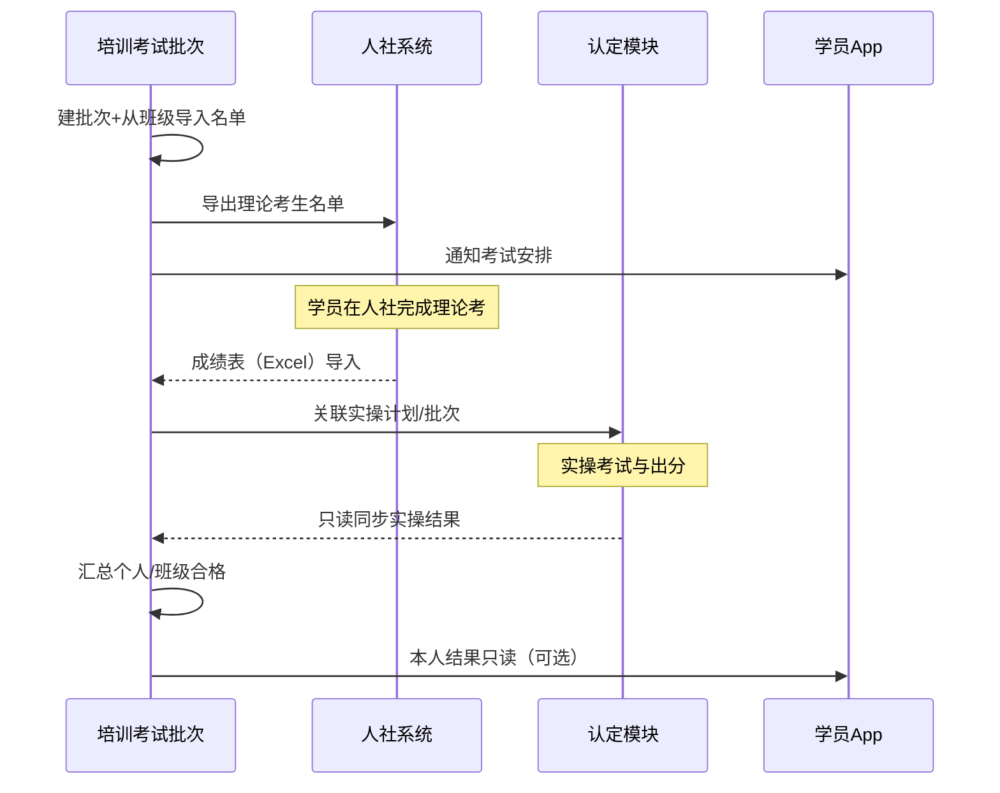

# 培训考试流程实现方案

> **日期**：2026-08-12  
> **状态**：方案稿（**先拍板 → 再开发**；未完成「九、待拍板」定稿前禁止编码）  
> **工程**：`qianlvguoyu_saas`（`platform-api` + `admin-web`）+ App `gjjd_appnext`（通知/进度只读）  
> **上游**：  
> - [培训模块_对外售卖介绍与功能需求说明.md](./培训模块_对外售卖介绍与功能需求说明.md) §3.8–3.9  
> - [考试计划功能复刻方案.md](./考试计划功能复刻方案.md)（`train_exam*` 名单/成绩骨架）  
> - [补贴与人社扩展实现方案.md](./补贴与人社扩展实现方案.md)（人社材料 L1–L3，本方案不替代）  
> - [跟班班级模拟试卷_实现方案.md](./跟班班级模拟试卷_实现方案.md)（模拟考 ≠ 正式认定分）  
> - [学员刷题已做未做覆盖_实现方案.md](./学员刷题已做未做覆盖_实现方案.md)（备考通道）  

---

## 〇、执行纪律（必读）

| 步骤 | 动作 | 产出 |
|------|------|------|
| **1. 拍板** | 产品 / 业务确认 **§九 待拍板** 每一项 | 在本文件「拍板结论」栏填写定稿值 + 日期 + 责任人 |
| **2. 冻结口径** | 更新 §三 结论表为「已定稿」 | 本文件状态改为「已拍板，可开发」 |
| **3. 分期开发** | 按 §七 P0 → P1 → P2 实施 | PR / 验收勾选 §八 |

**未完成步骤 1–2，不得开工编码、不得开 Flyway、不得上菜单空壳充数。**

---

## 一、背景与问题

### 1.1 业务事实（现状）

| 考试类型 | 实际发生地 | 成绩可见位置 |
|----------|------------|--------------|
| **理论** | 人社局考试系统 | 人社侧可导出成绩表 |
| **实操** | 认定业务侧组织/录入 | **认定模块**可看成绩 |
| **班级模拟考 / 刷题** | 跟班 + App | 教学过程分，非认定主成绩 |

培训链路到「考试」节点时，若在培训模块再造一套机考/再录一套实操分，会与人社、认定双真相源冲突。

### 1.2 目标

1. 培训侧提供可运转的 **考试流程（批次）**：排考、名单、状态、收分、班级通过率。  
2. **理论**：外考内导（人社导出 → 培训导入）。  
3. **实操**：认定出分、培训 **引用**（不重复主录）。  
4. 与跟班模拟/刷题严格隔离：备考可看，**不进正式通过率**。  
5. 为结课、补贴材料预留同一成绩口径挂载点。

### 1.3 非目标

| 不做 | 原因 |
|------|------|
| 在培训/App 内替代人社理论机考 | 考场在人社 |
| 在培训内再造认定实操考场与主成绩库 | 真相源在认定 |
| 把跟班模拟分默认计入认定/培训正式通过率 | 已有产品红线 |
| 一期做人社正式 API/RPA 代考代填 | 归补贴/人社 L3 可选；本方案 P0 用导入 |
| 一期改造认定子系统内部考务 | 只约定关联键与只读接口 |

---

## 二、产品定位（一句话）

**培训「考试流程」= 排考与收分中枢，不当第二套考场。**  
理论「外考内导」，实操「认定出分、培训引用」，模拟/刷题只做备考。

```text
跟班备考（刷题/模拟）
        │
        ▼
培训 · 考试批次（名单 / 状态 / 汇总）
   ├─ 理论 ──导出名单──► 人社系统 ──导出成绩──► 培训导入
   └─ 实操 ──关联计划──► 认定模块 ──成绩只读──► 培训展示
        │
        ▼
班级通过率 / 结课 / 补贴材料（同源口径）
```

---

## 三、结论表（拍板后改为定稿）

> 下列「建议」仅供拍板参考；**以 §九 拍板结论为准**。拍板前本表视为草案。

| # | 问题 | 建议默认 | 拍板后定稿 |
|---|------|----------|------------|
| D1 | 综合合格规则 | 理论合格 **且** 实操合格 | 〔待填〕 |
| D2 | 实操关联键 | 租户 + 身份证 + 工种/等级 + 认定计划(或批次)ID | 〔待填〕 |
| D3 | 理论多次导入 | **以最新导入批次覆盖**个人理论分；保留导入历史审计 | 〔待填〕 |
| D4 | 跟班模拟/刷题分 | **永不**进入本流程正式通过率；考试页可链到备考，仅参考 | 〔待填〕 |
| D5 | 理论及格线 | 批次可配，默认 60；或按工种等级配置表 | 〔待填〕 |
| D6 | 实操「合格」取值 | 优先读认定「是否合格」；无则按认定分+及格线折算 | 〔待填〕 |
| D7 | 缺考/缓考 | 名单级状态：`absent` / `deferred`；不参与通过率分母或单独统计（二选一） | 〔待填〕 |
| D8 | 与旧 `train_exam` 关系 | **复用并扩展**考试计划为「考试批次」载体，避免第二套主表 | 〔待填〕 |
| D9 | App 学员可见范围 | P0：考试时间通知 + 本人理论/实操结果只读；不做机考 | 〔待填〕 |
| D10 | 认定改分后培训侧 | P0 手动「同步实操成绩」；P1 定时/事件只读刷新 | 〔待填〕 |

---

## 四、职责切分

| 职责 | 归属 |
|------|------|
| 建考试批次、维护名单、状态看板、理论导入、通过率 | **培训 · 考试流程** |
| 理论机考与原始分 | **人社系统**（培训只收导出文件） |
| 实操考试执行与主成绩 | **认定模块** |
| 班级模拟考、刷题覆盖 | **跟班 / appsmart**（备考） |
| 补贴材料引用成绩 | **补贴方案**（消费本批次汇总，不另算） |

---

## 五、流程设计

### 5.1 主路径



### 5.2 状态机（批次）

建议批次状态（拍板 D8 确认落表后实现）：

| 状态 | 含义 |
|------|------|
| `draft` | 草稿，名单可改 |
| `roster_ready` | 名单锁定，可导出给人社 / 可关联认定 |
| `theory_pending` | 理论考试进行中/待导分 |
| `theory_imported` | 理论分已导入 |
| `practical_pending` | 实操进行中/待同步 |
| `practical_synced` | 实操结果已同步 |
| `closed` | 已关闭（通过率冻结或仅只读） |

名单行建议子状态：`pending` / `theory_done` / `practical_done` / `passed` / `failed` / `absent` / `deferred`。

### 5.3 理论导入（P0）

1. 模板列至少：身份证、姓名、理论成绩；（可选）是否合格、缺考标记、人社准考证号。  
2. 匹配键：**身份证**（主）+ 姓名校验告警。  
3. 未匹配行进入「失败清单」可下载，不阻断已匹配写入。  
4. 每次导入写 `import_batch_id` + 操作人 + 时间（满足 D3 审计）。

### 5.4 实操引用（P0 过渡 → P1 贯通）

| 阶段 | 做法 |
|------|------|
| P0 | 批次上填写「认定计划/批次 ID」或外链；名单上可 **手工勾选实操合格** 或粘贴认定分（过渡，需权限） |
| P1 | 按 D2 关联键批量只读拉取认定成绩/合格标志；提供「同步实操成绩」按钮（D10） |

**禁止** P1 及以后仍以手工主录为唯一真相源（过渡数据需可被同步覆盖，规则拍板）。

### 5.5 通过率口径（依赖 D1/D5/D6/D7）

草案（拍板后改公式）：

```text
理论合格 = 非缺考且 (导入分 ≥ 理论及格线 或 导入标记合格)
实操合格 = 非缺考且 (认定合格标志 或 认定分 ≥ 实操及格线)
综合合格 = 理论合格 AND 实操合格   // D1 默认

班级理论通过率 = 理论合格人数 / 应考人数
班级实操通过率 = 实操合格人数 / 应考人数
班级综合通过率 = 综合合格人数 / 应考人数

应考人数：默认 = 名单人数 − 缓考；缺考是否进分母由 D7 定
```

展示必须带来源标签：`理论·人社导入` / `实操·认定`。

---

## 六、实现设计（拍板后开工）

### 6.1 与现有 `train_exam*` 的关系

现网已有考试计划骨架（见《考试计划功能复刻方案》）：

- `train_exam_list` / `train_exam_work_type_list` / `train_exam_people_list`  
- 能力：CRUD、从培训导入考生、成绩字段、身份证导入  

**建议（D8）**：在考试计划上扩展「考试流程」语义，而非新建平行主域：

| 扩展点 | 说明 |
|--------|------|
| 批次字段 | 理论考期、实操考期、及格线、认定计划 ID、状态 |
| 名单字段 | 理论分/来源批次、实操分/认定合格、子状态、缺考缓考 |
| 导入 API | 人社成绩 Excel；与现「编辑成绩」并存，导入优先可配置 |
| 同步 API | 从认定只读拉取（P1） |
| 看板 API | 班级/批次通过率拆分 |

若拍板决定「考试计划仅保留旧语义、流程另起主表」，则 D8 定稿为新建 `train_exam_batch*`，考试计划只作名单来源之一——**须在拍板栏写明，避免双写。**

### 6.2 管理端信息架构（草案）

| 入口 | 内容 |
|------|------|
| 培训 → 考试流程（或考试计划增强页） | 批次列表、状态、通过率 |
| 批次详情 | 名单、理论导入、实操关联/同步、导出给人社 |
| 跟班工作台 | 只链到「本班关联批次」进度（可选）；不嵌认定考场 |
| 认定模块 | 实操主数据不变；对外提供只读查询约定 |

### 6.3 App（D9）

- P0：消息/工作台展示考试安排；结果页只读本人理论/实操/综合。  
- **不做** App 内理论交卷。  
- 备考入口继续：班级刷题、模拟考、同步学。

### 6.4 权限（草案）

| 动作 | 建议权限 |
|------|----------|
| 建批次 / 锁名单 / 导出 | `train:exam:update` 或独立 `train:exam-flow:*` |
| 理论成绩导入 | 同上 + 审计 |
| 手工改实操（仅 P0 过渡） | 更高权限或双人确认（拍板可删） |
| 同步认定 | 只读认定权限 + 培训更新批次 |

---

## 七、分期

### P0（打通最小闭环）— **须 §九 全部定稿后启动**

1. 考试批次（基于 D8 选定载体）+ 本班名单导入/锁定  
2. 导出给人社名单模板  
3. 理论成绩 Excel 导入 + 失败清单  
4. 实操：关联认定标识 + P0 过渡录入/勾选（若 D10/P1 提前，可跳过手工主录）  
5. 批次/班级通过率三块：理论 / 实操 / 综合 + 来源标签  
6. 明确文案：模拟考/刷题不计入  

### P1

1. 认定成绩只读同步（D2/D6/D10）  
2. 缺考/缓考完整状态与通过率分母规则落地（D7）  
3. App 本人结果只读（D9）  
4. 跟班工作台展示本班批次进度入口  

### P2

1. 人社 L2/L3 交换（与《补贴与人社扩展》对齐，非本方案必做）  
2. 认定改分事件驱动刷新  
3. 补贴/结课材料一键引用本批次汇总  

---

## 八、验收（P0）

- [ ] §九 拍板结论已填写完整且状态为「已拍板，可开发」  
- [ ] 可为班级建考试批次并从花名册带出考生  
- [ ] 可导出理论名单；可导入人社成绩表并匹配到人  
- [ ] 实操结果可按拍板方式进入名单（引用或过渡录入）  
- [ ] 综合合格规则与通过率数字与 §三/§九 一致  
- [ ] 页面可见「理论·人社导入 / 实操·认定」来源说明  
- [ ] 跟班模拟考成绩 **未** 计入本流程通过率  

---

## 九、待拍板（开发前门禁）

> **使用方式**：会议定稿后，把「拍板结论」列填实，并改顶部状态。  
> **建议默认**列供讨论；不同意则改结论，不要静默按建议开干。

| ID | 议题 | 选项 | 建议默认 | 拍板结论 | 日期/人 |
|----|------|------|----------|----------|---------|
| D1 | 综合合格 | A. 理论∧实操　B. 仅认定结论　C. 可配置 | A | | |
| D2 | 实操关联键 | A. 身份证+工种等级+认定计划ID　B. 仅认定考生主键　C. 其他_______ | A | | |
| D3 | 理论再导入 | A. 最新覆盖+历史审计　B. 禁止覆盖仅追加　C. 需审批后覆盖 | A | | |
| D4 | 模拟/刷题分 | A. 永不进正式通过率　B. 可开关计入教学参考通过率（仍非认定） | A | | |
| D5 | 理论及格线 | A. 批次默认60可改　B. 按工种等级全局表　C. 以人导「是否合格」为准不看分 | A | | |
| D6 | 实操合格 | A. 认定合格标志优先　B. 只认认定分数　C. 培训侧可覆盖认定 | A | | |
| D7 | 缺考与分母 | A. 缺考计不合格且进分母　B. 缺考不计分母　C. 缓考一律剔除分母 | A+缓考剔除 | | |
| D8 | 数据载体 | A. 扩展现有 train_exam*　B. 新建 exam_batch 主表　C. 班级维度轻量表+外链认定 | A | | |
| D9 | App 能力 | A. 通知+本人结果只读　B. 仅通知　C. P0 不做 App | A | | |
| D10 | 认定改分 | A. P0 手动同步 / P1 自动　B. P0 即自动　C. 仅快照不同步 | A | | |

### 9.1 拍板检查清单（全部勾选才可开发）

- [ ] D1–D10 结论列均非空  
- [ ] 与认定负责人确认 D2/D6/D10 可对接（有表/有接口或可接受 P0 过渡）  
- [ ] 与培训教务确认人社导出列可映射（身份证必有）  
- [ ] 与产品确认 D4 文案（模拟考页、考试流程页互链方式）  
- [ ] 本文档顶部状态已改为：**已拍板，可开发**  

---

## 十、风险与依赖

| 风险 | 缓解 |
|------|------|
| 认定模块暂无稳定只读成绩 API | P0 过渡手工；P1 前必须补认定只读约定 |
| 人社导出格式各地不一 | 导入映射可配置；失败行清单 |
| 身份证匹配失败（培训名单不规范） | 导入前名单质检；失败可下载 |
| 与旧考试计划字段语义混淆 | D8 定稿后改菜单文案：「考试计划/考试流程」合一或分 Tab |
| 业务误把模拟分当正式分 | UI 强提示 + 通过率查询不含 follow mock |

---

## 十一、总结

- 培训考试流程解决的是 **排考、收分、汇总**，不是再办一场人社/认定考试。  
- **先完成 §九 拍板并改状态，再按 §七 分期开发。**  
- 理论靠导入，实操靠认定引用；跟班模拟与刷题继续服务备考，不进正式通过率（除非 D4 明确改口）。

---

## 修订记录

| 日期 | 说明 |
|------|------|
| 2026-08-12 | 初稿：流程定位、分期、待拍板门禁；明确先拍板后开发 |
