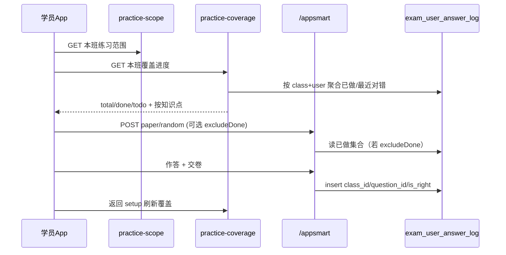

# 学员刷题「已做 / 未做」覆盖 — 实现方案

> 目标项目：`qianlvguoyu_saas`（`platform-api`）+ App `gjjd_appnext`  
> 通道：**A 班级刷题**（`/appsmart` + `classId` + practice-scope）  
> 上游基线：  
> - [班级刷题学情方案.md](./班级刷题学情方案.md)（管理端学情；本方案是 **学员侧覆盖感知**）  
> - [App端同步学与刷题作业设计实现方案.md](./App端同步学与刷题作业设计实现方案.md)（三通道边界）  
> - [跟班作业与随堂练实现方案.md](./跟班作业与随堂练实现方案.md)（双通道锁定）  
> 状态：已实现 P0+P1（覆盖接口 / 进度卡 / 答题卡 / 只练未做）  
> 编写日期：2026-08-11  
> 落地日期：2026-08-11  

---

## 一、问题与目标

### 1.1 现状

| 已有 | 缺失 |
|------|------|
| 本班练习范围（科目/知识点白名单 + `questionCount` / `typeCounts`） | 学员不知范围内 **哪些题做过、哪些没做** |
| 交卷写入 `exam_user_answer_log`（含 `class_id` / `question_id` / `is_right`） | 无「覆盖进度」只读 API |
| 作答页仅有「当前题序 / 本卷题数」 | 无本卷 **答题卡**；无知识点「已练/总量」 |
| 管理端刷题学情（人次、正确率、薄弱点） | 管的是教务视角聚合，**不替代**学员自查覆盖 |
| 错题本（最近一次仍答错） | 只覆盖「还错的题」，不是「做过/未做」全集 |

一句话缺口：**范围定了「能刷什么」，日志记了「刷过什么」，中间缺一层「覆盖差」给学员看。**

### 1.2 目标

| 角色 | 能力 |
|------|------|
| 学员 | 在本班刷题入口看到：知识点/题型维度的 **已做、未做、正确率**；作答中看到本卷答题卡 |
| 学员 | 可选择「只练未做」抽题，系统刷完范围内题库 |
| 教务 | 不新增管理端必做项；可与现有学情共用口径说明（可选二期对齐文案） |

### 1.3 非目标

| 不做 | 原因 |
|------|------|
| 把覆盖做成第二套答卷域 / 新表主存答案 | 继续投影 `exam_user_answer_log`，与学情方案一致 |
| 混算跟班作业 / 模拟卷 / 同步学（AI review）题 | 双通道 + 三通道已锁；本方案只认 appsmart 班级刷题 |
| 一期下发上万题干的「全量题清单」 | 性能与体验差；默认聚合到知识点，明细分页可选 |
| 一期改写 promote 全局刷题覆盖 | 无 `classId` 的旧入口可二期再做；本期以班级入口为准 |
| 用覆盖率替代作业完成率 / 认定成绩 | 教学参考，非认定主成绩 |

---

## 二、结论（先看）

| 问题 | 答案 |
|------|------|
| 「做过」怎么定义？ | 本班 `class_id` 下，该 `question_id` **至少有 1 条** `exam_user_answer_log`（不论对错） |
| 「未做」怎么定义？ | 本班练习范围内客观题池 − 已做集合 |
| 「还在错题本」？ | **另一口径**：最近一次作答 `is_right=0`（已落地）；与已做/未做并列展示，勿混成一个状态 |
| 数据从哪来？ | 池子 = practice-scope 展开后的 `exam_exam_detail`；已做 = answer_log 去重 `question_id` |
| 学员入口？ | `classPractice.vue` 增加「练习进度」卡片；`classPracticeExam.vue` 增加本卷答题卡 |
| 抽题要不要排除已做？ | P1 提供开关「只练未做」；默认关闭，避免老用户行为突变 |

**一句话：**  
练习范围定池 → 日志定已做 → App 展示覆盖差 → 可选只抽未做。

---

## 三、概念与口径（锁死）

### 3.1 状态机（单题，学员视角）

对范围内某一 `question_id`：

| 状态 | 条件 | 展示建议 |
|------|------|----------|
| **未做** | 本班无任何 answer_log | 灰 |
| **已做·对** | 有记录，且 **最近一次** `is_right=1` | 绿 |
| **已做·错** | 有记录，且 **最近一次** `is_right=0` | 橙/红（可点进错题重练） |
| （派生）错题本中 | 同「已做·错」 | 与错题本列表一致 |

说明：

- **已做** 只看「是否出现过」；**对/错角标** 看最近一次（与错题本「最新答对出本」一致）。  
- 答对后又答错 → 回到「已做·错」并再进错题本（已确认产品行为）。  
- 无 `class_id` 的历史日志：**不计入本班覆盖**（与学情方案一致）。

### 3.2 范围边界

与现网抽题一致（`AppExamSmartService.resolvePracticeContext` / `loadScopedQuestionPool`）：

1. 花名册校验 + 练习开关/日期窗。  
2. 白名单科目 + 知识点（含子孙展开）。  
3. 仅客观题：`type IN ('single','multi','judge')`，`deleted=0`，`status=1`。  
4. 覆盖统计默认 **整班范围**；学员在 setup 页勾选的知识点/题型，仅作为 **筛选视图与抽题过滤**，不改变「全班覆盖」主指标（UI 上写清「当前筛选」与「本班全部」）。

### 3.3 与现有指标的关系

| 指标 | 来源 | 用途 |
|------|------|------|
| `questionCount` / `typeCounts` | practice-scope | 池子大小（已有） |
| 覆盖率 `done/total` | 本方案 | 学员自查进度 |
| 正确率 | 已做题上最近一次或全部次数 | 建议：**已做题最近一次正确率**（简单、与对错角标一致） |
| 管理端学情答题数 | answer_log 条数（可重复做同一题） | **人次/次数**，≠ 覆盖题数 |
| 错题本数量 | 最近一次仍错 | ⊂ 已做·错 |

禁止把「答题次数」直接标成「已做题数」。

---

## 四、产品形态

### 4.1 分层（推荐）

```text
L0 本卷答题卡     —— 当前这一张卷里：未答 / 已答 /（交卷后）对错
L1 知识点覆盖     —— 白名单每个知识点：已做 n / 共 m，题型拆分可选
L2 只练未做       —— 抽题时排除已做 question_id
L3 未做明细列表   —— 分页列出未做题干（可选，量大时再开）
```

### 4.2 App 交互草案

#### A. 班级刷题 setup（`classPractice.vue`）

在现有「知识点 / 题型 / 顺序」卡片上方或旁侧增加 **练习进度** 卡：

| 元素 | 说明 |
|------|------|
| 总览 | `已做 {done} / 共 {total}（{rate}%）` · `未做 {todo}` · `仍错 {wrong}` |
| 知识点行 | 与现 chips 对齐：`标题（已做 a/共 b）` 或副文案 `未做 n` |
| 筛选项 | 切换「全部 / 仅看未完成知识点」 |
| 抽题开关 | 「只练未做过的题」（P1）；顺序练时若未做为 0，提示「本范围已刷完，可关开关复习或去错题重练」 |

#### B. 作答页（`classPracticeExam.vue`）

| 元素 | 说明 |
|------|------|
| 顶栏 | 保留 `i / N`；增加「答题卡」入口 |
| 答题卡弹层 | 题号网格：未答灰、已答蓝；交卷后可按对错绿/红（若本卷结果页已够，交卷前只区分已答/未答即可） |
| 点击题号 | 跳转到对应题（不改答案规则） |

#### C. 结果页（可选增强）

交卷后除分数外：`本卷答对 x · 未答 y`；若本次为「只练未做」，提示「本班覆盖提升至 z%」。

### 4.3 不做的 UI

- 首屏堆砌全部题号（九千级）。  
- 用卡片墙展示每道题干。  
- 与作业待办、模拟考待办混在同一「进度」条。

---

## 五、数据与接口

### 5.1 不新建主表

继续用：

- 池：`exam_exam_detail` + `train_class_practice_*`  
- 已做：`exam_user_answer_log`（`tenant_id, class_id, user_id, question_id, is_right, id`）  

量大再考虑二期汇总表（可选）：

| 表（二期） | 用途 |
|------------|------|
| `train_class_practice_user_coverage` | 班级×学员×知识点：done/total/wrong；异步刷新 |

一期 **实时聚合** 即可（单学员 + 白名单规模通常可接受）。

### 5.2 推荐 API

挂在学员跟班读接口旁（与 practice-scope 同鉴权：须在花名册）：

| 方法 | 路径 | 说明 |
|------|------|------|
| GET | `/training/follow/classes/{classId}/practice-coverage` | 本班覆盖总览 + 按知识点拆分 |
| GET | `/training/follow/classes/{classId}/practice-coverage/questions` | 可选：分页列出已做/未做题（轻量字段） |

抽题扩展（P1）：

| 方法 | 路径 | 变更 |
|------|------|------|
| POST | `/appsmart/paper/random` | body 增加 `excludeDone: true`；服务端排除本班已做 `question_id` |

> 亦可把 coverage 做进现有 `practice-scope` 响应（在每个 knowledge 上挂 `doneCount`），减少一次请求；但 scope 缓存/管理端复用时易脏。**推荐独立 coverage 接口**，setup 页并行请求。

### 5.3 `practice-coverage` 响应草案

```json
{
  "classId": 1001,
  "total": 9636,
  "done": 420,
  "todo": 9216,
  "wrong": 38,
  "doneRate": 4.4,
  "latestRightRate": 71.2,
  "byType": {
    "single": { "total": 5000, "done": 200, "todo": 4800, "wrong": 20 },
    "multi":  { "total": 3000, "done": 120, "todo": 2880, "wrong": 10 },
    "judge":  { "total": 1636, "done": 100, "todo": 1536, "wrong": 8 }
  },
  "knowledges": [
    {
      "knowledgeId": 12,
      "title": "安全基础",
      "total": 80,
      "done": 32,
      "todo": 48,
      "wrong": 5,
      "typeCounts": { "single": 40, "multi": 20, "judge": 20 },
      "doneTypeCounts": { "single": 18, "multi": 8, "judge": 6 }
    }
  ]
}
```

查询参数（可选）：

| 参数 | 说明 |
|------|------|
| `knowledgeIds` | 逗号分隔；只返回这些点的拆分（总览仍可给全班） |
| `types` | `single,multi,judge` |

### 5.4 核心查询思路

```text
1) allowedKnowledgeIds = expand(whitelist)   // 与抽题同口径
2) poolIds = SELECT id, knowledge_id, type FROM exam_exam_detail
             WHERE ... type IN (...) AND knowledge_id IN (...)
3) latest = 每题 MAX(log.id) WHERE class_id=? AND user_id=?
4) doneIds = latest 的 question_id 集合 ∩ poolIds
5) wrongIds = latest 中 is_right=0 ∩ poolIds
6) 按 knowledge_id / type 聚合 total/done/wrong
```

性能注意：

- 池子与抽题一样可能很大：优先 **按 knowledge_id、type 分组 COUNT**，避免把全部 id 拉到 App。  
- 已做集合：`SELECT question_id, MAX(id) ... GROUP BY question_id` 后再回表取 `is_right`，或窗口函数一次查出。  
- 索引（学情方案已建议，覆盖复用）：`(tenant_id, class_id, user_id, question_id)` 或 `(tenant_id, class_id, user_id, create_time)`；若慢再加覆盖查询专用索引。

### 5.5 `excludeDone` 抽题

在 `randomPractice` / 顺序全量组卷过滤后：

```text
pool = applyPracticeScopeFilter(...)
if excludeDone:
  done = findDoneQuestionIds(tenant, user, classId)
  pool = pool.filter(q -> !done.contains(q.id))
if pool empty -> 业务错误：「本范围内题目都做过了」
```

顺序模式 `all=true` 时同样适用：未做全集按题型/知识点排序出卷。

---

## 六、端到端链路



本卷答题卡 **仅前端状态**（`answers` / `revealed`），不依赖 coverage 接口。

---

## 七、实现落点（文件级）

### 7.1 后端 `platform-api`

| 项 | 位置 |
|----|------|
| Coverage 应用服务 | 新建 `ClassPracticeCoverageApplicationService`（或挂在 `ClassPracticeAnalyticsApplicationService` 的学员只读方法） |
| 接口 | `TrainFollowAppController`：`GET .../practice-coverage` |
| 已做 ID 查询 | `AppExamUserAnswerLogMapper`：`findLatestAnswerByQuestion` / `findDoneQuestionIds` |
| 池统计复用 | 与 `ClassPracticeScopeApplicationService.loadWhitelistTypeCounts` 同口径；避免两套展开逻辑分叉 |
| 抽题 | `AppExamSmartService.randomPractice`：读 `excludeDone` |

### 7.2 App `gjjd_appnext`

| 项 | 位置 |
|----|------|
| API | `api/class-practice.js`：`getClassPracticeCoverage` |
| Setup | `pages/class/classPractice.vue`：进度卡、chips 副文案、只练未做开关 |
| 作答 | `pages/class/classPracticeExam.vue`：答题卡弹层 |
| 结果 | `pages/class/classPracticeResult.vue`：可选覆盖文案 |

### 7.3 管理端

本期 **可不改**。若需教务看到「覆盖率」而非「答题次数」，二期在刷题学情学员表增加 `doneCount/totalCount` 列，复用同一服务口径。

---

## 八、分期交付

### P0 — 看得见（约 2～3 人日）

| 交付 | 验收 |
|------|------|
| `GET practice-coverage`（总览 + 按知识点） | 与抽题范围题量大体一致；交卷后刷新 done↑ |
| setup 页进度卡 + 知识点「a/b」 | 未登录/非本班 403/业务错 |
| 作答页答题卡（本卷已答/未答） | 点击可跳题 |

### P1 — 用得上（约 2 人日）

| 交付 | 验收 |
|------|------|
| `excludeDone` 抽题 | 未做为 0 时明确提示；关闭开关可复习已做 |
| 题型维度 done/todo | 与 chips「单选（n题）」并存不打架 |
| 仍错数跳转错题重练 | 与 wrong-replay 现网一致 |

### P2 — 可选增强

| 交付 | 说明 |
|------|------|
| 未做题分页列表 | 仅 id/题型/知识点/题干摘要 |
| 覆盖汇总表 + 定时刷新 | 大班超大题库时 |
| 无 classId 全局刷题覆盖 | promote 入口另开需求 |
| 管理端学员覆盖率列 | 与学情 Tab 对齐文案 |

---

## 九、验收清单

- [ ] 从班级进入刷题，coverage 的 `total` 与 scope 汇总题量同口径（允许展开子孙导致的说明文案一致）  
- [ ] 新账号全未做：`done=0, todo=total`  
- [ ] 交一卷后：对应题进入已做；再打开 setup，进度增加  
- [ ] 同一题再练答对：仍计已做；若曾错则 wrong 减少（最近一次口径）  
- [ ] 答对出本后再答错：wrong 增加，覆盖 done 不变  
- [ ] 作业/模拟考交卷 **不** 计入本覆盖（无 appsmart class 日志或不同表）  
- [ ] 「只练未做」不会抽到已做 id；刷完提示友好  
- [ ] 本卷答题卡与交卷未答校验一致  

---

## 十、风险与对策

| 风险 | 对策 |
|------|------|
| 范围展开与抽题 COUNT 不一致 | 强制复用同一 `expandKnowledge` + type/status 过滤；单测对齐 |
| 题库上万，实时聚合慢 | 先按知识点 GROUP BY；P2 汇总表；接口加短缓存（如 30s，交卷后客户端强制刷新） |
| 学员把「答题次数」当成覆盖 | UI 文案固定「已做题数 / 范围内题数」 |
| 只练未做导致「没事可刷」 | 空态引导：关开关复习 / 错题重练 / 换知识点 |
| 历史无 class_id 日志 | 不计本班覆盖；文案：「仅统计从本班入口练习的记录」 |

---

## 十一、决策待拍板（开发前确认）

| # | 问题 | 建议默认 |
|---|------|----------|
| 1 | 「已做」是否要求交卷才算，即时答对出本（wrong/resolve）算不算？ | **算**（已有 log 即算）；与 resolve 写入一致 |
| 2 | 正确率用最近一次还是历史全部次数？ | **已做题上最近一次** |
| 3 | 进度主指标看「本班全部」还是「当前勾选知识点」？ | 主指标本班全部；勾选时副行显示筛选覆盖 |
| 4 | P0 是否上「只练未做」？ | **P1**；P0 先展示 |
| 5 | 是否在 practice-scope 内嵌 doneCount？ | **独立 coverage 接口** |

---

## 十二、总结

在 **不新建答卷域、不打破双通道** 的前提下，用练习范围做分母、用带 `class_id` 的 `exam_user_answer_log` 做分子，给学员三层能力：**本卷答题卡 → 知识点覆盖进度 → 只练未做**。  

与 [班级刷题学情方案.md](./班级刷题学情方案.md) 的关系：学情是教务看「谁刷了、刷得怎样（次数/正确率）」；本方案是学员看「题库刷到哪了（覆盖差）」。二者共用日志，指标勿混用。
