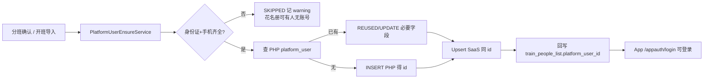
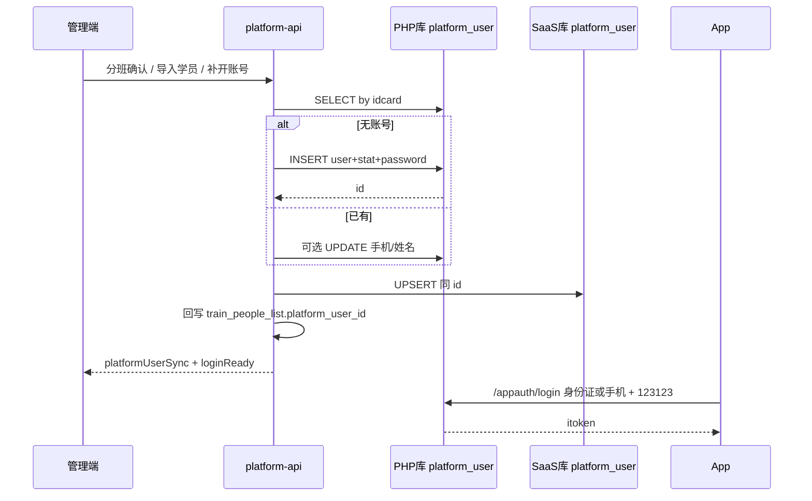

# 学员账号同步方案（确保班级学员可登录 App）

> **状态**：待评审 / 待开发  
> **日期**：2026-08-17  
> **目标**：分班企业确认、开班准备导入等路径产生的班级学员，**能用现有 App 登录协议正常登录**  
> **上游**：  
> - [企业确认分班后同步学员信息方案.md](./企业确认分班后同步学员信息方案.md)（SaaS `platform_user` ensure，已部分落地）  
> - [方案A_App登录PHP签发与SaaS令牌镜像验票实现方案.md](./方案A_App登录PHP签发与SaaS令牌镜像验票实现方案.md)（登录仍走 PHP）  
> - [培训模块_App端实现方案.md](./培训模块_App端实现方案.md)  
> **代码锚点**：`PlatformUserEnsureService`、`TrainDivisionApplicationService`、`TrainPeopleListApplicationService`、`PlatformSyncService`  
> **实现拆解**：[学员账号同步_实现方案.md](./学员账号同步_实现方案.md)（结合现网类/数据源/任务拆分）

---

## 一、结论（先看）

| 问题 | 答案 |
|------|------|
| 学员为什么进班了却登不上 App？ | App 登录查 **PHP `gjjddb.platform_user`**；现行 ensure 只写 **SaaS `gjjddb2026.platform_user`**（常为高位 id），PHP 无号 → 提示未创建账号 |
| 要不要改 App 登录？ | **不要**（保持方案 A：PHP 签发 `itoken`） |
| 正确做法？ | **开户以 PHP 为准双写**：先确保 PHP 有账号 → 同 id 写入/对齐 SaaS → 回写花名册 `platform_user_id` |
| 默认密码？ | 新建仍为 **`123123`**（与 PHP `md5(password.stat)`、学员信息页一致） |
| 谁触发？ | 分班 pack 企业确认物化、开班准备导入学员、班级「补开/同步 App 账号」、历史补跑 |

**一句话：**  
班级花名册开户必须让 **PHP 与 SaaS 同 id 可见**；只写 SaaS 不算「可登录」。



---

## 二、现状与断层

### 2.1 已落地（不够）

| 能力 | 说明 |
|------|------|
| SaaS ensure | `PlatformUserEnsureService.ensureFromDivisionPerson`：按身份证 upsert SaaS `platform_user` + 轻量 detail |
| 触发 | 分班 `materializePackTask`、开班准备 `importStudents*`、`sync-platform-users` |
| 花名册 | 写入 `train_people_list.platform_user_id` |
| 同步方向 | `PlatformSyncService`：**仅 PHP → SaaS**（读 PHP、镜像三表） |

### 2.2 断层

```text
企业确认 / 导入学员
  → ensure 写入 SaaS（id 常 ≥ 10 亿）
  → 花名册绑定该高位 id
  → App 登录 PHP /appauth/login
  → PHP 按身份证/手机查 platform_user → 无行
  → 「您还没在平台创建账号」
```

| 现象 | 根因 |
|------|------|
| 管理端「学员信息」能看到新建学员 | 查的是 SaaS 库 |
| App 登不上 | 签发在 PHP 库，高位号未进 PHP |
| 若干老学员能登 | 其人早在 PHP，同步到 SaaS 后走 REUSED |

方案 A 已明确：**禁止用「SaaS 单开、未回写 PHP」的账号做可登录验收**。本方案补齐该缺口。

---

## 三、目标与非目标

### 3.1 目标

1. 班级学员（证号+手机齐全）在开户成功后，**≤1 个同步周期内**可用 App 登录（目标：**接口返回后即可登**，不等同步）。  
2. 花名册 `platform_user_id` = **PHP 真实 id**（与镜像表一致，避免绑错高位 id）。  
3. 已有 PHP 账号：**不重置密码**；可按规则补手机/姓名。  
4. 脏数据可跳过并返回 `platformUserSync` 统计，不阻断整班确认。  
5. 历史「仅 SaaS 高位号」班级可补跑对齐。

### 3.2 非目标

| 不做 | 原因 |
|------|------|
| 改 App 登录为 SaaS 签发（方案 B） | 与现网提升/考试会话解耦成本高 |
| 登录时自动注册 | 权限与刷号风险（与分班方案一致） |
| 同步全量申报资料到 detail | 仍归开班准备资料收集 |
| 改 `PlatformSyncService` 为双向全量同步 | 本方案只做**开户写路径**；日常仍 PHP→SaaS |

---

## 四、架构设计

### 4.1 开户权威与镜像

| 库 | 角色 |
|----|------|
| PHP `gjjddb.platform_user` | **登录权威**；App `/appauth/login` 只认它 |
| SaaS `gjjddb2026.platform_user` | 管理端学员信息、花名册绑定、SaaS API 验票镜像 |
| `PlatformSyncService` | 持续 PHP→SaaS；开户双写后应与之**同 id 兼容**（勿被同步任务删高位保护逻辑误伤） |

### 4.2 推荐开户顺序（强制）

```text
1. 校验身份证 18 位、手机 11 位
2. 查 PHP.platform_user（idcard，deleted=0）
   - 命中 → REUSED / 按规则 UPDATE 手机姓名（不改 password/stat）
   - 未命中 → 查手机冲突 → INSERT PHP（password=md5('123123'+stat)）→ 取 id
3. Upsert SaaS.platform_user：**显式使用同一 id**（禁止再 AUTO 出一个高位 id）
4. syncDetail 轻量壳（两侧按需；至少 SaaS 与现逻辑一致）
5. 返回 platformUserId（= PHP id）→ 写花名册
```

密码算法（与 PHP `AppauthController` 一致）：

```text
stat = 4 位随机串
password = md5( 明文密码 + stat )   // 默认明文 123123
登录校验：md5(用户输入 + user.stat) == user.password
```

### 4.3 id 策略

| 场景 | 策略 |
|------|------|
| PHP 已有账号 | 一律用 PHP id；SaaS 无则插入同 id，有则按 id 更新 |
| PHP 新建 | 使用 PHP 自增 id；SaaS `INSERT` 指定该 id |
| 历史 SaaS 高位孤儿（id≥10亿，PHP 无同证） | 补跑时在 PHP **新建**得新 id，花名册改绑新 id；SaaS 高位行标记废弃或软删（避免双号）——见 §八 |
| 同步任务 | 继续保护「SaaS 本地高位行不被 PHP 对账删除」；开户成功后以 PHP 号为准，高位行不再作为花名册绑定 |

### 4.4 时序



---

## 五、触发点（全覆盖）

| # | 触发 | 入口 | 是否双写 |
|---|------|------|----------|
| T1 | 分班方案企业确认物化 | `POST /training/division/pack-tasks/{id}/company-confirm` | **是**（主路径） |
| T2 | 开班准备导入学员 | `TrainPeopleListApplicationService.importStudents*` | **是** |
| T3 | 分班历史补跑 | `POST .../sync-platform-users` | **是**（改为 PHP 优先） |
| T4 | 班级「补开/同步 App 账号」 | 新建 API：按 `classId` 扫花名册 | **是**（运营） |
| T5 | 学员信息页手工新建 | `PlatformUserApplicationService.save` | **建议同期改造**为双写，避免管理端再建孤儿 |
| — | 班级页仅 `info-classes/{id}/company-confirm` | 只改确认状态 | **否**（不开户） |
| — | 信息收集 ensure-collection | 只建收集计划 | **否** |

返回体统一扩展（在现有 `platformUserSync` 上）：

```json
{
  "created": 3,
  "reused": 10,
  "updated": 1,
  "skipped": 2,
  "phpWritten": 3,
  "loginReady": 14,
  "warnings": [
    { "name": "张三", "idCard": "…", "reason": "缺少有效手机号，无法开 App 账号" }
  ]
}
```

`loginReady` = 本批结束后，PHP 侧可登录人数（created+reused+updated，且非 skipped）。

---

## 六、同步规则（字段）

与 [企业确认分班后同步学员信息方案.md](./企业确认分班后同步学员信息方案.md) §五 对齐，并增加 PHP 侧：

| 输入 | 规则 |
|------|------|
| 身份证 | **必填** 18 位；否则 SKIPPED |
| 手机 | **必填** 11 位；否则 SKIPPED |
| 姓名 | 写入 realname；空则暂用手机号（与现网一致） |
| 企业/机构 | 能填则填 `company_id` / `org_id`（PHP+SaaS） |
| 密码 | **仅新建** 写 `123123`；REUSED **永不改密** |
| 手机冲突（证号不同） | SKIPPED 或保留原手机 + warning（与现策略一致） |
| 证号命中、手机变更 | 更新手机（PHP+SaaS），打审计日志 |

**禁止：** 在 App 登录接口 insert 用户。

---

## 七、实现落点

### 7.1 核心服务改造

| 组件 | 改造 |
|------|------|
| `PlatformUserEnsureService` | 拆为 `ensureOnPhp` + `mirrorToSaas(sameId)`；`CREATED` 必须已写 PHP |
| `PhpPlatformUserWriter`（新建） | 封装 `phpJdbcTemplate` 的 SELECT/INSERT/UPDATE；密码与 PHP 一致 |
| 数据源权限 | PHP 账号除 SELECT 外，开户库需 `INSERT,UPDATE` on `platform_user`、`platform_user_detail`（专账或扩权，生产最小权限） |
| `PlatformUserApplicationService.save` | 管理端新建学员走同一双写，避免再产高位孤儿 |
| 配置 | `platform.user-provisioning.php-write-enabled=true`；`false` 时仅 SaaS（开发降级，**禁止生产长期 false**） |

### 7.2 调用方

| 服务 | 改动 |
|------|------|
| `TrainDivisionApplicationService.materializePackTask` | 已调 ensure → 自动吃到双写；确认返回含 `loginReady` |
| `TrainPeopleListApplicationService.importOneFromSignUp` | 同上 |
| `TrainDivisionApplicationService.syncPlatformUsersForPackTask` | 补跑走新 ensure |
| 新建 `POST /training/info-classes/{id}/people/sync-app-accounts` | 班级维度补开；前端开班准备/花名册按钮 |

### 7.3 前端

| 页面 | 提示 |
|------|------|
| 分班企业确认成功 | 「已同步 App 账号：新建 x / 复用 y；默认密码 123123；跳过 z 见明细」 |
| 开班准备导入成功 | 同上；强调跳过者需补手机/身份证后再「补开」 |
| 花名册 | 「补开 App 账号」+ 列表标识：已绑定 / 未开户 / 仅 SaaS 待对齐 |

### 7.4 运维与开关

```yaml
platform:
  user-provisioning:
    php-write-enabled: true
    default-password: "123123"   # 仅新建；勿用于日志明文外泄
    fail-fast-on-php-error: false # false=单人失败记 warning；整班继续
```

PHP 授权示例：

```sql
GRANT SELECT, INSERT, UPDATE ON gjjddb.platform_user TO 'saas_sync'@'<SaaS-IP>';
GRANT SELECT, INSERT, UPDATE ON gjjddb.platform_user_detail TO 'saas_sync'@'<SaaS-IP>';
-- token 表仍只需 SELECT（由 App 登录签发，本方案不写 token）
```

---

## 八、历史数据治理

### 8.1 类型

| 类型 | 特征 | 处理 |
|------|------|------|
| A 无绑定 | `platform_user_id` 空 | 走新 ensure 双写 |
| B 绑 PHP 同步号 | id &lt; 10 亿且 PHP 有行 | 校验手机；已 loginReady |
| C SaaS 高位孤儿 | id ≥ 10 亿，PHP 无同证 | PHP 新建 → 花名册改绑 → SaaS 插新 id；旧高位行 soft-delete 或打标 `orphaned` |
| D 证号在 PHP 与 SaaS 各一行且 id 不同 | 数据脏 | **以 PHP 为准**改绑花名册；SaaS 高位行废弃 |

### 8.2 补跑入口

1. 按 pack-task：`sync-platform-users`（改造后）。  
2. 按班级：`POST .../people/sync-app-accounts`。  
3. 运维批处理：输出 CSV（classId, name, idCard, oldUserId, newUserId, outcome）。

### 8.3 验收抽检 SQL（示意）

```sql
-- 班级学员已绑账号但 PHP 无此人（应在补跑后为 0）
SELECT p.id, p.realname, p.platform_user_id
FROM gjjddb2026.train_people_list p
WHERE p.deleted = 0 AND p.type = 'student' AND p.class_id = ?
  AND p.platform_user_id IS NOT NULL
  AND NOT EXISTS (
    SELECT 1 FROM gjjddb.platform_user u
    WHERE u.id = p.platform_user_id AND u.deleted = 0
  );
```

---

## 九、分期与验收

| 阶段 | 交付 | 验收 |
|------|------|------|
| **P0** | `PhpPlatformUserWriter` + ensure 双写；分班确认 / 导入学员走通 | 新建学员 **App 立即登录成功**（123123） |
| **P1** | 班级补开按钮 + 返回 `loginReady`；管理端新建学员双写 | 历史班补跑后抽检可登 |
| **P2** | 高位孤儿治理脚本/批处理；监控告警 | 类型 C/D 清零或可报表 |

### 验收清单（P0 必过）

1. 新分班确认：证号+手机齐全的学员，App 用身份证或手机 + `123123` 登录成功。  
2. 开班准备导入：同上。  
3. 已存在 PHP 老学员：密码不变，花名册 id 为 PHP id。  
4. 缺手机/缺证：确认/导入不失败，warnings 可见，App 仍不可登（预期）。  
5. 手机被他人占用：不造脏号，有 warning。  
6. `php-write-enabled=false` 时行为与现网一致（仅 SaaS），生产配置检查项标红。  
7. `PlatformSyncService` 仍正常；双写用户不被对账删掉。

---

## 十、风险与对策

| 风险 | 对策 |
|------|------|
| PHP 写权限过大 | 专账、仅两表 INSERT/UPDATE；审计日志 |
| 双写一半成功 | 单人事务：PHP 成功后再写 SaaS；SaaS 失败则记补偿队列重试镜像（花名册暂不绑或绑 PHP id 等镜像） |
| 密码算法不一致 | 单测对齐 PHP `md5(pwd+stat)`；禁止只写明文 |
| 同步任务覆盖双写字段 | 开户字段与 PHP 一致；手机更新两边同写 |
| 误重置老用户密码 | REUSED 路径禁止 update password/stat |
| 高位号与 PHP 新号并存 | 补跑改绑；UI 展示「待对齐」 |

---

## 十一、拍板项（Gate）

| # | 项 | 推荐 |
|---|-----|------|
| G1 | 登录权威 | **继续 PHP**（本方案双写，不改方案 A） |
| G2 | 新建默认密码 | **123123** |
| G3 | 无手机 | **跳过开户**（强制补手机） |
| G4 | 管理端手工建学员 | **同步改造双写**（P1） |
| G5 | 高位孤儿 | **PHP 新建 + 改绑**（不把高位 id 插入 PHP，避免污染自增策略则另议） |
| G6 | 生产开关 | `php-write-enabled` 必须 true 方可宣称「可登录」 |

---

## 十二、文档关系

| 文档 | 关系 |
|------|------|
| 本文 | **可登录闭环**权威：PHP↔SaaS 开户双写 |
| 企业确认分班后同步学员信息方案 | SaaS ensure 字段/触发；本文补其「App 真登录」缺口 |
| 方案 A 登录 | 签发与镜像验票不变；本文保证「有号可签」 |
| App 同步学 / 跟班 | 依赖本方案后的可登录学员 |

---

## 十三、修订记录

| 日期 | 说明 |
|------|------|
| 2026-08-17 | 初稿：针对 SaaS 单开无法 App 登录，提出 PHP 优先双写与补跑治理 |

---

*P0 完成标志：分班确认或开班导入的新建学员，能在 App 用默认密码登录成功；花名册 `platform_user_id` 与 PHP `platform_user.id` 一致。*
