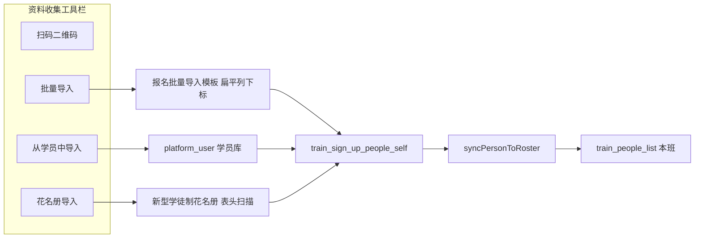

# 开班准备 · 资料收集 · 花名册导入 · 实现方案

> **日期**：2026-08-18  
> **状态**：可拍板后开发（本文只定方案，不改代码）  
> **入口**：开班准备 → 班级「资料收集」→ 工具栏 **花名册导入**（`ClassSignUpPeoplePanel`，按钮已占位）  
> **样表**：`文件/各班花名册/高级3班花名册.xlsx`（《新型学徒制培训学员花名册》）；同目录技师 1 班、高级 2/4 班版式一致  
> **关联**：现网「批量导入」、`ClassCollectionApplicationService`（收集计划 ↔ 班级花名册双写）、[学员账号同步_实现方案.md](./学员账号同步_实现方案.md)（ensure 双写 PHP）  
> **原则**：不改「批量导入」列约定；不吃人社成绩花名册；不写认定主库；导入范围仅**当前班级**的资料收集计划  

---

## 0. 结论（先看）

**产品一句话**：在资料收集里上传企业《新型学徒制培训学员花名册》→ 按表头识别人员行 → 写入本班资料收集名单 → 同步本班学员花名册 → **ensure 学员 App 账号（PHP 登录权威 + SaaS 同 id 镜像）**。

| 问题 | 定稿 |
|------|------|
| 入口 | 资料收集工具栏「花名册导入」，**当前班、当前 `signUpId`** |
| 模板 | 企业实表（多行页头 + 合并单元格），**不是**「报名批量导入模板.xlsx」 |
| 主写 | `train_sign_up_people_self`（资料收集列表） |
| 同步写 | `train_people_list`（本班 `type=student`），走现有 `syncPersonToRoster` |
| App 账号 | **复用** `PlatformUserEnsureService.ensureFromDivisionPerson`（与报名「批量导入」同一条路）；**新建/补开必须写 PHP `platform_user`**，再镜像 SaaS，App 才能 `/appauth/login` |
| 匹配键 | **身份证号码**（规范化后精确匹配）；本计划内重复则跳过或补空 |
| 必填 | 姓名 + 18 位身份证；手机号 11 位（与现网批量导入一致，缺则该行失败） |
| 与「批量导入」 | **并列、不混用**：后者仍吃扁平模板；本功能吃学徒制花名册 |
| 与「从学员中导入」 | 不替代；花名册导入面向企业线下 Excel |
| P0 交互 | 上传即导入 + 结果摘要（插入 / 跳过 / 失败行），不做列映射向导 |
| P1 | 预览确认、班期与班级标题核对告警、合同日期更严解析 |

现网「批量导入」按**列下标**读首行表头表，直接喂这份花名册会把页头当数据、列全错。必须单独解析器。

---

## 1. 实表结构（四班一致）

样例：高级 3 班，Sheet1，13 列，约 39 名学员。

### 1.1 页头（导入时只展示、不入库）

| 区域 | 内容（样例） |
|------|----------------|
| 标题 R1–R2 合并 | 新型学徒制培训学员花名册 |
| 企业 | 百色皓海碳素有限公司 |
| 合作培训机构 | 广西现代职业技术学院 |
| 班期 | 2024年百色市市本级第3班（炭极生产工高级工） |
| 班期编号 | 多为空 |

P0 **不**用页头匹配班级（入口已绑定当前班）。预览里可带出班期文案，便于人工确认传错班。

### 1.2 人员表头（R5，部分列与 R6 纵向合并）

| 列 | 表头 | 写入字段 | 规则 |
|----|------|----------|------|
| 1 | 序号 | — | 忽略 |
| 2 | 姓名 | `name` | 必填 |
| 3 | 性别 | `gender` | 原样（男/女） |
| 4 | 民族 | `nation` | 原样（如壮族） |
| 5 | 学历 | `education` | 原样（大学专科、高中、中专…） |
| 6 | 政治面貌 | `political` | 原样（群众等） |
| 7 | **身份证号码** | `idCardNumber` | **匹配键**；去空格、X 大写；须 18 位 |
| 8 | 家庭住址 | `address` | 原样 |
| 9 | 联系电话 | `phone` | 去空格；须 11 位 |
| 10 | 社保号 | `socialSecurity` | 原样 |
| 11 | 签订劳动合同时间(起、止） | `workDateStart` / `workDateEnd` | 见 §1.3 |
| 12 | 培训人员类别 | `comments`（P0） | 如「企业职工-在岗农民工」；不单建字典 |
| 13 | 备注 | 拼到 `comments` 末尾（有值才拼） | |

表头别名（防空格/换行/全角括号）：`身份证` / `证件号码`、`联系电话` / `手机`、`社保`、`劳动合同`、`人员类别` / `人员类型`。

### 1.3 合同时间解析

样例：`2019-3-1至无固定期限`、`2022-7-1至2025-6-30`。

| 原文 | start | end |
|------|-------|-----|
| `A至B` | A | B；若 B 含「无固定」则 end 留空 |
| 仅一个日期 | start | 空 |
| 解析失败 | 整段写入 `workTime`，start/end 空 | 不阻断该行 |

不在 P0 生成 `workExp` JSON（批量导入才有起止+岗位证明人列，本表没有）。

### 1.4 行起止

- 表头：扫描含「姓名」且同行有「身份证」的行（样表为 R5）。  
- 数据：从表头下一非空行起（样表 R6 为空合并行，数据从 R7）。  
- **跳过**：空姓名、姓名为「合计/小计/序号」、行首为「女性N人，占总人数…」等统计行。  
- 人数上限：单文件 **500** 行（与成绩单解析同量级，防误传整库）。

### 1.5 本表没有、不从花名册填的

工种、技能等级、证书编号、照片、学历证明。预约工种/等级 P0 取**当前班级** `workTypeId` / `workTypeLevel`（与资料收集编辑弹窗「空则带班级」一致；班级等级 1–5 需换成人员 `reqLevel` 的 0–4：`reqLevel = 5 - classLevel`）。

---

## 2. 与现网三条导入的关系

| 按钮 | 源 | 解析 | 是否同步学员列表 |
|------|----|------|------------------|
| 批量导入 | 系统模板 xlsx | 第 1 行表头、列下标写死 | 现网 **未** 调 `syncPersonToRoster`（本功能不改它） |
| 从学员中导入 | 学员库勾选 | 无 Excel | 创建人员后现网 create 会 sync |
| **花名册导入** | 企业学徒制花名册 | 新解析器 | **必须 sync**，否则扫码填写会报「不在本班学员名单中」 |

打开资料收集时 `ensureCollection` 会把已有 `train_people_list` **种子**进收集名单。花名册导入是反向补齐：企业 Excel → 收集名单 → 再写回学员列表。身份证已在收集名单中则 **跳过插入、仅补空字段**（见 §4）。

**禁止**把本解析接到 `TrainPlanRosterParseService`（分班名单列是工种/车间/班组）或 `RensheScoreRosterParseService`（成绩单）。

---

## 3. 交互（P0）

1. 点击「花名册导入」→ Modal（对齐「批量导入」拖拽上传）。  
2. 说明文案：请上传《新型学徒制培训学员花名册》（含姓名、身份证号码、联系电话）。不提供该实表下载（企业自制）；可列必填列。  
3. 选择 `.xls` / `.xlsx` → 直接提交（当前 `signUpId`）。  
4. Toast：`导入成功 N 人，跳过重复 M 人，失败 K 人`；失败原因最多展示前 5 条。  
5. 刷新资料收集表格。

不做：列映射 UI、改班选择、覆盖已填学历/手机的强制更新。

---

## 4. 写入规则

对每一有效人员行（`tenant_id` + 当前 `signUpId`）：

1. **ensure App 账号**（**先于**是否已在收集名单）：调用 `PlatformUserEnsureService.ensureFromDivisionPerson(姓名, 身份证, 手机, 班级企业, 机构)`，与报名「批量导入」相同。  
   - `php-write-enabled=true`（生产必开）：先写 **PHP `platform_user`**（登录权威，默认密码 `123123` + `stat`），再 **同 id** 写 SaaS；返回的 `platform_user_id` 必须落在 PHP 区间（&lt; 10 亿）。  
   - `false`：仅写 SaaS，**App 登不进新建号**；导入结果须带现网同款警告。  
   - 本计划已有该身份证（跳过插入）**仍要 ensure**：给未开户的人补 PHP/SaaS，并回填 `platform_user_id`。  
   - ensure 失败（如手机被他人占用）记入 errors，该行不插入收集名单。  
2. 按身份证查本计划是否已有行（`deleted=0`）。  
3. **无行**：insert；`status=0` 待审核、`companyStatus=0`、`hasPay=0`、`dataSource=class_roster_xlsx`；绑定 `platformUserId`。预约工种/等级按 §1.5 带班级。  
4. **已有行**：`skipped++`；仅当目标字段为空时补：性别/民族/学历/政治面貌/住址/社保/合同起止/人员类别；已有手机、姓名不覆盖。  
5. 每条成功 insert（及补空/回填账号后的 update）调用 `ClassCollectionApplicationService.syncPersonToRoster`，把 `platform_user_id` 一并写到本班 `train_people_list`。  
6. 整文件一个事务：**任一行解析成功则已成功行提交**（按行失败不回滚整表，与批量导入一致）；文件级错误（非 Excel、无表头）直接 400。

登录口径（不改 App）：学员用 **手机号或身份证 + 默认密码 123123** 走 PHP `/appauth/login`（方案 A）。本功能 **不** 另写 PHP 花名册/报名表。

身份证非法、手机非法、无名：计入失败，不写库。

文件内身份证重复：保留首次，后续行失败「表内重复」。

---

## 5. API 与代码落点（拍板后）

权限复用 `train:sign-up-people:create` / `view`。

| 方法 | 路径 | 说明 |
|------|------|------|
| POST | `/training/sign-up-people/import-class-roster` | `signUpId` + `file`；校验计划为开班准备 `collection_source=class_prep` 且已绑 `train_class_id` |
| — | 不新增 Flyway | 字段均已存在 |

建议类：

| 类 | 职责 |
|----|------|
| `ClassPrepRosterParseService` | 读流 → 页头文案 + 人员行 DTO |
| `ClassPrepRosterImportService` | 鉴权、落库、ensure、sync、结果 VO |
| `TrainSignUpPeopleSelfController` | 新 endpoint |
| `ClassSignUpPeoplePanel.tsx` | 按钮接 Modal，去掉「功能开发中」 |

结果 VO 可复用 `SignUpPeopleImportResultVO`（inserted / skipped / invalid / errors / platformUserSync）。

前端：`trainApi.importClassPrepRoster(signUpId, file)`。

单测：用**脱敏**迷你 xlsx（保留合并表头 + 2 名假人 + 页脚统计行），断言解析出行数、跳过页脚、合同拆分、`X` 身份证。禁止把真实花名册提交进仓库。

---

## 6. 非目标

- 不解析人社《职业技能等级认定成绩花名册》（考试导入另案）。  
- 不改报名「批量导入」模板与列下标。  
- 不按页头企业名改 `company_id`（以班级已有企业为准）。  
- 不导入照片、不自动审核通过、不自动已支付。  
- 不写 PHP 侧花名册/报名人员表；**必须写 PHP `platform_user`（ensure 双写）**，否则 App 无法登录。  
- P0 不把「培训人员类别」做成枚举字典。

---

## 7. 验收

- [ ] 高级 3 班样表导入当前班：约 39 人出现在资料收集；学员列表同步出现同身份证。  
- [ ] 再导一次：inserted=0，skipped≈39，已填字段不被覆盖。  
- [ ] 页脚「女性 11 人…」不进名单。  
- [ ] 缺身份证 / 手机非 11 位：该行失败，其它行成功。  
- [ ] 误传「报名批量导入模板」：提示未识别学徒制花名册表头。  
- [ ] 非本班收集计划（无 `train_class_id`）调用接口：400。  
- [ ] 导入后扫码填写：身份证在本班名单内（门禁通过）。  
- [ ] 生产 `php-write-enabled=true`：新建学员 PHP 与 SaaS `platform_user.id` 一致；导入结果 `platformUserSync.loginReady` 增加。  
- [ ] 抽 1 人用花名册手机号 + `123123` 能登 App（PHP `/appauth/login`）。  
- [ ] `php-write-enabled=false` 时 Toast 警告「仅写 SaaS，PHP/App 不会开户」。  

---

## 8. 实现清单（开工勾选）

1. `ClassPrepRosterParseService` + 脱敏夹具单测  
2. `ClassPrepRosterImportService` + Controller  
3. admin-web 花名册导入 Modal 接 API  
4. 用高级 3 班实表在开班准备资料收集手工验一次（不入库测试文件）  

拍板后按上表开工。
