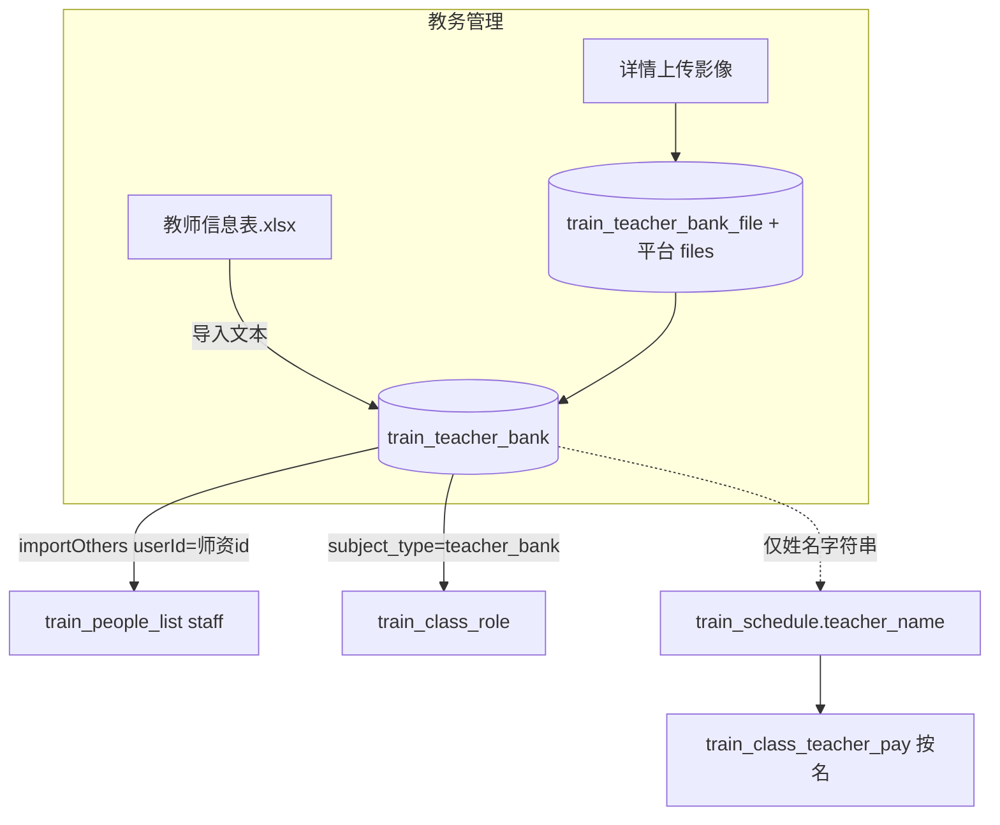

# 教务管理 · 师资库 Excel 导入与证照影像 · 实现方案

> **日期**：2026-08-20  
> **状态**：**P0/P1 已落地**（见总纲 §11）  
> **入口**：培训管理 → 支持保障 → **教务管理**（`train_teacher-bank`）  
> **样表**：`文件/教师信息表.xlsx`（业务提供）  
> **总纲（含老系统迁移）**：[教务管理_师资库建设_老系统迁移与整合方案.md](./教务管理_师资库建设_老系统迁移与整合方案.md)  
> **现状**：主表已扩字段 + 附件表；管理页支持 Excel 导入、老系统 JSON 迁移、详情证照上传  
> **原则**：样表导入补全主数据；影像与证号结构化可管；不破坏现有开班导入教务 / 五角色 / 课表选人链路  
> **已拍板**：同身份证 → **默认更新**；无身份证 → **临时建档**；P0 **不强制**影像  

---

## 0. 结论（先看）

**产品一句话**：在「教务管理」支持按业务样表 **批量导入教师**，并支持为每位教师上传/查看 **身份证正反面、毕业证、学历证、教师资格证、职称证、技能等级证书** 等影像；列表可搜可管，详情可看证号与附件。

| 问题 | 定稿 |
|------|------|
| 导入主键 | **有身份证号**：同租户按证号匹配，已存在 → **默认更新**文本（不覆盖已有影像） |
| 无身份证 | **允许临时建档**（见 §4.3）；不因缺证号失败 |
| 样表「持有何种职业资格证书」 | 自由文本，**整段入库** + **启发式拆出**教师资格证号 / 职称证号 / 技能证号（拆不出也不挡导入） |
| 证照影像 | **独立附件表**（一人多证、一证可多图）；主表保留摘要字段便于列表 |
| 上传时机 | 导入只带文本；影像在 **详情页按类型上传**（ZIP 批量挂图作 P2） |
| 影像是否强制 | **P0 不强制**；缺图可后续在详情补传 |
| 与课表/课酬 | 仍按 **姓名** 弱关联；导入后不改历史课表 |
| 停用 | 导入新建默认 `status=1`；更新已存在记录时 **不自动改 status** |

---

## 1. 样表分析（`教师信息表.xlsx`）

### 1.1 结构

| 项 | 值 |
|----|-----|
| 标题行 | 第 1 行「教师信息表」 |
| 表头行 | 第 2 行 |
| 数据行 | 第 3 行起，约 **107** 人 |
| 列数 | 11 |

### 1.2 列定义

| 列 | 样表表头 | 示例 / 特点 |
|----|----------|-------------|
| A | 序号 | 可忽略，不入库 |
| B | 姓名 | 必填语义 |
| C | 性别 | 男 / 女 |
| D | 身份证号码 | 主匹配键；偶有空 |
| E | 学历 | 硕士研究生 / 大学本科 / 专科 / 中专…（写法不统一） |
| F | 专业 | 自由文本 |
| G | 持有何种职业资格证书 | **多证混写**，常含换行：类型名 + 证号；一人可多类 |
| H | 职业资格等级 | 混有「职业资格三级」「副高级职称」「无等级」等 |
| I | 职业技能名称 | 工种，可多值顿号分隔 |
| J | 专业技术职务 | 教授 / 高级工程师 / 高等学校教师… |
| K | 联系电话 | 约 **1/3 为空** |

### 1.3 证书列形态（导入难点）

样表 **没有** 独立「教师资格证号 / 职称证号」列，而是写在 G 列，例如：

- `教师资格证20074500171100449`
- `职称证书` + 换行 + `GX12022017960`
- 同时出现：`职业技能等级证书` + 证号 + `教师资格证` + 证号 + `职称证书` + 证号

因此：

1. **原文必须完整保留**（`cert_text` / 备注类字段），避免解析丢信息。  
2. 解析为「尽力而为」：按关键词切段提取证号，供详情展示与检索；解析失败不阻断导入。  
3. **影像不在 Excel 内**，需单独上传流程。

---

## 2. 与现网字段对照

现表 `train_teacher_bank` 已有（节选）：

| 现字段 | 含义（现状） | 与样表 |
|--------|--------------|--------|
| name / phone / gender / education / major | 基本信息 | 直接映射 |
| id_card_number | 身份证号 | ← 身份证号码 |
| id_card | 历史上像「证号或图」混用 | **建议改为仅存正面图 fileId**，或废弃改用附件表 |
| teacher_license / edu_license / graduate_paper / level_license / engineer_license | 证照字符串 | 可继续存 **fileId 或证号**；语义混乱，需收敛 |
| company / address / nation / birthday… | 扩展 | 样表无 → 手工维护 |

**缺口（相对本次需求）：**

- 无：职业技能名称、职业资格等级、专业技术职务、证书原文  
- 无：身份证反面、职称证独立槽、技能等级证独立槽（工程师证字段勉强可挪用但不准确）  
- 管理页未做影像上传与详情查看  

---

## 3. 数据模型建议

### 3.1 主表扩展（`train_teacher_bank`）

新增（名称可微调）：

| 字段 | 类型 | 说明 |
|------|------|------|
| skill_name | VARCHAR(512) | 职业技能名称（样表 I） |
| qualification_level | VARCHAR(255) | 职业资格等级（样表 H） |
| professional_title | VARCHAR(255) | 专业技术职务（样表 J） |
| cert_text | TEXT | 持有何种职业资格证书 **原文**（样表 G） |
| teacher_qual_no | VARCHAR(128) | 解析出的教师资格证号（可空） |
| title_cert_no | VARCHAR(128) | 解析出的职称证号（可空） |
| skill_cert_no | VARCHAR(255) | 解析出的技能等级证号摘要（可多号逗号拼接） |
| id_card_front_file_id | BIGINT | 身份证正面（平台文件 id） |
| id_card_back_file_id | BIGINT | 身份证反面 |
| graduate_file_id | BIGINT | 毕业证 |
| education_file_id | BIGINT | 学历证 |
| teacher_qual_file_id | BIGINT | 教师资格证 |
| title_cert_file_id | BIGINT | 职称证 |
| skill_cert_file_id | BIGINT | 技能等级证书（主图；多图见附件表） |

> **兼容**：旧字段 `teacher_license` 等若已有 URL/路径，迁移脚本可读入附件表或保留只读；新逻辑统一写 `*_file_id` + 附件表。

唯一建议：同租户 **`(tenant_id, id_card_number, deleted)`** 唯一（空证号不参与唯一，或禁止空证号入库）。

### 3.2 附件明细表（推荐，P1）

`train_teacher_bank_file`

| 字段 | 说明 |
|------|------|
| id / tenant_id / teacher_id | |
| file_type | 枚举：`ID_FRONT` `ID_BACK` `GRADUATE` `EDUCATION` `TEACHER_QUAL` `TITLE` `SKILL` `OTHER` |
| file_id | 平台 `/files` 返回的 id |
| cert_no | 可选，该附件对应证号 |
| sort_no / remark | |
| deleted / 审计 | |

**主表 `*_file_id`**：每种类型的「默认展示图」（详情页大图）；明细表支持同类型多张（如多本技能证）。

文件上传复用现网 `POST /files`（`uploadPlatformFile`），accessPolicy 建议租户私有。

---

## 4. 导入规则

### 4.1 模板

- **下载模板**：与样表列一致的 xlsx（可带一行示例 + 说明 sheet）。  
- **兼容业务原表**：识别第 2 行为表头（或首行含「姓名」「身份证」），跳过标题行。

### 4.2 列映射

| 样表 | 入库 |
|------|------|
| 姓名 | name（必填） |
| 性别 | gender：男→1，女→0，其它空 |
| 身份证号码 | id_card_number（有则作匹配键；空则走临时建档） |
| 学历 | education（原样；可选归一「大学本科→本科」） |
| 专业 | major |
| 持有何种… | cert_text + 启发式解析三证号 |
| 职业资格等级 | qualification_level |
| 职业技能名称 | skill_name |
| 专业技术职务 | professional_title |
| 联系电话 | phone（可空） |
| 序号 | 忽略 |

### 4.3 校验与结果（已拍板）

| 规则 | 处理 |
|------|------|
| 姓名空 | 失败 |
| **有身份证**且同租户已存在 | **默认更新**文本字段；**不覆盖**已有影像 file_id |
| **有身份证**且库中不存在 | 新建 |
| **无身份证** | **临时建档**：新建一条，`id_card_number` 空；匹配键改为「本文件内 / 库内」按 **姓名+手机**（手机也空则仅姓名，同名多条时本文件后行覆盖前行写入同一逻辑键，并在结果里标 `provisional=true` 警告） |
| 同文件内身份证号重复 | 失败（避免歧义） |
| 身份证格式明显非法（非空且非 15/18 位） | 警告仍导入（宽松），或记 warning |
| 电话非 11 位 | 警告仍导入 |
| 影像 | P0 不校验、不强制 |

临时建档说明：列表可标「待补身份证」；后续手工补证号后，若与已有证号冲突则编辑保存时提示合并/改号（P1 可做，P0 仅展示标记）。

唯一索引：`(tenant_id, id_card_number, deleted)` 仅对 **非空** 证号生效（MySQL 下可用生成列或应用层保证）；空证号允许多条临时档。

返回结构对齐现网其它导入（考勤/花名册）：

```json
{
  "total": 107,
  "success": 102,
  "created": 80,
  "updated": 18,
  "provisional": 4,
  "failed": [{ "row": 15, "name": "...", "reason": "姓名为空" }],
  "warnings": [{ "row": 20, "name": "...", "reason": "临时建档（无身份证）" }]
}
```

可提供「导出失败行」xlsx。

### 4.4 证书原文解析（启发式，可单测）

```text
按行/按关键词切分：教师资格证|职称证(书)|职业技能等级证(书)|职业资格证
提取后续连续证号（字母数字，长度≥6）
「未扫描证书编号」→ 不写入证号字段
```

不保证 100% 准；详情页允许手工改三证号字段。

---

## 5. 页面改造（教务管理）

### 5.1 列表页（`TrainingAcademicManagePage`）

- 工具栏新增：**下载导入模板**、**导入 Excel**、刷新。  
- 搜索：姓名 / 手机 / **身份证**（后端补齐 like）。  
- 筛选项：状态、是否缺影像（可选）。  
- 列：姓名、性别、身份证、学历、专业、职务、电话、证照齐全度（如 3/7）、状态、操作。  
- 操作：编辑、**详情/证照**、删除。

### 5.2 详情 / 证照抽屉（新）

- 基本信息只读 + 编辑入口。  
- 证号区：资格证号 / 职称证号 / 技能证号 / 证书原文。  
- 影像区：7 类卡片，每类 Upload + 缩略图预览（点开大图），支持替换/删除。  
- 权限：`train:teacher-bank:update` 可传图；`view` 只看。

### 5.3 编辑弹窗

在现有字段上补：技能名称、资格等级、专业技术职务、三证号；影像仍以详情页为主（避免弹窗过重）。

---

## 6. 接口（拟）

| 方法 | 路径 | 说明 | 权限 |
|------|------|------|------|
| GET | `/training/teacher-banks/import/template` | 下载模板 | view |
| POST | `/training/teacher-banks/import` | multipart 导入 | create 或 update |
| GET | `/training/teacher-banks/{id}` | 详情（含 fileId + 附件列表） | view |
| PUT | `/training/teacher-banks/{id}` | 更新文本 | update |
| PUT | `/training/teacher-banks/{id}/files/{fileType}` | 绑定/替换某类主图（body: fileId） | update |
| DELETE | `/training/teacher-banks/{id}/files/{fileType}` | 清空主图 | update |
| POST | `/training/teacher-banks/{id}/files` | 追加附件明细 | update |

文件本体仍走 `POST /files`，业务只存 fileId。

---

## 7. 与系统其它模块关系



| 模块 | 影响 |
|------|------|
| 开班导入教务 | 仍按师资库 id；导入教师变多后候选更全 |
| 五角色指派 | 同上；详情证照可供人工核验，不自动阻断指派 |
| 跟班课表 / 课酬 | 仍姓名弱关联；**不**把课酬单价写入师资库（保持按班） |
| 材料包 / 补贴 | 若已读 teacher_bank 证照字段，需适配新 fileId（`TrainClassMaterialPackService` 等处） |

---

## 8. 实现切面

| 层 | 改动 |
|----|------|
| DB | Flyway：主表加列 + 附件表；身份证唯一索引 |
| 解析 | `TeacherBankExcelImporter` + 证书文本解析器 + 单测（用样表切片） |
| API | Controller 扩 import / files；Service 扩 page 身份证搜索 |
| FE | 列表导入；详情证照管理；类型与 VO 同步 |
| 权限 | 沿用 `train:teacher-bank:*`；导入用 create+update |

---

## 9. 分期

| 阶段 | 内容 | 预估 |
|------|------|------|
| **P0** | 主表扩字段 + Excel 导入/模板 + 失败/警告清单；同证更新、无证临时建档；列表展示新字段与「待补身份证」；身份证搜索；**不强制影像** | 优先，规则已拍板 |
| **P1** | 详情页 7 类影像上传/预览；主表 file_id；附件表 | 紧随 |
| **P2** | ZIP 按「身份证号_类型」批量挂图；学历归一；缺证看板；临时档补证号合并；材料包读新证照 | 可选 |

---

## 10. 拍板记录

| # | 议题 | 结论 | 日期 |
|---|------|------|------|
| 1 | 同身份证已存在 | **默认更新**文本，不覆盖已有影像 | 2026-08-20 |
| 2 | 无身份证行 | **允许临时建档**（姓名必填；尽量用姓名+手机去重提示） | 2026-08-20 |
| 3 | 影像是否强制 | **P0 不强制** | 2026-08-20 |
| 4 | 旧 `*_license` 字符串字段 | 待开发时定：默认 **废弃只读**，新逻辑写 file_id | — |
| 5 | 多技能证 | 待开发时定：P1 建议上附件表；P0 可不建 | — |

---

## 11. 验收

- [ ] 用业务 `教师信息表.xlsx` 导入：成功/失败/临时建档数合理，失败可解释  
- [ ] 同身份证二次导入更新文本，不抹掉已传影像  
- [ ] 无身份证行能建成临时档，列表可识别「待补身份证」  
- [ ] P0 无影像也可导入成功  
- [ ] 详情可上传并预览 7 类影像，刷新仍在（P1）  
- [ ] 列表可按姓名/手机/身份证搜到导入教师  
- [ ] 开班「从师资库导入教务」、跟班课表选老师仍可用  
- [ ] 无权限用户无法导入/传图  

---

**§0 / §10 前 3 条已拍板；按用户要求当前先不动代码，确认开工后再按 P0→P1 开发。** 本方案不改课酬按班逻辑，只增强教务管理主数据与证照可管理性。
