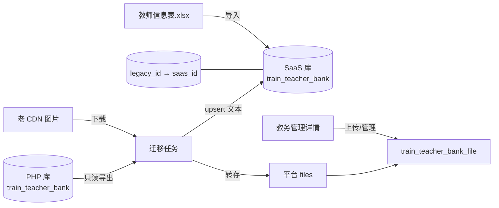

# 教务管理 · 师资库建设（老系统迁移 + Excel 导入 + 证照影像）· 整合方案

> **日期**：2026-08-20  
> **状态**：**P0/P1 已落地**（Excel 导入 + 异库 JSON 迁移 + 详情证照绑定；材料包/staff remap 仍属后续）  
> **入口（SaaS）**：培训管理 → 支持保障 → **教务管理**（`train_teacher-bank`）  
> **老系统入口**：`https://gjjdp.gjjd168.com/yunteacher/list`（Phalcon `YunteacherController::listAction`）  
> **关联文档**：[教务管理_师资库导入与证照影像_实现方案.md](./教务管理_师资库导入与证照影像_实现方案.md)（Excel 样表与 P0 拍板规则，本文为其**总纲升级**）  
> **原则**：以 SaaS `train_teacher_bank` 为唯一主数据；一次性/可重复迁移 PHP 存量；Excel 补数；详情管影像；不破坏开班教务导入 / 五角色 / 课表选人  
> **已拍板（环境）**：**SaaS 与 PHP 不是同一库** → 走 **异库导出导入**（§5）  

---

## 0. 结论（先看）

**产品一句话**：把 PHP 老师资库（含证照图片）迁到 SaaS「教务管理」，并保留 Excel 批量导入与证照上传能力，形成统一师资主数据。

| 议题 | 定稿 |
|------|------|
| 库关系 | **异库**：PHP 源库只读导出 → 写入 SaaS 目标库（**非**同表升级） |
| 主系统 | **SaaS**；老 `yunteacher/*` 迁移完成后可只读或下线（另排期） |
| 存量数据 | 从 PHP 库 `train_teacher_bank` **跨库迁移**（文本 + 证照图），按身份证对齐 SaaS |
| 主键映射 | SaaS 新生成 id；必存 **`legacy_id` = PHP 原 id**；另建/维护映射便于对账 |
| 增量补数 | 业务 `教师信息表.xlsx` **导入**（规则已拍板，见 §3） |
| 同身份证 | **默认更新**文本；已有影像不覆盖（迁移/导入均适用） |
| 无身份证 | **临时建档** |
| 影像强制 | **P0 不强制** |
| 证照模型 | 迁移时把老 JSON 图数组落入 **附件表 + 主表默认 file_id**；职称≈老 `engineer_license`，技能≈`level_license` |
| 性别口径 | SaaS 统一 **0=女，1=男**（与当前 admin-web 一致）；迁移时把 PHP 的 0男/1女 **翻转** |

---

## 1. 老系统能力盘点（`gjjd_phalcon`）

### 1.1 接口

| 路径 | 方法意图 | 说明 |
|------|----------|------|
| `POST /yunteacher/list` | 分页列表 | body：`pageSize` `currentPage` `keyword`；keyword 搜姓名/身份证/手机/学历/专业 |
| `POST /yunteacher/save` | 新增/编辑 | **姓名+身份证+手机必填**；同身份证唯一；证照字段为 **JSON 数组** |
| `POST /yunteacher/delete` | 逻辑删 | `ids[]` |
| `POST /yunteacher/idcardorc` | 身份证 OCR | 百度 OCR；`type=front/back`；回填民族/证号/生日/性别或有效期 |

实现：`app/controllers/api/YunteacherController.php`，模型 `TrainTeacherBank` → 表 **`train_teacher_bank`**（与 SaaS 表名同源，库可能是同一历史库或副本，以实际部署为准）。

### 1.2 证照存储形态（关键）

老系统 **不是** 单 fileId，而是各字段存 **JSON 字符串数组**，元素多为 **http(s) 图片 URL**（或相对路径）：

| 字段 | 业务含义 | 材料包导出命名（`YuntrainController`） |
|------|----------|----------------------------------------|
| `id_card` | 身份证图（可多张，正反面混在数组） | 身份证{k} |
| `graduate_paper` | 毕业证 | 毕业证{k} |
| `edu_license` | 学历证 | 学历证{k} |
| `teacher_license` | 教师资格证 | 教师资格证{k} |
| `engineer_license` | 工程师/职称类证 | 工程师证{k} |
| `level_license` | 技能等级证 | 技能等级证{k} |

列表接口会把上述字段 `json_decode` 成数组再返回给前端。

其它文本：`name` `phone` `id_card_number` `gender` `birthday` `nation` `education` `major` `start_date` `end_date`（身份证有效期）等。

### 1.3 老系统性别约定（迁移必转）

- **保存**：由身份证倒数第二位奇偶推性别：奇数 → `gender=0`，偶数 → `gender=1`。  
- **列表展示**：`gender>0 ? '女' : '男'` → **0=男，1=女**。  
- **SaaS 当前 FE**：`1=男，0=女`（`TrainingAcademicManagePage`）。  

→ 迁移脚本必须做 **gender 翻转**（或双写时显式映射），并在方案/单测中固定。

### 1.4 与开班材料包

老开班「教师材料」ZIP 直接读师资库 JSON 图 URL 下载打包。SaaS 侧已有 `TrainClassMaterialPackService` 读 teacher_bank——迁完后需读 **新 file_id / 附件表**（列入 P1/P2 适配，见 §7）。

---

## 2. SaaS 现状与缺口

| 能力 | SaaS 现状 | 缺口 |
|------|-----------|------|
| 菜单/CRUD | 教务管理手工增删改查 | 无导入、无详情证照管理 |
| 表 `train_teacher_bank` | 有证照相关列，多为 **VARCHAR(255)** | 装不下老 JSON 多图；语义当「路径/证号」混用 |
| 搜索 | FE 文案含身份证，BE keyword 未含证号 | 应对齐老系统（含证号） |
| 下游 | 开班 importOthers、五角色、课表姓名弱引用 | 迁移后 id 变化需注意历史 staff.userId=师资 id |

**注意（已拍板）**：SaaS 与 PHP **不是同一库**。SaaS 表即使也叫 `train_teacher_bank`，也是目标库新建/扩展行，**不能**按「同表原地改 JSON」理解。历史若 SaaS 已有手工录入师资，迁移按身份证 upsert 合并。

---

## 3. 已拍板规则（沿用 Excel 方案）

来自业务确认 + [导入与证照影像方案](./教务管理_师资库导入与证照影像_实现方案.md)：

1. 同身份证 → **默认更新**文本，不覆盖已有影像  
2. 无身份证 → **临时建档**  
3. P0 **不强制**影像  

Excel 列映射、证书原文解析、临时建档「姓名+手机」逻辑：**仍以该文档 §4 为准**，本文不重复展开。

---

## 4. 目标数据模型（统一）

### 4.1 主表扩展

在现有 `train_teacher_bank` 上增加（与 Excel 方案一致）：

- 文本：`skill_name` `qualification_level` `professional_title` `cert_text` `teacher_qual_no` `title_cert_no` `skill_cert_no`  
- 默认图 file_id：`id_card_front_file_id` `id_card_back_file_id` `graduate_file_id` `education_file_id` `teacher_qual_file_id` `title_cert_file_id` `skill_cert_file_id`  
- 可选：`legacy_id`（PHP 原 id，便于对账与 staff 映射）  
- 可选：`source` = `legacy` / `excel` / `manual`

旧列 `id_card` / `*_license` / `graduate_paper`：

- **迁移完成后**：可保留只读备份列（或改名为 `*_legacy_json` TEXT），新逻辑不再写入。  
- VARCHAR(255) **不够存 JSON** 时，迁移前先 `ALTER` 为 `TEXT` 再读，或直接从 PHP 库只读导出。

### 4.2 附件表 `train_teacher_bank_file`

| file_type | 对应老字段 / 需求 |
|-----------|-------------------|
| `ID_FRONT` / `ID_BACK` | 老 `id_card[]`（按顺序：第 1 张倾向正面，第 2 张反面；无法区分则全部 OTHER/ID_FRONT 并人工调整） |
| `GRADUATE` | `graduate_paper[]` |
| `EDUCATION` | `edu_license[]` |
| `TEACHER_QUAL` | `teacher_license[]` |
| `TITLE` | `engineer_license[]`（职称/工程师） |
| `SKILL` | `level_license[]` |
| `OTHER` | 无法归类 |

每条记录：`file_id`（平台文件）、`legacy_url`（源 URL，便于重跑）、`sort_no`。

主表各 `*_file_id` = 该类型 sort 最小的一张，供列表「是否齐全」与详情主图。

---

## 5. 迁移策略（异库 · 已定）

> ~~路径 A 同库同表~~ **不适用**（已确认异库）。下文仅为 **路径 B**。

### 5.1 总体步骤

1. **SaaS Flyway**：扩主表列（含 `legacy_id` / `source`）+ 建 `train_teacher_bank_file`；对 `legacy_id` 建唯一索引 `(tenant_id, legacy_id)`（legacy_id 非空时）。  
2. **配置 PHP 只读数据源**（迁移 Job 专用，与 SaaS 主库分离）：或一次性 SQL 导出 JSON/CSV 快照，避免运行期连生产写库。  
3. **读取** PHP `train_teacher_bank` where `deleted=0`（全量；可按 id 游标分页）。  
4. **Upsert 到 SaaS**（同一租户，默认 `tenant_id=1` 待 §9 确认）：  
   - 有 `id_card_number`：按租户+证号找已有 → **更新**文本 / 无则 **新建**；  
   - 无证号：**临时建档**（与 Excel 规则一致）；  
   - 写入 `legacy_id` = PHP `id`，`source=legacy`；  
   - **gender 翻转**后入库；  
   - SaaS **自增新 id**（与 PHP id 不同）。  
5. **图片**：解析各证照 JSON 数组 → 下载 CDN → 平台 files → 附件表；主表 file_id 仅在空时回填。  
6. **幂等**：以 `legacy_id` 或「证号已存在」判断；附件以 `legacy_url` 去重；支持失败重跑。  
7. **映射表**（推荐显式）：`train_teacher_bank_legacy_map(legacy_id, saas_id, tenant_id)`，或仅依赖主表 `legacy_id` 字段查询。

### 5.2 取数方式（二选一，实施时定）

| 方式 | 优点 | 注意 |
|------|------|------|
| Job 直连 PHP 只读库 | 可重复、增量补跑方便 | 需只读账号与网络策略 |
| 离线导出包（SQL dump / 分页调 `yunteacher/list`） | 不碰生产库连接 | list 接口要带登录态；图片 URL 仍要可下 |

**不推荐**仅依赖公网 list 做唯一通道（鉴权、分页、字段完整性风险）；优先只读库或运维导出。

### 5.3 历史 staff / 角色 id 映射（异库必做）

开班 `train_people_list`（type=staff）的 `user_id`、五角色 `subject_id` 若曾指向 **PHP 师资 id**：

- SaaS 侧若尚无这批历史数据 → 可不迁映射，只迁师资主数据。  
- 若 SaaS 已从别处同步过 staff 且 user_id 仍是 PHP id → 迁移后跑 **remap**：`user_id/subject_id = map(legacy_id)`。  
- 实施前抽样确认 SaaS 是否已有 staff 引用老师资 id（§9）。

### 5.4 图片转存要点

- 仅处理 `http`/`https`（与材料包逻辑一致）；相对路径拼老 CDN 根再下。  
- 失败记 `warnings`，不阻断该教师文本迁移。  
- 大图可压缩后上传（可选）。  
- 租户：写入 SaaS 目标租户（默认 1，§9 确认）。

### 5.5 与 Excel 导入的优先级

| 场景 | 行为 |
|------|------|
| 先迁移后 Excel | 同身份证 **更新** Excel 文本字段；不覆盖已迁影像 |
| 先 Excel 后迁移 | 同身份证 **补空字段**；影像仅当该类 file_id 为空时写入；`legacy_id` 补上 |
| 冲突字段 | 文本以「后执行的更新源」为准；影像永不覆盖已有 file_id（除非运维强制重跑参数） |

---

## 6. SaaS 功能建设（与迁移并行的产品面）

### 6.1 分期（整合后）

| 阶段 | 内容 |
|------|------|
| **P0** | 表结构扩展；Excel 导入/模板；身份证搜索；列表「待补身份证」；**迁移任务骨架**（可先只迁文本） |
| **P1** | 详情 7 类影像上传/预览；附件表；**迁移任务完整转存图片**；材料包读新附件 |
| **P2** | ZIP 批量挂图；缺证看板；临时档补证合并；老 `yunteacher` 只读开关/下线；可选身份证 OCR（移植百度或换供应商） |

### 6.2 管理端页面

- 列表：导入 Excel、（运维）触发/查看迁移任务状态、搜索对齐老系统。  
- 详情：基本信息 + 证号 + 7 类影像（与 Excel 方案 §5 一致）。  
- 不必 1:1 复刻老 OCR；P2 再评估。

### 6.3 API（在 Excel 方案 §6 上增加）

| 方法 | 路径 | 说明 |
|------|------|------|
| POST | `/training/teacher-banks/migrate-from-legacy` | 管理员触发迁移（或仅内部 Job，不暴露） |
| GET | `/training/teacher-banks/migrate-from-legacy/status` | 进度：total/success/imageFail |

权限：建议独立 `train:teacher-bank:migrate` 或仅超管。

---

## 7. 下游影响清单

| 模块 | 动作 |
|------|------|
| 开班 `importOthers` | 使用 **SaaS 新师资 id**；若有历史 PHP id 引用则按 `legacy_id` remap |
| 五角色 `teacher_bank` | 同左 |
| 跟班课表 / 课酬 | 姓名弱关联，无强制变更 |
| `TrainClassMaterialPackService` | P1 读附件表/file_id（SaaS 侧一般无老 JSON） |
| 老前端 `yunteacher` | 迁移验收后冻结写入，避免继续只写 PHP 库 |

---

## 8. 验收（整合）

**迁移**

- [ ] 文本条数与 PHP `deleted=0` 基本一致（允许临时档差异说明）  
- [ ] 同身份证不重复；gender 与 SaaS「1男0女」展示正确  
- [ ] 抽样 N 人：各类证照图在详情可打开，与老站一致  
- [ ] 转存失败有清单可重跑  

**Excel / 产品**

- [ ] 样表导入规则符合已拍板三条  
- [ ] 更新不覆盖已有影像  
- [ ] 开班导入教务、课表选老师仍可用  

---

## 9. 环境拍板与剩余确认

### 9.1 已拍板

| # | 议题 | 结论 | 日期 |
|---|------|------|------|
| 1 | 同库 / 异库 | **异库**（SaaS ≠ PHP） | 2026-08-20 |
| 2 | 同身份证 / 无证 / 影像 | 更新；临时建档；P0 不强制 | 2026-08-20 |

### 9.2 仍待确认（实施前）

1. PHP 只读库连接方式：直连只读账号 vs 运维导出包？  
2. 老证照图片 CDN 是否公网可下？是否需内网/鉴权？  
3. 迁入 SaaS 的 `tenant_id` 固定为 `1`，还是按机构拆分？  
4. SaaS 开班 staff / 五角色是否已存在「指向 PHP 师资 id」的历史数据（要不要 remap 脚本）？  
5. 老 `yunteacher` 停止写入的时间点？  

---

## 10. 文档关系

| 文档 | 角色 |
|------|------|
| **本文** | 总纲：老系统**异库**迁移 + 建设路线 + 与 Excel 规则对齐 |
| [教务管理_师资库导入与证照影像_实现方案.md](./教务管理_师资库导入与证照影像_实现方案.md) | Excel 样表细节、导入校验、页面/API 细目；**P0 三条拍板仍有效** |

开发开工顺序建议：**§9.2 剩余项有结论 → P0 表结构+Excel → 异库迁移 Job（先文本+legacy_id，后图片）→ P1 详情影像 → staff remap（如需要）→ 材料包适配**。

---

## 11. 落地说明（2026-08-20）

| 能力 | 实现要点 |
|------|----------|
| 表结构 | Flyway `V20260820_010__train_teacher_bank_extend.sql`（避开已占用的 `20260820.001`）：主表扩列 + `legacy_id`/`source` + `train_teacher_bank_file` |
| Excel | `POST /training/teacher-banks/import` + 模板下载；同证更新不盖影像；无证临时建档 |
| 异库迁移 | `POST /training/teacher-banks/migrate-from-legacy`：上传 PHP 导出 JSON；gender 翻转；图片 URL 下载转存平台 files |
| 详情证照 | `PUT/DELETE .../files/{fileType}`；管理端详情 Drawer 上传/查看/清除 |
| 列表 | 关键词含身份证；「待补身份证」标记；证照就绪数 `n/7` |

**运维**：重启 `platform-api` 使 Flyway 生效；迁移包为 PHP 师资 JSON 数组（含证照 URL 字段）。

**未做（P2/后续）**：ZIP 批量挂图、缺证看板、材料包读新附件、staff/`legacy_id` remap、老 `yunteacher` 下线、迁移进度 status API。
