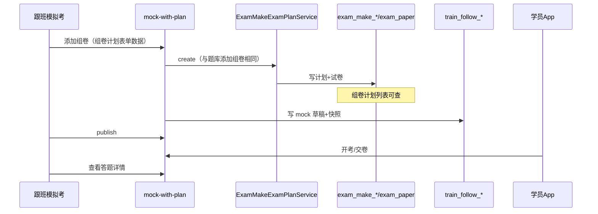

# 跟班模拟考：调用组卷计划添加组卷 + 学员答卷详情 — 实现方案

> 日期：2026-08-12（再修订）  
> 状态：**已落地 P0**（Flyway + mock-with-plan/from-plan/options + FollowMockExamTab 重构）  
> **产品定调**  
> 1. **在跟班中也可调用**题库「组卷计划」**添加组卷**功能（同一套能力 / 同一 API：`POST /exam/make-exam-plans`）  
> 2. 组好卷后：班级学员在跟班模拟考中作答  
> 3. 在跟班中查看学员答题详情  
> 4. 试卷在题库「组卷计划」列表（`GET /exam/make-exam-plans`）**必须有记录**  
> 5. **舍弃**跟班自研配卷（智能抽题、题型数量自配等）；不另造第二套组卷引擎  
> 上游：[`跟班班级模拟试卷_实现方案.md`](./跟班班级模拟试卷_实现方案.md)  
> 工程：`platform-api` + `admin-web` + App  

---

## 一、结论（先看）

| 问题 | 答案 |
|------|------|
| 跟班能不能添加组卷？ | **能**。跟班入口调用题库「组卷计划」添加组卷（复用表单组件 + `createMakeExamPlan`） |
| 和题库菜单添组卷是否同一套？ | **是**。同一 API、同一生成逻辑；禁止跟班另写抽题引擎 |
| 组卷计划页有没有记录？ | **有**。写入的就是 `exam_make_exam_plan`，列表可查 |
| 学员在哪考？ | **跟班** `task_type=mock` + App「模拟考」 |
| 答题详情在哪看？ | **跟班**模拟考 Tab（进度 + 答卷抽屉 + 导出） |

**一句话：**  
跟班点「添加组卷」= 调题库组卷计划把卷造出来（列表有记录）→ 挂本班模拟考给学员考 → 详情仍在跟班看。

```text
跟班「模拟考」                         题库「组卷计划」
  ├─ 添加组卷 ──调用──►  MakeExamPlan 表单/API
  │                      POST /exam/make-exam-plans
  │                      → 列表有记录 + exam_paper
  │                            │
  │◄─── 返回 makeId / 自动挂接 ─┘
  ├─（或）选用已有计划
  ├─ 发布 → 学员考试
  └─ 查看学员答题详情
```

---

## 二、职责切分

| 职责 | 归属 |
|------|------|
| 添加组卷（规则、抽题、生成正式卷） | **题库组卷计划**（跟班只调用，不重写） |
| 选用已有计划并发给本班 | 跟班 |
| 发布 / 关闭 / 学员作答 / 答卷详情 | 跟班 |
| 智能抽题配模拟考 | **舍弃** |

---

## 三、产品流程

### 3.1 主路径：跟班内添加组卷

```text
跟班工作台 → 模拟考 →「添加组卷」
  ① 打开组卷计划「添加」表单（复用 MakeExamPlan 表单组件；科目默认本班范围）
  ② 填写与题库页相同的字段 → 提交
  ③ 后端：createMakeExamPlan（与题库完全一致）
       → 组卷计划列表立即有记录
  ④ 编排：将该计划正式卷快照为本班 mock 草稿（自动挂接）
  ⑤ 教务确认 → 发布 → 学员考试
  ⑥ 跟班查看答题详情
```

### 3.2 辅路径：选用已有计划

不新建计划，只选已有 `makeId` → 挂 mock（列表不新增行）。

### 3.3 舍弃（跟班多余）

- 单选/多选/判断数量 + 智能抽题预览  
- 跟班自写 bank-draw 当配卷主路径  
- 跟班自研第二套组卷规则引擎（比重/难度等若需要，必须走组卷计划表单字段，由 `createMakeExamPlan` 执行）  

### 3.4 保留（跟班必要）

- 模拟考任务列表、发布/关闭/重开  
- 选用已有计划  
- 进度 / 答卷详情 / 导出  
- 挂接时可选 `excludeOtherMock`  

---

## 四、实现设计

### 4.1 完全复用「添加组卷」的两种落地（二选一，推荐 A）

| 方案 | 做法 | 说明 |
|------|------|------|
| **A. 抽公共表单组件（推荐）** | 从 `MakeExamPlanPage` 抽出 `MakeExamPlanForm`；题库页与跟班 Drawer **共用**；提交都调 `createMakeExamPlan` | 跟班「也调用」且 UI/逻辑真复用 |
| **B. 跟班深链题库页** | 「添加组卷」跳转组卷计划并 `?from=follow&classId=`；创建成功回跳跟班并自动选中 | 复用整页；体验多一次跳转 |

**禁止：** 跟班 Modal 里手写一套与 `createMakeExamPlan` 字段不一致的「假组卷」。

### 4.2 后端编排（推荐）

| 方法 | 路径 | 说明 |
|------|------|------|
| POST | `/training/follow-tasks/classes/{classId}/mock-with-plan` | 跟班添加组卷：**内调** `ExamMakeExamPlanApplicationService.create`，再挂 mock |
| POST | `/training/follow-tasks/classes/{classId}/mock-from-plan` | 仅选用已有计划 |
| GET | `/training/follow-tasks/classes/{classId}/mock-plan-options` | 已有计划下拉 |

`mock-with-plan`：

1. 校验权限、科目 ∈ 本班范围  
2. `create(ExamMakeExamPlanCreateReq)` —— **与题库添加组卷同一方法**  
3. 读 `exam_paper` 题 ID → 客观题 + 范围过滤 + 可选 excludeOtherMock  
4. 建 `task_type=mock` 草稿 + 快照 + `make_exam_plan_id` / `source_paper_id`  
5. 失败则整体回滚/补偿删除刚建计划（避免「有计划无模拟考」孤儿）  
6. 返回 `{ task, makeExamPlanId, paperId, importStats }`  

前端若走方案 A 两段式（先 `createMakeExamPlan` 再 `mock-from-plan`），必须处理中途失败补偿；**更推荐**一次 `mock-with-plan`。

### 4.3 数据关系

```text
exam_make_exam_plan + exam_paper     ← 跟班/题库添加组卷都会写入（列表有记录）
        │
        ▼ 挂接快照
train_follow_task(mock) + questions
        │
        ▼
items / answers（考试与详情）
```

Flyway：`train_follow_task.make_exam_plan_id`、`source_paper_id`。

### 4.4 UI（`FollowMockExamTab` 重构）

| 按钮 | 行为 |
|------|------|
| **添加组卷** | 打开复用的组卷计划添加表单 → `mock-with-plan`（或 create + from-plan） |
| **选用已有计划** | 下拉计划 → `mock-from-plan` |
| （删除）智能抽题配卷 | 移除 |

列表/详情展示来源组卷计划名称；可链到题库组卷计划。

### 4.5 学员考试与答题详情

- 发布后 App「模拟考」作答（现网通道）  
- 管理端：`stats` / `items` / `answers` / 导出  
- 补齐：来源计划、未交空态、入口文案「答卷详情」  
- 不建考试域答卷页  

### 4.6 快照策略

- 挂接瞬间冻结题目到 follow  
- 题库再生/改计划 **不自动改**已发布 mock  
- 草稿可提供「从源卷重新同步」（P1）  

---

## 五、时序



---

## 六、分期

### P0

1. 抽出或复用 `MakeExamPlanForm`（或跟班内嵌调用同一 create）  
2. `mock-with-plan` + `mock-from-plan` + `mock-plan-options`  
3. Flyway 关联字段  
4. 重构 `FollowMockExamTab`：主「添加组卷」、辅「选用已有」；去掉智能抽题  
5. 答卷详情来源与空态  

### P1

1. 题库页与跟班共用表单组件彻底合一  
2. 创建成功回跳 / Tag「跟班模拟」  
3. 草稿重新同步源卷  

---

## 七、验收

- [ ] 跟班「添加组卷」走题库组卷计划同一套创建逻辑  
- [ ] 提交后 `GET /exam/make-exam-plans?examType=0` 能看到该记录  
- [ ] 同时生成本班 mock 草稿；发布后学员可考  
- [ ] 跟班可查看学员答题详情，并显示来源计划  
- [ ] 跟班无智能抽题配卷入口  
- [ ] 题库菜单原「添加组卷」不受影响  

---

## 八、待拍板

| # | 问题 | 建议 |
|---|------|------|
| 1 | 跟班用嵌入表单(A)还是跳转题库页(B) | **A 嵌入复用表单** |
| 2 | 添加失败是否保留计划 | **不保留**（回滚） |
| 3 | 默认草稿还是直接发布 | **草稿** |
| 4 | 实操计划 | 跟班添加仅理论 `examType=0` |

---

## 九、总结

- **跟班中也调用**题库组卷计划「添加组卷」→ 计划列表有记录。  
- **不**在跟班另做抽题配卷；学员考试与答题详情留在跟班。  
- 核心接口：`mock-with-plan` = `createMakeExamPlan` + 挂本班 mock。
