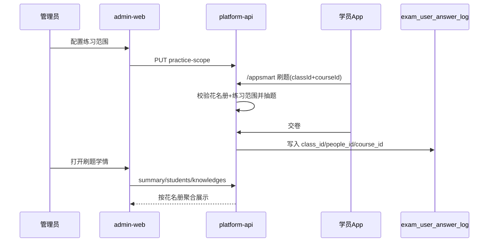

# 班级刷题学情方案

> 目标项目：`qianlvguoyu_saas`（`platform-api` + `admin-web`）  
> App 端：`gjjd_appnext`（刷题继续走 `/appsmart`，需带班级上下文）  
> 上游基线：  
> - [跟班作业与随堂练实现方案.md](./跟班作业与随堂练实现方案.md)（双通道 / 科目+知识点白名单）  
> - 已落地：开班准备「练习范围」配置（`train_class_practice_*`）  
> 状态：方案稿（先方案、后开发）  
> 编写日期：2026-08-04  

---

## 一、问题与目标

### 1.1 现状断层

```
已有：班级练习范围配置（科目/知识点白名单）
已有：App /appsmart 刷题 → exam_mock_paper + exam_user_answer_log
缺失：答题日志无 class_id → 后台无法按班看学员刷题情况
缺失：管理端「班级刷题学情」页面 / API
```

刷题与作业保持双通道：**本方案只管自助刷题学情**，不覆盖跟班作业/随堂练完成率（那是 `train_follow_task*`）。

### 1.2 目标

| 角色 | 能力 |
|------|------|
| 管理员 / 跟班教务 | 在后台按班级查看学员刷题概况、薄弱知识点、最近练习 |
| 班主任 / 主讲（后续可开 App） | 同数据口径的只读学情（本期可仅管理端） |
| 学员 | 仍在 App 刷题；感知不变，仅抽题受练习范围约束 |

### 1.3 非目标

| 不做 | 原因 |
|------|------|
| 把刷题答卷并入跟班作业表 | 双通道已锁定 |
| 刷题分计入认定通过率 | 教学参考分，非认定主成绩 |
| 本期改写 promote 课后作业 | 语义分离 |
| 完整 AI 学情报告 / 个性化推题引擎 | 可二期 |
| 依赖 `train_user_exam_log` 主路径 | 遗留表字段弱（无 class、无对错明细），不作为主数据源 |

---

## 二、结论（先看）

| 问题 | 答案 |
|------|------|
| 学情数据从哪来？ | 以 `exam_user_answer_log` + `exam_mock_paper` 为主；**补齐班级上下文** |
| 如何绑到班级？ | App 刷题请求带 `classId`；日志落 `class_id`（及可选 `people_id`） |
| 没带 classId 的历史题？ | 不进班级学情；或按「花名册 platform_user_id + 练习范围」弱关联（可选补跑，默认不做） |
| 后台入口？ | 开班准备班级行 / 跟班工作台「刷题学情」Tab |
| 与练习范围关系？ | 学情统计默认按本班范围过滤；可切换「全部刷题」视图 |

**一句话：**  
练习范围定「能刷什么」→ App 带班刷题并记日志 → 后台按花名册汇总「谁刷了、刷得怎样」。

---

## 三、概念对齐

| 名称 | 说明 |
|------|------|
| 练习范围 | `train_class_practice_*`，科目+知识点白名单（已实现配置） |
| 刷题会话/试卷 | `exam_mock_paper`（mock / random / wrong） |
| 答题明细 | `exam_user_answer_log`（对错、知识点、耗时、source） |
| 班级学情 | 按 `class_id` + 花名册学员聚合后的管理视图 |
| 跟班作业学情 | **另一通道**（`train_follow_task_item`），本方案不混算 |

身份映射：

```
train_people_list.platform_user_id  ↔  platform_user.id  ↔  exam_* .user_id
```

无 `platform_user_id` 的花名册学员：学情显示「未开 App 账号 / 无刷题数据」。

---

## 四、数据模型

### 4.1 现有表增强（推荐）

#### `exam_user_answer_log` 增加字段

| 字段 | 类型 | 说明 |
|------|------|------|
| `class_id` | BIGINT NULL | 刷题时所在班级；班级学情主键过滤 |
| `people_id` | BIGINT NULL | 可选，`train_people_list.id`，便于直连花名册 |
| `course_id` | INT NULL | 可选冗余，便于按科汇总 |
| `biz_date` | DATE NULL | 可选，练习自然日（本地时区） |

索引建议：

- `(tenant_id, class_id, user_id, create_time)`  
- `(tenant_id, class_id, knowledge_id, is_right)`  

#### `exam_mock_paper` 增加字段

| 字段 | 类型 | 说明 |
|------|------|------|
| `class_id` | BIGINT NULL | 组卷/练习所属班级 |
| `course_id` | INT NULL | 主科目（多科时取请求主 course 或首科） |

> Flyway：`V20xxxxxx__add_class_context_to_app_exam_logs.sql`

### 4.2 可选汇总表（量大时再上）

若单班查询实时扫明细过慢，再增加日汇总：

| 表 | 用途 |
|----|------|
| `train_class_practice_daily_stat` | 班级×日：答题数、正确数、练习人数 |
| `train_class_practice_user_stat` | 班级×学员：累计题数、正确率、最近练习时间、连续未练天数 |

一期可 **实时聚合**；二期再异步落汇总。

### 4.3 不新建「第二套答卷域」

刷题答卷继续只写 appsmart 表；班级学情是 **查询/投影**，不是再拷一份答案。

---

## 五、App 改造要点（学情前置条件）

### 5.1 请求契约（`/appsmart`）

以下接口增加可选/推荐参数：

| 参数 | 说明 |
|------|------|
| `classId` | 当前班级；有则写入 mock_paper / answer_log |
| `courseId` | 保持现有；并与练习范围校验 |
| （服务端） | 若 `classId` 有值：加载 `practice-scope`，过滤可抽题目 |

涉及：`/paper/generate`、`/paper/random`、`/wrong-replay`、交卷 `/paper/submit/{id}`（交卷时从 paper 带回 `class_id` 写日志，避免客户端漏传）。

### 5.2 校验规则

1. 学员须在该班花名册（`platform_user_id` 命中或身份证命中后回写）。  
2. `enabled=0` 的练习范围：按产品默认——**允许刷但不计入班级学情**，或 **禁止按班入口刷题**（建议：禁止按班入口；全局刷题仍可走无 classId 通道）。  
3. 有科目白名单：只抽白名单科目题。  
4. 有知识点白名单：只抽白名单知识点题；无知识点白名单则整科可刷。  

### 5.3 无 classId 兼容

旧客户端不传 `classId`：行为与现网一致，**不进班级学情**。管理端提示「请升级 App / 从班级入口进入刷题」。

---

## 六、管理端学情能力

### 6.1 入口

| 入口 | 说明 |
|------|------|
| 开班准备 → 班级行 | 花名册等；**试题配置/刷题学情已迁至跟班** |
| 跟班工作台 →「刷题」Tab | 试题配置（练习范围）+ 学员刷题详情；与「作业」Tab 分列 |

### 6.2 班级总览（卡片）

| 指标 | 口径 |
|------|------|
| 在册学员数 | 花名册 `type=student` |
| 已开通 App 账号数 | `platform_user_id IS NOT NULL` |
| 有刷题行为人数 | 统计期内 `class_id` 下有 answer_log 的去重 user |
| 参与率 | 有刷题行为人数 ÷ 在册学员数 |
| 答题总数 / 正确数 / 正确率 | 统计期内明细聚合 |
| 人均答题数 | 答题总数 ÷ 有刷题行为人数 |
| 近 7 日活跃人数 | 近 7 日有日志的去重 user |

筛选：统计起止日期（默认近 30 天）、科目（可选）、模式（全部 / 仅范围内知识点）。

### 6.3 学员明细表

| 列 | 说明 |
|----|------|
| 姓名 / 手机 / 身份证掩码 | 来自花名册 |
| App 账号 | 有/无 platform_user |
| 答题数 | |
| 正确数 / 正确率 | |
| 练习次数（试卷数） | 按 `exam_mock_paper` 或按日去重次数 |
| 最近练习时间 | |
| 连续未练天数 | 相对 `biz_date`/最后练习日 |
| 操作 | 查看知识点分布 / 最近错题（只读） |

排序：默认「最近练习时间倒序」；支持按正确率、答题数、未练天数。

### 6.4 薄弱知识点（班级维度）

| 列 | 说明 |
|----|------|
| 知识点 | |
| 科目 | |
| 答题数 | |
| 错误数 / 错误率 | |
| 覆盖学员数 | 该点做过题的人数 |

用途：教研调整练习范围或课堂讲解重点。

### 6.5 学员下钻

- 知识点正确率条形图/表  
- 最近 N 条错题（题干摘要、知识点、作答时间；**不展示标准答案给企业账号可配置**）  
- 练习轨迹：按日答题数折线（可选）

---

## 七、接口规划

前缀建议：`/training/info-classes/{classId}/practice-analytics/**`  
权限：与班级人员查看对齐（`CLASS_PEOPLE_VIEW`）；敏感错题明细可再拆 `practice-analytics:detail`。

| 方法 | 路径 | 说明 |
|------|------|------|
| GET | `/summary` | 班级总览卡片 |
| GET | `/students` | 学员学情分页（query: from,to,keyword,sort） |
| GET | `/knowledges` | 班级薄弱知识点 TopN / 分页 |
| GET | `/students/{peopleId}` | 学员下钻：知识点分布 + 最近错题 |
| GET | `/export` | 导出学员学情 Excel（二期可） |

App 侧（可选二期）：

| 方法 | 路径 | 说明 |
|------|------|------|
| GET | `/appsmart/class/{classId}/my-stats` | 学员看自己在本班的刷题统计 |

练习范围接口已有，不重复：`/info-classes/{id}/practice-scope`。

---

## 八、统计口径（锁死）

1. **时间**：按 `exam_user_answer_log.create_time`（或 `biz_date`）闭区间过滤。  
2. **班级归属**：只统计 `class_id = 当前班` 的日志；禁止用「同人其它班」数据冒充。  
3. **范围内模式**（默认开）：仅统计知识点 ∈ 本班白名单（白名单为空则 ∈ 白名单科目下全部知识点）。  
4. **正确率**：`sum(is_right=1) / count(*)`；分母为 0 显示 `-`。  
5. **参与**：至少 1 条 answer_log 即计「有刷题行为」。  
6. **与作业完成率**：分开展示，禁止加权混成一个「练习完成率」除非产品另定。

---

## 九、端到端链路



---

## 十、分期交付

### P0 — 数据可归因（App + 表结构）

| 交付 | 说明 |
|------|------|
| Flyway 日志表加 `class_id` 等字段 | |
| `/appsmart` 接受 `classId`，交卷落库 | |
| 抽题按练习范围过滤 | |
| 班级入口进入刷题（App） | 无入口则 classId 难以普及 |

**验收**：学员从班级进刷题 → DB 日志 `class_id` 有值。

### P1 — 管理端学情（可独立于 App 华丽 UI）

| 交付 | 说明 |
|------|------|
| summary / students / knowledges / daily API | |
| 跟班工作台「刷题」Tab | 试题配置 + 学员刷题详情（总览 / 学员表 / 薄弱知识点 / 每日） |
| 无数据空态文案 | 区分：未配置范围 / 无 App 刷题 / 旧数据无 classId |

**验收**：造数或真刷几题后，后台能看到该班学员答题数与正确率。

### P2 — 增强

| 交付 | 说明 |
|------|------|
| 学员下钻错题列表 | |
| 导出 Excel | |
| 日/人汇总表与定时任务 | 性能 |
| 跟班工作台 Tab 对齐 | 已落「刷题」Tab；作业 Tab 仍按 M3 |
| 老师 App 只读学情 | 可选 |

---

## 十一、权限与隐私

1. 机构账号：本租户班级。  
2. 企业账号：仅本企业班级（现有 `assertClassAccessible`）。  
3. 身份证、手机号列表脱敏展示。  
4. 错题是否展示标准答案：默认仅机构可见，企业端可关。  
5. 审计：导出操作记 AuditLog。

---

## 十二、风险与对策

| 风险 | 对策 |
|------|------|
| 历史刷题无 classId | 学情只认新数据；文案说明；可选弱关联补跑（默认关闭） |
| 一人多班 | 严格按日志 class_id；禁止跨班合并 |
| 练习范围变更 | 学情「范围内」按**当前**白名单滤历史日志（简单）；或快照范围版本（二期） |
| 明细表过大 | P2 汇总表；查询强制时间窗（默认 30 天，最大 180 天） |
| 与作业指标混淆 | UI 分区命名：「刷题学情」vs「作业/随堂练」 |

---

## 十三、与已落地能力的关系

| 能力 | 关系 |
|------|------|
| 练习范围配置 | 前置；P0 抽题依赖它 |
| 企业确认分班 → platform_user | 前置；无账号则无刷题、学情为空 |
| 跟班作业/随堂练 | 并行通道；完成率不进本方案指标 |
| `/appsmart` 现网刷题 | 兼容增强，不推翻 |

---

## 十四、建议默认产品规则（可再拍板）

| # | 项 | 建议默认 |
|---|----|----------|
| 1 | 无练习范围时按班刷题 | 用工种推导科目；仍写 class_id |
| 2 | 范围 enabled=0 | 班级入口不可刷；学情可查历史 |
| 3 | 刷题日期窗 | **可选，精确到日**；未设置则不过期；截止日含当天；组卷/交卷均校验 |
| 4 | 默认统计窗口 | 近 30 天 |
| 5 | 默认视图 | 「范围内」学情 |
| 6 | 历史无 classId 补跑 | **不做**（除非运营强需求） |

---

## 十五、一句话路径

**日志补 `class_id` → App 带班刷题并受练习范围约束 → 管理端按花名册聚合 summary/学员表/薄弱知识点；与跟班作业学情分开展示。**
