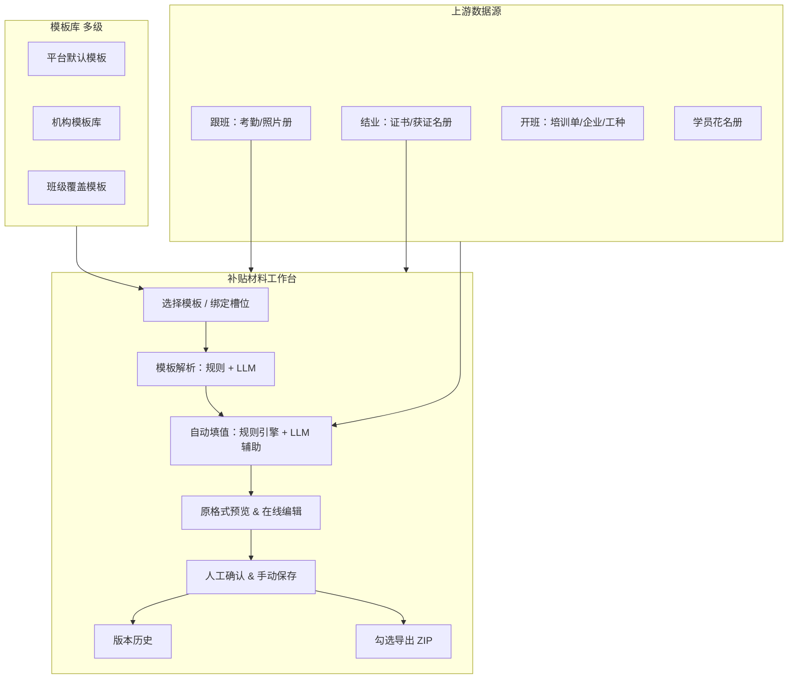

# 申报补贴工作台 — 材料编辑与导出方案

> **状态**：需求拍板稿（基于 2026-09-02 决策问答）  
> **范围**：`admin-web` 申报补贴工作台 + `platform-api` 材料/模板/导出能力  
> **原则**：方案文档；实现按 Phase 分阶段落地  
> **对齐**：  
> - [申报补贴材料生成实现方案.md](./申报补贴材料生成实现方案.md)（配方槽位、ZIP 生成、renderer）  
> - [补贴与人社扩展实现方案.md](./补贴与人社扩展实现方案.md)（台账 S1、齐套 S2、人社 L1–L3）  

---

## 一、背景与目标

### 1.1 现状

申报补贴已具备：一班一单、配方槽位、本班材料刷新（证书/名册）、槽位上传、ZIP 导出、阶段流转。  
短板是：**材料以人工上传为主**，缺少「模板 → 自动填数 → 预览审核 → 系统内修改 → 按需导出」的闭环。

### 1.2 目标

| 目标 | 说明 |
|------|------|
| **一班一套** | 工作台集中查看本班全部申报材料（表、名册、汇总、照片、证书等） |
| **模板驱动** | 上传申请表/花名册/汇总表等模板，系统自动填入班级数据 |
| **预览审核** | 原格式预览，可在预览中编辑并保存 |
| **模板复用** | 上传的模板入库，换班后选模板 + 填该班数据 |
| **灵活导出** | 每次临时勾选要导出的文件，支持全选，不记忆上次 |
| **逐步替代手动** | 智能填表成为主路径，逐步替代「纯手动上传槽位」 |

---

## 二、已确认决策清单

| # | 议题 | 决定 |
|---|------|------|
| 1 | 编辑方式 | 上传模板 → 系统识别字段并自动填 → 系统内预览审核 → 缺失/错误可在系统修改；**LLM 可辅助模板解析与填值** |
| 2 | 材料范围 | **一班一套**；照片/证书也要在工作台可见；支持多类模板；各班可不同；模板保存复用 |
| 3 | 模板库范围 | **多级**：平台默认 + 机构增删 + 班级可覆盖 |
| 4 | 导出勾选 | **每次临时勾选**，有全选，**不记住**上次 |
| 5 | 预览形态 | **尽量原格式预览**，且**可在预览中编辑保存** |
| 6 | 照片/证书 | **仅查看 + 替换上传**，不对图片/PDF 内容做在线编辑 |
| 7 | LLM 角色 | 尽量自动填完；**必须人工确认后手动保存** |
| 8 | 版本管理 | **保留历史版本**，可回滚再导出 |
| 9 | 与现网关系 | **逐步替代**现有「手动上传为主」模式 |
| 10 | 在线 Office | **无偏好**，由技术评估推荐 |
| 11 | 第一期范围 | **一班完整材料包**（表 + 名册 + 照片 + 证书） |
| 12 | 导出门槛 | **无门槛**，随时导出，勾什么导什么 |
| 13 | 模板权限 | **运营人员**也可向机构库上传模板 |
| 14 | 数据缺项 | **组合策略**：先拉上游 → 缺失高亮 → LLM 推测标「待核实」→ 人工确认保存 |
| 15 | ZIP 结构 | 按**材料类型**分目录（申请表/花名册/照片/证书…） |
| 16 | LLM 合规 | **敏感数据不出公网**；私有化或脱敏后调用 |

---

## 三、总体架构

```text
上游数据源（跟班/结业/开班/学员）
        ↓
多级模板库（平台 → 机构 → 班级覆盖）
        ↓
选用模板 → 解析（规则+LLM）→ 自动填值 → 原格式预览/编辑
        ↓
人工确认 & 手动保存 → 材料实例版本链
        ↓
勾选导出 → 按类型分目录 ZIP
```



### 3.1 核心对象（概念层）

| 对象 | 含义 |
|------|------|
| **模板 Template** | 可复用的空白或样例文件（docx/xlsx），带解析出的字段/schema |
| **材料实例 Instance** | 某补贴单 + 某槽位/某模板 生成的一份**已填数据文件**，有版本链 |
| **材料包 Export** | 用户勾选若干 Instance 后打包的 ZIP（按类型分目录） |

与现网 `train_subsidy_slot_file` 的关系：**Instance 落库后仍映射到槽位**，对外兼容现有齐套/生成逻辑，但主交互从「上传文件」升级为「模板填表 + 版本管理」。

---

## 四、工作台信息架构（建议 UI）

### 4.1 布局（一班一套）

```text
┌─────────────────────────────────────────────────────────────┐
│ ← 返回班级列表   班级名   阶段标签   [保存全部已确认]        │
├─────────────────────────────────────────────────────────────┤
│ 左侧：材料清单（按类型分组）          │ 右侧：主工作区        │
│  ▼ 申请表 (2)                        │  - 原格式预览/编辑器  │
│  ▼ 花名册/汇总表 (3)                  │  - 或字段核对面板     │
│  ▼ 培训照片 (1)                       │  - 照片/证书：预览+替换│
│  ▼ 证书材料 (N)                       │                      │
│  [+ 从模板库添加] [+ 上传仅存档文件]    │  [确认本材料] [历史版本]│
├─────────────────────────────────────────────────────────────┤
│ 底部：导出区 — ☑全选  已选 8/12  [导出 ZIP]                  │
└─────────────────────────────────────────────────────────────┘
```

### 4.2 材料清单项状态

| 状态 | 含义 |
|------|------|
| 未生成 | 已绑模板但未执行填表 |
| 已填待审 | 自动填完，含「待核实」字段 |
| 已确认 | 人工确认并保存 |
| 仅上传 | 手动上传的盖章扫描件（无模板） |
| 来自本班 | 跟班/结业同步的 `[班]` 文件 |

---

## 五、模板库设计（多级）

### 5.1 层级与优先级

```text
班级覆盖模板  >  机构模板  >  平台默认模板
（同 slotCode + 同材料类型 匹配时）
```

| 层级 | 维护者 | 典型内容 |
|------|--------|----------|
| **平台** | 平台管理员 | 来宾/玉林/南丹 2024 标准申请表、花名册 |
| **机构** | 机构管理员、**运营** | 本机构惯用表样、盖章前 Word 版 |
| **班级** | 班级负责人/运营 | 某班特殊申请表、甲方指定格式 |

### 5.2 模板元数据（建议字段）

- `materialType`：申请表 / 花名册 / 汇总表 / 其他
- `region`、`trainMode`、`policyYear`（可选，用于推荐）
- `slotCode`（可选，与配方槽位关联）
- `fileFormat`：docx / xlsx
- `fieldSchema`：解析出的字段清单（名称、类型、是否必填、映射来源）
- `parseVersion`：解析结果版本（模板变更需重新解析）

### 5.3 模板生命周期

1. 上传模板文件
2. **解析**（规则 + LLM）：识别表格区域、字段名、占位符
3. 人工校对字段映射（第一期可简化：解析后一次性确认）
4. 发布到对应层级模板库
5. 后续班级「选用模板 → 一键填本班数据」

---

## 六、自动填写流水线

### 6.1 数据拉取顺序（缺项组合策略）

```text
1. 本班补贴单字段（人数、金额、地市、政策年）
2. 班级/培训单（企业、工种、培训期、地址）
3. 学员花名册（姓名、身份证、电话、工种等级…）
4. 跟班（照片册路径、考勤汇总等）
5. 结业/获证（证号、获证日期、证书文件）
        ↓ 仍缺失
6. 字段标红「缺失」
7. LLM 在脱敏上下文中推测 → 标「待核实」
        ↓
8. 人工在预览/字段面板修改
9. 人工点击「确认并保存」→ 生成 Instance 新版本
```

### 6.2 LLM 使用边界

| 环节 | LLM | 规则引擎 |
|------|-----|----------|
| 解析模板结构 | ✅ 辅助识别表头、合并单元格、隐含字段 | ✅ 已知 slot 映射优先 |
| 字段填值 | ✅ 推测待核实项 | ✅ 身份证、姓名、班名等确定性字段 |
| 最终落库 | ❌ | ✅ 仅保存人工确认后的结果 |

**合规**：身份证、手机号等**脱敏或私有化模型**；日志不落明文；可选「LLM 关闭仅用规则」降级。

### 6.3 人工确认规则

- 自动填完后状态为 **「已填待审」**，**不能**静默进入「已确认」
- 用户必须打开预览/字段面板，点击 **「确认并保存」** 才写入新版本
- 含「待核实」字段时，确认前弹窗提示（可配置是否强制清零待核实项）

---

## 七、预览与在线编辑

### 7.1 分材料类型策略

| 类型 | 预览 | 编辑 |
|------|------|------|
| Word/Excel 申请表、花名册 | **原格式预览 + 在线编辑** | 编辑器内改 → 保存为新版本 |
| 培训照片册 | 缩略图列表 / 原文档预览 | **仅替换上传**整册或单张包 |
| 证书 PDF | 内嵌 PDF 预览 | **仅替换上传** |
| 盖章扫描件 | 图片/PDF 预览 | **仅手动上传**（无模板） |

### 7.2 在线 Office 技术选型（待评估）

| 方案 | 优点 | 风险 |
|------|------|------|
| **OnlyOffice / Collabora 自建** | 原格式编辑体验好，可私有化 | 部署与授权成本 |
| **WPS / 微软在线** | 兼容性好 | 合规、费用、对接复杂度 |
| **轻量方案**（表格组件 + docx 导出） | 成本低、可控 | 难满足「原格式预览编辑」，与决策 5 冲突 |

**建议**：第一期若坚持「预览中编辑 Word/Excel」，优先评估 **私有化 OnlyOffice**；并行保留「字段面板 + 服务端渲染 docx/xlsx」作为 LLM/规则填值后端，编辑器只负责微调。

---

## 八、版本管理

- 每个 **材料实例** 独立版本链：`v1 自动填` → `v2 人工改` → `v3 回滚自 v1`
- 列表展示：版本号、操作人、时间、变更摘要（改了哪些字段）
- **回滚**：选定历史版本 → 设为当前工作版 → 可再编辑保存为新版本（不删历史）
- 导出默认使用 **当前工作版**；勾选时可指定「导出某历史版本」（可选，二期）

---

## 九、导出 ZIP

### 9.1 交互

- 材料清单每项前有 **checkbox**
- 顶部 **全选 / 全不选**
- **不记忆**上次勾选
- **无导出门槛**：未确认的材料也可勾选导出（UI 可用浅色提示「未确认」）

### 9.2 包内目录结构（按类型）

```text
补贴材料_班级名_20240902.zip
├── 01_申请表/
│   ├── 补贴资金申请表.docx
│   └── 代为申请协议.docx
├── 02_花名册汇总/
│   ├── 申领花名册.xlsx
│   └── 补贴汇总表.xlsx
├── 03_培训照片/
│   └── 培训照片册.docx
├── 04_证书材料/
│   ├── 获证花名册.xlsx
│   └── 证书/
│       ├── 张三_证号.pdf
│       └── ...
└── README.txt
```

（具体文件夹命名可对齐各地市样例，第一期先统一类型目录，地市差异放二期配置。）

### 9.3 与现网「生成 ZIP」关系

- 短期：**新导出**与现 `materials/generate` 并存，新按钮为「按勾选导出」
- 中期：旧「一键全量生成」收敛为新导出（默认全选 = 旧行为）
- 补贴单 `materialPackagePath` 仍记录**最后一次导出**路径，便于下载上次包

---

## 十、与现网能力迁移路径

| 现网能力 | 迁移策略 |
|----------|----------|
| 配方槽位 | 保留；槽位关联 `materialType` + 默认模板 |
| 从本班刷新 | 保留；同步结果进入「证书/照片」类 Instance，可替换 |
| 槽位手动上传 | 降级为「仅上传存档」入口，逐步隐藏为主按钮 |
| 齐套进度 | 改为统计「已确认 Instance 数 / 必填数」 |
| 阶段流转 | 暂不强制与材料确认绑定（无导出门槛） |
| profileLocked | 首次「确认并导出」或「全班材料齐套确认」后锁定（二期可拍板） |

---

## 十一、第一期交付范围（一班完整包）

### 11.1 必须交付

1. 工作台新布局：按类型展示一班全部材料
2. 多级模板库（平台 seed + 机构上传 + 班级覆盖）
3. 选用模板 → 拉上游数据 → 规则填表 → LLM 补待核实项
4. Word/Excel：**原格式预览编辑 + 保存版本**
5. 照片册、证书：**预览 + 替换**；本班刷新接入
6. 版本历史与回滚
7. **勾选 + 全选 + 按类型目录导出 ZIP**
8. LLM **私有化/脱敏**方案落地

### 11.2 第一期可简化

- 模板解析后字段映射 UI 可做「管理员校对页」，运营侧先用平台预置 schema
- 多地市目录细粒度差异 → 先用统一类型目录
- 与人社 L2 对接 → 不做
- `docx_var` 旧 renderer 与新区块并存，逐步迁移

---

## 十二、分阶段实施建议

```text
Phase A（4～6 周）— 骨架
  · 材料实例 + 版本表
  · 工作台新布局 + 清单勾选导出（先不支持在线编辑，支持预览+替换+手动上传）
  · 本班刷新/证书/照片接入新清单
  · 按类型 ZIP

Phase B（4～6 周）— 模板与填表
  · 多级模板库 CRUD
  · 规则引擎填 docx/xlsx（来宾 2024 试点字段集）
  · 字段缺失高亮 + 待核实标记
  · 私有化 LLM 解析模板 + 辅助填值

Phase C（3～4 周）— 在线编辑
  · 接入 OnlyOffice（或选定方案）
  · 预览内编辑保存 → 新版本
  · 逐步下线「纯手动上传」主路径

Phase D（持续）— 推广
  · 玉林、南丹模板入库
  · 配方运营后台
  · 导出/确认与阶段联动（若业务后续需要）
```

---

## 十三、待后续拍板的技术项

| 项 | 建议 | 确认时机 |
|----|------|----------|
| 在线编辑器 | 私有化 OnlyOffice | Phase C 启动前 |
| LLM 厂商/部署 | 与现网 AI 网关统一，走内网 | Phase B 前安全评审 |
| 模板解析准确率 | 首期平台预置来宾 10 份标准模板 schema | 减少运营校对成本 |
| 身份证展示 | 界面脱敏显示，导出文件是否全量 | 合规评审 |
| 未确认材料导出 | 已选无门槛；是否在 ZIP/README 标注「含未确认」 | 可选 |

---

## 十四、风险与依赖

| 风险 | 缓解 |
|------|------|
| 原格式在线编辑成本高 | Phase A 先预览+替换，编辑不阻塞主路径 |
| LLM 填错关键字段 | 待核实 + 人工确认；确定性字段不用 LLM |
| 每班模板不一致 | 班级覆盖 + 机构库；不强求全国统一 |
| 与现网槽位双轨 | 明确迁移时间表，Instance 映射 slotCode |
| 一期范围大 | Phase A/B 先上线可用导出，C 补编辑体验 |

---

## 十五、一句话结论

**「模板驱动的班级材料工作台」**：多级模板复用 → 上游数据 + LLM（私有化）自动填 → 原格式预览编辑（表）/ 查看替换（照片证书）→ 人工确认落版本 → 每次勾选按类型导出 ZIP，并逐步取代纯手动上传。

---

## 十六、实现方案总览

### 16.1 改造范围

| 层级 | 模块 | 改造力度 |
|------|------|----------|
| 数据库 | 新增模板表、材料实例表、版本表；扩展 slot_file 关联 | **中** |
| 后端 | 新 Service + Controller 端点；复用 `TrainClassMaterialPackService` 渲染引擎 | **大** |
| 前端 | 重构 `SubsidyClassWorkbench`；列表页小改；新增模板库 UI | **大** |
| 基础设施 | 私有化 LLM 网关、OnlyOffice（Phase C） | **中** |

### 16.2 技术原则

1. **Instance 映射 slotCode**：新材料实例落库后仍写 `train_subsidy_slot_file`，兼容现网齐套与跟班指标。
2. **渲染引擎复用**：docx/xlsx 填空优先复用开班 `TrainClassMaterialPackService` + `train_file_temp` 能力，`bizScope=subsidy` 独立模板库。
3. **分阶段可交付**：Phase A 即可「看材料 + 勾选导出」；B 补自动填表；C 补在线编辑。
4. **敏感数据**：LLM 调用前脱敏；界面身份证默认掩码；日志不落明文。

---

## 十七、数据模型（新增表）

> 迁移脚本建议：`V202609xx_001__subsidy_material_instance_and_template.sql`

### 17.1 `train_subsidy_material_template`（模板库）

| 字段 | 类型 | 说明 |
|------|------|------|
| id | BIGINT PK | |
| scope | VARCHAR(16) | `platform` / `tenant` / `class` |
| tenant_id | BIGINT | 机构模板必填 |
| class_id | BIGINT | 班级覆盖必填 |
| material_type | VARCHAR(32) | `application_form` / `roster` / `summary` / `photo` / `certificate` / `other` |
| slot_code | VARCHAR(64) | 可选，关联配方槽位 |
| region_code | VARCHAR(32) | 推荐用 |
| train_mode | VARCHAR(32) | |
| policy_year | INT | |
| title | VARCHAR(200) | 展示名 |
| file_format | VARCHAR(16) | docx / xlsx / pdf |
| template_file_id | BIGINT | 模板文件 |
| field_schema_json | TEXT | 解析后的字段 schema |
| parse_version | INT | 模板变更递增 |
| status | VARCHAR(16) | draft / active / retired |
| created_by, created_at, updated_at | | |

**索引**：`(scope, tenant_id, material_type, status)`、`(class_id)`。

### 17.2 `train_subsidy_material_instance`（材料实例）

| 字段 | 类型 | 说明 |
|------|------|------|
| id | BIGINT PK | |
| subsidy_id | BIGINT | 补贴单 |
| slot_code | VARCHAR(64) | 配方槽位（可空=自定义材料） |
| template_id | BIGINT | 来源模板（可空=纯上传） |
| material_type | VARCHAR(32) | 分组与导出目录 |
| title | VARCHAR(200) | |
| status | VARCHAR(16) | `pending` / `filled` / `confirmed` / `upload_only` / `from_class` |
| current_version_id | BIGINT | 当前工作版 |
| required | TINYINT | 是否必填（来自配方） |
| sort_order | INT | 清单排序 |
| tenant_id | BIGINT | |

**索引**：`(subsidy_id, material_type)`、`(subsidy_id, slot_code)`。

### 17.3 `train_subsidy_material_version`（版本链）

| 字段 | 类型 | 说明 |
|------|------|------|
| id | BIGINT PK | |
| instance_id | BIGINT | |
| version_no | INT | 从 1 递增 |
| file_id | BIGINT | 本版文件 |
| file_path | VARCHAR(512) | |
| file_name | VARCHAR(255) | |
| source | VARCHAR(32) | `auto_fill` / `manual_edit` / `upload` / `class_sync` / `rollback` |
| field_snapshot_json | TEXT | 填值快照（含缺失/待核实标记） |
| confirmed | TINYINT | 是否经人工确认 |
| confirmed_by | BIGINT | |
| confirmed_at | DATETIME | |
| remark | VARCHAR(500) | 变更摘要 |
| created_by, created_at | | |

### 17.4 现网表扩展（可选）

`train_subsidy_slot_file` 增加：

- `instance_id` BIGINT — 关联材料实例
- `version_id` BIGINT — 关联版本

便于双轨期查询与迁移脚本回填。

---

## 十八、后端 API 设计

> Controller 扩展：`TrainSubsidyController` 或新建 `TrainSubsidyMaterialController`（`/training/subsidies/{id}/...`）。

### 18.1 材料实例

| 方法 | 路径 | 说明 |
|------|------|------|
| GET | `/subsidies/{id}/material-instances` | 清单（含分组、状态、当前版文件信息） |
| POST | `/subsidies/{id}/material-instances` | 从模板创建 / 纯上传创建 |
| GET | `/material-instances/{instanceId}` | 详情 + 字段快照 |
| DELETE | `/material-instances/{instanceId}` | 删除实例（草稿期） |
| POST | `/material-instances/{instanceId}/fill` | 自动填写（规则 + LLM）→ 新版本，`status=filled` |
| POST | `/material-instances/{instanceId}/confirm` | 人工确认当前版 → `status=confirmed`，写 slot_file |
| POST | `/material-instances/{instanceId}/replace-file` | 照片/证书/盖章件替换上传 |
| GET | `/material-instances/{instanceId}/versions` | 版本列表 |
| POST | `/material-instances/{instanceId}/rollback` | 回滚到指定 versionId → 生成新工作版 |

### 18.2 导出

| 方法 | 路径 | 说明 |
|------|------|------|
| POST | `/subsidies/{id}/materials/export` | Body: `{ instanceIds: number[] }`；按 `material_type` 分目录打 ZIP |
| GET | `/subsidies/{id}/materials/export/preview` | 可选：返回将导出的文件树（不落盘） |

**ZIP 目录规则**（与 §9.2 一致）：

```text
01_申请表/  02_花名册汇总/  03_培训照片/  04_证书材料/  README.txt
```

README 可选标注「含未确认材料」条目。

### 18.3 模板库

| 方法 | 路径 | 说明 |
|------|------|------|
| GET | `/subsidy-material-templates` | 列表（scope、materialType、region 筛选） |
| GET | `/subsidy-material-templates/{id}` | 详情含 field_schema |
| POST | `/subsidy-material-templates` | 上传模板 + 触发解析任务 |
| PUT | `/subsidy-material-templates/{id}` | 更新元数据 / 发布 |
| DELETE | `/subsidy-material-templates/{id}` | 软删除/退役 |
| POST | `/subsidy-material-templates/{id}/reparse` | 重新解析字段 schema |

### 18.4 在线编辑（Phase C）✅ 已实现骨架

| 方法 | 路径 | 说明 |
|------|------|------|
| GET | `/material-instances/{instanceId}/office-config` | 返回 OnlyOffice editor config（document key、url、callback、JWT） |
| GET | `/office/files/{fileId}?token=` | Document Server 拉取文档（短期签名，免登录） |
| POST | `/office/callback` | 编辑保存回调 → 新版本（source=`manual_edit`） |

**本地启动 Document Server**：`services/platform-api/docker-compose.onlyoffice.yml`  
环境变量：`ONLYOFFICE_ENABLED=true`、`ONLYOFFICE_DS_URL`、`ONLYOFFICE_PUBLIC_BASE_URL`、`ONLYOFFICE_JWT_SECRET`（与 compose 中 JWT_SECRET 一致）。

### 18.5 核心 Service 划分

| Service | 职责 |
|---------|------|
| `TrainSubsidyMaterialInstanceService` | 实例 CRUD、状态机、与 slot_file 同步 |
| `TrainSubsidyMaterialVersionService` | 版本链、回滚、确认 |
| `TrainSubsidyMaterialTemplateService` | 多级模板库 CRUD、解析调度 |
| `TrainSubsidyMaterialFillService` | 拉上游数据、规则填值、调 LLM、写 field_snapshot |
| `TrainSubsidyMaterialExportService` | 勾选导出 ZIP（替代/并存 `TrainSubsidyMaterialPackService.generate`） |
| `TrainSubsidyTemplateParseService` | 模板解析（规则 + LLM），产出 field_schema |
| `TrainSubsidyLlmGateway` | 脱敏、内网 LLM 调用封装 |

**复用**：

- `TrainSubsidyClassMaterialService` — 本班刷新 → 写入 `from_class` 实例/版本
- `TrainClassMaterialPackService` — docx/xlsx 变量渲染（subsidy 上下文适配层）
- `GraduationCertifiedRosterExportService` — 花名册 xlsx 字节
- `FileApplicationService` — 文件存储

### 18.6 自动填写上下文（FillContext）

组装顺序（与 §6.1 一致）：

```text
SubsidyVO → ClassVO → TrainInfoVO → StudentRoster[] → FollowMetrics/PhotoPack
  → GraduationCerts[] → 缺失字段列表 → LLM 补「待核实」
```

输出 `field_snapshot_json` 示例：

```json
{
  "fields": [
    { "key": "company_name", "label": "申报单位", "value": "某某公司", "status": "ok", "source": "class" },
    { "key": "subsidy_amount", "label": "补贴金额", "value": null, "status": "missing" },
    { "key": "train_address", "label": "培训地址", "value": "南宁市…", "status": "unverified", "source": "llm" }
  ]
}
```

---

## 十九、前端实现方案

### 19.1 文件结构（建议）

```text
apps/admin-web/src/pages/training/subsidy/
  SubsidyClassWorkbench.tsx          # 编排层（变薄）
  SubsidyTemplateManagePage.tsx      # 模板库管理（Phase B，可选独立路由）
  components/
    WorkbenchHeader.tsx
    WorkbenchToolbar.tsx
    MaterialKitLayout.tsx            # 左右分栏
    MaterialTreePanel.tsx            # 左：分组清单 + checkbox
    MaterialWorkspacePanel.tsx       # 右：预览/编辑路由
    ExportDockBar.tsx                # 底：全选 + 导出
    MaterialStatusTag.tsx
    PdfPreviewPane.tsx
    FileReplaceUpload.tsx
    FieldReviewPanel.tsx             # Phase B
    VersionHistoryDrawer.tsx
    TemplatePickerModal.tsx          # Phase B
    TemplateUploadWizard.tsx         # Phase B
    DocxOfficeEditor.tsx             # Phase C
  hooks/
    useMaterialInstances.ts
    useMaterialExport.ts
    useTemplateLibrary.ts
  types/
    materialInstance.ts
```

### 19.2 工作台布局改造（相对现网）

| 现网 `SubsidyClassWorkbench` | 改造 |
|------------------------------|------|
| 纵向 Descriptions + 操作条 + 上游卡片 + 进度 + 槽位 Table Tab | 改为 **Header + Toolbar + 左右分栏 + 底栏导出** |
| 槽位 Table 上传/删除 | 下沉到 **实例行**；表类走填表流程，二进制走替换上传 |
| 「生成并导出 ZIP」 | Phase A 并存；底栏 **「按勾选导出」** 为主按钮 |
| 齐套进度 `requiredOk/requiredTotal` | 改为 **已确认实例数 / 必填实例数** |
| 时间线 Tab | 保留为 Drawer 或右侧次要 Tab |

### 19.3 列表页 `TrainingSubsidyDeclarePage`

改动量 **小**：

- 班级表增加列「材料进度」（`confirmedRequired / totalRequired`）
- 文案：引导「进入工作台选模板填表」
- 可选：页头入口「模板库管理」→ `SubsidyTemplateManagePage`
- 跟班/结业 `stashSubsidyDeclareFocus` 跳转逻辑不变

### 19.4 前端 API（`training.ts` 新增）

```typescript
// 类型
MaterialInstance, MaterialVersion, MaterialFieldSnapshot,
SubsidyMaterialTemplate, ExportMaterialsRequest

// 方法
listMaterialInstances(subsidyId)
createMaterialInstance(subsidyId, payload)
fillMaterialInstance(instanceId)
confirmMaterialInstance(instanceId, payload?)
replaceMaterialFile(instanceId, file)
listMaterialVersions(instanceId)
rollbackMaterialVersion(instanceId, versionId)
exportSubsidyMaterials(subsidyId, { instanceIds })
listSubsidyMaterialTemplates(params)
createSubsidyMaterialTemplate(payload)
getOfficeEditorConfig(instanceId)  // Phase C
```

### 19.5 关键交互状态机（前端）

```text
pending ──fill──► filled ──confirm──► confirmed
   │                │
   └──upload_only    └──► (Phase C 编辑保存) ──► filled
from_class ──replace──► upload_only / confirmed
```

导出勾选：`exportSelectedIds: Set<string>`，**组件卸载清空**，不持久化。

---

## 二十、分阶段任务清单（WBS）

### Phase A — 骨架（4～6 周）

**后端**

- [ ] 迁移：instance + version 表；slot_file 扩展字段
- [ ] `listMaterialInstances`：将现有 slot_files + profile.slots + class_materials **适配为实例列表**
- [ ] `replace-file`、`export`（按类型目录 ZIP）
- [ ] 本班 `sync` 结果写入 instance/version（`from_class`）
- [ ] 事件日志：`export_selected`、`instance_replace`

**前端**

- [ ] `MaterialKitLayout` + `MaterialTreePanel` + `ExportDockBar`
- [ ] `PdfPreviewPane`、`FileReplaceUpload`
- [ ] 重构 `SubsidyClassWorkbench` 编排
- [ ] 勾选导出对接新 API
- [ ] 保留旧「一键生成」并标注将废弃

**验收**

- [ ] 进入工作台可见按类型分组的材料清单
- [ ] 照片/证书可预览、可替换
- [ ] 勾选部分材料导出 ZIP，目录符合 §9.2
- [ ] 本班刷新后清单更新

---

### Phase B — 模板与填表（4～6 周）

**后端**

- [ ] 模板表 CRUD + 上传解析
- [ ] 来宾 2024 平台 seed 模板 + 预置 field_schema
- [ ] `TrainSubsidyMaterialFillService`：规则引擎填 docx/xlsx
- [ ] `TrainSubsidyLlmGateway`：脱敏 + 内网 LLM 解析/补值
- [ ] `fill` + `confirm` + 完整版本链 + `rollback`
- [ ] 齐套统计改为 confirmed 口径

**前端**

- [ ] `TemplatePickerModal`、`TemplateUploadWizard`
- [ ] `FieldReviewPanel`（缺失红、待核实黄）
- [ ] 「自动填写」「确认并保存」按钮流
- [ ] `VersionHistoryDrawer`
- [ ] `SubsidyTemplateManagePage`（机构运营可上传）
- [ ] 弱化纯上传入口视觉权重

**验收**

- [ ] 选模板 → 自动填 → 字段核对 → 确认保存 → 清单状态变「已确认」
- [ ] 待核实字段确认前有提示
- [ ] 版本历史可查看、可回滚
- [ ] 机构可上传模板并在下个班复用

---

### Phase C — 在线编辑（3～4 周）

**后端**

- [ ] 部署私有化 OnlyOffice Document Server
- [ ] `office-config` + callback 保存新版本
- [ ] 编辑后 `status` 回 `filled`，需再次确认（与 §6.3 一致）

**前端**

- [ ] `DocxOfficeEditor` 嵌入 `MaterialWorkspacePanel`
- [ ] Word/Excel 主路径改为编辑器；`FieldReviewPanel` 作侧栏
- [ ] 移除旧槽位 Table 与旧一键生成

**验收**

- [ ] docx/xlsx 在浏览器内编辑保存为新版本
- [ ] 保存后需「确认」才进入 confirmed
- [ ] 导出使用当前工作版文件

---

### Phase D — 推广（持续）

- [ ] 玉林、南丹模板与 schema 入库
- [ ] 配方运营后台（profile CRUD）
- [ ] 班级列表材料进度、Dashboard 深链
- [ ] 导出 README 标注未确认项（可选）
- [ ] 阶段流转与材料确认联动（若业务需要）

---

## 二十一、现网迁移策略

### 21.1 数据迁移（一次性脚本）

```text
对每个 train_subsidy_slot_file：
  → 创建 material_instance（slot_code、material_type 由 profile slot 映射）
  → 创建 material_version v1（source=upload 或 class_sync）
  → 回写 instance_id / version_id 到 slot_file
```

### 21.2 双轨期（Phase A～B）

| 能力 | 旧路径 | 新路径 |
|------|--------|--------|
| 上传 | `POST slot-files` | `replace-file` / `create instance` |
| 齐套 | checklist + slot_files | confirmed instances |
| 导出 | `materials/generate` 全量 | `materials/export` 勾选 |
| 跟班指标 | 读 slot_files | 读 instances（兼容层转发） |

### 21.3 下线时间表

- Phase A 结束：新 UI 默认展示，旧 Table 隐藏为「高级/旧版」
- Phase C 结束：移除旧槽位 Table 与 `materials/generate` 入口

---

## 二十二、测试与验收要点

| 场景 | 预期 |
|------|------|
| 新班首次进入 | ensure 补贴单 → 按配方生成空实例清单（必填标记） |
| 选模板填表 | fill 后状态「已填待审」，含待核实项 |
| 缺身份证 | 字段标红缺失，不静默确认 |
| LLM 推测 | 标「待核实」，确认前弹窗 |
| 本班刷新 | 证书/名册实例更新，`[班]` 文件可替换 |
| 回滚 | 回滚后为新 version_no，历史保留 |
| 勾选导出 | 未确认项可导出；ZIP 目录按类型 |
| 权限 | 运营可传机构模板；不可改平台模板 |
| 合规 | LLM 请求无完整身份证号明文 |

---

## 二十三、依赖与排期建议

```text
Week 1-2   DB + Instance/Export API + 前端分栏骨架
Week 3-4   预览/替换 + 勾选导出 + 本班同步适配
Week 5-6   Phase A 联调验收
Week 7-10  模板库 + Fill + FieldReview + LLM 网关
Week 11-12 Phase B 验收
Week 13-15 OnlyOffice + 在线编辑
Week 16    Phase C 验收 + 旧路径下线评估
```

**外部依赖**：私有化 LLM 环境（Phase B 前）、OnlyOffice 部署（Phase C 前）、来宾样例模板文件（Phase B 前）。

---

## 二十四、实现方案结论

本实现方案在不动人社 L2/L3 的前提下，以 **材料实例 + 版本链 + 多级模板库** 为中枢，分三期交付：

1. **Phase A**：工作台换壳 + 勾选导出（可先用现网数据适配）
2. **Phase B**：模板驱动自动填表 + 字段核对 + LLM（私有化）
3. **Phase C**：OnlyOffice 原格式编辑

后端复用开班渲染引擎与现网补贴台账；前端集中重构 `SubsidyClassWorkbench`；通过 slot_file 关联保证跟班齐套等指标平滑过渡。

