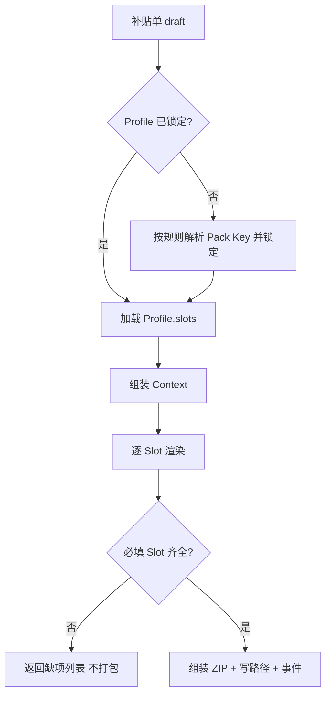

# 申报补贴材料生成实现方案

> **状态**：方案已按现网拍板（§九 D1–D21 **已确认**，2026-08-13）；**S1/P1/P2 骨架已落地**（`V20260813_004` + 申报补贴真页 + 配方/生成 API）  
> **日期**：2026-08-12（拍板修订 2026-08-13）  
> **范围**：`qianlvguoyu_saas`（`platform-api` + `admin-web`）补贴材料配方、模板版本与一键生成  
> **样例依据**：桌面目录 `申报补贴材料`（来宾 / 河池南丹 / 玉林；百色新型学徒文件夹为空待补）  
> **对齐**：  
> - [补贴与人社扩展实现方案.md](./补贴与人社扩展实现方案.md)（台账 S1、齐套 S2、人社 L1–L3；本文专写 **材料生成 L1**）  
> - [培训考试流程实现方案.md](./培训考试流程实现方案.md)（获证/成绩口径挂载，补贴消费不另算）  
> - 开班材料：`train_file_temp` + `TrainClassMaterialPackService`（引擎复用，清单不共用）  
> - [跟班课堂影像与培训照片材料生成实现方案.md](./跟班课堂影像与培训照片材料生成实现方案.md)（`photo_album` 优先消费跟班照片册）  

---

## 一、结论（先看）

| 问题 | 答案 |
|------|------|
| 各地市材料不一样怎么办？ | **Pack Profile**：按「地市 × 培训模式」配置材料槽位，不写死 `if 来宾` |
| 岗位技能提升 vs 新型学徒？ | **两套（或多套）Profile**；槽位字典共用，勾选不同 |
| 不同年份表样/清单会变？ | 增加 **policyYear + profileVersion**；补贴单**锁定**配方，旧单不被新模板冲掉 |
| 能不能整站用扣子/LLM 生成？ | **不能当主路径**；主路径是模板填空 + 附件归档；LLM 最多做辅助解读 |
| 和现网开班申报材料关系？ | **复用渲染引擎**（Word/Excel 变量、ZIP）；**清单与模板库独立**（`bizScope=subsidy`） |
| 管理端现状 | `TrainingSubsidyDeclarePage` 空壳；须先 S1 台账，再接本文生成 |

**一句话：**  
补贴材料生成 = **可配置配方（地市 × 模式 × 政策年 × 版本）+ 统一槽位渲染 + 单上锁定**；证据与证书走附件槽；齐套清单与配方同源。

```text
结课/获证就绪
  → 创建补贴单（锁定 region × trainMode × policyYear × profileVersion）
  → 按 Profile.slots 齐套核验
  → 一键生成 ZIP（docx/xlsx 填空 + 附件归档 + 人工上传槽）
  → 提交人社（L2 登记 / 可选 L3）
```

---

## 二、样例盘点（桌面「申报补贴材料」）

### 2.1 目录与规模

| 文件夹 | 推断模式 | 文件量级 | 备注 |
|--------|----------|----------|------|
| 来宾 | 岗位技能提升 | ~35（含证书 PDF） | 封面目录、汇总表、正考/补考获证、教学大纲、按人证书 |
| 河池南丹 | 岗位技能提升 | ~57 | 合同签订情况表、获证多册、证书夹 + PDF 合并 |
| 玉林 | 岗位技能提升 | ~11 | 代申协议、满意度调查、培训方案；样例无证书 PDF 夹 |
| 百色新型学徒 | 新型学徒 | **0** | **无样例，学徒 Profile 不可臆造清单** |

### 2.2 共性 vs 地市特有（岗位技能提升）

| 类型 | 材料 |
|------|------|
| **共性高频** | 拨付请示/资金申请、补贴申请表、申领/申报花名册、培训照片、获证相关名册 |
| **来宾特有倾向** | 封面目录、补贴汇总表、正考/补考获证拆分、教学大纲、按人证书 PDF |
| **南丹特有倾向** | 合同签订情况表、获证花名册分册、证书目录合并 PDF |
| **玉林特有倾向** | 代为申请培训补贴协议、学员满意度调查表、培训方案；拨付文案含「鉴定补贴」口径 |

> 差异本质是 **材料菜单与附件组织不同**，不是另一套业务流程。

---

## 三、配方模型（核心设计）

### 3.1 Pack Key

```text
Pack Key = region × trainMode × policyYear × profileVersion
```

| 维度 | 含义 | 示例 |
|------|------|------|
| `region` | 地市/区县申报口径 | 来宾、玉林、河池南丹、百色 |
| `trainMode` | 培训模式 | `skill_upgrade` 岗位技能提升 / `apprentice` 新型学徒 |
| `policyYear` | 政策年（业务年，非「今天的年份」） | 2024、2025 |
| `profileVersion` | 同年内补丁版 | v1、v2（年中增表/改表头） |

**补贴单在建单或首次生成时锁定上述四元组**；已提交/已生成包默认不可静默升版。

### 3.2 Profile 与 Slot

```text
train_subsidy_pack_profile
  - region, trainMode, policyYear, version, status(draft|active|retired)
  - slots[] 有序

train_subsidy_pack_slot
  - slotCode, title, required, sortOrder
  - renderer: docx_var | xlsx_row | file_copy | pdf_merge | manual_upload
  - templateId（可空，manual/file_copy 可不绑）
  - dataBinding（字段来源约定）
  - folderPath（ZIP 内相对路径，如「证书/」）
```

### 3.3 建议槽位字典（全省共用 code，各地勾选）

| slotCode | 名称 | 典型渲染 |
|----------|------|----------|
| `cover_toc` | 封面/申请目录 | docx_var |
| `fund_request` | 拨付请示/资金申请 | docx_var |
| `apply_form` | 补贴申请表 | xlsx_row / docx_var |
| `claim_roster` | 申领培训补贴人员花名册 | xlsx_row |
| `cert_roster` | 获证/鉴定名册 | xlsx_row |
| `cert_pass` / `cert_retake` | 正考/补考获证（可选拆分） | xlsx_row |
| `summary_sheet` | 补贴汇总表 | xlsx_row |
| `contract_sign` | 合同签订情况表 | xlsx_row |
| `proxy_agreement` | 代为申请培训补贴协议 | docx_var |
| `satisfaction` | 学员满意度调查表 | xlsx_row |
| `train_plan` / `syllabus` | 培训方案 / 教学大纲 | docx_var 或 manual_upload |
| `photo_album` | 培训照片 | 优先引用跟班生成的培训照片 Word；见 [跟班课堂影像与培训照片材料生成实现方案.md](./跟班课堂影像与培训照片材料生成实现方案.md) |
| `cert_pdf_bundle` | 证书 PDF 按人/合并 | file_copy / pdf_merge |
| `apprentice_*` | 新型学徒专属（协议/培养/出师等） | **待样例后补码** |

齐套核验（S2）的 checklist **直接来自**当前锁定 Profile 的 `required` slots，避免两套清单漂移。

### 3.4 政策年选择规则（默认建议，拍板可改）

1. **主规则**：补贴所属年度（申报预算年 / 结业所属年）。  
2. **跨年开班**：以结业日或获证日所在年写入并锁定。  
3. **禁止**用「系统当前自然年」自动切版（年底补报去年会错）。  
4. `draft` 可人工改 `policyYear`；首次生成或 `submitted` 后锁定。  
5. 跨年补报：允许显式选上年 Profile，须权限 + 审计。

### 3.5 版本演进

```text
玉林 × skill_upgrade × 2024 × v1  → 历史
玉林 × skill_upgrade × 2025 × v1  → 新年：复制上年 Profile 后改 Slot/模板
玉林 × skill_upgrade × 2025 × v2  → 年中补丁；新单默认 v2，旧单仍 v1
```

运维：**复制 Profile → 换模板 → 发布 active**；禁止同名模板静默覆盖导致历史不可回放。

---

## 四、与开班材料 / 补贴台账的边界

| 能力 | 开班申报材料 | 补贴材料（本文） |
|------|--------------|------------------|
| 模板表 | `train_file_temp`（建议扩 `bizScope`） | 同引擎；`bizScope=subsidy` 或独立 profile 表挂 templateId |
| 挂载 | 班级 `fileTemps` | 补贴单锁定 Profile，不逐班手挂四类（可预览槽位） |
| 生成服务 | `TrainClassMaterialPackService` | `TrainSubsidyMaterialPackService`（复用 Docx/Excel 工具类） |
| 数据上下文 | 开班花名册、师资等 | + 获证、考勤达标、影像索引、补贴金额口径 |
| 台账状态 | 开班申报流程 | `train_subsidy.phase`（见人社扩展方案 S1） |

人社 L1–L3 仍以《补贴与人社扩展实现方案》为准：本文交付的是 **L1 标准包生成**；L2 登记进度；L3 地市上传插件与配方解耦。

---

## 五、数据与生成流水线

### 5.1 补贴单建议字段（增量）

| 字段 | 说明 |
|------|------|
| `region_code` / `region_name` | 申报地市 |
| `train_mode` | 岗位技能提升 / 新型学徒 / … |
| `policy_year` | 政策年 |
| `profile_id` + `profile_version` | 锁定配方 |
| `material_pack_path` | 最近一次生成包 |
| `checklist_json` 或子表 | 齐套快照（可与 profile slots 对齐） |

### 5.2 生成流水线



**Context（与地市无关）**：班级/项目、机构企业、花名册、获证名单、补贴人数金额、考勤摘要、影像索引、证书文件列表。  
**Renderer（少数几种）**：模板填空、行写入、附件拷贝、PDF 合并、人工上传占位。

### 5.3 非目标（本文不做）

- 按地市硬编码多个 `*CitySubsidyService`。  
- 以 LLM 直接生成合规人社整包为主路径。  
- 开班材料包直接当补贴包交付。  
- 无样例前提下编造新型学徒完整清单。  
- 承诺各地人社门户一键代填成功（属 L3 选配）。

---

## 六、分期建议（咬合 S1–S3）

| 阶段 | 内容 | 依赖 |
|------|------|------|
| **P0 文档与盘点** | 本文 + 三市 Slot 勾选表 + 模板变量表 | 拍板 §九 |
| **P1 配方配置** | Profile/Slot CRUD、按年复制、默认版设置；模板入库（city+mode+year） | S1 补贴单可建 |
| **P2 生成试点** | 一市一模式（建议：来宾 × 岗位技能提升 × 已定政策年）一键 ZIP | 开班引擎复用；获证字段口径锁定 |
| **P3 扩展地市** | 玉林、南丹配方挂载；人工上传槽完善 | P2 稳定 |
| **P4 新型学徒** | 百色（或样例地）`apprentice_*` 槽位 | **学徒完整样例齐套后** |
| **P5 齐套联动** | checklist = Profile.required；跟班证据自动项 | S2 + 跟班 M2 |

---

## 七、权限与审计（摘要）

| 动作 | 建议角色 |
|------|----------|
| 维护 Profile/模板/发布版本 | 机构运营或系统配置岗 |
| 创建补贴单、选/改政策年（draft） | 机构操作员 |
| 一键生成、下载包 | 机构操作员 |
| 显式「升级到新年/新版并重生成」 | 机构操作员 + 确认；写 event |
| 齐套抽查 | follow_staff（对齐五角色） |
| 跨年补报选旧 Profile | 收紧权限 + 审计 |

---

## 八、风险与缓解

| 风险 | 缓解 |
|------|------|
| 地市/年份组合爆炸 | 复制 Profile；槽位字典稳定；只挂开通地市 |
| 模板静默覆盖导致历史包对不上 | templateId 版本化；单上锁定 profile |
| 用「今天年份」错切版 | 政策年规则 + 锁定；UI 展示四元组 |
| 学徒清单未齐就开发 | P4 门禁：无样例不开工 |
| 获证/证书来源不一 | 开工前锁定唯一获证口径（见拍板） |
| R3/M2 未到承诺自动影像齐套 | 影像槽可先 manual；自动项标「待跟班」 |

---

## 九、开工前拍板项（Gate）

> **正式决议**：下表已于 **2026-08-13** 按现网培训系统确认。  
> **依据**：`train_subsidy`（仅 `projectId`）、`train_info_list.city*`、`train_info_class.dateEnd`、三年规划 `trainMode`、开班材料按班生成、跟班照片册 E1–E3、申报页空壳、桌面三市样例。  
> **执行顺序**：**S1 台账 → P1 配方 → P2 来宾试点**（不得跳过 S1 先写配方生成）。

### 9.0 决议一览

| # | 正式决议 | 现网依据 |
|---|----------|----------|
| D1 | **C**：项目+班级皆可；**首期强制 `class_id`** | 现网补贴仅 `projectId`；开班/跟班/样例以班为中心 |
| D2 | **A**：一班一包 | 开班 materials/generate、跟班照片册均按班 |
| D3 | **C**：自 `train_info_list.city*` 带出，申报可改 | 班级无地市字段 |
| D4 | **建单必选 `trainMode`**；规划可追溯则预填可改 | 班级/培训单无该字段；规划矩阵/花名册有 |
| D5 | **来宾+玉林+河池南丹**；不含学徒地 | 桌面三市有包；百色学徒空 |
| D6 | **仅岗位技能提升** | 学徒无样例、无 runtime Profile |
| D7 | **`dateEnd`→`endDate` 定政策年** | 两字段现成；获证日未落地 |
| D8 | draft 可改，**首次生成锁定** | 避免建单过早锁错年 |
| D9 | **显式升级重生成 + 审计** | 禁止静默覆盖 |
| D10 | **允许**跨年补报选旧 Profile（权限+审计） | 年底补报刚需 |
| D11 | 新年默认版：**人工发布** | 禁止按自然日自动切 |
| D12 | 证书：预留系统+上传；**首期批量上传** | 证书表无班挂载；无稳定回写主路径 |
| D13 | 正式=考试综合合格；**过渡期导入/勾选**；禁模拟分 | 考试流程 Gate 未落地为补贴源 |
| D14 | **跟班照片册优先**，人工整册兜底 | E1–E3 已落地；E4 随台账挂钩 |
| D15 | **`manual_upload` 可进包** | 盖章件习惯 |
| D16 | **本期不做学徒**（P4） | 百色 0 文件 |
| D17 | §3.3 为槽位初稿；负责人=培训部教务/材料岗 | 三市可勾选差异化 |
| D18 | 试点 **来宾×skill_upgrade×2024**；备 2025 v1 空壳 | 来宾样例最完整 |
| D19 | **先 S1 台账再 P1** | UI 空壳；无单无法锁配方 |
| D20 | **不含 L3** | 仅 L1 生成 + L2 登记 |
| D21 | 对外=生成+齐套+台账；**不承诺代填** | 与人社扩展一致 |

### 9.1 业务口径

| # | 拍板项 | 决议 | 确认人 | 日期 |
|---|--------|------|--------|------|
| D1 | 补贴单粒度 | **C**（首期强制 `class_id`） | 现网推导 | 2026-08-13 |
| D2 | 一包范围 | **A** 一班一包 | 现网推导 | 2026-08-13 |
| D3 | `region` 来源 | **C**（`train_info_list.city*` 带出可改） | 现网推导 | 2026-08-13 |
| D4 | `trainMode` 来源 | **建单必选**；规划可预填 | 现网推导 | 2026-08-13 |
| D5 | 首期地市 | **来宾+玉林+河池南丹** | 现网推导 | 2026-08-13 |
| D6 | 首期模式 | **仅岗位技能提升** | 现网推导 | 2026-08-13 |

### 9.2 政策年与版本

| # | 拍板项 | 决议 | 确认人 | 日期 |
|---|--------|------|--------|------|
| D7 | `policyYear` | **A**（`dateEnd`→`endDate`） | 现网推导 | 2026-08-13 |
| D8 | 锁定时点 | **C**（首次生成锁定） | 现网推导 | 2026-08-13 |
| D9 | 升版 | **B**（显式+审计） | 现网推导 | 2026-08-13 |
| D10 | 跨年补报 | **A**（允许旧 Profile） | 现网推导 | 2026-08-13 |
| D11 | 新年生效 | **A**（人工发布） | 现网推导 | 2026-08-13 |

### 9.3 材料与数据

| # | 拍板项 | 决议 | 确认人 | 日期 |
|---|--------|------|--------|------|
| D12 | 证书 PDF | **C**（首期主路径上传） | 现网推导 | 2026-08-13 |
| D13 | 获证口径 | **考试综合合格**；过渡期导入/勾选 | 现网推导 | 2026-08-13 |
| D14 | 培训照片 | **C**（跟班优先，人工兜底） | 现网推导 | 2026-08-13 |
| D15 | 非模板件 | **A** 可进包 | 现网推导 | 2026-08-13 |
| D16 | 新型学徒 | **B** 本期不做 | 现网推导 | 2026-08-13 |
| D17 | Slot 勾选 | **是**；负责人=培训部教务/材料岗 | 现网推导 | 2026-08-13 |

### 9.4 产品分期与人社

| # | 拍板项 | 决议 | 确认人 | 日期 |
|---|--------|------|--------|------|
| D18 | 试点包 | **来宾 × skill_upgrade × 2024** | 现网推导 | 2026-08-13 |
| D19 | 与 S1 排期 | **A** 先台账再配方 | 现网推导 | 2026-08-13 |
| D20 | L3 | **A** 不含 | 现网推导 | 2026-08-13 |
| D21 | 对外口径 | **确认**（不承诺代填） | 现网推导 | 2026-08-13 |

### 9.5 Gate 检查清单

- [x] D1–D21 **已按现网确认**（2026-08-13）  
- [ ] P2 前：来宾 2024 完整样例入库并标注 `region + trainMode + policyYear`  
- [ ] D13 与《培训考试流程》交叉确认（**不阻塞** S1/P1；过渡期用导入）  

**Gate 通过。下一步：S1 补贴台账真页（`class_id`/`phase`/锁定四元组）→ P1 配方 → P2 来宾试点 ZIP。**

---

## 十、验收建议（拍板后细化）

| 编号 | 验收项 |
|------|--------|
| A1 | 同一班级切换 `policyYear`（draft）可解析到不同 Profile |
| A2 | 锁定后改库内新年默认版，已锁单重打仍为旧版材料清单 |
| A3 | 来宾试点：必填 Slot 缺项时拒绝打包并列出缺项 |
| A4 | 生成 ZIP 目录/文件名与样例约定一致（允许配置 folderPath） |
| A5 | 玉林特有 Slot（协议/满意度等）仅在玉林 Profile 出现 |
| A6 | 事件表可查：生成、升版、跨年补报操作人与时间 |

---

## 十一、文档索引

| 文档 | 关系 |
|------|------|
| 本文 | 补贴**材料配方与生成**权威方案；含开工前 Gate |
| [补贴与人社扩展实现方案.md](./补贴与人社扩展实现方案.md) | 台账/齐套/人社 L1–L3/结算；本文为其 L1 材料深化 |
| [培训考试流程实现方案.md](./培训考试流程实现方案.md) | 成绩/获证挂载，补贴消费同源口径 |
| [培训班级五角色落地实现方案.md](./培训班级五角色落地实现方案.md) | 齐套抽查角色 |
| 桌面 `申报补贴材料` | 来宾/南丹/玉林样例；百色学徒待补 |

---

*P0 完成标志：本文入库；§九 **已按现网正式拍板**（2026-08-13）。下一步 **S1 台账 → P1 配方 → P2 来宾试点**。开发默认不改人社生产环境。*
