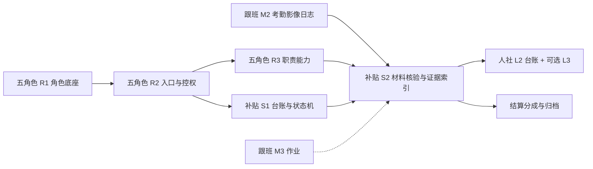

# 补贴与人社扩展实现方案

> **状态**：方案稿（文档先行；与五角色 R2–R3、跟班 M2–M4 对齐后分期开发）  
> **日期**：2026-08-07  
> **范围**：`qianlvguoyu_saas`（`platform-api` + `admin-web`）；人社侧以「材料真相源 + 进度镜像」为主，正式 API/RPA 为可选 L3  
> **对齐**：  
> - [培训班级五角色落地实现方案.md](./培训班级五角色落地实现方案.md) **R2–R3**  
> - [跟班模块功能实现方案.md](./跟班模块功能实现方案.md) **M2–M4**（证据链）  
> - [培训模块_对外售卖介绍与功能需求说明.md](./培训模块_对外售卖介绍与功能需求说明.md) §3.9 / §5.2  
> - [SaaS云平台培训模块详细介绍与功能需求说明.md](./SaaS云平台培训模块详细介绍与功能需求说明.md) §5.1–5.2  
> - [培训部数字化功能需求规格说明书.md](./培训部数字化功能需求规格说明书.md)（机构提交人社、补贴材料与拨款）  

---

## 一、背景与目标

### 1.1 为什么单独成文

五角色方案将「人社对接、补贴全流程、独立师资 App」列为非目标。其中：

| 项 | 本方案是否覆盖 |
|----|----------------|
| 补贴全流程（材料→申报→拨款→结算→归档） | **覆盖**（主线） |
| 人社对接（模板/台账/可选 API） | **覆盖**（分 L1–L3） |
| 独立师资 App | **不覆盖**（维持五角色「同 App」；人社师资操作以外链指引） |

补贴与人社强依赖**班级证据与角色控权**，须与五角色 R2–R3、跟班留痕同步规划，避免空壳菜单无法验收。

### 1.2 目标

1. 管理端「申报补贴」从空壳变为可运转的**项目/班级补贴台账 + 状态机**。  
2. 补贴材料可**清单化核验**，并挂接跟班证据索引（考勤、影像、日志等）。  
3. 人社交互按 **L1 模板对齐 → L2 交换台账 → L3 适配器** 递进，不绑定单一地市接口。  
4. 权限与待办按班级角色拆分（跟班教务抽查合规、班主任催材料、机构操作员推进申报）。

### 1.3 非目标

- 替代人社官方门户完成全部在线填报（无接口时不做虚假「一键代填」承诺）。  
- 独立师资 App、人社考前系统账号托管。  
- 十大管理表全自动、协议多级审批全量（可引用立项扩展，本方案只留挂载点）。  
- 认定子系统内部改造（仅约定获证名单回写字段）。

---

## 二、与五角色 R2–R3 / 跟班的对齐

### 2.1 依赖关系



| 五角色 / 跟班阶段 | 对本方案的贡献 | 本方案可并行交付 |
|-------------------|----------------|------------------|
| **R1** 角色底座 | 知道本班跟班教务/班主任/主讲是谁 | 补贴记录可挂 `owner`/`checker`（可选） |
| **R2** 入口与控权 | `ClassRoleScopeService`；跟班教务多班；班主任本班写读规则 | **S1** 补贴台账 UI + 状态机（机构操作员为主） |
| **R3** + **M2** | 考勤确认流、影像、日志落库 | **S2** 齐套核验与证据目录导出 |
| **M3** 作业 | 作业完成率可进核验项（可选） | S2 清单项扩展 |
| **M4** 督导/指标 | 合规标记、通过率 | S2/S3 抽查与退件归因 |

### 2.2 角色在补贴/人社中的职责

| 角色码 | 补贴与人社侧职责 |
|--------|------------------|
| 机构操作员（组织层） | 创建补贴单、生成/上传材料包、登记人社进度、拨款与结算发起 |
| `follow_staff` | 多班抽查齐套与证据；标记「材料齐全 / 待补传」；复核退件项 |
| `head_teacher` | 催本班缺项；确认企业侧盖章/名单；查看本班补贴进度（只读为主） |
| `lead_teacher` / `assistant` | 一般不直接做补贴；教学证据经跟班回流 |
| `monitor` / `student` | 不直接操作补贴；班长影像等进入证据池 |
| 财务 / 综合办 / 总经理 | 结算审批（S4，按开通） |

> R2 未上线前：S1 仅管理端 org 权限；R2 后把「齐套抽查」待办推给 `follow_staff`。

---

## 三、现状资产

| 资产 | 说明 | 本方案用法 |
|------|------|------------|
| `train_subsidy` | 已有：`policy_template`、金额、人数、`material_*`、`rssb_*`、实拨 | S1 强化状态语义与班级维度 |
| `TrainSubsidyApplicationService` / Controller | CRUD + submit/approve 骨架 | 扩展状态机与校验，接真 UI |
| 菜单 `train_subsidy_declare` | 流程步「申报补贴」 | 替换 `TrainingSubsidyDeclarePage` 空壳 |
| 运营占位 `ops_subsidy_*` | 材料申请/导出/流程 | 收敛进申报补贴工作台或逐步替换 |
| 开班材料包 | `TrainClassMaterialPackService` 等 | L1 模板能力复用到补贴清单 |
| 人社考勤导入 | `TrainAttendanceImportSupport` | L1 双向：我方导出索引 ↔ 人社表导入 |
| `train_settlement` / `train_summary` | 结算与总结表已建 | S4 接真，避免另起炉灶 |
| 获证 / 考试 | 考试菜单 + 认定衔接需求 | S2 齐套项「获证名单核对」 |

---

## 四、业务蓝图

```text
结课 / 获证名单就绪
    → 创建补贴申请单（项目或班级）
    → 材料清单生成 + 缺项核验（跟班证据索引）
    → 机构提交人社（线下或 L3）
    → 登记 rssb 进度（通过 / 退回补正）
    → 拨款登记
    → 结算分成审批
    → 归档与项目总结
```

人社 L1–L3：

| 层级 | 能力 | 依赖外部接口 |
|------|------|--------------|
| **L1** | 补贴/开班材料模板与人社版式对齐；校验表头；导出标准包 | 否 |
| **L2** | 系统内登记提交时间、回执号、退回原因、纸质盖章状态；时间线 | 否 |
| **L3** | `RssbGateway` 按地市插件：上传/查进度/解析退回；失败可降级 L2 | 是（或受控 RPA） |

> 补贴材料「地市 × 培训模式 × 政策年」配方、槽位生成与**开工前拍板项**见专文：[申报补贴材料生成实现方案.md](./申报补贴材料生成实现方案.md)。

---

## 五、数据模型扩展（建议）

### 5.1 强化 `train_subsidy`（兼容现表）

在不大改主键的前提下建议补充（Flyway 增量）：

| 字段 | 说明 |
|------|------|
| `class_id` | 可空；班级级补贴；空则纯项目级 |
| `train_info_id` | 冗余项目/培训单 |
| `phase` | 状态机：`draft` / `checking` / `ready` / `submitted` / `rejected` / `approved` / `granting` / `granted` / `closed` |
| `checklist_json` 或子表 | 齐套项快照 |
| `evidence_index_path` | 证据目录导出包路径 |
| `follow_staff_user_id` | 可选：责任跟班教务 |
| `head_teacher_user_id` | 可选：责任班主任 |

现有 `status` / `material_status` / `rssb_status`：S1 起映射到 `phase` 与枚举字典，避免三套含义漂移；过渡期双写。

### 5.2 建议新增表

| 表 | 用途 |
|----|------|
| `train_subsidy_checklist_item` | 齐套项：code、名称、必填、状态、缺项说明、关联证据类型 |
| `train_subsidy_event` | 进度时间线：操作人、动作、备注、附件 |
| `train_rssb_exchange` | L2/L3：方向(upload/query)、通道(manual/api/rpa)、请求摘要、回执原文、结果 |
| （复用）`train_settlement` | 分成金额、审批状态 |
| （复用）`train_summary` | 结项总结 |

### 5.3 齐套项默认清单（可配置）

| code | 名称 | 证据来源 | 最早可用阶段 |
|------|------|----------|--------------|
| `roster` | 花名册与开班人数一致 | `train_people_list` | R1+ |
| `cert_list` | 获证名单已核对 | 认定/导入 | 结课 |
| `attendance` | 考勤有效出勤达标 | `train_attendance` + 确认流 | M2 / R3 |
| `evidence_photo` | 课堂影像齐全度 | `train_follow_evidence` | M2 / R3 |
| `follow_log` | 班主任/跟班日志 | `train_follow_log` | M2 / R3 |
| `homework` | 作业完成率（可选） | `train_follow_task*` | M3 |
| `open_pack` | 开班申报材料已存档 | 开班材料包 | 已有 |
| `seal` | 企业/机构盖章备注 | 人工 | L2 |

R2 仅强制 `roster` + 人工项；R3/M2 后自动核验考勤与影像项。

---

## 六、权限与待办

| 能力 | 机构操作员 | follow_staff | head_teacher | 财务/审批 |
|------|:----------:|:------------:|:------------:|:---------:|
| 创建/编辑补贴单 | ✓ | — | — | — |
| 跑齐套核验 | ✓ | ✓ | 本班只读结果 | — |
| 标记缺项/催办 | ✓ | ✓ | 本班催办 | — |
| 登记人社进度 L2 | ✓ | 可协助 | — | — |
| 触发 L3 上传 | ✓ | — | — | — |
| 拨款登记 | ✓ | — | — | ✓(可选) |
| 结算审批 | 发起 | — | 企业确认(可选) | ✓ |

待办（R2 后）：

- 跟班教务：`checking` 且缺项 > 0 的班级列表。  
- 班主任：本班缺项（影像、名单）催办。  
- 机构：人社退回 `rejected` 待补正。

---

## 七、API / 页面清单（只列）

### 7.1 API（建议）

| 方法 | 路径 | 阶段 |
|------|------|------|
| GET/POST | `/training/subsidies` | S1 |
| GET/PUT | `/training/subsidies/{id}` | S1 |
| POST | `/training/subsidies/{id}/transition` | S1 状态机 |
| POST | `/training/subsidies/{id}/checklist/run` | S2 |
| GET | `/training/subsidies/{id}/evidence-index` | S2 |
| POST | `/training/subsidies/{id}/rssb/manual` | S2=L2 |
| POST | `/training/subsidies/{id}/rssb/submit` | S3=L3 可选 |
| GET | `/training/subsidies/{id}/events` | S1 |
| CRUD | `/training/settlements` | S4 |

### 7.2 页面

| 页面 | 改造 | 阶段 |
|------|------|------|
| `TrainingSubsidyDeclarePage` | 列表 + 详情 + 状态流转 + 时间线 | S1 |
| 补贴详情「齐套」Tab | 清单、一键核验、缺项 | S2 |
| 补贴详情「人社」Tab | L2 表单；L3 按钮（无网关则隐藏） | S2/S3 |
| 跟班工作台 | 「合规/齐套」摘要入口（follow_staff） | R2+S2 |
| 结算 / 总结页 | 接 `train_settlement` / `train_summary` | S4 |

---

## 八、人社 L3 适配器（可选）

```text
RssbGateway (interface)
  submitOpenClassPack(classId, pack)
  submitSubsidyPack(subsidyId, pack)
  queryStatus(receiptNo) -> RssbStatus
  parseReject(raw) -> reason + items

实现：
  ManualRssbGateway     → 仅写 train_rssb_exchange（L2）
  CityXxxRssbClient     → HTTP/SDK
  RpaRssbGateway        → 受控机器人（需安全评审）
```

配置：`sys_dict` / 租户配置 `rssb.provider=manual|city_xxx|rpa`。默认 `manual`。

---

## 九、分期与验收（S1–S4 ↔ R2–R3）

| 阶段 | 对齐 | 交付 | 验收 |
|------|------|------|------|
| **S0** | — | 本文档评审 | 产品确认 L1–L3 边界与不承诺代填 |
| **S1 台账** | **R2 同期或紧随** | 补贴单 CRUD、`phase` 状态机、申报补贴真页、事件时间线；org 操作 | 可建单并走到 `submitted`（人工） |
| **S2 齐套+证据** | **R3 + 跟班 M2** | checklist 核验、证据索引导出、跟班教务抽查待办；人社 **L2** | 缺考勤/影像能提示；退回可登记原因 |
| **S3 人社 L1 强化 + L3** | S2 后 | 模板校验加固；可选 Gateway | 有接口的租户可试上传/查进度；无接口不影响 L2 |
| **S4 结算归档** | S2 后可并行 | settlement/summary 真页、分成审批 | 一笔补贴能闭环到归档 |

**独立师资 App**：不在本路线；人社「老师登录」用操作指引 + 外链。

---

## 十、对外口径

| 可承诺（扩展包） | 不可承诺（除非签约 L3） |
|------------------|-------------------------|
| 补贴进度台账、拨款登记、材料缺项核验 | 全自动登录各地人社并代填成功 |
| 证据目录导出服务稽核 | 替代人社官方审批结果 |
| 开班/补贴 Excel 与已知模板对齐 | 全国统一人社 API（各地差异大） |

售卖材料 §5.2「补贴材料一键核验与拨款跟踪、人社系统对接」应对应本方案 **S2 + L2**，L3 单列选配。

---

## 十一、风险

| 风险 | 缓解 |
|------|------|
| R3/M2 未到就承诺自动齐套 | S1 只做人工清单；自动项标「待跟班证据」 |
| 地市政策/模板多变 | 模板版本化；租户级挂载；详见《申报补贴材料生成》Pack Key（含政策年锁定） |
| L3 安全与账号合规 | 默认 manual；RPA 需专审 |
| `status` 三字段语义混乱 | 引入 `phase` + 字典映射 |
| 与认定获证字段不统一 | S2 前锁定唯一「合格/获证」来源字段 |

---

## 十二、评审清单

- [ ] 确认补贴粒度：项目级 / 班级级 / 两者皆可  
- [ ] 确认齐套必填项首期集合（建议：花名册 + 获证 + 考勤；影像随 M2）  
- [ ] 确认 L3 是否进入本期报价（默认否）  
- [ ] 确认结算审批链（综合办/总经理/企业）  
- [ ] 确认与五角色 R2 同步排期：S1 不阻塞 R2，S2 不早于 M2 证据落库  
- [ ] 评审通过后输出：《补贴接口清单》+ 状态机枚举表再开工  

---

## 十三、文档索引

| 文档 | 关系 |
|------|------|
| 本文 | 补贴 + 人社扩展权威方案（台账/齐套/人社/结算） |
| [申报补贴材料生成实现方案.md](./申报补贴材料生成实现方案.md) | **材料 L1 深化**：地市×模式×政策年配方、槽位、分期；**§九 开工前拍板 Gate** |
| 培训班级五角色落地实现方案 | R2–R3 控权与待办主体 |
| 跟班模块功能实现方案 | 证据链 M2–M4 |
| 对外售卖介绍 §5.2 | 商务扩展包口径 |
| 培训部数字化规格 | 业务步骤来源（机构交人社、拨款跟进） |

---

*S0 完成标志：本文入库并完成交叉引用；开发以 S1 起另排期，默认不改人社生产环境。*
