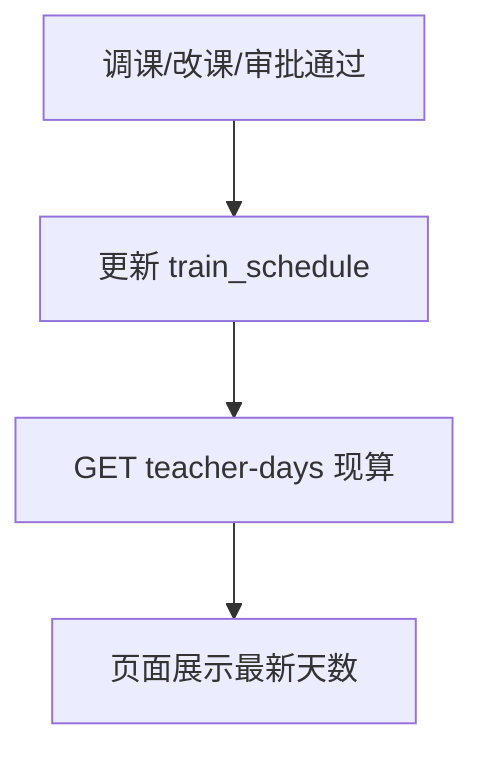
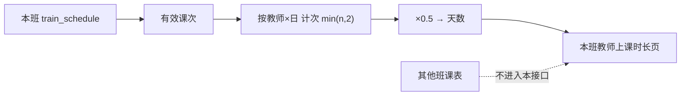

# 跟班 · 教师上课时长统计 · 实现方案

> **日期**：2026-08-19  
> **状态**：**P0 已落地**（口径现算 + `GET .../teacher-days` + 课程表「教师上课时长」页）  
> **入口**：跟班工作台 → 课程表 → 「教师上课时长」  
> **关联**：[跟班_学员上课总课时统计_实现方案.md](./跟班_学员上课总课时统计_实现方案.md)（学员侧是「课时」；教师侧是「天」，口径互不混用）  
> **原则**：P0 不新建表、**不落时长快照**；每次打开/刷新均按**当前结构化课表**现算；**调课（含审批通过、直接改课、增删课次、改老师）后时长自动与课表一致**；按班统计；以 `teacher_name` 为归属  

---

## 0. 结论（已拍板）

**产品一句话**：在**当前班级**课表里，按教师汇总上课次数；**一次课 = 课表上的一条课次 = 0.5 天**；老师**一天最多两节**（同日最多计 **1.0 天**）。同一老师在其他班上课，须进入**对应班级**各自统计，**不做跨班合计**。**调课后以最新课表重算，时长与课表同步。**

| 问题 | 定稿 |
|------|------|
| 统计范围 | **仅当前班级** `classId`；一班一页、一班一算 |
| 「一次课」 | **课表 1 条 `train_schedule` 记录**（与墙钟长短、`classHours` 无关） |
| 折算 | **1 次课 = 0.5 天** |
| 一天上限 | 业务约束：**一天最多 2 节** → 同一教师同一 `schedule_date` 最多计 **2 × 0.5 = 1.0 天**；若课表误排超过 2 节，统计时 **按 2 节封顶**，并提示「超限课次数」 |
| 跨班 | **不合并**。老师在 A 班、B 班各算各的；本页只展示本班 |
| **调课同步** | **现算、不缓存结果表**。凡写入/变更本班 `train_schedule` 的操作，下次查询教师时长即反映新课表（见 §2.5） |
| 未填老师 | 不计入任何人；班级提示「未指派老师课次数」 |
| 未来课次 | **已上天数**只含 `schedule_date ≤ 今天`；**计划天数**含全课表（同样受「同日最多 2 节」约束） |
| 学员考勤 / 老师打卡 | P0 **都不看** |
| 姓名 | `trim(teacherName)` 聚合；异名不自动合并 |
| 与学员「课时」 | 单位不同：教师用 **天**，禁止混叫「课时」 |

---

## 1. 背景与目标

### 1.1 已有能力

- 课表可维护课次，老师可从师资库选择或手输（`teacher_name`）。
- 「教师上课时长」入口已切空页。

### 1.2 要解决什么

- 跟班过程中/结班时，按**本班**统计每位老师上了多少天课（劳务/对账）。
- 老师一天最多两节 ↔ 一天最多计 1.0 天；多班授课则分班查看。

### 1.3 不做（本期）

- 跨班汇总报表（P1 可选，且须标注分班明细，禁止 silently 相加后当唯一结果）  
- 教师 App、补贴单据直写、`teacher_id` 强制绑定  
- 按分钟 / `classHours` 再折算教师天数  

---

## 2. 口径（锁定）

### 2.1 计次与折算

```text
范围：仅 class_id = 当前班

有效课次 = train_schedule
           AND deleted = 0
           AND teacher_name 去空白后非空

一次课 = 一条有效课次
单次天数 = 0.5

同一教师 × 同一上课日：
  计次 = min(当日有效课次数, 2)
  当日天数 = 计次 × 0.5   // 最大 1.0
```

教师 T 在本班：

| 指标 | 算法 |
|------|------|
| `taughtSessionCount` | Σ 各日 `min(当日已发生课次数, 2)`，且 `schedule_date ≤ today` |
| `taughtDays` | `taughtSessionCount × 0.5` |
| `plannedSessionCount` | Σ 各日 `min(当日计划课次数, 2)`（全课表日期） |
| `plannedDays` | `plannedSessionCount × 0.5` |
| `overflowSessionCount` | 各日 `max(0, 当日课次数 − 2)` 之和（用于告警，不计入天数） |

时区：**Asia/Shanghai**。

### 2.2 示例（本班）

| 课表 | 计次（封顶后） | 天数 |
|------|----------------|------|
| 张三 当天第 1 节 | 1 | 0.5 |
| 张三 当天第 2 节 | 1 | 0.5 |
| 张三 当天第 3 节（异常） | **不计**（计入 overflow） | — |
| **张三当天合计** | **2** | **1.0** |
| 张三在本班另有 2 个已过日、每日 1 节 | +2 | +1.0 |
| **张三本班已上** | 4 | **2.0** |

张三同时在乙班有课：乙班跟班工作台各自再算一遍，**不与本班数字相加展示在本页**。

### 2.3 姓名

- 键：`normalizeName = trim`（去全角空格）。  
- 提示：尽量从师资库选择，避免手输异名拆成两人。

### 2.4 调课与时长同步（锁定）

**唯一真相源 = 当前结构化课表**（`train_schedule`，`deleted=0`）。教师时长接口**每次请求现算**，不写独立快照表，因此：

| 调课/改课路径 | 对课表的影响 | 对教师时长的影响 |
|---------------|--------------|------------------|
| 课程表「直接改课 / 添加 / 删除 / 保存」 | 增删改课次、改日期时段、改 `teacherName` | **自动同步**（刷新或再进「教师上课时长」即新数） |
| 「调课审批」通过 | 审批通过后写入结构化课表并标记已调课 | **自动同步** |
| App 紧急改课（若有） | 以最终写入课表为准 | **自动同步** |
| 重导开班课表 | 覆盖结构化课次 | **自动同步**（按覆盖后的课表重算） |
| 仅驳回调课申请、未改课表 | 课表不变 | 时长不变 |

实现要求：

1. **禁止**把「某次导出的教师天数」当成永久账；对账以**当前课表重算结果**为准（若业务要留痕，P1 再做导出快照文件，仍不进库表）。  
2. 前端在课表保存成功、调课审批通过后，**invalidate** `teacher-days` 查询缓存，避免列表仍显示旧数。  
3. 逻辑删除的旧课次 **不计时长**；老师从课次 A 调到课次 B：A 删除/改名后不再计给原老师，B 计入新老师。  
4. 换老师：原老师天数减少、新老师增加，同一次现算完成。



---

## 3. 数据流

```text
读「当前班级」train_schedule（禁止拉其他 class_id）
  → 有效课次
  → 按 (teacherName, scheduleDate) 计数并封顶 2
  → 按教师汇总 taught / planned
  → 本班页面展示
```



纯函数建议：`FollowTeacherDayCalculator` + 单测（含同日 3 节封顶、跨日累加、空姓名）。

---

## 4. 接口（拟）

`GET /training/info-classes/{classId}/follow/teacher-days`  
权限与本班课表查看一致。**仅返回该 classId。**

```json
{
  "classId": 1001,
  "sessionUnitDays": 0.5,
  "maxSessionsPerDay": 2,
  "asOfDate": "2026-08-19",
  "assignedSessionCount": 22,
  "unassignedSessionCount": 2,
  "overflowSessionCount": 1,
  "taughtDaysSum": 8.5,
  "plannedDaysSum": 11.0,
  "teachers": [
    {
      "teacherName": "韦秀曼",
      "taughtSessionCount": 6,
      "taughtDays": 3.0,
      "plannedSessionCount": 10,
      "plannedDays": 5.0,
      "overflowSessionCount": 0
    }
  ]
}
```

文案说明建议带一句：「仅统计本班；其他班级请进入对应跟班工作台查看。」

---

## 5. 前端

| 区域 | 内容 |
|------|------|
| 说明 | 1 课次 = 0.5 天；一天最多 2 节 = 最多 1.0 天；**仅本班** |
| Statistic | 已上天数合计、计划天数合计、未指派课次、超限课次（>0 时警告色） |
| 表格 | 教师 / 已上课次 / 已上天数 / 计划课次 / 计划天数 |
| 空态 | 无老师 → 引导回课表补老师 |

---

## 6. 实现切面（待开发）

| 层 | 职责 |
|----|------|
| Calculator + 单测 | 0.5、同日封顶 2、今日截止、仅输入本班课次列表 |
| ApplicationService | `eq classId` 读课表 → 计算 |
| FE | 填空页；课表/调课变更后 invalidate teacher-days |

不改课表保存、学员课时、考勤导入。

---

## 7. 验收

- [ ] 本班教师 4 条已发生课次、且无同日超 2 节 → 已上天数 **2.0**  
- [ ] 同日 2 节 → **1.0** 天；同日 3 节 → 仍 **1.0** 天且 overflow≥1  
- [ ] 切换到另一班级，同一老师数字仅含该班课表  
- [ ] 本页无任何「全租户/跨班合计」入口（P0）  
- [ ] 文案用「天 / 课次」，不与学员「课时」混用  
- [ ] **调课同步**：直接改课更换老师 / 删除课次 / 审批通过调课申请后，教师时长页数字与最新课表一致（无需手工重算按钮）  
- [ ] 驳回调课且未改课表 → 时长不变  

---

## 8. 分期

| 阶段 | 内容 |
|------|------|
| **P0** | 本班口径 + 现算 API + 页面；调课/改课后 FE 刷新缓存 |
| P1 | 课酬单价（本班）+ 按样表导出；见 [跟班_教师课酬设置与导出_实现方案.md](./跟班_教师课酬设置与导出_实现方案.md) |
| P2 | 双师共课；对接补贴；跨班汇总 |

---

**已拍板，可按本文开发。** 调课同步依赖「现算 + 课表为真相源」，不另做同步任务。
