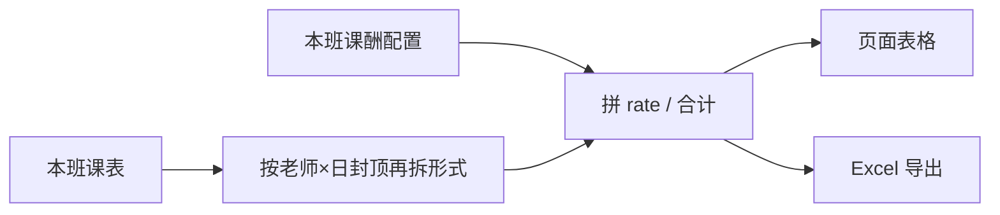

# 跟班 · 教师上课时长 · 课酬设置与导出 · 实现方案

> **日期**：2026-08-19  
> **状态**：**已落地（P1a+P1b）**（天数统计 P0 已落地；课酬配置 + 样表导出已实现）  
> **入口**：跟班工作台 → 课程表 →「教师上课时长」  
> **样表**：业务提供的课酬表（序号 / 班期 / 授课老师 / 授课形式 / 授课天数 / 课酬（天数/元） / 合计课酬 / 备注）  
> **前置**：[跟班_教师上课时长统计_实现方案.md](./跟班_教师上课时长统计_实现方案.md)  
> **原则**：天数仍按课表现算；课酬单价**按班配置、可改**；导出只反映**当前班**；调课后天数变、合计课酬跟着变  

---

## 0. 结论（先看）

**产品一句话**：在「教师上课时长」页按 **老师 + 授课形式** 展示已上天数，可填写 **课酬（元/天）**，并 **导出 Excel**，列与样表一致；`合计课酬 = 授课天数 × 课酬单价`。

| 问题 | 定稿建议 |
|------|----------|
| 导出列 | 与样表一致：序号、班期、授课老师、授课形式、授课天数、课酬（天数/元）、合计课酬、备注 |
| 行粒度 | **教师 × 授课形式**（理论 / 实操 / 未填形式单独一行「未填」） |
| 授课天数用哪套 | **已上天数**（`schedule_date ≤ 今天`，同日封顶规则同 P0）；导出结算用「已上」 |
| 一天最多 2 节 | 仍按 **教师 × 自然日** 全局封顶（理论+实操合计 ≤ 2），再按课次归属分摊到各形式行 |
| 课酬单价存哪 | **本班配置表**（见 §3），不写进师资库全局（避免各班单价不同互相覆盖） |
| 单价维度 | **班级 + 教师姓名 + 授课形式** 各一条单价（样表里同人理论/实操单价可不同） |
| 未设单价 | 页面可空；导出「课酬」「合计」留空或 0，备注可写「未设课酬」 |
| 调课同步 | 天数现算；单价不变；合计课酬随天数变。无需单独「同步课酬」任务 |
| 跨班 | 导出仍只含本班；班期列填本班名称 |

---

## 1. 与样表对齐

样表行示意：

| 序号 | 班期 | 授课老师 | 授课形式 | 授课天数 | 课酬（天数/元） | 合计课酬 | 备注 |
|------|------|----------|----------|----------|-----------------|----------|------|
| 1 | 技师1班 | 林忠 | 理论 | 4 | 800 | 3200 | |
| 2 | （合并） | 韦后明 | 理论 | 12.5 | 800 | 10000 | |
| … | | 黄承盼 | 实操 | 42.5 | 600 | 25500 | |

实现要点：

1. **班期**列：本班 `title`，多行可合并单元格（导出时 POI merge）。  
2. **授课形式**：来自课表 `teach_form`（归一：含「理论」→理论，含「实操」→实操，其余→原样或「未填」）。  
3. **授课天数**：该「老师+形式」下的已上天数（0.5 步进）。  
4. **课酬**：用户在页面录入的单价。  
5. **合计课酬**：`天数 × 单价`，保留整数或 2 位小数（建议 **整数元**，与样表一致）。

---

## 2. 天数拆分（在 P0 上扩展）

P0 只按教师汇总。导出需要 **按授课形式拆行**，且不破坏「一天最多 2 节」。

### 2.1 算法

```text
对本班每条有效课次（有老师）：
  归入桶 (teacherName, scheduleDate, teachForm)

对每个 (teacher, date)：
  当日全部课次按开始时间排序
  只取前 2 条计入（其余进 overflow）
  被计入的课次按其 teachForm 累加到 (teacher, form) 的「已上课次」

taughtDays(teacher, form) = taughtSessionCount(teacher, form) × 0.5
```

计划天数若页面也要展示，同理对全课表做封顶分摊（导出默认只用已上）。

### 2.2 示例

同一天：理论 08:00、实操 13:00、理论 19:30  

- 计入前 2 节 → 理论 0.5 + 实操 0.5；第三节理论进 overflow。  
- 导出两行：理论 0.5 天、实操 0.5 天。

---

## 3. 课酬配置存储

### 3.1 建议新建表（本班维度）

`train_class_teacher_pay`（名称可微调）

| 字段 | 说明 |
|------|------|
| id | 主键 |
| tenant_id | 租户 |
| class_id | 班级 |
| teacher_name | 与课表一致的展示名（trim 后） |
| teach_form | `理论` / `实操` / `未填`（或空串统一成未填） |
| rate_per_day | 课酬单价（元/天），`DECIMAL(12,2)` |
| remark | 备注（可选，对应导出「备注」） |
| deleted / 审计字段 | 同现网 |

唯一键：`(tenant_id, class_id, teacher_name, teach_form, deleted)`。

**不放师资库**：同一老师不同班单价可以不同（样表是班期课酬表）。

### 3.2 接口（拟）

| 方法 | 路径 | 说明 |
|------|------|------|
| GET | `.../follow/teacher-days` | **扩展**：行改为老师×形式；带上 `ratePerDay`、`payTotal`、`remark`（联配置表） |
| PUT | `.../follow/teacher-pay` | 批量保存本班课酬：`[{ teacherName, teachForm, ratePerDay, remark }]` |
| GET | `.../follow/teacher-days/export` | 导出 Excel（或 POST 带筛选，P0 用 GET） |

权限：查看 `train:info-class:view`；改课酬 / 导出建议 `train:info-class:update`（或与课表保存同权）。

---

## 4. 页面交互

在现有「教师上课时长」页：

1. **表格列**（对齐样表，班期内可无「班期」列因已在本班上下文；导出再带班期）  
   - 授课老师、授课形式、已上天数、**课酬（元/天）可编辑**、合计课酬（只读）、备注可编辑、超限提示  
2. **保存课酬**按钮：提交当前编辑的单价/备注（未改天数）。  
3. **导出**按钮：下载 `.xlsx`，格式同样表；班期列合并。  
4. 说明文案：天数按课表现算；课酬为本班设置；合计 = 天数 × 单价。

未出现在课表、但曾保存过课酬的行：P0 **不展示**（以课表老师×形式为准）；避免脏数据。

---

## 5. 导出实现要点

- 技术：与现网课表导出相同（POI / EasyExcel，跟 `exportClassSchedule` 对齐）。  
- 文件名：`{班期}-教师课酬-{yyyyMMdd}.xlsx`。  
- 班期单元格纵向合并。  
- 数值：天数 1 位小数；单价、合计按整数或 2 位（与财务约定，建议合计四舍五入到元）。  
- **不落库导出快照**：每次导出现算天数 + 读最新课酬配置。



---

## 6. 实现切面（待编码）

| 层 | 改动 |
|----|------|
| DB | Flyway：`train_class_teacher_pay` |
| Calculator | 扩展为 `teacher × form` 输出；同日跨形式封顶 |
| API | teacher-days 扩字段；PUT teacher-pay；export |
| FE | 可编辑单价/备注、保存、导出；invalidate 同 P0 |

调课审批通过 / 保存课表后：仍 invalidate `teacher-days`（天数变、合计变；单价保留）。

---

## 7. 已拍板

1. **导出「授课天数」一律用已上天数**（计划天数仅页面展示）。  
2. **合计课酬**：四舍五入到整数元。  
3. **授课形式空**：归一为「未填」。

---

## 8. 验收

- [x] 页面可按老师×形式改课酬并保存，刷新仍在  
- [x] 合计课酬 = 已上天数 × 单价  
- [x] 导出列与样表一致，班期可合并，天数与页面一致  
- [x] 调课改老师/形式后，再导出天数与合计已变，旧老师行消失或天数减少  
- [x] 同日理论+实操两节：各 0.5 天，不出现同日合计超过 1.0  
- [x] 仅本班数据，无跨班混入  

---

## 9. 分期

| 阶段 | 内容 |
|------|------|
| **P1a** | ✅ 天数按形式拆行 + 课酬表 + 页面编辑保存 |
| **P1b** | ✅ Excel 导出（样表格式） |
| P2 | 从历史班复制课酬；打印 PDF；跨班汇总报表 |

---

**已实现**。接口：`GET .../follow/teacher-days`（老师×形式 + 课酬）、`PUT .../follow/teacher-pay`、`GET .../follow/teacher-days/export`。