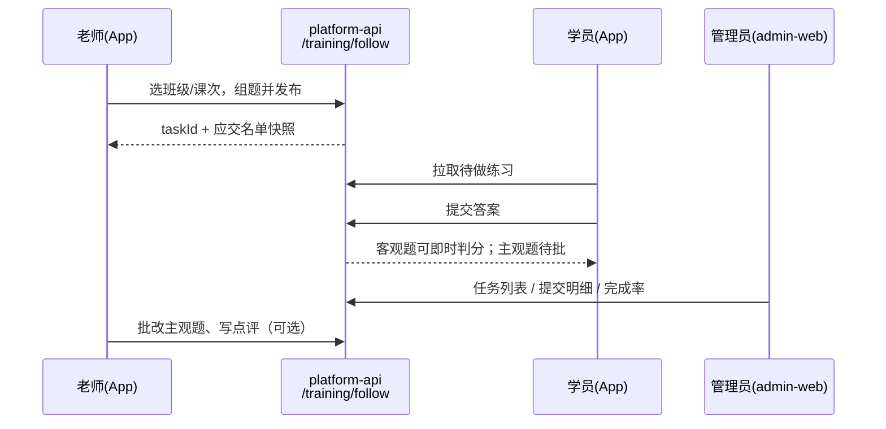

# 跟班作业与随堂练实现方案

> 目标项目：`qianlvguoyu_saas`（`platform-api` + `admin-web`）  
> App 端：`gjjd_appnext`（跟班作业走 `saasRequest`）  
> 上级文档：[跟班模块功能实现方案.md](./跟班模块功能实现方案.md)（决策 3 / M3）  
> 状态：方案稿（决策已锁，先方案、后开发）  
> 更新日期：2026-08-04  
> 决策锁定：见 §1.2 / §十二（2026-08-04 产品确认）

---

## 一、目标与边界

### 1.1 业务目标

| 角色 | 能力 |
|------|------|
| 上课老师（App） | 给本班学员布置作业 / 随堂练习题（客观题） |
| 学员（App） | 在 App 上答题、提交；另可按本班范围刷题 |
| 管理员（admin-web） | 配置班级练习范围；跟班后台查看答题进度、答卷明细、完成率 |

### 1.2 已拍板边界（2026-08-04 锁定）

| # | 项 | 决议 |
|---|----|------|
| 1 | 刷题与作业通道 | **坚持双通道**：跟班作业/随堂练走 SaaS `train_follow_task*`；学员自助刷题走题库 + `/appsmart`（可按班裁剪范围）。不混用 promote「课后作业」承载跟班任务 |
| 2 | 班级刷题范围 | **科目 + 知识点白名单**（挂班级；App 刷题按此过滤） |
| 3 | 作业挂载粒度 | **可选课次，并允许按日**：有课次挂 `schedule_id`；无则 `class_id + biz_date` |
| 4 | 题型与判分 | **仅客观题 + 自动判分**（单选/多选/判断）；主观题/人工批改本期不做 |
| 5 | 插班补发 | **已发布任务自动给插班生补发** `task_item`（pending） |

承接总方案：作业体系 SaaS 新建；promote 继续考前复习；题库可选作布置选题源，答卷落跟班域。

### 1.3 非目标（本期不做）

- 替换或改写 PHP promote / `/apppromote` 课后作业
- 跟班练习分计入认定「通过率」主成绩（可另做教学参考分）
- 人社代填、补贴材料自动生成
- 主观题、人工批改、AI 批改（决策 4）
- 把刷题答卷强行并入跟班任务表（决策 1：双通道）

### 1.4 现状结论

| 能力 | 现状 |
|------|------|
| `train_follow_task` 等表 | 仅总方案提及，无 Flyway |
| `/training/follow/**` 作业 API | 无 |
| 跟班工作台「作业」Tab | `comingSoon` |
| `ops_homework_mgmt` | `ProductPlaceholder` |
| App promote「课后作业」 | 课件练习 / 考试任务（PHP），**不可直接当跟班作业** |
| App `saasRequest` | 已有，可用于跟班新接口 |
| SaaS 题库 `exam_*` | 可作选题源，勿与答卷域合并 |

---

## 二、端到端链路



---

## 三、数据模型

### 3.1 新增表

| 表名 | 用途 |
|------|------|
| `train_follow_task` | 任务主表：作业 / 随堂练 |
| `train_follow_task_question` | 题目**快照**（发布后不受题库改题影响） |
| `train_follow_task_item` | 学员任务态（未交 / 已交 / 已批） |
| `train_follow_task_answer` | 学员每题作答与判分 |

### 3.2 `train_follow_task` 核心字段（建议）

| 字段 | 说明 |
|------|------|
| `id` | 主键 |
| `tenant_id` | 租户 |
| `class_id` | 班级 |
| `project_id` / `train_info_id` | 开班项目（可选冗余） |
| `schedule_id` | 课次，可空 |
| `biz_date` | 无课次时的业务日 |
| `session_id` | 若已有 `train_follow_session` 可挂载，可空 |
| `task_type` | `homework` \| `practice`（随堂练） |
| `title` | 标题 |
| `description` | 说明 |
| `deadline_at` | 截止时间，可空 |
| `status` | `draft` \| `published` \| `closed` |
| `pass_score` / `pass_rule` | 达标规则（可选；未配置则「已提交即达标」） |
| `show_analysis_after_submit` | 交卷后是否立即显示解析（建议：随堂练默认 true，作业可配） |
| `created_by` | 布置人（平台用户或师资人员 ID，实现时定一种） |
| `published_at` | 发布时间 |
| `deleted` | 软删 |

> 首版 `question_type` 仅允许：`single` / `multi` / `judge`。提交时服务端自动判分，`item` 可直接 `pending → graded`。

### 3.3 `train_follow_task_question` 核心字段

| 字段 | 说明 |
|------|------|
| `task_id` | 所属任务 |
| `sort_number` | 题序 |
| `question_type` | `single` / `multi` / `judge` / `text`（主观） |
| `stem` | 题干 |
| `options_json` | 选项 JSON |
| `answer_json` | 标准答案（管理端/判分用；学员拉卷时不下发或交卷后再下发解析） |
| `score` | 分值 |
| `source_exam_detail_id` | 题库来源，可空 |
| `analysis` | 解析，可空 |

### 3.4 `train_follow_task_item` 核心字段

| 字段 | 说明 |
|------|------|
| `task_id` | 任务 |
| `people_id` | `train_people_list.id`（学员） |
| `user_name` | 冗余姓名 |
| `status` | `pending` \| `submitted` \| `graded` |
| `score` | 得分 |
| `submitted_at` | 提交时间 |
| `graded_at` / `graded_by` | 批改 |
| `comment` | 文字点评 |

### 3.5 `train_follow_task_answer` 核心字段

| 字段 | 说明 |
|------|------|
| `task_id` / `item_id` / `question_id` | 关联 |
| `people_id` | 学员 |
| `answer_json` | 学员作答 |
| `is_correct` | 是否正确（客观题） |
| `score` | 本题得分 |

### 3.6 挂载与名单规则

```text
挂载（决策 3）：
  - 可选填 schedule_id（课次）
  - 无课次：必须 class_id + biz_date
  - 有课次时 biz_date 可冗余课次日，便于按日统计

发布时：
  - 按当时花名册 type=student 生成 task_item（名单快照）

插班补发（决策 5，已锁定）：
  - 学员入班成功（花名册新增 student）后：
      扫描本班 status=published 且未 closed（或未过 deadline，实现可选）的任务
      → 为该 people_id 补插 task_item(pending)
  - 已存在 item 则幂等跳过
  - 任务已 closed：默认不补发（避免复活已截止任务）
```

### 3.7 状态机

```text
task:  draft → published → closed
item:  pending → submitted → graded
       （本期全客观题：提交时直接 → graded，无需人工批改）
```

### 3.8 班级刷题范围（决策 2，双通道之「刷题」侧）

与作业快照表分离，单独配置「本班可刷范围」：

| 表（建议） | 用途 |
|------------|------|
| `train_class_practice_scope` | 班级练习主配置：`class_id`、默认/启用状态、备注 |
| `train_class_practice_course` | 科目白名单：`class_id` + `exam_course_id` |
| `train_class_practice_knowledge` | 知识点白名单：`class_id` + `knowledge_id`（须属于已选科目树下） |

规则建议：

1. 开班后可由管理员在开班准备/跟班配置录入；未配置时：可回退用班级 `work_type_id + level` 推导默认科目（实现时再定是否允许「未配置禁止刷题」）。  
2. App `/appsmart` 抽题：传入本班解析出的 `courseId` 列表，并在知识点维度按白名单过滤（无知识点白名单则整科可刷）。  
3. 刷题答卷仍写 `exam_mock_paper` / `exam_user_answer_log`，**不**写入 `train_follow_task_*`。  
4. 班级维度学情见独立方案：[班级刷题学情方案.md](./班级刷题学情方案.md)。

---

## 四、接口规划

统一前缀：`/training/follow/**`  
权限：`train:follow:homework:*`（或对齐 `ops_homework_mgmt`）  
租户：`X-Tenant-Id` + soft delete  
App 与管理端**共用服务层**，按角色裁剪 VO。

### 4.1 老师 App

| 方法 | 路径 | 说明 |
|------|------|------|
| GET | `/my-teaching-classes` | 我可布置作业的班级 |
| GET | `/classes/{classId}/tasks` | 班级任务列表 |
| POST | `/tasks` | 创建草稿（含题目） |
| PUT | `/tasks/{id}` | 改草稿 |
| POST | `/tasks/{id}/publish` | 发布并生成应交名单 |
| POST | `/tasks/{id}/close` | 截止/关闭 |
| GET | `/tasks/{id}/items` | 提交进度 |
| （本期不做） | `/tasks/{id}/items/{itemId}/grade` | 主观题批改延后 |

### 4.2 学员 App

| 方法 | 路径 | 说明 |
|------|------|------|
| GET | `/student/tasks` | 待做 / 已做（按班级筛选） |
| GET | `/tasks/{id}/paper` | 拉题（默认不含标准答案） |
| POST | `/tasks/{id}/submit` | 交卷；客观题服务端判分；幂等 |
| GET | `/tasks/{id}/result` | 得分 / 对错 / 解析（按 `show_analysis_after_submit`） |

### 4.3 管理端

| 方法 | 路径 | 说明 |
|------|------|------|
| GET | `/classes/{classId}/tasks` | 同老师列表，管理视角 |
| GET | `/tasks/{id}` | 任务详情 + 统计 |
| GET | `/tasks/{id}/items` | 学员提交表 |
| GET | `/tasks/{id}/items/{itemId}/answers` | 答卷明细 |
| GET | `/classes/{classId}/homework-metrics` | 完成率等汇总 |
| GET/PUT | `/classes/{classId}/practice-scope` | 科目 + 知识点白名单（刷题范围） |
| POST | `/tasks/{id}/sync-roster` | 手动触发插班补发（自动逻辑的补偿入口） |

---

## 五、App 改造（`gjjd_appnext`）

### 5.1 原则

1. 跟班作业入口放在 **「我的班级 / 跟班」**，**不**写入 promote「课后作业」Tab。  
2. 网络层统一 **`saasRequest`**，不走 `/apppromote`。  
3. 老师身份依赖班级角色（主讲/助教）；过渡期可用开班准备师资 / `train_people_list` 中 teacher 类型。  
4. 学员身份对齐花名册 `people_id`（身份证/手机号绑定策略与现有开班人员一致）。

### 5.2 页面（建议）

| 端 | 页面 | 能力 |
|----|------|------|
| 老师 | 班级列表 → 布置练习 | 选课次/日期、录题或选题、预览、发布 |
| 老师 | 任务进度 | 已交/未交、进入批改 |
| 学员 | 待办列表 | 作业 + 随堂练 |
| 学员 | 答题页 | 客观题优先；提交确认 |
| 学员 | 结果页 | 得分、对错、解析（可配置交卷后可见） |

---

## 六、管理端改造（`admin-web`）

### 6.1 跟班工作台「作业」Tab（主入口）

替换现有 `comingSoon`：

| 视图 | 内容 |
|------|------|
| 任务列表 | 标题、类型、课次/日期、截止、应交/已交、完成率、状态 |
| 任务详情抽屉/页 | 学员表：状态、得分、提交时间；点开答卷 |
| 未交名单 | 一键查看，支撑催交 |
| 题目正确率（可选） | 哪几题错得多，供教学反馈 |

### 6.2 运营菜单

| 菜单 | 定位 |
|------|------|
| `ops_homework_mgmt` | 跨班作业总览（可后做）；首期可用跟班进班 Tab 满足 |

### 6.3 指标口径

| 指标 | 公式 |
|------|------|
| 作业完成率 | 达标提交数 ÷ 应交人数（`task_item`） |
| 随堂练完成率 | 同模型，按 `task_type=practice` 过滤 |
| 达标 | 由 `pass_score` / `pass_rule` 配置；未配置则「已提交即达标」 |

跟班概览「作业完成率」、学员预警「连续未交」在本域数据就绪后接入。

---

## 七、与题库关系（两档）

| 档位 | 做法 | 适用 |
|------|------|------|
| **A 轻量（首版作业/随堂练）** | 老师 App 自拟**客观题**写入 `task_question` 快照 | 快速上线 |
| **B 接题库（作业布置增强）** | 从 `exam_exam_detail` 选题（限客观题），**拷贝**到快照；保留 `source_exam_detail_id` | 题量大 |
| **刷题通道** | 不建任务快照；按班级 `practice-scope` 过滤科目/知识点后走 `/appsmart` | 决策 1+2 |

无论 A/B：作业答卷只写 follow 表。刷题答卷只写 appsmart 日志表。promote 主链路不改语义。

---

## 八、分期交付

### M3-a 骨架（可先后台造数验收）

| 交付 | 说明 |
|------|------|
| Flyway：`train_follow_task` 四表 | 见 §3；题型约束客观题 |
| 发布 / 列表 / 提交 / 明细 API | 提交即自动判分 |
| 插班补发钩子 | 花名册新增学员 → 补 `task_item` |
| 管理端作业 Tab 只读列表 + 明细 | 完成率可算 |

**验收**：造一条 `practice`（可按日或挂课次）→ 学员交卷自动得分 → 后台可见；再插班一人 → 自动出现 pending。

### M3-b App 闭环

| 交付 | 说明 |
|------|------|
| 老师 App 布置（A 档自拟客观题） | 可选课次或按日；发布生成名单 |
| 学员 App 答题提交 | 客观题即时判分 + 可选解析 |
| 与后台同一数据 | |

**验收**：老师发布 → 学员交卷 → 跟班「作业」Tab 进度一致。

### M3-b2 班级刷题范围（可与 M3-b 并行）

| 交付 | 说明 |
|------|------|
| Flyway：`train_class_practice_*` | 科目 + 知识点白名单 |
| 管理端配置 UI | 开班准备或跟班配置 |
| App 刷题入参 | 按白名单调用 `/appsmart` |

**验收**：配置科目/知识点后，学员刷题仅落在白名单内。

### M3-c 增强

| 交付 | 说明 |
|------|------|
| B 档题库选题（仍限客观题） | |
| 概览完成率 / 未交预警 | |
| 可选：`ops_homework_mgmt` 跨班页 | |
| （延期）主观题批改 + 点评 | 不在本期 |

**验收**：主讲布置 → 学员提交自动得分 → 班级完成率可统计；promote 不受影响；刷题范围可配。

### 前置依赖

| 依赖 | 说明 |
|------|------|
| 班级角色 `train_class_role`（M1） | 理想前置；过渡可用开班师资绑定 |
| App「我的班级」入口 | 与跟班考勤等同入口建设 |
| （可选）`train_follow_session` | 无 session 时允许直接挂 class + date |

---

## 九、权限与安全要点

1. 老师仅能操作**自己有授课/跟班权限**的班级。  
2. 学员仅能拉取/提交**本人** `task_item`。  
3. `paper` 接口默认不下发 `answer_json`；解析在交卷后或任务关闭后按配置开放。  
4. 提交接口幂等，防止重复刷分。  
5. 管理端查看需 `train:follow:homework:view`（或现有培训查看权扩展）。

---

## 十、明确不做与易踩坑

| 项 | 说明 |
|----|------|
| 禁止写入 promote 任务表 | 跟班与考前语义分离 |
| 题目必须快照 | 题库改题不影响已发布练习 |
| 练习分 ≠ 认定通过率 | 通过率仍读考试/认定结果 |
| 名单快照 | 发布时固化；**插班自动补发**（决策 5），closed 任务不补 |
| 主观题 | 本期拒绝录入 `text` 题型 |
| 旧 offline homework | 历史 bak 包不作为实现基线 |

---

## 十一、落地映射（代码位置）

| 资产 | 用法 |
|------|------|
| `FollowClassWorkbench` 作业 Tab | M3-a/b 替换 comingSoon |
| `ops_homework_mgmt` | M3-c 可替换 Placeholder |
| `gjjd_appnext/utils/saasRequest.js` | App 跟班作业唯一通道 |
| `gjjd_appnext/pages/promote/*` | **不改语义**；不承接跟班作业 |
| `platform-api` `exam_*` / 题库 API | 仅 B 档选题 |
| `TrainAttendance*` 模式 | 新 follow task 包可参考权限/租户/软删风格 |
| 总方案 `/training/follow/**` | 本域任务接口落于此前缀 |

---

## 十二、产品决策纪要（已锁定 · 2026-08-04）

| # | 决策 | 结论 |
|---|------|------|
| 1 | 刷题与作业是否双通道 | **是**。作业/随堂练 = follow 任务域；刷题 = 班级 scope + `/appsmart` |
| 2 | 班级刷题配备方式 | **科目 + 知识点白名单** |
| 3 | 时间挂载 | **可选课次，并允许按日** |
| 4 | 题型 | **仅客观题，自动判分** |
| 5 | 插班生 | **自动补发**已发布未关闭任务 |

### 仍可实现期细化（不阻塞开工）

| # | 问题 | 建议默认 |
|---|------|----------|
| a | 作业布置首版 A 自拟还是 B 题库 | **A**，M3-c 再上 B |
| b | 老师身份 | 过渡用开班师资 / 花名册 teacher，并行推 `train_class_role` |
| c | 交卷后立即显示解析 | 随堂练默认 **是**；作业可配置 |
| d | 管理端代布置 | 首期 **否** |
| e | 班级未配 practice-scope 时刷题 | 建议：用工种推导默认科目；无工种则提示未配置 |
| f | 已过 `deadline_at` 是否仍给插班生补发 | 建议 **否**（与 closed 一致） |

---

## 十三、一句话路径

**双通道：① 班级配置科目+知识点 → App `/appsmart` 刷题；② SaaS `train_follow_task` 四件套承载作业/随堂练（可选课次或按日、客观题自动判分、插班自动补发）→ App `saasRequest` + 跟班「作业」Tab；题库可选作布置选题；promote 只做考前。**
