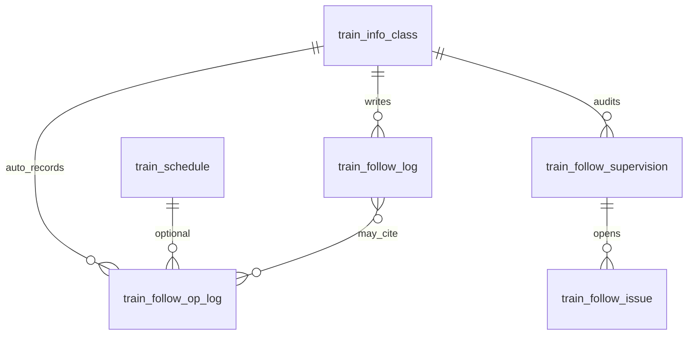

# 跟班「日志·督导」实现方案（含自动操作记录）

> **状态**：L1–L4 已落地（2026-08-13）；L5 督导闭环待做  
> **日期**：2026-08-13  
> **目标**：明确「日志·督导」能否、如何**自动记录跟班过程中的操作**；替换管理端 `localStorage` 原型；并规划督导检查与异常闭环  
> **对齐**：  
> - [跟班模块功能实现方案.md](./跟班模块功能实现方案.md) **M2 日志** / **M4 督导·Feed**  
> - [SaaS云平台培训模块详细介绍与功能需求说明.md](./SaaS云平台培训模块详细介绍与功能需求说明.md) §4.6  
> - [培训班级五角色落地实现方案.md](./培训班级五角色落地实现方案.md)（写日志权限）  
> - [跟班课堂影像与培训照片材料生成实现方案.md](./跟班课堂影像与培训照片材料生成实现方案.md)（留痕事件源）  

### 落地清单（已实现）

| 阶段 | 内容 | 位置 |
|------|------|------|
| L1 | `train_follow_op_log` / `train_follow_log`；`FollowOpLogWriter` + `FollowOpEventCode` | Flyway `V20260813_006`；`.../follow/*` |
| L2 | 工作日志 CRUD + 管理端替换 localStorage | `TrainFollowLogAdminController`；`FollowLogsSupervisionTab` |
| L3 | P0 自动写入：影像/课表/考勤/工作日志/角色 + **作业布置·提交·关闭·重开** + 过程动态 UI | Evidence / Schedule / Attendance / Log / Role / **Task** |
| L4 | 「根据当日动态生成草稿」；角色与任务事件已接入 | `draft-from-ops`；`class_role.*`；`task.publish/submit/close/reopen` |
| L5 | 督导检查单 / issue 闭环 | **未做**（Tab 分区占位） |

---

## 一、结论（先看）

| 问题 | 答案 |
|------|------|
| **能否自动记录跟班过程中「所有」操作日志？** | **能自动记录跟班域内约定清单上的全部关键业务操作**；**不能也不应**把「每一次页面浏览 / 未标注 API / 平台全局审计」无差别灌进本 Tab |
| 产品口径中的「所有操作」指什么？ | 跟班业务闭环里**改变班级过程状态或材料证据**的写操作（见 §3.2 事件白名单） |
| 「日志·督导」Tab 展示什么？ | **三层合一页**：① 过程操作时间线（自动）② 班主任工作日志（手写为主，可一键引用动态）③ 督导检查与整改（M4） |
| 与 `sys_audit_log` 关系？ | 平台审计仍写 `@AuditLog` → `sys_audit_log`（合规底账）；跟班时间线写 **`train_follow_op_log`**（业务可读）；**禁止**把全局审计表直接当班级过程日志 UI 数据源 |
| 现网能否已自动记？ | **L3 起：是（域内 P0 白名单）**。工作日志手写落库；督导仍为 M4/L5 |

**一句话：**  
跟班过程要**自动、可查、按班/按日/按课次**留下操作轨迹；范围锁定在跟班域**写操作白名单**，而不是技术意义上的「全站所有请求」。

```text
跟班写操作（考勤/影像/作业/角色/…）
        ↓ 服务层统一 emit（成功后）
train_follow_op_log（过程操作日志 · 自动）
        ↓
「日志·督导」Tab · 过程动态时间线
        ↕ 可选引用
train_follow_log（班主任工作日志 · 手写落库）
        ↕ M4
train_follow_supervision / train_follow_issue（督导与整改）

并行底账：@AuditLog → sys_audit_log（运维/合规，不进班级主 UI）
```

---

## 二、现状与问题

### 2.1 管理端现状

| 项 | 现状 |
|----|------|
| Tab | `FollowClassWorkbench` → `key=logs`「日志·督导」 |
| 写入 | 「新增跟班日志」弹窗，手填日期/记录人/内容 |
| 存储 | `localStorage` 键 `follow_logs_{classId}` |
| 督导 | 文案：「督导检查 / 异常闭环将在 M4 接入」 |
| 自动操作 | **无** |

### 2.2 需求原文要点（§4.6）

1. 班主任工作日志：日期、出勤概况、异常学员、沟通与处理（对齐线下表）。  
2. **日志须落库**，支持按班级与日期查询。  
3. 督导检查：设备、纪律、到课等清单勾选与复核。  
4. 学员预警：阈值触发，可下钻（预警本身属指标域，本方案只约定事件挂钩）。

### 2.3 旧方案歧义（本次拍板消除）

旧跟班总方案将 `train_follow_log` 与 M4「班级动态 Feed」分开写，但未回答「操作是否自动记」。  
**本次明确**：Feed / 过程动态 = **自动操作日志**；工作日志 = **结构化人工记录**；二者同属「日志·督导」信息架构，表分开。

---

## 三、产品决策

### 3.1 决策表

| # | 决策 | 说明 |
|---|------|------|
| D1 | **自动记录：是（域内白名单）** | 跟班相关 ApplicationService 在**业务成功提交后**写入 `train_follow_op_log` |
| D2 | **「所有操作」= 白名单内写操作 100% 覆盖** | 清单外（纯查询、未纳入跟班的模块）不记入本表；新增跟班写接口必须同步登记白名单 |
| D3 | **工作日志仍保留手写** | `train_follow_log` 对齐线下班主任日志；可「从今日动态生成草稿」减轻填写 |
| D4 | **督导独立表，同 Tab 分区展示** | M4 落地；不与 op_log / work_log 混表 |
| D5 | **平台审计并行不替代** | 关键写接口继续 `@AuditLog`；班级 UI 只读 op_log |
| D6 | **失败写操作不记成功事件** | 仅成功路径 emit；可选另记 `failed` 仅用于排障（P2，默认不做） |

### 3.2 自动记录事件白名单（「所有」的边界）

| 域 | 事件码（示例） | 触发点 | 优先级 |
|----|----------------|--------|--------|
| 考勤 | `attendance.sign_in` / `proxy_sign` / `confirm` / `reject` / `batch_update` | 考勤服务 | P0 |
| 影像 | `evidence.upload` / `review_approve` / `review_reject` / `delete` / `photo_pack.generate` | 证据服务（已有） | P0 |
| 课表 | `schedule.save` / `schedule.reimport` | 跟班课表 | P0 |
| 工作日志 | `work_log.create` / `update` / `delete` | 日志服务 | P0 |
| 作业/练/模考 | `task.publish` / `submit` / `review` / `close` … | 任务服务（已有） | P1 |
| 角色 | `class_role.assign` / `unbind` | 角色服务 | P1 |
| 点评 | `comment.create` / `update` | 点评服务 | P1 |
| 督导 | `supervision.submit` / `issue.open` / `issue.close` | M4 | P1 |
| 指标/预警 | `metric.alert_raised`（系统） | 定时/聚合 | P2 |

**明确不纳入自动过程日志（除非后续单独立项）：**

- 仅 `GET` 列表/详情/预览/下载（含看照片、下 Word）  
- 登录/登出、菜单切换、Tab 切换  
- 未打 `@AuditLog` 且未登记白名单的接口  
- 跨模块（认定、补贴台账主流程等）——补贴侧有自己的审计；跟班侧仅在「影像包被引用」等交叉点可选记一条 `subsidy.photo_pack_linked`（P2）

### 3.3 非目标

- 不做「键盘级 / 点击级」前端埋点作为过程日志真相源。  
- 不用 `sys_audit_log` 直接驱动班级时间线（字段无 class_id/biz_date，文案不可读）。  
- 不要求自动日志替代督导签字与人工工作日志的合规效力（人工日志 + 督导单仍是业务凭证；op_log 是过程追溯）。

---

## 四、信息架构（管理端 Tab）

「日志·督导」内部分区（建议用子 Tab 或 Segmented）：

| 分区 | 数据 | 写入方式 | 读者 |
|------|------|----------|------|
| **过程动态** | `train_follow_op_log` | **系统自动** | 班主任、跟班教务、主讲（按权限过滤敏感项） |
| **工作日志** | `train_follow_log` | **人工**（可生成草稿） | 同上；教务抽查 |
| **督导检查** | `train_follow_supervision` + issue | 教务/督导人工 | 教务为主；班主任看整改待办 |

筛选：业务日、课次、操作人、事件类型、仅异常（`severity_level>=warn`）。

---

## 五、数据模型

### 5.1 `train_follow_op_log`（过程操作日志 · 自动）

| 字段 | 说明 |
|------|------|
| `id` | 雪花 |
| `tenant_id` | 租户 |
| `class_id` | 必填 |
| `schedule_id` / `session_id` | 可空；有课次则填 |
| `biz_date` | `YYYY-MM-DD`，便于按日筛 |
| `event_code` | 如 `evidence.upload` |
| `event_category` | `attendance` / `evidence` / `task` / `schedule` / `role` / `work_log` / `supervision` / `system` |
| `title` | 人可读短标题，如「班长上传课堂照片」 |
| `summary` | 一行摘要 |
| `detail_json` | 结构化细节（学员数、文件 id、审核结果等），控制体积 |
| `actor_user_id` / `actor_name` / `actor_role` | 操作者 |
| `target_type` / `target_id` | 如 evidence / task / attendance |
| `severity_level` | `info` / `warn` / `critical`（代签待确认、驳回、整改等可升 warn） |
| `client` | `admin` / `app` / `job` |
| `request_id` | 可选，对齐 Trace |
| `created_at` | 写入时间 |
| `deleted` | 软删（一般不删；合规要求可仅隐藏） |

索引建议：`(class_id, biz_date, created_at)`、`(class_id, event_category)`、`(tenant_id, created_at)`。

### 5.2 `train_follow_log`（班主任工作日志 · 手写）

| 字段 | 说明 |
|------|------|
| `id` / `tenant_id` / `class_id` | |
| `schedule_id` / `session_id` | 可空 |
| `biz_date` | 必填 |
| `author_user_id` / `author_name` | |
| `attendance_summary` | 出勤概况（可选结构化） |
| `exception_note` | 异常学员与处理 |
| `content` | 正文（至少一项非空） |
| `source_op_ids_json` | 可选：引用的过程动态 id 列表 |
| `status` | `draft` / `published` |
| 审计字段 | `created_by` / `updated_by` / `created_at` / `updated_at` / `deleted` |

### 5.3 督导（M4，摘要）

- `train_follow_supervision`：检查单头（class、日期、检查人、结论）  
- `train_follow_supervision_item`：清单项勾选结果  
- `train_follow_issue`：异常/整改（可挂 supervision_id），状态流转 open → doing → done → closed  

督导提交/结案时 **必须** emit 对应 `op_log` 事件。

### 5.4 ER（逻辑）



---

## 六、自动写入机制

### 6.1 推荐实现

在跟班各 `*ApplicationService` 成功路径调用统一组件，例如：

```text
FollowOpLogWriter.write(FollowOpLogCommand cmd)
```

约束：

1. **同一事务**：与业务写入同事务提交（失败则日志也不落，避免脏事件）。  
2. **禁止**仅在 Controller / 前端埋点作为唯一来源（App/管理端双通道会漏）。  
3. **白名单登记表**（代码枚举 `FollowOpEventCode`）：新事件不进枚举则 CI/评审不通过。  
4. 已有 `@AuditLog` 的接口：**两套都写**——审计给平台，op_log 给班级时间线（文案面向业务）。

### 6.2 与现有代码映射（首批接入）

| 现有能力 | 接入方式 |
|----------|----------|
| `TrainFollowEvidenceApplicationService` | upload/review/delete/photo_pack → P0 |
| `TrainFollowTaskApplicationService` | publish/submit/review/… → P1 |
| 考勤相关 Controller/Service | 签到/代签/确认 → P0（随考勤扩展一并做） |
| 跟班课表保存/重导 | P0 |
| 新建 `TrainFollowLogApplicationService` | CRUD 工作日志 + emit |
| 班级角色指派 | P1 |

### 6.3 覆盖率验收口径（回答「是否所有」）

| 验收项 | 标准 |
|--------|------|
| 白名单覆盖率 | §3.2 P0 事件 **100%** 有自动化测试或手工用例证明落库 |
| 漏记零容忍 | 抽检：对 P0 接口各成功一次，时间线必须出现对应 `event_code` |
| 查询 | 按 `classId + bizDate` 能还原当日过程 |
| 跨端 | 同一操作无论 App 还是管理端，只记一条业务成功事件 |

**对外表述建议：**  
> 「日志·督导」**自动记录跟班过程中全部约定业务操作**；查询、浏览及未纳入跟班域的操作不在此列。平台级审计另行保存。

---

## 七、接口规划

前缀：`/training/info-classes/{classId}/follow/...`（与证据接口风格一致）  
App：`/training/follow/classes/{classId}/...` 共用服务层。

| 方法 | 路径 | 说明 |
|------|------|------|
| GET | `/op-logs` | 过程动态；支持 `bizDate`/`from`/`to`/`category`/`actorUserId` |
| GET | `/op-logs/export` | 可选：导出当日/区间操作清单（结课材料） |
| GET/POST | `/logs` | 工作日志列表/新增 |
| PUT/DELETE | `/logs/{id}` | 改删（权限校验作者或教务） |
| POST | `/logs/draft-from-ops` | 按日汇总 op_log 生成工作日志草稿 |
| GET/POST | `/supervisions` | M4 |
| POST | `/issues/{id}/transition` | M4 整改流转 |

权限（摘要）：

| 角色 | 过程动态 | 工作日志 | 督导 |
|------|----------|----------|------|
| 班长 | 读（可过滤部分管理操作） | 一般不写 | 可上报 issue（若开放） |
| 班主任 | 读 | 读写本班 | 看整改待办 |
| 跟班教务 | 读全量 | 读；可代写/抽查批注（可选） | 主写检查单 |
| 主讲/助教 | 读与教学相关类别 | 读 | 读 |
| 学员 | 默认不可见本 Tab | — | — |

---

## 八、前端改造

### 8.1 管理端

- 拆出 `FollowLogsSupervisionTab.tsx`（自 `FollowClassWorkbench` 抽离）。  
- 去掉 `loadLogs` / `saveLogs` localStorage。  
- 「过程动态」：时间线或表格 + 筛选；`severity_level=warn` 高亮。  
- 「工作日志」：表格 + 新增/编辑；提供「根据当日动态生成草稿」。  
- 「督导」：M4 前保持 Empty + 说明；不删分区以免二次改 Tab。

### 8.2 App

- 班主任台：写/看工作日志；只读过程动态（精简）。  
- 班长：不强制写工作日志；其上传影像等操作由服务端自动进时间线。

---

## 九、分期交付

| 阶段 | 内容 | 验收 |
|------|------|------|
| **L0** | 方案评审；事件白名单签字 | 本文 D1–D6 确认 |
| **L1** | Flyway：`train_follow_op_log` + `train_follow_log`；Writer 组件 | 表可用 |
| **L2** | 工作日志 CRUD API + 管理端替换 localStorage | 跨浏览器可见 |
| **L3** | P0 事件全量自动写入 + 过程动态 UI | 白名单 P0 抽检 100% |
| **L4** | P1 任务/角色等 + 草稿生成 | 班主任可一键成稿 |
| **L5** | M4 督导/issue + 对应自动事件 + 导出 | 检查与整改可闭环 |

建议开发顺序：L1 → L2 → L3（先自动时间线再扩展事件）→ L4 → L5。

---

## 十、风险与缓解

| 风险 | 缓解 |
|------|------|
| 「所有」被理解为全站 HTTP | 对外口径固定为「跟班业务写操作白名单」；文档置顶结论表 |
| 漏接新接口 | 枚举强制登记；Code Review 清单；可选集成测试扫描 follow 写接口 |
| 日志表膨胀 | detail_json 截断；按租户+时间归档策略（P2）；列表默认按日 |
| 与审计重复 | 明确双写职责；UI 只读 op_log |
| 事务变慢 | Writer 保持轻量 insert；禁止同步调外部 HTTP |

---

## 十一、与总方案修订关系

| 原表述 | 本方案 |
|--------|--------|
| M2「跟班日志落库」 | = `train_follow_log`（L2） |
| M4「班级动态 Feed」 | = `train_follow_op_log` 过程动态（提前到 L3，不必等 M4） |
| M4 督导 | 不变，L5 |

**修订建议**：跟班总方案 M2 验收增加一条——「P0 跟班写操作可在班级过程动态中追溯」；M4 Feed 改为「增强筛选/导出/预警联动」，避免重复建设。

---

## 十二、评审清单

- [ ] 确认 D1：自动记录采用域内白名单，而非全站请求  
- [ ] 确认 §3.2 P0/P1 事件清单无重大遗漏  
- [ ] 确认班长是否可见全部过程动态（或脱敏）  
- [ ] 确认工作日志是否必须「每日一篇」还是按需  
- [ ] 确认 L5 督导清单项（设备/纪律/到课…）业务方提供终稿  
- [ ] 评审通过后开工 L1，并回写本文「落地清单」表

---

## 附录 A：事件码命名约定

```text
{domain}.{action}[.{sub}]
例：evidence.upload / attendance.proxy_sign / task.item.review / supervision.issue.close
```

## 附录 B：单条过程动态展示示例

```text
2026-08-13 09:12  班长·王某  上传课堂照片（课次：8/13 上午理论）  [evidence.upload]
2026-08-13 09:40  班主任·李某  确认代签 3 人                          [attendance.confirm]
2026-08-13 12:05  教务·赵某  审核通过影像 5 张                        [evidence.review_approve]
2026-08-13 18:20  班主任·李某  发布工作日志                            [work_log.create]
```

## 附录 C：现网原型废弃说明

| 废弃项 | 处理 |
|--------|------|
| `follow_logs_${classId}` localStorage | L2 上线后删除读写；不提供自动迁移（原型数据非权威） |
| Toast「本地暂存，待跟班日志 API 落库」 | 改为「已保存」 |
