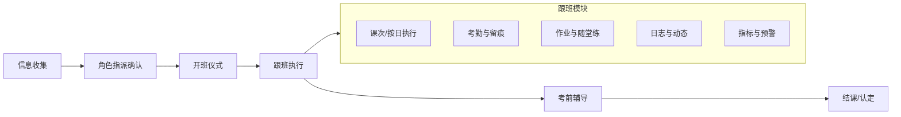
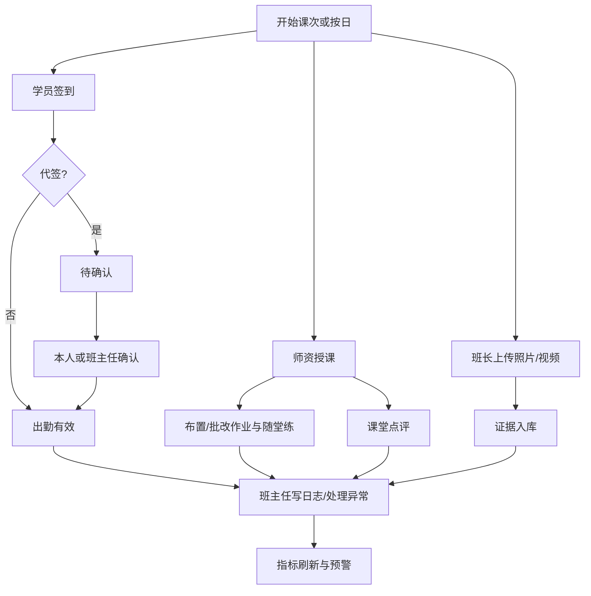
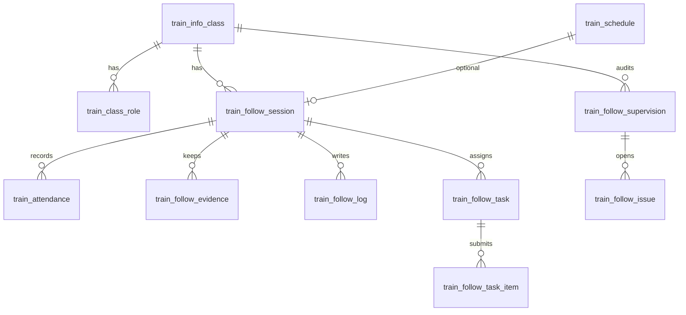
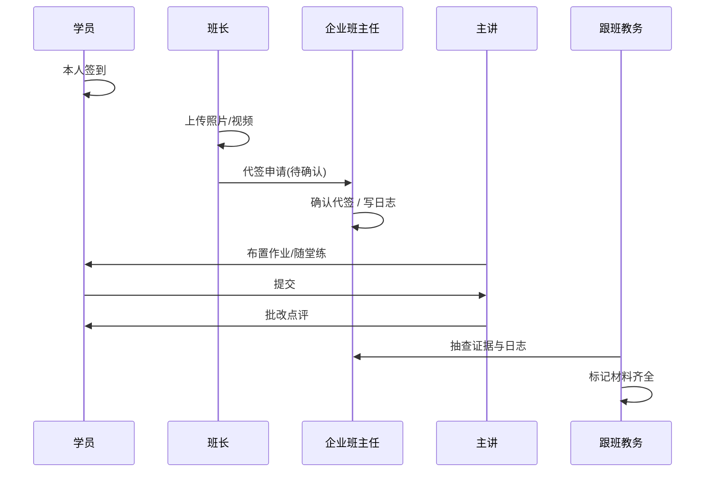

# 跟班模块功能实现方案

> 目标项目：`qianlvguoyu_saas`（`platform-api` + `admin-web`）  
> App 端：`gjjd_appnext`（跟班工作台走 `saasRequest`）  
> 依据：培训部数字化需求规格、现有开班前主链路现状、跟班拍板决策默认组合  
> 状态：方案稿（先方案、后开发）

---

## 一、背景与目标

### 1.1 现状

培训 SaaS 主链路已落地到开班前：

```
企业调研 → 方案规划 → 分班 → 开班准备 → 开班申报 → 信息收集
```

开班后「培训实施 / 跟班」在需求与菜单中已出现，但生产能力不足：

| 能力 | 现状 |
|------|------|
| 班级/人员 | `train_info_class`、`train_people_list` 可用；`is_leader` 仅标记 |
| 师资库 | `train_teacher_bank` 可用；班级角色（主讲/助教/班主任）未产品化 |
| 考勤 | `train_attendance` + API 骨架有；管理端多为占位 |
| 作业 | 运营菜单占位；App promote「课后作业」≈ 考试任务，非跟班作业 |
| 跟班日志/留痕 | `TrainingImplementationPage` 原型为本地 state，无落库 |
| 指标 | 出勤率/通过率/作业/评价/记录菜单均为 `ProductPlaceholder` |

### 1.2 目标

建成以**班级**为中心的跟班过程管控能力，覆盖四类角色门户：

| 角色包 | 核心能力 |
|--------|----------|
| 学员管理 | 出勤率、作业、通过率、满意度、预警 |
| 师资管理 | 作业批改、随堂练、课堂点评 |
| 班长管理 | 拍照、视频、督导上报（非直接代签生效） |
| 班主任管理 | 班级动态、工作日志、异常闭环、证据完整性 |

并与后续考前辅导、结课、补贴证据链衔接。

### 1.3 非目标（本期不做）

- 人社系统对接代填
- 补贴申报全流程
- 完整替换 App promote 学习/考前复习
- 十大管理表全自动生成（仅预留证据索引与导出）

---

## 二、已拍板决策（默认组合）

| # | 决策项 | 决议 | 说明 |
|---|--------|------|------|
| 1 | 班主任归属 | **C 双轨** | 企业班主任负责日常动态/考勤督促/影像确认；培训部跟班教务负责合规抽查与督导复核 |
| 2 | 班长权限 | **B 留痕可代提醒、代签需确认** | 班长可拍照/视频/缺勤提醒；代签到进入「待确认」，本人确认或班主任确认后生效 |
| 3 | 作业体系 | **C 过渡双通道** | 跟班作业/随堂练在 SaaS 新建；学员刷题走题库+`/appsmart`（可按班裁剪）；promote 只做考前，不承载跟班作业 |
| 4 | 时间粒度 | **C 可选课次、允许按日** | 可挂 `schedule_id`；无课次则 `class_id + biz_date` |
| 5 | 班级刷题范围 | **科目 + 知识点白名单** | 见作业子方案 §3.8；与任务快照分离 |
| 6 | 作业题型 | **仅客观题自动判分** | 主观题/人工批改延期 |
| 7 | 插班补发 | **已发布未关闭任务自动补发** | 花名册新增学员 → 补 `task_item` |

> 决策 3～7 明细与分期见 [跟班作业与随堂练实现方案.md](./跟班作业与随堂练实现方案.md)（2026-08-04 锁定）。

---

## 三、业务定位与流程衔接

### 3.1 在培训全流程中的位置



### 3.2 跟班日/课次闭环



---

## 四、角色与权限模型

### 4.1 班级角色定义

在现有 `train_people_list` 基础上扩展「班级角色」，建议新增班级岗位表或在人员表增加可扩展角色字段（见第六章）。

| 角色码 | 名称 | 来源 | 典型职责 |
|--------|------|------|----------|
| `student` | 学员 | 现有 type | 签到、交作业、随堂练、评满意度 |
| `monitor` | 班长 | `is_leader=1` 的学员 | 拍照/视频、缺勤提醒、督导项上报 |
| `head_teacher` | 班主任 | 企业侧指派 | 班级动态、日志、确认代签、异常闭环 |
| `follow_staff` | 跟班教务 | 培训部指派 | 抽查留痕、督导复核、合规检查 |
| `lead_teacher` | 主讲 | 师资库绑定 | 布置作业、随堂练、批改、点评 |
| `assistant` | 助教 | 师资库绑定 | 协助批改、随堂练、点评 |

> 一人可多角色（如学员兼班长）；权限按「当前班级 + 角色」取并集。

### 4.2 权限矩阵（摘要）

| 能力 | 学员 | 班长 | 班主任 | 跟班教务 | 主讲/助教 | 培训管理端 |
|------|:----:|:----:|:------:|:--------:|:---------:|:----------:|
| 本人签到 | ✓ | ✓ | — | — | — | 查看 |
| 代签提交（待确认） | — | ✓ | ✓ | — | — | 查看 |
| 确认代签 | ✓(本人) | — | ✓ | — | — | 可强制修正 |
| 上传照片/视频 | — | ✓ | ✓ | ✓ | ✓ | 查看 |
| 写跟班/班主任日志 | — | — | ✓ | ✓ | — | 查看 |
| 布置/批改作业 | — | — | — | — | ✓ | 监管 |
| 随堂练下发/批阅 | — | — | — | — | ✓ | 监管 |
| 督导检查 | — | 上报 | 处理 | 复核 | — | 抽查 |
| 指标看板 | 本人 | 本班摘要 | 本班 | 多班 | 本班教学 | 全量 |

### 4.3 数据范围

- App：仅可见自己担任角色的班级。
- 管理端：按租户 + 组织权限；跟班教务默认可看负责班级集合。

---

## 五、功能范围

### 5.1 学员管理

| 功能 | 说明 | 口径 |
|------|------|------|
| 出勤率 | 班级/个人维度 | 有效出勤课次（或日）÷ 应到课次（或日） |
| 作业完成率 | 应交作业中已提交且达标占比 | 达标规则由布置时定义（交即算 / 分数线） |
| 通过率 | 班级维度对接考试/认定结果 | 取认定或考试合格状态字段，方案阶段锁定单一口径 |
| 满意度 | 学员评课/评师问卷 | 模板化评分，班级均值 |
| 学员预警 | 缺勤、作业滞后、模拟偏低 | 阈值可配置（如出勤 &lt; 80% 黄灯） |
| 学员详情 | 过程时间线：签到、作业、点评、预警 | 支撑一对一辅导记录（P2） |

### 5.2 师资管理

| 功能 | 说明 |
|------|------|
| 班级授课指派 | 主讲/助教绑定到班级或课次 |
| 作业管理 | 布置、截止、收取、批改、文字/分数量点评 |
| 随堂练 | 轻量练习任务（可选题库题目或简易题）；与跟班作业同任务模型、不同 `task_type` |
| 课堂点评 | 按课次/按日对班级或学员点评 |
| 教学进度 | 已完成课次、待批作业数 |

### 5.3 班长管理

| 功能 | 说明 |
|------|------|
| 课堂拍照 | 上传至课次/当日证据，类型=照片 |
| 课堂视频 | 同上，类型=视频；限制大小/时长在实现规范中约定 |
| 缺勤提醒 | 对未签到学员一键提醒（站内/消息通道按现有能力） |
| 代签申请 | 代他人签到 → 状态 `pending_confirm`，不计入有效出勤直至确认 |
| 督导上报 | 按检查清单勾选异常（设备、纪律、到课等） |

### 5.4 班主任管理

| 功能 | 说明 |
|------|------|
| 班级动态 | 聚合：签到摘要、新上传证据、新作业、异常、日志 |
| 工作日志 | 日期、出勤概况、异常学员、沟通与处理（对齐「班主任工作日志表」） |
| 代签确认 | 确认/驳回班长或本人代签 |
| 异常闭环 | 从预警/督导生成问题 → 处理 → 关闭 |
| 证据完整性 | 当日/当课是否缺照片、视频、考勤 |

### 5.5 跟班教务（双轨配套）

| 功能 | 说明 |
|------|------|
| 多班抽查 | 按项目/日期抽查证据与日志是否齐全 |
| 督导复核 | 复核班长/班主任上报项 |
| 合规标记 | 标记「材料齐全 / 待补传」供结课与审计 |

### 5.6 管理端运营菜单映射

| 菜单 code | 页面定位 |
|-----------|----------|
| `ops_train_implementation` | 培训实施总览：进班、今日待办、异常 |
| `ops_attendance_mgmt` | 出勤率管理（替换 Placeholder） |
| `ops_homework_mgmt` | 作业管理（SaaS 跟班作业） |
| `ops_pass_rate_mgmt` | 通过率管理 |
| `ops_evaluation_mgmt` | 评价/满意度管理 |
| `ops_record_mgmt` | 记录管理：日志、证据、督导 |

原型页 `zhixunplatform/TrainingImplementationPage` 收敛为正式实现来源，避免双轨 UI。

---

## 六、数据模型设计

### 6.1 复用表

| 表 | 用途 |
|----|------|
| `train_info_list` | 项目 |
| `train_info_class` | 班级 |
| `train_people_list` | 班级人员底座 |
| `train_teacher_bank` | 师资档案 |
| `train_attendance` | 考勤（扩展字段见下） |
| `train_schedule` | 课次（有则优先） |

### 6.2 建议新增表

| 表名 | 用途 |
|------|------|
| `train_class_role` | 班级角色指派：class_id、people_id/teacher_id、role_code、起止 |
| `train_follow_session` | 执行单元：class_id、schedule_id(可空)、biz_date、status、主题 |
| `train_follow_evidence` | 过程留痕：session 或 class+date、类型(photo/video)、上传人、审核状态 |
| `train_follow_log` | 跟班/班主任日志 |
| `train_follow_task` | 任务主表：homework / practice（随堂练），布置人、截止、达标规则 |
| `train_follow_task_item` | 学员提交与批改：状态、分数、点评 |
| `train_follow_comment` | 课堂点评（班级/学员） |
| `train_follow_supervision` | 督导检查单与项结果 |
| `train_follow_issue` | 异常/整改闭环 |
| `train_follow_survey` | 满意度问卷定义与答卷 |
| `train_follow_metric_snapshot` | 可选：日出勤率等快照，降低实时聚合压力 |

### 6.3 执行单元挂载规则（决策 4）

```text
优先：schedule_id 非空 → 课次跟班
否则：class_id + biz_date → 按日跟班
考勤/证据/作业均可挂 session_id；无 session 时允许直接挂 class_id + biz_date
```

### 6.4 考勤状态扩展（决策 2）

在现有 `status`（缺勤/出勤/迟到/早退）之上增加确认流字段建议：

| 字段 | 说明 |
|------|------|
| `source` | `self` / `proxy_monitor` / `proxy_head_teacher` / `admin` |
| `confirm_status` | `none` / `pending` / `confirmed` / `rejected` |
| `confirmed_by` / `confirmed_at` | 确认人与时间 |

**有效出勤**：`status∈{出勤,迟到,早退}` 且 `confirm_status∈{none,confirmed}`（本人签到 `none` 即有效；代签必须 `confirmed`）。

### 6.5 核心 ER（逻辑）



---

## 七、接口与端侧规划

### 7.1 后端包与路由约定

- 包路径：`com.guoyu.platform.trainingdepartment` 下 `follow`（或 `implementation`）子域  
- REST 前缀：`/training/follow/**`  
- 权限码：对齐并扩展 `ops.*` / `train:follow:*`  
- 租户：沿用 `X-Tenant-Id` + soft delete

### 7.2 接口分组（摘要）

| 分组 | 示例 | 说明 |
|------|------|------|
| 角色 | `POST /classes/{id}/roles` | 指派班主任/主讲/助教/跟班教务；班长沿用 is_leader |
| 执行单元 | `GET/POST /sessions` | 按课次生成或按日打开 |
| 考勤 | 扩展现有 `/attendances` + `sign-in` / `proxy-sign` / `confirm` | 代签确认流 |
| 证据 | `/evidences` | 上传、列表、审核 |
| 日志 | `/logs` | 班主任/跟班日志 CRUD |
| 任务 | `/tasks`、`/tasks/{id}/items` | 作业与随堂练 |
| 点评 | `/comments` | 课堂点评 |
| 督导 | `/supervisions` | 检查与复核 |
| 问题 | `/issues` | 异常闭环 |
| 指标 | `/metrics/class/{id}`、`/metrics/student/{id}` | 出勤/作业/通过/满意 |
| 动态 | `/classes/{id}/feed` | 班主任班级动态流 |
| 问卷 | `/surveys` | 满意度 |

App 端接口与管理端共用服务层，按角色裁剪 VO。

### 7.3 前端

| 端 | 改造点 |
|----|--------|
| `admin-web` | 替换 ops 五个 Placeholder；培训实施进班工作台；开班准备增加角色指派 |
| `gjjd_appnext` | 新增「我的班级 / 跟班」入口；按角色切换工作台；上传走 SaaS；**不**把跟班作业接到 promote |

### 7.4 与 promote 边界（决策 3）

| 场景 | 系统 |
|------|------|
| 跟班作业、随堂练、课堂点评 | SaaS follow |
| 考前复习 | 现有 promote |
| 班级范围内刷题 | `/appsmart` + 班级科目/知识点白名单（见作业子方案） |
| 通过率 | 优先读考试/认定结果，跟班模块只做聚合展示 |

---

## 八、指标口径（先锁文档，后写代码）

| 指标 | 计算公式 | 备注 |
|------|----------|------|
| 出勤率 | 有效出勤次数 ÷ 应到次数 | 应到 = 已发布 session 中需考勤的单元；请假另议（P2） |
| 作业完成率 | 达标提交数 ÷ 应交作业数 | 「达标」由任务配置 |
| 随堂练完成率 | 同作业，可单独展示 | |
| 通过率 | 合格学员数 ÷ 参考学员数 | 合格来源字段立项时写死一种 |
| 满意度 | 有效答卷均分（或 NPS） | 模板版本化 |

预警示例（可配置）：出勤率 &lt; 80%、连续 2 次未交作业、满意度 &lt; 3.5。

---

## 九、分期交付（M1–M4）

### M1 角色与入口（打通「谁管哪个班」）

**目标**：双轨角色可指派，两端能进班。

| 交付 | 说明 |
|------|------|
| `train_class_role` + API | 班主任、跟班教务、主讲、助教 |
| 开班准备页扩展 | 角色指派 UI |
| 管理端培训实施总览 | 班级列表进班（可先空壳工作台） |
| App 我的班级 | 按角色展示入口 |
| 菜单 | `ops_train_implementation` 接真页 |

**验收**：指定企业班主任 + 培训部跟班教务后，双方能进入同一班级且权限不同。

### M2 出勤与留痕（跟班能每天跑）

**目标**：课次优先/按日降级；考勤确认流；证据；日志。

| 交付 | 说明 |
|------|------|
| `train_follow_session` | 从排课生成或按日创建 |
| 考勤扩展 + 代签确认 | 决策 2 |
| 证据上传 | 班长/班主任/教务 |
| 跟班日志 | 落库，替换原型 local state |
| 出勤率页 | 替换 `ops_attendance_mgmt` |
| 记录页雏形 | 日志+证据列表 |

**验收**：无排课班级可按日跟班；有排课按课次；班长代签未确认不计入出勤率。

### M3 作业与随堂练（教学闭环）

**目标**：SaaS 跟班作业独立语义。

> 详细设计见：[跟班作业与随堂练实现方案.md](./跟班作业与随堂练实现方案.md)（数据模型、三端接口、App/管理端改造、M3-a/b/c 分期与待确认项）。

| 交付 | 说明 |
|------|------|
| 任务/提交/批改 API 与页 | `ops_homework_mgmt`；跟班工作台「作业」Tab |
| 随堂练 | 同模型 `task_type=practice` |
| 课堂点评 | 师资端 |
| App 学员交作业、看点评 | `saasRequest`，不进 promote |
| 作业完成率进学员看板 | |

**验收**：主讲布置 → 学员提交 → 批改点评 → 班级完成率可统计；与 promote 任务互不影响。

### M4 指标、督导与质量

**目标**：管得住质量，接得住审计。

| 交付 | 说明 |
|------|------|
| 通过率、满意度页 | 替换对应 Placeholder |
| 学员预警 | 列表+详情 |
| 督导检查与 issue 闭环 | 班长上报、班主任处理、教务复核 |
| 班级动态 Feed | 班主任主页 |
| 证据链导出索引 | 按班级/日期列出签到与影像，服务结课材料 |

**验收**：班主任能在一页看动态与待办；教务能抽查标记齐全；管理端能导出过程证据目录。

---

## 十、与现有代码的落地映射

| 现有资产 | 跟班用法 |
|----------|----------|
| `TrainingProcessSteps` 六步 | 不改主流程条；跟班作为开班后独立运营菜单 |
| `TrainingClassPeoplePage` | M1 扩展角色指派 |
| `TrainAttendanceController` | M2 扩展，避免另起一套签到 |
| `train_schedule` | M2 生成 session 的优先来源 |
| `TrainingImplementationPage` | 重构为正式页或迁入 ops 实现页 |
| `ProductPlaceholder` ops_* | M2–M4 逐个替换 |
| App `saasRequest` | 跟班 API 统一走 SaaS |
| App `promote` | 仅考前，不承接跟班作业 |

---

## 十一、风险与依赖

| 风险 | 缓解 |
|------|------|
| 企业班主任账号未开通 | M1 支持手机号邀请/绑定；允许培训部临时代管并留痕 |
| 排课数据不全 | 决策 4 按日降级，不阻塞 M2 |
| 通过率字段不统一 | M4 前单独确认考试/认定合格字段 |
| 与 promote 用户混淆 | App 文案与入口分离：「跟班作业」vs「考前练习」 |
| 影像存储与合规 | 复用现有上传；证据表只存路径与元数据 |
| 双轨职责不清 | 权限矩阵与待办列表按角色拆分，避免都做或都不做 |

**前置依赖**：班级与学员名单稳定（信息收集完成后）；师资库可选用；文件上传可用。

---

## 十二、建议开发顺序（单迭代内）

1. Flyway：角色表、session、证据、日志（M1–M2 核心表）  
2. 角色 API + 开班准备指派  
3. Session + 考勤扩展 + 确认流  
4. 证据与日志 + 管理端/App 最小闭环  
5. 任务模型（作业/随堂）  
6. 指标聚合与预警  
7. 督导/issue/满意度/导出  

---

## 十三、文档与评审清单

- [ ] 确认本文「第二节决策」仍为最终决议  
- [ ] 确认通过率合格字段来源（考试计划 / 认定花名册）  
- [ ] 确认请假是否计入应到（建议 M2 不做请假，P2 加）  
- [ ] 确认 App 消息通道（站内信 / 企微 / 短信）用于缺勤提醒  
- [ ] 评审通过后输出：《跟班模块接口清单》+ 《App 页面清单》再开工

---

## 附录 A：角色双轨协作示意



## 附录 B：菜单与迭代对照

| 菜单 | M1 | M2 | M3 | M4 |
|------|----|----|----|----|
| 培训实施总览 | ✓ | 增强 | 增强 | 增强 |
| 出勤率管理 | | ✓ | | |
| 作业管理 | | | ✓ | |
| 通过率管理 | | | | ✓ |
| 评价管理 | | | | ✓ |
| 记录管理 | | ✓ | | ✓ 督导/导出 |

---

**文档维护**：方案变更时同步更新第二节决策表与第九节分期范围，避免实现漂移。
