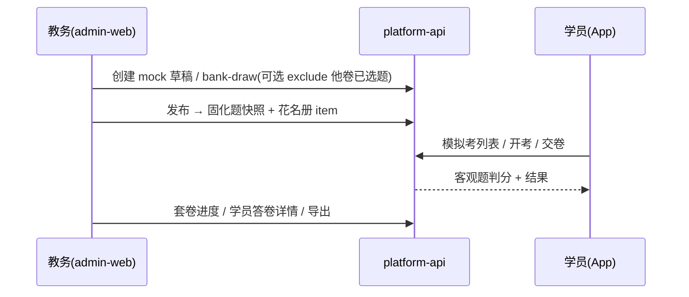

# 跟班班级模拟试卷方案

> 目标项目：`qianlvguoyu_saas`（`platform-api` + `admin-web`）  
> App 端：`gjjd_appnext`（模拟考走 `saasRequest` → `/training/follow/**`）  
> 上游基线：  
> - [跟班作业与随堂练实现方案.md](./跟班作业与随堂练实现方案.md)（双通道锁定；`train_follow_task*` / bank-draw）  
> - [班级刷题学情方案.md](./班级刷题学情方案.md)（通道 A：practice-scope + `/appsmart`）  
> - [跟班模块功能实现方案.md](./跟班模块功能实现方案.md)  
> 状态：产品方案；**P0 已按 [跟班班级模拟试卷_实现方案.md](./跟班班级模拟试卷_实现方案.md) 落地**  
> 编写日期：2026-08-11  

---

## 一、结论

**可以在跟班模块配置班级模拟试卷**：一班多套、配卷时可抽「本班其他模拟卷未占用」试题、后台按套卷查看学员考试详情。

**推荐落点**：扩展跟班任务域（通道 E = `train_follow_task.task_type = mock`），**不要**塞进学员自助刷题（`/appsmart` / `exam_mock_paper`）。

| 诉求 | 是否可做 | 说明 |
|------|----------|------|
| 跟班内配置模拟卷 | 是 | 管理端跟班工作台 + 可选 App 主讲配卷 |
| 一班多套 | 是 | 多条 `mock` 任务，题集彼此独立 |
| 第二套可选「未抽试题」 | 是 | **配卷时**排除本班其他模拟卷已选题 ID |
| 后台看学员考试详情 | 是 | 复用作业进度/答卷明细能力，独立「模拟考」Tab |

---

## 二、问题与目标

### 2.1 现状断层

```
已有：班级练习范围（科目 + 知识点白名单）
已有：学员自助刷题 /appsmart → 每人一卷，非统考
已有：跟班作业/随堂练 train_follow_task* → 同卷、可看进度与答卷
已有：bank-draw 单次会话 excludeIds（作业选题）
缺失：班级级「模拟卷」产品叙事与独立入口
缺失：跨套卷配卷去重（一模已抽题，二模可选不抽）
缺失：按「套卷」聚合的模拟考学情（与刷题学情分算）
```

### 2.2 与现网能力对照

| | 班级刷题（A） | 跟班作业（B） | 班级模拟卷（E，本方案） |
|--|--------------|--------------|------------------------|
| 谁出题 | 学员即时抽 | 老师布置 | **管理端/老师预配固定卷** |
| 是否同卷 | 否 | 是 | **是** |
| 多套 | 个人历史多卷 | 多任务 | **一班多套班级卷** |
| 未抽题 | 无跨卷去重 | 仅单次 draw 会话 | **跨套卷题集去重（配卷）** |
| 后台明细 | 学情汇总，非「某套卷」 | 作业 Tab | **按套卷看考试详情** |

### 2.3 目标角色

| 角色 | 能力 |
|------|------|
| 跟班教务 / 管理员 | 配卷、发布/关闭、看进度与答卷详情、导出 |
| 主讲（可选分期） | App 或后台辅助配卷、看本班进度 |
| 学员 | App「我的班级」→ 模拟考列表 → 开考/交卷；与刷题、作业分入口 |

### 2.4 非目标

| 不做 | 原因 |
|------|------|
| 用 `/appsmart` 承载统考同卷 | 每人随机卷，难按套看详情、难配卷去重 |
| 把模拟卷答卷并入 `exam_mock_paper` 学情 | 双通道锁定；指标不与自助刷题混算 |
| 替换认定/正式考试计划 | `train_exam` / 考试计划语义不同 |
| 模拟分默认计入认定通过率 | 教学参考分，非认定主成绩 |
| 主观题 / 人工批改（P0） | 与作业决策一致，客观题自动判分即可 |
| 改写 promote「课后作业」 | 语义分离 |

---

## 三、通道归属（建议拍板）

坚持已锁双通道，本方案增加产品线 **E**：

```text
A 自助刷题     practice-scope + /appsmart      → 巩固练
B 作业/随堂练  train_follow_task (homework/practice) → 课后练
E 班级模拟卷   train_follow_task (mock)        → 考前同卷模拟 ★
认定考试       train_exam / 考试计划            → 正式考，不混
```

### 3.1 为何选扩展 follow 任务（E1）

1. 已有「题快照 + 花名册 item + 答卷 + 管理端进度/明细」闭环，契合统考同卷。  
2. `bank-draw` / `excludeIds` 可直接支撑「抽未抽题」。  
3. 不破坏「刷题答卷不进 follow 表」：模拟卷是**统考任务**，答卷进 follow 域合理。  
4. 比新建全套 `train_class_mock_*`（E2）工期短、行为与作业一致，利于教务学习成本。

### 3.2 何时考虑独立表（E2）

仅当产品强要求：作业与模拟考权限/报表必须物理分表、或模拟考生命周期与作业差异过大（如多次机考、密封卷库）时再拆。P0 不建议。

---

## 四、产品规则

### 4.1 配卷

| 项 | 规则 |
|----|------|
| 挂载 | `class_id`；可选 `schedule_id` / 开放起止时间 / 考试时长 |
| 范围 | 默认受本班 **practice-scope（科目+知识点）** 约束；「允许超范围」默认关、需权限 |
| 组题 | 题库智能抽 / 手工选；（P2）复制已有卷、从错题生成冲刺卷 |
| 一班多套 | 多条 `task_type=mock`，标题区分（一模 / 二模 / 冲刺） |
| 状态 | `draft → published → closed`（复用作业） |

### 4.2 「未抽试题」（核心）

| 选项 | 含义 | P0 |
|------|------|----|
| **A. 配卷去重（默认）** | 二模抽题池排除本班其他模拟卷已选题 | **做** |
| B. 学员作答去重 | 开考时按人排除已答题 → 变成每人一卷 | 与同卷冲突，不做或仅高级选项 |
| C. 排除自助刷题做过的题 | 读 `exam_user_answer_log` | 跨通道，二期可选 |

**A 的计算**：

```text
excludeIds = 本班所有 task_type=mock 且未删除任务的
             train_follow_task_question.source_exam_detail_id 并集
（可配置：仅已发布 + 草稿，或含已关闭；默认含草稿+已发布）
```

- 仅影响**本次抽题池**；不追溯改已发布卷。  
- 与「排除本班作业题」默认**分开开关**（避免作业练过的题模拟不能出）。  
- 题池不足：提示「可抽题仅剩 N，不足题量」；允许降量或取消「仅未抽」。

### 4.3 发布与作答

- 发布时固化题目快照 + 花名册 `item`；插班补发与作业一致（已发布补 pending；closed 不补）。  
- App：学员端「模拟考」列表（与「作业」「刷题」分入口）；开考倒计时、交卷。  
- 客观题自动判分；交卷后是否显示解析沿用作业类开关。  
- 重考策略：P0 默认不允许；P1 可配「允许重考 / 取最高分 / 取最近一次」。

### 4.4 后台详情

跟班工作台新增 Tab **「模拟考」**（推荐独立 Tab；备选：作业 Tab 按类型筛选）。

| 层级 | 内容 |
|------|------|
| 套卷列表 | 名称、题量、状态、应交/已交、均分、及格率 |
| 学员表 | 姓名、状态、得分、用时、交卷时间 |
| 答卷详情 | 逐题对错、选项、正确答案、解析（权限控制） |
| 可选（P1） | 按知识点正确率、导出 Excel |

---

## 五、数据模型草案

### 5.1 方案 E1（推荐）：扩展 follow 任务

```text
train_follow_task
  task_type: homework | practice | mock   ← 扩展 mock
  可选字段（P0/P1）：
    time_limit_min      考试时长（分钟）
    pass_score          及格分
    allow_retake        是否允许重考
    open_start / open_end  开放窗口（可与 practice-scope 日期独立）
    # 配卷偏好仅草稿有效，可不落库：exclude_other_mock_questions

继续复用：
  train_follow_task_question   题快照（含 source_exam_detail_id）
  train_follow_task_item       学员应交/状态
  train_follow_task_answer     作答与判分
```

配卷抽题：

```text
POST /training/follow/classes/{classId}/bank-draw
  …既有参数…
  excludeIds: 服务端在勾选「未抽题」时组装为本班其他 mock 已占用题 ID
```

管理端：复用 `/training/follow-tasks/**`，按 `taskType=mock` 过滤；答卷详情复用现有 item/answers 接口。

### 5.2 方案 E2（备选）：独立表

```text
train_class_mock_paper
train_class_mock_paper_question
train_class_mock_attempt
train_class_mock_answer
```

语义同 E1，工作量大。仅在 §3.2 条件满足时启用。

---

## 六、端到端链路



---

## 七、与现有模块边界

| 模块 | 关系 |
|------|------|
| 试题配置（practice-scope） | 模拟卷抽题默认白名单；不替代 scope |
| 刷题学情 | 只统计 `/appsmart`；模拟考另做「模拟考学情」，**指标不混算** |
| 作业 Tab | 底层可共用；UI 分 Tab，避免把模拟考当随堂练 |
| 认定/考试计划 | 不替代；成绩不默认进认定通过率 |
| AI 班级助理 | 可后接「催未考」「二模未抽题余量」；非 P0 阻断 |

---

## 八、App / 管理端入口

### 8.1 管理端

- `FollowClassWorkbench` 新增 Tab：**模拟考**  
- 能力：套卷 CRUD（草稿）、抽题（含未抽开关）、发布/关闭、学员表、答卷抽屉、导出（P1）  
- 配卷范围选择器复用 practice-scope / bank-scope 组件

### 8.2 App（`gjjd_appnext`）

- 入口：**我的班级** → 某班 → **模拟考**（不进「提升」刷题）  
- 页面：列表 → 答题/交卷 → 结果（可与作业页样式对齐，路由独立）  
- 网络：`saasRequest` → `/training/follow/**`（与作业同鉴权）  
- **不改** `pages/promote/*` 主语义

---

## 九、分期建议

| 期 | 交付 | 验收 |
|----|------|------|
| **P0** | `task_type=mock`；管理端模拟考 Tab：配卷（含「排除本班其他模拟卷已选题」）+ 发布；App 作答交卷；学员答卷详情 | 一班两套；二套勾未抽后与一套题集无交集；后台能打开某人答卷 |
| **P1** | 考试时长/窗口、及格线、重考策略、导出、知识点正确率 | 教务日常可用 |
| **P2** | 卷模板复制、错题冲刺卷、助理催考 | 增强 |

---

## 十、风险与约束

1. **题池耗尽**：知识点白名单条数 ≠ 可抽客观题量；未抽开关必须有余量校验。  
2. **改卷**：已发布禁止改题集；只能 closed 后新建「补考卷/三模」。  
3. **权限**：配卷/看解析建议跟班教务 + 主讲；学员交卷后看解析沿用任务开关。  
4. **红线**：不改 promote / 认定考试主链路；不与通道 A 答卷混表混算。

---

## 十一、待产品拍板（5 点）

| # | 议题 | 建议默认 |
|---|------|----------|
| 1 | 通道：E1 扩展 follow `mock` vs E2 独立表 | **E1** |
| 2 | 未抽题：仅配卷去重（A）？ | **是** |
| 3 | 配置人：仅管理端，还是 App 主讲也可配？ | P0 **仅管理端**；P1 开 App |
| 4 | 重考：是否允许；多套成绩并列还是取最高？ | P0 **不允许重考**；多套并列展示 |
| 5 | UI：独立「模拟考」Tab vs 作业内筛类型？ | **独立 Tab** |

---

## 十二、相关文件索引（落地时）

| 区域 | 路径 |
|------|------|
| 作业服务 | `.../trainingdepartment/service/TrainFollowTaskApplicationService.java` |
| App 跟班 API | `.../controller/TrainFollowAppController.java` |
| 管理端作业 API | `.../controller/TrainFollowTaskAdminController.java` |
| 练习范围 | `.../ClassPracticeScopeApplicationService.java` |
| 跟班工作台 | `apps/admin-web/.../follow/FollowClassWorkbench.tsx` |
| App 作业页 | `gjjd_appnext/pages/class/homework*.vue`、`api/follow-homework.js` |
| 刷题（勿混） | `AppExamSmartService`、`/appsmart`、`exam_mock_paper` |

---

## 十三、一句话

**跟班可配多套同卷模拟考：扩展 `train_follow_task` 为 `mock`，配卷可选排除本班他卷已选题，答卷与进度走 follow 域并在跟班「模拟考」Tab 查看详情；自助刷题通道保持不动。**
