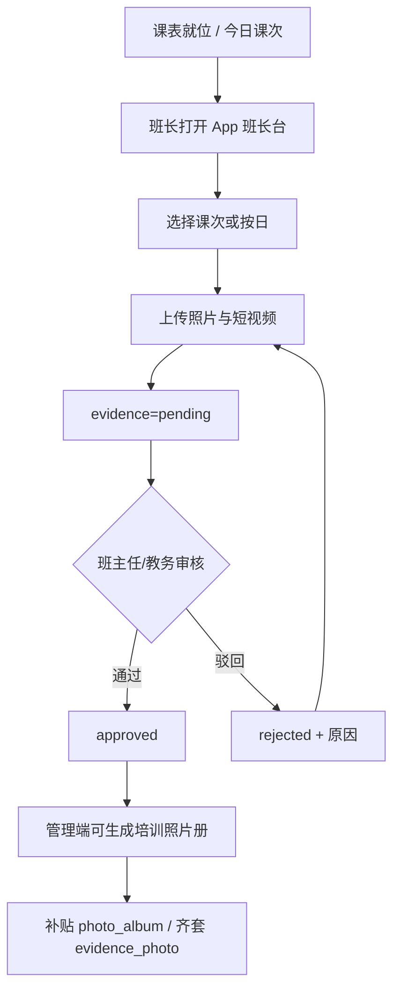

# 跟班课堂影像与「培训照片」材料生成实现方案

> **状态**：E1/E2/E3 已落地（2026-08-13）；**课次配额拍板：每节课照片 5 张 + 视频 3 段×15 秒**；E4 补贴挂钩随台账消费  
> **日期**：2026-08-13（配额修订同日）  
> **样例**：桌面 `申报补贴材料/河池南丹/火初1培训照片.docx`（及来宾/玉林同类「培训照片」包；样例文件非标准 OOXML，以业务版式约定为准）  
> **目标**：班长在跟班过程回传课堂照片/短视频 → 管理端可管可审 → 后台生成与补贴样例一致的「上课过程/培训照片」材料，并标明**理论/实操**与**上课时长（学时）**  
> **对齐**：  
> - [跟班模块功能实现方案.md](./跟班模块功能实现方案.md) **M2**（证据 / 班长拍照）  
> - [培训班级五角色落地实现方案.md](./培训班级五角色落地实现方案.md)（`monitor` 等）  
> - [培训模块_App端实现方案.md](./培训模块_App端实现方案.md) **A2**（班长台影像写）  
> - [申报补贴材料生成实现方案.md](./申报补贴材料生成实现方案.md) 槽位 `photo_album`  
> - [补贴与人社扩展实现方案.md](./补贴与人社扩展实现方案.md) 齐套项 `evidence_photo`  

### 落地清单（已实现）

| 阶段 | 内容 | 位置 |
|------|------|------|
| E1 | `train_follow_evidence` / `train_follow_photo_pack`；课表 `actual_class_hours`/`evidence_required` | Flyway `V20260813_001` |
| E1 | 管理端「留痕」Tab：课次齐套、补传、审核、生成 Word | `FollowEvidenceTab` + `/training/.../follow/evidences*` |
| E2 | App 班长台「课堂影像上传」 | `followEvidence.vue` + `/training/follow/classes/{id}/evidences*` |
| E3 | 按已审照片生成培训照片.docx（理论/实操+学时） | `TrainFollowPhotoPackGenerator` |
| E3.1 | **每课次：照片 ≥5、视频 ≥3（每段约 15 秒）** | `V20260813_005` + coverage/上传校验 + App/管理端 |
| E4 | 补贴 `photo_album` 自动引用 | **未做**（依赖补贴台账） |

---

## 一、结论（先看）

| 问题 | 答案 |
|------|------|
| 照片在哪收集最合适？ | **跟班 · 课次级证据**（挂 `train_schedule`）；无课表时降级「按日」 |
| 谁传？ | **班长（`monitor`）为主**；班主任/跟班教务可补传与审核 |
| 理论/实操、时长从哪来？ | **优先读课表** `teachForm` + `classHours`（现网已有）；允许课次上补录「实际学时」 |
| 管理端放哪？ | `FollowClassWorkbench` 已有 **「留痕/证据」Tab 占位** → 做成真功能 |
| 如何生成南丹式照片册？ | 按课次聚合已审照片 → Word 模板填空/插图 → 供补贴 `photo_album` 槽直接引用 |
| 现网缺口 | `train_follow_evidence` **未建表未实现**；App 班长上传未做；生成链路未做 |

**一句话：**  
课堂过程照片的真相源放在**跟班课次证据**，不放在补贴单临时上传；补贴只消费「已审核、已按课次打标」的影像包。

```text
课表 train_schedule（理论/实操 + 学时）
        ↓ 打开课次 / 按日 session
班长 App 上传照片 → train_follow_evidence
        ↓ 班主任/教务审核
管理端跟班「课堂影像」管理
        ↓ 一键生成
《××班培训照片.docx》（过程材料）
        ↓
补贴材料包 photo_album 槽引用
```

---

## 二、样例与产品定义

### 2.1 样例在业务里的角色

河池南丹包中的 `火初1培训照片.docx`、来宾/玉林「培训照片」均为**补贴申报过程材料**：按培训过程展示课堂实景，通常需能看出：

- 哪个班、哪段培训；  
- 理论课 / 实操课区分（标题、分组或页眉）；  
- 对应上课日期与时长（学时或起止时间）；  
- 若干现场照片（全景/授课/实操操作等）。

> 样例文件体积大且非标准 zip OOXML，实施时以**我方 Word 模板**复刻版式，不依赖直接解析该文件二进制。

### 2.2 产品一句话

> 开班后按课表跟班：班长每课次回传课堂照片；系统记录课次的授课形式与学时；管理端审核后一键生成「培训照片」Word，进入补贴材料清单。

### 2.3 非目标（本期不做）

- 不替代考勤签到（影像≠出勤证明，可并列服务补贴齐套）。  
- **视频用于课次齐套留痕**；「培训照片」Word **默认仍只插已审照片**（视频不进默认册页）。  
- 不在补贴页让教务「临时拼相册」作为主路径（仅作缺项补传兜底）。  
- 不做学员人人拍照（避免重复与权限混乱）。

---

## 三、为何挂在「跟班课次」而不是别处

| 候选位置 | 评价 |
|----------|------|
| **跟班 + `train_schedule` 课次（推荐）** | 现网课表已有 `teachForm`（理论/实操）、`classHours`（学时）、日期/起止时间；跟班方案 M2 已约定班长「课堂拍照」；工作台已有课表与证据 Tab 占位 |
| 仅按日、不挂课次 | 无课表班级可用作降级；但难以稳定区分同日理论+实操两节 |
| 开班申报材料 | 开班前无过程照片；职责错位 |
| 补贴单上直接上传整册 | 失去过程管理与按课催办；与「班长回传」脱节；仅作兜底 |
| 认定/考试材料 | 对象是考生证件照等，不是课堂过程 |

**挂载规则（与跟班决策 4 一致）：**

```text
优先：evidence.schedule_id → 继承课次 teachForm / classHours / 日期时间
否则：class_id + biz_date → 按日；须手工选 teachForm，学时可填
可选：先建 train_follow_session，再把证据挂 session_id
```

---

## 四、角色与采集流程

### 4.1 职责

| 角色 | 采集/管理 |
|------|-----------|
| **班长 `monitor`** | App：选今日课次 → 拍照/从相册选图上传；可删自己未审图；看缺课次提醒 |
| **班主任 `head_teacher`** | 催传、补传、确认/驳回本班影像 |
| **跟班教务 `follow_staff`** | 多班抽查、审核、标记「可进补贴包」 |
| **主讲/助教** | 可补传（可选）；不替代班长主责 |
| **机构操作员（管理端）** | 跟班工作台管理、生成 Word、缺项催办；补贴侧只读引用 |

花名册「是否班长」→ 角色 `monitor` 现网已通，采集权限挂此角色即可。

### 4.2 闭环（建议）



### 4.3 最低采集规范（拍板）

| 规则 | 默认（全课次统一，不按理论/实操分档） |
|------|----------|
| 每课次照片 | **≥ 5 张**（`media_type=photo`，待审+已审合计上限 5，驳回后可重传） |
| 每课次视频 | **≥ 3 段**，**每段约 15 秒**（录制上限 15s；校验允许 13～17s 容差） |
| 单张/单段大小 | 与现有上传组件一致（照片 ≤ 5～10MB；视频按端上压缩） |
| 格式 | 照片 jpg/png/webp；视频 mp4/mov 等端上可选格式 |
| 必填说明 | 可选 caption；默认用课次名+形式+日期生成说明 |
| 齐套判定 | 该课次 **已审照片 ≥5 且 已审视频 ≥3** → 课次达标；应采课次全达标 → 班级影像齐套 |

「应采课次」：课表中需留痕的节次（可按 `teachForm` 全采，或仅标记 `needEvidence=1` / `evidence_required=1` 的课次）。

---

## 五、数据模型（建议）

### 5.1 复用现网

| 资产 | 用法 |
|------|------|
| `train_schedule` | `teachForm`、`classHours`、`scheduleDate`、`startTime`/`endTime`、`courseName`、`teacherName` |
| `train_class_role` / 花名册班长 | 上传鉴权 |
| 跟班工作台课表 Tab | 展示应采课次与缺图红点 |
| 统一文件上传 | 存对象路径，证据表只存元数据 |

### 5.2 新建 / 落实跟班已规划表

**`train_follow_evidence`（M2 落地，本方案核心）**

| 字段 | 说明 |
|------|------|
| `id` | PK |
| `class_id` | 班级 |
| `schedule_id` | 可空；优先挂课次 |
| `session_id` | 可空；有 session 时关联 |
| `biz_date` | 业务日（无 schedule 时必填） |
| `media_type` | `photo` / `video` |
| `duration_seconds` | 视频时长（秒）；照片为空；目标 15 |
| `file_path` / `thumb_path` | 存储路径 |
| `caption` | 说明 |
| `uploader_user_id` / `uploader_role` | 上传人与角色 |
| `review_status` | `pending` / `approved` / `rejected` |
| `reviewed_by` / `reviewed_at` / `reject_reason` | 审核 |
| `sort_no` | 同课次内排序（生成册用） |
| `tenant_id` 等 | 多租户 |

**课次侧补强（建议，小改 `train_schedule` 或挂 session）：**

| 字段 | 说明 |
|------|------|
| `actual_class_hours` | 可选；实际授课学时。空则生成用 `classHours` |
| `evidence_required` | 可选；是否必须留影像（默认按策略） |

> **时长口径（拍板默认）：** 材料上「上课时长」= `coalesce(actual_class_hours, classHours)`；若需展示钟点，并列 `startTime–endTime`。  
> **形式口径：** 材料上「理论/实操」= 课次 `teachForm`（规范化：含「实操/实作/操作」→ 实操；含「理论」→ 理论；其他原文或「综合」）。

### 5.3 生成物

| 表/字段 | 说明 |
|---------|------|
| `train_follow_photo_pack` 或班级附件记录 | 最近一次生成的培训照片 Word 路径、生成时间、依据课次快照 JSON |
| 补贴侧 | `photo_album` 槽引用上述路径；不二次选图（除非补传覆盖） |

---

## 六、功能范围

### 6.1 App（班长台为主）

| 能力 | 说明 | 阶段 |
|------|------|------|
| 今日/本班课次列表 | 展示形式、学时、照片/视频是否达标 | P1 |
| 上传/删除未审照片 | 每课最多 5 张；压缩后传 | P1 |
| 上传/删除未审视频 | 每课最多 3 段×约 15 秒 | P1 |
| 缺项提醒 | 昨日/本周缺图/缺视频课次 | P1 |
| 班主任确认入口 | 列表审核通过/驳回 | P1～P2 |

对齐 App 方案 A2「影像写」；入口：`roles/monitor` + 跟班影像页。

### 6.2 管理端跟班工作台

在 `FollowClassWorkbench` **「留痕/证据」Tab**（现占位）实现：

| 能力 | 说明 |
|------|------|
| 课次维度看板 | 日期、课程、理论/实操、计划学时、实际学时、**照片 已审/5、视频 已审/3**、审核状态 |
| 照片/视频墙 | 按课次浏览、排序、删改说明、驳回重传 |
| 补传 | 教务/班主任代班长上传照片或视频（记 `uploader_role`） |
| 批量审核 | 通过可选「可进补贴」 |
| **生成培训照片.docx** | 选课次范围（默认全班已审）→ 套地市/通用模板 → 下载 |
| 催办 | 一键提醒班长（站内消息/待办，通道按现有能力） |

考勤、作业 Tab 不承载照片主数据，仅可链到「本日影像」。

### 6.3 生成版式（对齐南丹类样例）

Word 建议结构（模板可按地市挂 `photo_album`）：

1. 封面/标题：`{企业/班级名}{工种等级}培训照片`  
2. 按**授课形式分组**或按**日期课次**分页：  
   - 小标题：`{日期} {课程名}（理论/实操） 学时：{n}`  
   - 下挂 2～N 张图（固定栏宽，自动换行）  
3. 文末可选：学时合计（理论合计 / 实操合计）— 数据来自课表聚合（工作台已有类似统计逻辑）

渲染：复用开班/补贴 Docx 插图能力；图用来自 `approved` 证据。

### 6.4 与补贴材料衔接

| 环节 | 行为 |
|------|------|
| 齐套 `evidence_photo` | 统计应采课次 vs 已审达标课次 |
| 槽位 `photo_album` | 优先嵌入跟班已生成 Word；无则允许 `manual_upload` 兜底（对齐补贴草稿 D14/D15） |
| 政策年/地市 | 照片册**内容**跟班产；**封面套话/目录名**可由补贴 Profile 决定 |

---

## 七、API 清单（建议）

| 方法 | 路径 | 说明 |
|------|------|------|
| GET | `/training/info-classes/{id}/follow/evidences` | 按 scheduleId/date/status 筛选 |
| POST | `/training/info-classes/{id}/follow/evidences` | 上传元数据+文件（班长/班主任/教务） |
| PATCH | `/training/follow/evidences/{id}` | 说明、排序 |
| POST | `/training/follow/evidences/{id}/review` | 审核 |
| DELETE | `/training/follow/evidences/{id}` | 未审可删；已审需教务 |
| GET | `/training/info-classes/{id}/follow/evidence-coverage` | 课次齐套摘要 |
| POST | `/training/info-classes/{id}/follow/photo-pack/generate` | 生成培训照片 Word |
| GET | `/training/info-classes/{id}/follow/photo-pack/latest` | 最近生成包 |

App 与管理端共用写接口；鉴权按班级角色。

---

## 八、分期与验收

| 阶段 | 交付 | 验收 |
|------|------|------|
| **E0** | 本文评审 + 模板草图（通用培训照片.docx） | 拍板 §十 |
| **E1 证据底座** | Flyway `train_follow_evidence`；管理端课次照片墙+审核；课表缺图指示 | 教务可代传并审核 |
| **E2 班长 App** | 班长台选课次上传、缺项列表 | 班长当日传图进系统 |
| **E3 生成** | 一键生成 Word（理论/实操+学时标题+插图） | 与南丹样例信息要素一致（不要求像素级） |
| **E4 补贴挂钩** | `photo_album` / `evidence_photo` 读跟班包 | 补贴齐套能识别缺影像课次 |

依赖：课表质量（`teachForm`/`classHours` 尽量在开班导入或跟班课表维护时填全）；班长角色已设置。

---

## 九、风险与缓解

| 风险 | 缓解 |
|------|------|
| 课表无理论/实操或学时 | 生成前校验；缺则阻断或强制补录 `teachForm`/`actual_class_hours` |
| 班长不传 | 课次红点 + 班主任催办 + 教务补传兜底 |
| 照片隐私/存储 | 租户隔离；仅班级角色可见；定期归档策略另定 |
| 同日多节课混传 | **强制选课次**（有课表时）；禁止只选日期不选节次 |
| 样例 docx 无法解析 | 自建模板，不依赖原文件解压 |
| 与补贴抢主数据 | 明确跟班为真相源；补贴禁止默认可覆盖已审图集 |

---

## 十、开工前拍板项（Gate）

> 未确认前不编码。下表为**推荐草稿**（可改）。

| # | 拍板项 | 推荐草稿 |
|---|--------|----------|
| P1 | 采集挂载 | **课次优先**；无课表按日且必填理论/实操 |
| P2 | 主上传角色 | **班长**；班主任/教务可补传 |
| P3 | 时长展示 | **`actual_class_hours` 优先，否则 `classHours`**；可附带起止时间 |
| P4 | 理论/实操 | **继承课表 `teachForm`**；生成时规范化文案 |
| P5 | 每课次配额 | **照片 5 张 + 视频 3 段×约 15 秒**（统一，不按理论/实操分档） |
| P6 | 审核是否强制 | **进补贴包必须 approved**；跟班日常可先看 pending |
| P7 | 首期是否做 App | **E1 管理端先于或并行 E2**；若班长只在现场用手机，E2 不建议长期缺 |
| P8 | 生成模板 | 先做**通用模板**；南丹/来宾差异作补贴 Profile 封面套用 |
| P9 | 视频进册 | **齐套统计计入视频**；默认照片册 Word **仍只插 photo** |
| P10 | 与补贴 D14 | 确认升级为：**跟班生成优先，人工整册上传仅兜底** |

---

## 十一、文档索引

| 文档 | 关系 |
|------|------|
| 本文 | 课堂影像采集 + 培训照片材料生成权威方案 |
| 跟班模块功能实现方案 | M2 总册；本文细化证据与生成 |
| 申报补贴材料生成实现方案 | `photo_album` 消费方 |
| 培训模块_App端实现方案 | 班长台上传入口 |
| 桌面南丹/来宾/玉林「培训照片」 | 版式与信息要素参照 |

---

*E0 完成标志：本文入库并完成 §十 确认；随后 E1 建表与跟班「留痕」Tab 真做。*
