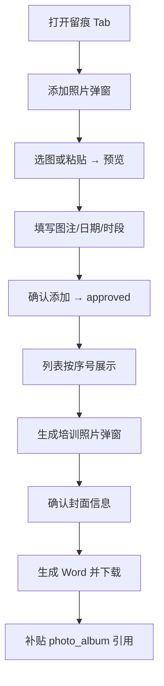

# 跟班课堂影像与「培训照片」材料生成实现方案

> **状态**：**E5 手动相册已落地（2026-08-17）**；采集主路径改为管理端跟班「留痕」手动添加；**不再按课表逐课次齐套**，App 班长上传已关闭  
> **日期**：2026-08-17（修订）；初版 2026-08-13  
> **样例**：桌面 `申报补贴材料/玉林/8.华友锂业浸出工高级培训照片.docx`（及来宾/南丹同类「培训照片」包）  
> **目标**：管理员在跟班工作台添加课堂照片并填写图注 → 一键生成与申报样例一致的「培训照片」Word，封面写入工种/级别/时间/单位/地址  
> **对齐**：  
> - [跟班模块功能实现方案.md](./跟班模块功能实现方案.md) **M2**（证据 / 留痕）  
> - [申报补贴材料生成实现方案.md](./申报补贴材料生成实现方案.md) 槽位 `photo_album`  
> - [补贴与人社扩展实现方案.md](./补贴与人社扩展实现方案.md) 齐套项 `evidence_photo`  
> - [跟班日志与督导实现方案.md](./跟班日志与督导实现方案.md)（`evidence.*` / `photo_pack.generate` 事件源）  

### 落地清单

| 阶段 | 内容 | 位置 | 状态 |
|------|------|------|------|
| E1 | `train_follow_evidence` / `train_follow_photo_pack`；课表补强字段 | Flyway `V20260813_*` | 已落地（表结构保留） |
| E1～E3 | 课次齐套、App 上传、按课次生成 | 旧路径 | **已废弃为非主路径** |
| **E5** | **管理端手动相册 + 图注 + 生成弹窗元信息** | `FollowEvidenceTab` + `TrainFollowPhotoPackGenerator` | **现行主路径** |
| E4 | 补贴 `photo_album` 自动引用 | 补贴台账 | 未做 |

---

## 一、结论（先看）

| 问题 | 答案（现行） |
|------|----------------|
| 照片在哪收集？ | **跟班工作台 · 留痕 Tab**：管理员手动添加，**不挂课次**（`schedule_id` 可空） |
| 谁传？ | **管理端操作员**（需 `train:info-class:update`）；**App 班长上传已关闭** |
| 图注怎么写？ | 必填 `caption`（开班 / 公共课 / 实操课，可选手选可手输）+ 业务日 `biz_date` + 时段（上午/下午/全天，存 `teach_form_override`） |
| 理论/实操、课次学时？ | **生成册不再按课次分组标理论/实操**；版式对齐玉林样例图注 |
| 如何生成照片册？ | 弹窗确认标题与培训信息 → 按列表序号顺序插图 → Word |
| 齐套口径？ | **有 ≥1 张已审照片即可生成**；metrics `mode=manual`，不再卡课次 5+3 |

**一句话：**  
课堂过程照片由**管理端手动建相册**，补贴侧仍只消费「已审核」影像包；课次配额与 App 上传不再作为主验收路径。

```text
管理端 FollowClassWorkbench「留痕」
        ↓ 选择/粘贴图片 → 预览 → 填图注/日期/时段 → 确认添加
train_follow_evidence（无 schedule_id，admin 上传自动 approved）
        ↓ 生成培训照片（弹窗填封面信息）
《××培训照片.docx》
        ↓
补贴材料包 photo_album 槽引用（E4）
```

---

## 二、样例与产品定义

### 2.1 样例信息要素（玉林类）

培训照片 Word 通常包含：

1. **标题**：如「华友锂业浸出工高级培训照片」  
2. **封面信息行**：  
   - 培训工种  
   - 培训级别  
   - 培训时间  
   - 培训单位  
   - 培训地址  
3. **过程插图 + 图注**：  
   `图N：{说明}                                 {yyyy年M月d日}{上午|下午|全天}`  
   例：`图1：开班、公共课                                 2024年6月6日上午`

### 2.2 产品一句话（现行）

> 跟班过程中由管理员在留痕页添加课堂照片并写图注；生成前确认标题与培训元信息；导出 Word 供补贴申报使用。

### 2.3 非目标

- 不替代考勤签到。  
- 视频不进默认培训照片册（表结构仍可存 `video`，现行 UI 只做 photo）。  
- **不做**班长 App 主传、**不做**按课表 5 张照片 + 3 段视频齐套催办（历史设计归档见 §十二）。  
- 不在补贴页以「临时拼相册」为主路径。

---

## 三、采集与交互（管理端）

### 3.1 留痕 Tab（`FollowEvidenceTab`）

| 能力 | 说明 |
|------|------|
| 已添加列表 | 序号（图1…）、预览、图注、日期、时段、状态、删除 |
| 添加照片 | 弹窗：图注（下拉+手输）→ 日期 → 时段 → 选图/粘贴预览 → **确认添加** |
| 粘贴上传 | 弹窗打开时 `Ctrl+V` / `⌘+V` 仅写入预览，**不立刻落库**（避免重复提交） |
| 本地选图 | 与粘贴共用预览区；可重新选择 / 清除 |
| 删除 | 软删（`@TableLogic`，服务端须 `deleteById`，不可仅 `updateById` 改 deleted） |
| 生成培训照片 | 弹窗编辑封面字段 → 生成并自动下载 |
| 列表/导出顺序 | **日期 ASC → sortNo ASC → id ASC**（须一致，避免时段参与排序打乱序号） |

图注候选项（可扩展）：`开班`、`公共课`、`实操课`；允许自定义文本（≤100 字）。

### 3.2 生成弹窗字段

| 字段 | 默认来源 | 可改 |
|------|----------|------|
| 标题 | 班级标题 + 工种/级别 等拼装 | ✓ |
| 培训工种 | `exam_work_type.title` | ✓ |
| 培训级别 | 班级/开班 `work_type_level` → 初级工…高级技师 | ✓ |
| 培训时间 | `date_start`至`date_end` | ✓ |
| 培训单位 | 开班 `train_company_name`（空则「千铝工投」） | ✓ |
| 培训地址 | 开班 `company_address` / 企业名兜底 | ✓ |

API：`GET .../photo-pack/defaults`；`POST .../photo-pack/generate` body=`FollowPhotoPackGenerateReq`。

### 3.3 闭环



---

## 四、数据模型（现行用法）

### 4.1 `train_follow_evidence`（保留，用法变更）

| 字段 | 现行用法 |
|------|----------|
| `class_id` | 必填 |
| `schedule_id` | **手动添加时为空** |
| `biz_date` | **必填**（业务日） |
| `media_type` | 现行 `photo` |
| `file_id` / `file_path` | 文件 |
| `caption` | **必填**图注说明 |
| `teach_form_override` | **存时段**：`上午` / `下午` / `全天`（列表 VO 的 `teachForm` 在无课次时回落此字段） |
| `review_status` | 管理端上传 **自动 `approved`** |
| `sort_no` | 班级内递增；导出图序依据之一 |
| `uploader_role` | 如 `admin` |

课表侧 `actual_class_hours` / `evidence_required` 仍保留，**现行生成与齐套不再依赖**。

### 4.2 `train_follow_photo_pack`

| 字段 | 说明 |
|------|------|
| `file_id` / `file_path` | 生成 Word |
| `title` | 封面标题 |
| `snapshot_json` | 含 photoCount、封面元信息等 |
| `generated_at` / `generated_by` | 生成审计 |

---

## 五、Word 生成规则

实现：`TrainFollowPhotoPackGenerator`。

1. 居中标题（弹窗 `title`）。  
2. 左对齐五行：培训工种/级别/时间/单位/地址。  
3. 按统一排序遍历已审 `photo`：插图（居中）+ 图注一行。  
4. 图注格式：`图{n}：{caption}                                 {中文日期}{时段}`。  
5. 字体约定：标题/正文宋体（或实现中的仿宋小四等，与模板对齐时以代码为准）。  
6. **排序**：`bizDate` → `sortNo` → `id`（与留痕列表序号一致；**时段不参与排序**）。

文件名：`{sanitize(title)}.docx`，私有存储；下载走鉴权 `/api/files/{id}/download`。

---

## 六、API（现行）

| 方法 | 路径 | 说明 |
|------|------|------|
| GET | `/training/info-classes/{id}/follow/evidences` | 列表（可筛 mediaType） |
| POST | `/training/info-classes/{id}/follow/evidences/upload` | multipart 上传；admin 自动审核通过 |
| DELETE | `/training/follow-evidences/{id}` | 逻辑删除（`deleteById`） |
| GET | `/training/follow-evidences/{id}/preview` | 鉴权预览 |
| GET | `/training/info-classes/{id}/follow/photo-pack/defaults` | 生成弹窗默认值 |
| POST | `/training/info-classes/{id}/follow/photo-pack/generate` | body 可选封面字段 |
| GET | `/training/info-classes/{id}/follow/photo-pack/latest` | 最近生成包 |

App 侧原 `/training/follow/classes/{id}/evidences*` **上传接口拒绝**（产品关闭班长主传）。

权限：查看 `train:info-class:view`；写/生成 `train:info-class:update`。

---

## 七、齐套与 metrics

| 项 | 现行 |
|----|------|
| coverage / metrics | `mode=manual`；有已审照片即视为影像就绪 |
| 补贴 `evidence_photo` | 建议改为「已生成照片包或已审照片数 > 0」；具体以补贴齐套实现为准（E4） |
| 旧课次 5+3 配额 | 代码常量可保留，**UI/验收不再使用** |

---

## 八、分期与验收（修订）

| 阶段 | 交付 | 验收 |
|------|------|------|
| **E5 手动相册** | 留痕 Tab 添加/预览/粘贴/确认、删除、生成弹窗、Word 封面+图注 | 列表序号与导出图序一致；封面字段可改并写入 Word |
| E4 补贴挂钩 | `photo_album` 读最新 photo_pack | 补贴齐套能引用跟班包 |
| （归档）E1～E3 | 课次齐套 + App 上传 | 不再作为主验收 |

---

## 九、风险与缓解

| 风险 | 缓解 |
|------|------|
| 粘贴重复提交 | 仅预览落选中文件；确认按钮才上传；勿对同一 paste 绑双监听 |
| 逻辑删除无效 | `@TableLogic` 必须用 `deleteById`，禁止 `setDeleted` + `updateById` |
| 导出顺序错乱 | 禁止用时段参与 sortKey；与前端同一套 `date/sortNo/id` |
| 大图 ID 精度 | 前端排序用字符串 `localeCompare(..., { numeric: true })` |
| 班长现场无法传 | 产品接受管理端补传；若需恢复 App，另开需求回滚 §十二 |

---

## 十、拍板项（E5 已确认）

| # | 项 | 结论 |
|---|-----|------|
| P1 | 采集主路径 | **管理端手动添加**，不按课表齐套 |
| P2 | App 上传 | **关闭** |
| P3 | 审核 | 管理端上传 **自动通过** |
| P4 | 图注 | 必填；候选项开班/公共课/实操课 + 手输 |
| P5 | 时段 | 上午/下午/全天，写入 `teach_form_override` |
| P6 | 生成 | 弹窗确认标题与五项培训信息 |
| P7 | 版式 | 对齐玉林类：封面五行 + `图N：说明 + 日期时段` |
| P8 | 视频进册 | 默认不进 |
| P9 | 与补贴 | 仍跟班生成优先，人工整册仅兜底 |

---

## 十一、文档索引

| 文档 | 关系 |
|------|------|
| 本文 | 课堂影像 + 培训照片生成权威方案（**以 E5 为准**） |
| 跟班模块功能实现方案 | M2 总册；班长拍照描述已过时处指向本文 |
| 申报补贴材料生成实现方案 | `photo_album` 消费方 |
| 跟班日志与督导实现方案 | 影像事件码 |

---

## 十二、历史方案摘要（已废弃主路径）

> 仅供对照，**勿按此验收现行产品**。

- 采集挂 `train_schedule`；班长 App 每课次照片 ≥5、视频 ≥3×约 15 秒。  
- 管理端课次齐套看板、批量审核 pending。  
- 生成 Word 按理论/实操课次小标题分组。  
- 相关代码与常量（`MIN_PHOTOS_PER_SESSION` 等）可能仍存在，E5 后 UI/metrics 不再依赖。

---

*E5 完成标志：留痕 Tab 手动相册可用；生成 Word 含封面五项与图注；列表序号与导出一致。*
