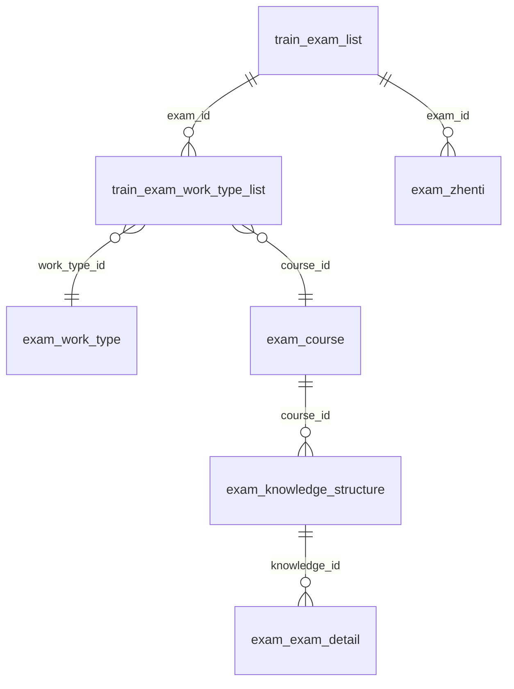

# Agent 数据关系理解增强方案

> 状态：**待审核**（v1.1，2026-10-20）
> 修订记录：v1.1 经 STORM 七视角审核（取证方法学 / Agent 行为设计 / DBA / 跨平台工具链 / 安全合规 / 流程治理 / 知识管理），3 项 P0、10 项 P1、7 项 P2 全部采纳；逐条落点见附录 E。
> 背景事故：历年真题共享方案 §2 只对 `train_exam_list` 做 `SHOW COLUMNS`，断言“工种/等级只存在于标题文本”，漏掉 `train_exam_work_type_list`（1067 行、租户 10159 全量）。
> 定位：不是业务功能，是 **Agent 工程基础设施**；目标是让“字段在哪、谁写、谁读、怎么连”从“靠模型想到”变成“一条命令查到 + 有证据标准”。
> 约束：根 `AGENTS.md` 保持高度精简，只保留一行索引；本方案不新增业务代码、不改生产运行逻辑。

---

## 1. 问题定义

本次错误的本质不是“不知道关联表存在”，而是三层能力缺失：

| 层 | 缺失 | 后果 |
|---|---|---|
| 发现 | 没有“从主表出发找关联表”的固定动作 | 单表 `SHOW COLUMNS` 的否定被当成全库结论 |
| 成本 | 查证要跨迁移、实体、Mapper、Service、DB 五处 | 模型倾向走最省力的单表检查 |
| 约束 | 方案评审不要求“否定性结论”附证据 | 错误前提直接进入实施计划 |

已完成的止血（T0，2026-10-20）：

- `docs/agent/数据关系速查.md`（37 行）：30 秒红线 5 步、核心关系表、事故锚点；
- 根 `AGENTS.md` 子文档索引 +1 行，净增 1 行；
- `services/platform-api/AGENTS.md` 数据库规则 +1 条（字段归属/否定性结论）；
- `docs/agent/踩坑库.md` #37。

本方案是止血之后的**系统性增强**，分阶段实施，每阶段可独立验收、独立回滚。

---

## 2. 目标与非目标

### 2.1 目标

1. Agent 用 **1 条命令** 回答“关键词在哪些表/实体/引用里”，默认输出 ≤ 40 行。
2. Agent 能查到**结构化的表-列-类型-索引**，不依赖单表 `SHOW COLUMNS`。
3. 核心业务关系有**可读的关系图 + 写入方/读取方索引**，不要求读完整条 Java 调用链。
4. 数据库结构变化时，**生成物能自动暴露漂移**，不靠人工记忆。
5. 方案评审能拦住“不存在/只有/没有”这类无证据断言。

### 2.2 非目标

- 不把所有表结构塞进 `AGENTS.md` 或任何“每轮必读”的文件；
- 不做数据抽样、不导出业务数据、不引入生产写操作；
- 不替代业务方案文档，不维护全量字段业务含义；
- 一期不做 MCP Server / 不做图数据库 / 不新增 npm 依赖（Node 内置能力优先）；数据库访问复用本机 `mysql` CLI，缺失时降级为离线模式。

---

## 3. 设计原则

1. **语义靠人维护，schema 靠脚本生成**：业务关系（谁和谁一对多）写在短文档里；表/列/类型/索引由 `information_schema` 生成。
2. **按需加载**：生成物默认不进上下文，由命令查询；文档控制在 60 行以内。
3. **证据路径优先**：每条关系、每个生成物都带来源（`file:line` 或 `information_schema`）。
4. **默认只读、默认测试库**：脚本不做任何写入；生产库仅显式 `--db prod` 时只读查询。
5. **可复现、可 diff**：生成物确定性输出，`--check` 能判断是否漂移。
6. **不增加根 AGENTS.md 行数**：需要新增知识时，放进已索引的 `docs/agent/数据关系速查.md` 或其链接文档。

---

## 4. 文件布局

```text
AGENTS.md                                  # 只保留已有的一行索引，不再增长
services/platform-api/AGENTS.md            # 已有第 6 条取证规则
docs/agent/
  数据关系速查.md                          # 已存在；后续只补“同名不同义字段”“必查 SQL”
  数据关系图.md                            # 新增：Mermaid ER 图 + 写入方/读取方
  schema-index.<前缀>.json                 # 新增：生成物（表/列/类型/索引，按表名前缀拆分，不含数据）
  schema-diff.md                           # 新增：测试库 vs 生产库结构差异（生成物）
scripts/agent/
  schema-find.mjs                          # 新增：一条命令跑五步取证
  schema-index.mjs                         # 新增：生成/校验 schema-index.<前缀>.json
  schema-diff.mjs                          # 新增：两库结构 diff
  sql/relation-health.sql                  # 新增：关系健康检查 SQL
  schema-find.test.mjs                     # 新增：node:test 单测
```

> 生成物放 `docs/agent/` 而非 `outputs/` 的理由：与既有 `docs/agent/项目现状.md` 同属“Agent 上下文生成物”，由脚本生成、可重复、可 diff；文件头标注 `generated`，禁止手改。

---

## 5. 分阶段实施

### T1 速查文档补强 + 关系健康 SQL（0.5 人天）

**交付物**

1. `docs/agent/数据关系速查.md` 增加两节：
   - **同名不同义字段**（至少收 `level` / `source` / `type` / `exam_id` / `course_id` / `status`）：
     | 字段 | 不同表含义 |
     |---|---|
     | `level` | `train_exam_list.level` 计划类型占位串；`train_exam_work_type_list.level` **VARCHAR(50)** 存 '0'~'4' 等级；`exam_course.level` 课程等级 |
     | `source` | 题目来源：0 内部 / 1 外部 / 2 AI 生成 / 3 赛前复习 |
     | `exam_id` | 在 `exam_zhenti` 是归属计划；在 `train_exam_people_list` 是考试计划；在 `train_exam_work_type_list` 是关联键 |
   - **必查关系 SQL**：指向 `scripts/agent/sql/relation-health.sql`，并说明默认在测试库执行。
   - 顺手修订既有"等级码"行：补列类型 `VARCHAR(50)`（存 '0'~'4' 字符串，勿按数字列假设）。
2. `scripts/agent/sql/relation-health.sql`，至少四条（**全部按 `tenant_id` 分列**——多租户库不按租户分组的统计回答不了"某租户多少计划有绑定"）：
   - 计划绑定覆盖率（有/无 `train_exam_work_type_list` 行的计划数）；
   - 每计划绑定行数分布（0/1/2/N）；
   - `work_type_id` / `level` / `course_id` 空值数；
   - `level` 取值分布（'0'~'4'；该列为 `VARCHAR(50)` 字符串）。
3. 文档总行数仍 ≤ 60 行。

**验收**

- 在测试库执行 `relation-health.sql` 成功，输出按租户分列，可直接回答”10159 的 261 条计划里多少已有绑定”；
- 根 `AGENTS.md` 行数不变；
- 速查文档新增内容不超过 20 行。

**风险**：SQL 依赖真实表结构；若测试库缺表，脚本应输出明确提示而不是堆栈。

---

### T2 `schema-find` 一命令取证（0.5~1 人天）

**交付物**

1. `scripts/agent/schema-find.mjs`；
2. **同步登记发现性**（缺了这一步脚本建成即闲置）：把速查文档 30 秒红线的第 0 步改为——先跑 `node scripts/agent/schema-find.mjs <关键词>`，一条命令等价第 1~4 步；红线总步数与文档行数预算不变。

**CLI**

```bash
node scripts/agent/schema-find.mjs <keyword> [--json] [--db test|prod|none] [--limit N]
```

- 默认 `--db none`：离线模式，只查迁移、Java、Mapper；
- `--db test`：额外查 `information_schema.COLUMNS` / `STATISTICS`；
- `--json`：输出结构化结果，便于其他脚本消费；
- 默认输出上限 40 行，超出折叠为“还有 N 条，--limit 查看”。

**检索面（五步固化）**

1. `services/platform-api/src/main/resources/db/migration*/**/*.sql`：表名、列名、注释；
2. Java 源码：`@TableName`、字段声明、getter；
3. Mapper XML / `@Select` / `@Update`：一期只做关键词**纯文本命中**，不做"SQL 中的表名提取"（join/别名的正则做不准、工期会爆），命中输出 `file:line` 供人判断；
4. 反向引用（规则写死，不留实现者自由发挥）：对表名 `T`，剥掉 `train_` / `exam_` 前缀后取**尾词**，生成 camelCase + snake_case 两个候选键（如 `train_exam_list` → `examId` / `exam_id`），在实体、Service、Mapper 中做纯文本搜索；
5. 可选 DB：`information_schema` 的列、类型、注释、索引。

**输出示例**

```text
$ node scripts/agent/schema-find.mjs work_type_id
[migrations] 3 hits
  V20260521_001__add_legacy_training_tables.sql:119  train_exam_work_type_list.work_type_id
[entities] 1 hit
  trainingdepartment/entity/TrainExamWorkTypeListEntity.java:27  private Long workTypeId;
[references] 5 hits
  reviewsync/service/ReviewQuestionQueryService.java:95
  trainingdepartment/service/TrainExamListApplicationService.java:643
[db:test] train_exam_work_type_list.work_type_id bigint NULL COMMENT '工种ID'
```

**测试**：`node --test scripts/agent/schema-find.test.mjs`

- 回归本次事故：`schema-find work_type_id` 必须命中 `train_exam_work_type_list` 与 `TrainExamWorkTypeListEntity`；
- `schema-find level` 必须同时命中 `train_exam_list` 与 `train_exam_work_type_list`；
- fixture 测试：临时目录放一个迁移 + 一个实体，断言输出顺序与截断。

**验收**

- 原事故问题用一条命令在 **2 秒内**得到关联表；
- 不连库也能工作（离线模式）；
- 输出不含业务数据、不含凭据。

**风险**：SQL 用正则提取会误报；约定只输出 `file:line` 供人判断，不做“自动结论”。

---

### T3 schema 索引生成 + 漂移检查（1 人天）

**交付物**

1. `scripts/agent/schema-index.mjs`
   - `--generate`：从 `information_schema.TABLES / COLUMNS / STATISTICS` 生成 `docs/agent/schema-index.<前缀>.json`（**一期即按表名前缀拆分**，如 `schema-index.train.json` / `schema-index.exam.json`——本仓库多人并行，单大文件会成为合并冲突磁石，不等超阈值再拆）；
   - `--check`：内存重新生成并与已提交文件比较（忽略 `generatedAt`），有差异退出码 1 并打印摘要；
   - `--db test|prod`：默认 `test`；生产仅只读；
   - 输出确定性排序（表名、列序按 `ORDINAL_POSITION`）；
   - 生成物头部 `_meta` 注明"仅含结构元数据，禁止写入任何数据行"及 `--check` 失败处置口径（见附录 C）。
2. `docs/agent/schema-index.<前缀>.json`：JSON 结构见附录 C，**不含任何数据行**。
3. **生成物互指**：`schema-index` 头部写"迁移版本/双写对基线见 `项目现状.md`"；同时在 `scripts/gen-agents-context.mjs` 输出头部加一行"表/列/索引结构见 `schema-index.<前缀>.json`"——`项目现状.md` 是脚本生成物勿手改，互指必须改脚本。

**使用方式**

- 新增/修改迁移后，在同一个 PR 里执行 `node scripts/agent/schema-index.mjs --generate`；
- 提交前执行 `--check`；若仓库暂无 CI，则写入提交 checklist（不加进根 AGENTS.md）；
- **`--check` 失败的唯一处置口径**：以测试库为准重新 `--generate` 并提交——结构变化只能来自迁移，迁移必须先应用于测试库；本仓库无 CI，该口径同时写进生成物头部注释，消除"该重新生成还是库被改了"的分歧。

**验收**

- 生成物可重复：连续生成两次字节一致（`generatedAt` 除外）；
- 人为在测试库加一列后，`--check` 退出 1 并准确列出新增列；
- 按表名前缀拆分输出，单文件 < 2MB；
- **中文注释往返一致**：以 `train_exam_work_type_list.work_type_id` 的注释 `'工种ID'` 为断言（Windows mysql CLI 编码陷阱的回归用例）；
- 无 `mysql` 客户端时退出码 3 并提示安装/配置，**不修改**已提交的生成物。

**风险**：测试库与生产库结构不同步 → 生成物只代表一个 profile；T5 的 diff 报告补充差异，不声称“全库真相”。

---

### T4 核心域 ER 图 + 写入方/读取方索引（0.5~1 人天）

**交付物**：`docs/agent/数据关系图.md`

1. Mermaid `erDiagram`，覆盖考试/培训核心链路（见附录 D）；
2. **主从声明**：关系语义主源 = 本文档；速查文档”核心关系”表只保留最高频 7 行精选 + 链接到本文档；维护触发规则与速查文档同款——“新增一对多关系时同步更新本图”，两处不得各自漂移；
3. 表级”写入方 / 读取方”表（`train_exam_work_type_list` 行需标注 **legacy 形态**：`create_time` 而非 `created_at`、非 BaseEntity 六列，不得拿它当新表模板）：

   | 表 | 写入方 | 读取方 |
   |---|---|---|
   | `train_exam_list` | `TrainExamListApplicationService` | 考试计划页、同步学、真题 |
   | `train_exam_work_type_list` | `TrainExamListApplicationService.saveWorkTypeList` | `ReviewQuestionQueryService`、真题 scope |
   | `exam_course` | 课程管理 | 考试计划、题库、同步学 |
   | `exam_zhenti` | `ZhentiAdminService` / `ZhentiIngestService` | `ZhentiAppService`、`ZhentiAdminService` |

4. 在 `数据关系速查.md` 末尾加一行链接，不新增根 AGENTS.md 索引行。

**验收**

- 只看速查文档 + 关系图，能完整追踪：页面“工种选择” → `course_id` → `train_exam_work_type_list` → `exam_course` → 知识点 → 题目；
- Mermaid 文本可直接被 Agent 读取，不依赖渲染。

---

### T5 测试库 vs 生产库结构差异报告（0.5~1 人天）

**交付物**

1. `scripts/agent/schema-diff.mjs`
   - `--left test --right prod`：比较表、列、类型、可空、索引；
   - 输出 `docs/agent/schema-diff.md`（生成物，标注生成时间与两侧库名）；
   - 只读 `information_schema`，不查业务表数据。
2. 报告至少回答：仅一侧存在的表、同表不同列、同列不同类型、索引差异。

**验收**

- 若两库结构一致，输出“无差异”；
- 若存在差异，按“新增/缺失/类型变化”分组，附 `table.column` 精确定位；
- 生产库不可达时，脚本给出明确配置提示，不静默通过。

**风险**：生产库只读凭据只在本机 `AGENTS.local.md`；CI/其他机器无凭据时该步骤跳过，不阻塞主流程。

---

### T6 流程约束：方案“数据事实”栏 + verifier 复核（0.5 人天）

**交付物**

1. 在 `docs/agent/多Agent协作协议.md` 的 verifier 职责加一条：
   > 生产者每一条存在性断言（”不存在/只有/没有”，以及”在 X 表 / 由 X 提供”类肯定断言），verifier 必须按 `数据关系速查.md` 五步独立重跑并附结果，不得由生产者自证。
2. **单 Agent 阶段口径**（协作协议自述单 Agent 阶段可跳过 verifier，而本次事故恰恰发生在单 Agent 模式——规则不能在默认工作模式下空转）：无 verifier 时，producer 的存在性断言必须在方案文档中附五步或 `schema-find` 输出原文，owner 评审只查证据、不查人；与 `services/platform-api/AGENTS.md` 第 6 条呼应。
3. 在方案模板/评审清单中加”数据事实”要求：
   > 现状表的每一行必须有 SQL 或 `file:line`；没有证据路径的只能标”未核实”，不得进入结论。
4. 若仓库暂无统一方案模板，先落到 `docs/05_decisions/` 的评审清单，不新建重量级模板。

**验收**

- 下一份改造方案的 §现状 每一行都有证据路径；
- verifier 记录中能看到否定性结论的独立复核结果；单 Agent 产出时，方案文档内能直接看到五步 / `schema-find` 输出原文。

---

### T7（可选）只读查询 helper / MCP（1 人天，默认不做）

- `scripts/agent/db-query.mjs`：只允许 `SELECT / SHOW / DESCRIBE`，默认测试库，超时与行数上限，禁止 `INTO OUTFILE`；
- 或本地只读 schema MCP：只暴露“列表、描述表、找列”，不暴露业务数据；
- 凭据只从环境变量或 `AGENTS.local.md` 读取，不写入仓库；
- 建议在一期（T1~T6）稳定后再评估，不作为本方案前置条件。

---

## 6. 连接与凭据

- 优先读环境变量：`MYSQL_HOST`、`MYSQL_PORT`、`MYSQL_USER`、`MYSQL_PASSWORD`、`MYSQL_DATABASE`；
- 本机可使用 `AGENTS.local.md`（已 gitignore）中的连接信息，脚本解析失败时按当前 shell 给出提示（Git Bash `export` / cmd `set` / PowerShell `$env:`），**不把密码写进命令行历史或日志**；
- 默认库：测试库 `gjjddb2026`；生产库 `gjjddbpro` 仅 `--db prod` 且只读；
- **"只读"的保证机制如实写明**：生产只读由 `gjjd` 账号在生产库的只读 GRANT 兜底（2026-09-28 起授权）；脚本级 SQL 白名单（仅 `SELECT / SHOW / DESCRIBE`）属 T7，一期不建——一期的"只读" = 账号约束 + 代码审查自觉，风险表述以此为准；
- 实现优先调用 `mysql` CLI（`MYSQL_PWD` 环境变量传密码），避免新增 Node 依赖；Windows 下允许 `MYSQL_BIN` 指定路径；
- **Windows 中文编码**：调 `mysql` CLI 一律带 `--default-character-set=utf8mb4 --batch`，Node `spawn` 按 UTF-8 解码——列注释全是中文，控制台 GBK 错配会让生成物里的注释变乱码并随提交入库；
- 所有 SQL 超时 ≤ 10s，行数上限可配。

---

## 7. 测试与验收总表

| 项 | 方式 | 通过标准 |
|---|---|---|
| 事故回归 | `node scripts/agent/schema-find.mjs work_type_id` | 命中 `train_exam_work_type_list` + 实体 |
| 同名不同义 | `schema-find level` | 列出至少两张表的 `level` 及类型 |
| 离线可用 | 断开 DB / `--db none` | 迁移与代码检索仍工作 |
| 生成确定性 | `schema-index --generate` 两次 | 除时间戳外字节一致 |
| 漂移检测 | 加一列后 `--check` | 退出 1 并列出该列 |
| 关系健康 | 测试库执行 `relation-health.sql` | 按租户分列输出覆盖率与分布，无报错 |
| 盲测（发现性） | 开全新会话问"考试计划表里有工种/等级字段吗"，不给任何提示 | Agent 仅凭索引行自主走完取证链（`schema-find` 或五步），给出带证据的正确答案 |
| 上下文预算 | 统计文档行数 | 速查 ≤ 60 行、关系图 ≤ 80 行、命令输出 ≤ 40 行 |
| 根 AGENTS.md | `wc -l` | 保持 T0 后的行数，不再增长 |

---

## 8. 实施顺序与工作量

| 阶段 | 内容 | 人天 | 依赖 |
|---|---|---|---|
| T1 | 速查补强 + 关系健康 SQL | 0.5 | 无 |
| T2 | `schema-find`（离线优先） | 0.5~1 | T1 的字段口径 |
| T3 | schema 索引生成 + `--check` | 1 | 测试库只读连接 |
| T4 | ER 图 + 写入/读取索引 | 0.5~1 | T1、T2 的检索结果 |
| T5 | 双库结构 diff | 0.5~1 | 生产只读连接（可选） |
| T6 | 流程约束 | 0.5 | 无 |
| T7 | 只读 helper / MCP | 1（可选） | 一期稳定后 |

**开工前置**：T0 止血产物（速查文档、根 AGENTS.md 索引行、platform-api 第 6 条、踩坑库 #37）与本方案文档当前均未提交；本仓库多会话并行、发生过未提交编辑被抹事故——**先提交 T0 + 本方案，再启动 T1**。

建议顺序：**T1 → T2 → T3 → T4 → T6 → T5**；T5 依赖生产只读凭据，可最后做。

**首个纵向切片（tracer bullet）**：先只做 T1 + T2 的端到端闭环——速查文档写清”怎么查” → `schema-find work_type_id` 一条命令命中关联表 → 单测锁住本次事故。跑通并实际使用一周后，再决定 T3 的 schema 索引是否值得入库，避免一次性铺开五份生成物却没人用。”使用”的观测信号（二选一；两个信号都不出现 = 工具没被用，T3 暂停、回头补发现性）：① 该周产出的方案文档 §现状 出现 `schema-find` 输出引用；② §7 盲测通过。

---

## 9. 回滚

- 全部为新增文件 + 两处文档追加，无业务运行时代码改动；
- 回滚只需删除新增文件、撤销文档追加；
- 根 `AGENTS.md` 的索引行若撤销，行数回到 T0 前；
- 生成物删除后不影响任何服务启动或构建。

---

## 10. 风险与对策

| 风险 | 对策 |
|---|---|
| 生成物过期 | `--check` + “迁移同 PR 重新生成”约定；无 CI 环境下 `--check` 失败一律以测试库为准重新生成（口径写进生成物头部） |
| 测试库/生产库结构分叉 | T5 diff 报告；生成物标注 profile，不声称全库真相 |
| 正则误报 | 只输出 `file:line`，不做自动结论；fixture 测试 |
| 无 DB 权限的机器 | `schema-find --db none` 离线可用；`--check` 跳过并提示 |
| 文档再次变长 | 上下文预算验收；根 AGENTS.md 行数不增长 |
| 凭据泄漏 | 只读、环境变量/`AGENTS.local.md`、不打印密码、不提交 |
| 维护成本 | 生成物 + 单测；语义文档只维护“一对多/名不副实”的部分 |

---

## 11. 待拍板问题

| # | 问题 | 推荐 |
|---|---|---|
| Q1 | schema 索引默认从哪个库生成？ | 测试库 `gjjddb2026`；生产只做 diff |
| Q2 | `schema-index.<前缀>.json` 是否入库？ | 入库，配 `--check`；否则离线机器无法查 |
| Q3 | 脚本语言用 Node `.mjs` + `node:test`？ | 是，零新增依赖，与 `gen-agents-context.mjs` 一致 |
| Q4 | T5 双库 diff 是否本期做？ | 本期做脚本，生产凭据缺失时跳过 |
| Q5 | T6 verifier 规则是否现在写进协作协议？ | 是，成本最低、收益直接 |
| Q6 | T7 只读 helper/MCP 是否本期做？ | 不做，一期稳定后评估 |

---

## 附录 A：关系健康 SQL（草案）

```sql
-- 0. 口径说明：全部按 tenant_id 分列——多租户库不分组的统计回答不了
--    "某租户多少计划有绑定"；train_exam_work_type_list.level 为 VARCHAR(50)，
--    存 '0'~'4' 字符串，勿按数字列假设。

-- 1. 计划绑定覆盖率（按租户）
SELECT e.tenant_id,
       COUNT(*) AS plans,
       SUM(w.exam_id IS NULL) AS no_binding,
       COUNT(DISTINCT w.exam_id) AS bound_plans
FROM train_exam_list e
LEFT JOIN (SELECT DISTINCT exam_id FROM train_exam_work_type_list WHERE deleted = 0) w
       ON w.exam_id = e.id
WHERE e.deleted = 0
GROUP BY e.tenant_id;

-- 2. 每计划绑定行数分布（按租户）
SELECT t.tenant_id, t.cnt AS bindings_per_plan, COUNT(*) AS plans
FROM (SELECT w.tenant_id, w.exam_id, COUNT(*) AS cnt
      FROM train_exam_work_type_list w
      WHERE w.deleted = 0
      GROUP BY w.tenant_id, w.exam_id) t
GROUP BY t.tenant_id, t.cnt
ORDER BY t.tenant_id, t.cnt;

-- 3. 关键列空值（按租户）
SELECT tenant_id,
       SUM(work_type_id IS NULL) AS null_work_type,
       SUM(level IS NULL) AS null_level,
       SUM(course_id IS NULL) AS null_course
FROM train_exam_work_type_list
WHERE deleted = 0
GROUP BY tenant_id;

-- 4. 等级分布（按租户；level VARCHAR(50)，'0'~'4' = 五级~一级）
SELECT tenant_id, level, COUNT(*) AS cnt
FROM train_exam_work_type_list
WHERE deleted = 0
GROUP BY tenant_id, level
ORDER BY tenant_id, level;
```

## 附录 B：`schema-find` 输出契约

- 默认按 `[migrations] → [entities] → [references] → [db]` 分段；
- 每条命中必须带 `文件:行号` 或 `表.列`；
- 默认最多 40 行，超出显示“还有 N 条”；
- `--json` 输出 `{ keyword, migrations: [], entities: [], references: [], db: [] }`；
- 退出码：0 正常（无命中也是 0），2 参数错误，3 依赖缺失（如指定 `--db` 但无 mysql 客户端）。

## 附录 C：`schema-index.<前缀>.json` 结构（一期即按表名前缀拆分）

```json
{
  "_meta": {
    "generated": true,
    "source": "information_schema",
    "schema": "gjjddb2026",
    "generatedAt": "2026-10-20T00:00:00Z",
    "notice": "仅含结构元数据，禁止写入任何数据行；迁移版本/双写对基线见 docs/agent/项目现状.md",
    "onCheckFail": "--check 失败一律以测试库为准重新 --generate 提交（结构变化只能来自迁移）"
  },
  "tables": {
    "train_exam_work_type_list": {
      "columns": [
        {"name": "id", "type": "bigint", "nullable": false, "key": "PRI", "comment": ""},
        {"name": "work_type_id", "type": "bigint", "nullable": true, "key": "", "comment": "工种ID"}
      ],
      "indexes": [
        {"name": "PRIMARY", "unique": true, "columns": ["id"]}
      ]
    }
  }
}
```

## 附录 D：核心域 ER 图（草案）



> 图只表达“已知且稳定”的关系；未确认的关系不要画，避免制造第二个错误前提。
> 维护触发规则：新增一对多关系时同步更新本图（与速查文档同款）。
> `train_exam_work_type_list` 是 legacy 表（`create_time` 而非 `created_at`、非 BaseEntity 六列），关系成立但不作新表模板。

---

## 附录 E：STORM 多视角审核结论（2026-10-20，v1.1 修订依据）

七个视角独立审核（取证方法学 / Agent 行为设计 / DBA / 跨平台工具链 / 安全合规 / 流程治理 / 知识管理），涉及代码与库结构的结论均当场取证（速查文档 37 行、根 AGENTS.md 索引行、platform-api 第 6 条、踩坑库 #37、Node v24 与 `node:test` 先例、mysql CLI 位置、迁移目录三档布局、`V20260521_001` / `V20261018_001` DDL）。产出 3 项 P0、10 项 P1、7 项 P2，v1.1 全部采纳：

| 级别 | 发现 | v1.1 落点 |
|---|---|---|
| P0 | `schema-find` 建成即闲置：命令必须登记进速查文档 30 秒红线第 0 步 | T2 交付物 2 |
| P0 | “实际使用一周”无观测信号，等于没有闸门 | §8 tracer bullet（两个信号） |
| P0 | Windows mysql CLI 中文编码陷阱：注释乱码会随生成物提交入库 | §6 + T3 验收（`'工种ID'` 断言） |
| P1 | 缺“盲测”验收——唯一直接度量“对 Agent 有帮助”的测试 | §7 总表 |
| P1 | T6 verifier 规则在单 Agent 阶段空转（本次事故即单 Agent 产出） | T6 交付物 2 |
| P1 | `relation-health.sql` 缺租户维度，答不了“10159 的计划” | 附录 A（全部按 `tenant_id` 分列）+ T1 |
| P1 | `level` 实为 `VARCHAR(50)` 存 '0'~'4'，文档未写类型 | T1 + 附录 A |
| P1 | T2“反向引用”规则模糊无法照此实现；Mapper XML 表名提取会超工期 | T2 检索面 3/4（规则写死 + 砍范围） |
| P1 | “只读”只有自觉、没有机制说明 | §6（`gjjd` 只读 GRANT 兜底如实写） |
| P1 | `--check` 失败处置有分歧（无 CI 环境） | T3 使用方式 + 附录 C `_meta.onCheckFail` |
| P1 | T0 产物未提交，T1 开工前有被并发会话抹掉的风险 | §8 开工前置 |
| P1 | 与 `项目现状.md` 职责相邻、无互指，会产生“该信谁”困惑 | T3 交付物 3（改 `gen-agents-context.mjs` 头部） |
| P1 | 速查 / ER 图 / 写入方索引三处重叠、主从未声明 | T4 交付物 2 |
| P2 | 肯定性存在断言（“在 X 表 / 由 X 提供”）同样需要证据路径 | T6 交付物 1（断言口径扩展） |
| P2 | legacy 表形态未注明，易被当新表模板 | T4 交付物 3 + 附录 D |
| P2 | schema-index 单大文件是合并冲突磁石（本仓库多人并行） | T3（一期即按前缀拆分） |
| P2 | “手动 `export`”是 bash 语法，需三 shell 提示 | §6 |
| P2 | 生成物缺防呆注释（禁止写入数据行） | 附录 C `_meta.notice` |
| P2 | 已合格无需改动：T6 落点选择、附录 D 边取证（`exam_zhenti.exam_id` 与 `V20261018_001` 一致）、Node/零依赖/mysql CLI 前提 | — |
