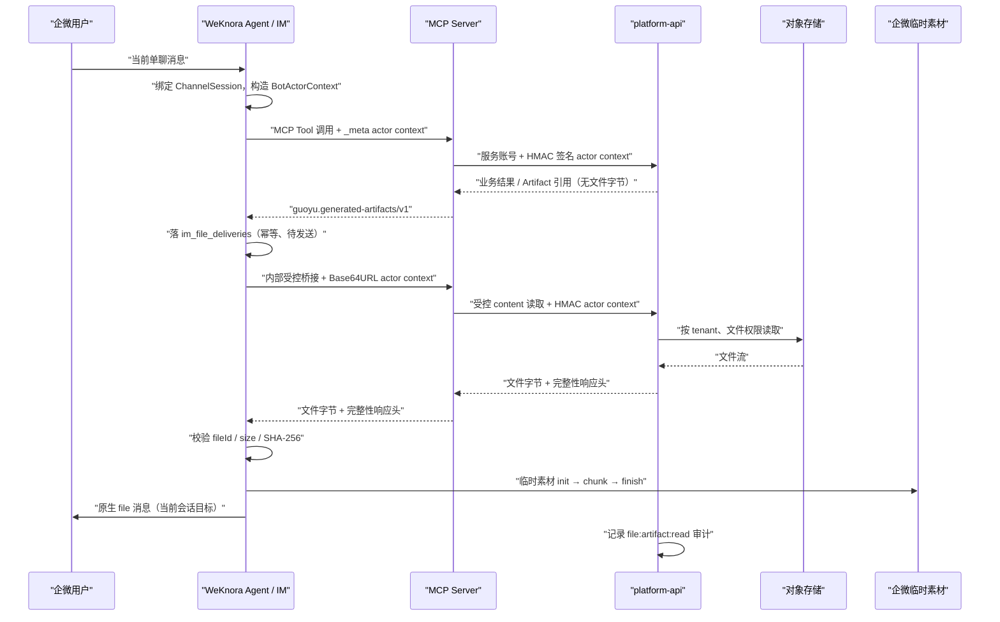

# WeKnora Agent 文件智能生成与企微交付：新项目上下文

更新时间：2026-08-12  
适用对象：独立 `weknora-agent` 项目（负责 Agent 编排、MCP 调用和企业微信会话内文件交付）

## 1. 已完成且经生产环境验证的能力

系统已经打通“平台已生成文件 → 企微当前会话收到原生 `file` 消息”的安全交付链路。它不是把下载链接或 Base64 交给模型，而是由可信 Worker 在内存中短暂取得文件字节、上传企业微信临时素材，再发送文件消息。

2026-08-11 已完成真实 DOCX 的端到端验证：平台受控读取、MCP 二进制桥接、WeKnora Worker、企微临时素材上传、主动 `file` 消息发送以及平台审计均成功。2026-08-12 又验证了 UTF-8 中文文件名 `test培训方案.docx` 能原样显示。

当前实现是所有“智能生成文件”能力的公共底座，合同、报告、证书、表格、题目导出等模块均应复用这一条交付通道。

## 2. 总体架构与职责边界



| 组件 | 负责什么 | 明确不负责什么 |
| --- | --- | --- |
| 业务模块 / Agent Tool | 生成业务文件，取得 `sys_file.file_id`，返回 Artifact Envelope | 不能指定企微接收人，不能返回文件字节/Base64 |
| `platform-api` | 文件元数据、对象存储读取、租户与私聊权限裁决、审计 | 不连接企微，不直接给模型二进制 |
| MCP Server | Tool 网关、BotActorContext HMAC 签名、内部二进制桥接 | 不存业务文件，不把二进制放进 Tool Result |
| WeKnora Agent | 从当前入站会话创建 actor 上下文；采集 Artifact；可靠交付与重试 | 不保存平台服务账号、平台 Token 或 HMAC 密钥 |
| 企业微信适配器 | 临时素材分片上传、主动/被动 `file` 消息发送 | 不决定业务权限或文件权限 |

## 3. 两个必须区分的数据通道

### 3.1 控制面：MCP Tool Result

模型只允许看到结构化 Artifact 引用。业务 Tool 在成功生成文件后返回如下结果（所有雪花 ID 必须是字符串）：

```json
{
  "schema": "guoyu.generated-artifacts/v1",
  "businessType": "contract",
  "businessId": "2084569567062556674",
  "taskId": "2084569567062556675",
  "artifacts": [
    {
      "provider": "platform-file",
      "documentId": "2084569567062556676",
      "fileId": "2084569567062556677",
      "filename": "软件技术服务框架协议-草稿.docx",
      "mimeType": "application/vnd.openxmlformats-officedocument.wordprocessingml.document",
      "size": 328476,
      "sha256": "<64 位小写十六进制>",
      "version": 1,
      "draft": true
    }
  ]
}
```

禁止在 schema、Tool 参数或模型提示中传递：`receiver`、`chatId`、`userId`，也禁止放入文件字节、下载 URL、临时 `media_id`。

### 3.2 数据面：仅 Worker 可调用的内部 HTTP 桥接

WeKnora Worker 根据 Artifact 的来源 `mcp_service_id` 调用同一 MCP 服务的内部路由：

```text
GET /internal/artifacts/platform-file/{fileId}/content
Authorization: <该 MCP Service 已配置的服务鉴权>
X-WeKnora-Bot-Actor-Context: <Base64URL JSON>
```

MCP 校验上下文后，使用自己的平台服务账号及 HMAC 签名调用：

```text
GET /internal/artifacts/files/{fileId}/content
X-Tenant-Id: <platform tenant>
X-Bot-Actor-Context: <Base64URL JSON>
X-Bot-Actor-Signature: <HMAC-SHA256>
```

响应可信头为 `X-File-Id`、`X-File-Name-Base64`、`X-File-Mime-Type`、`X-File-Size`、`X-File-SHA256`。Worker 必须复核 ID、大小、SHA-256，且当前最大文件大小为 20 MiB，再上传企微。

## 4. 身份、租户与审计上下文

### BotActorContext

```json
{
  "tenant_id": "1",
  "bot_id": "wecom:ws:<bot-id>",
  "wecom_user_id": "zhangsan",
  "chat_id": "zhangsan",
  "chat_type": "private",
  "channel_session_id": "<uuid>",
  "weknora_session_id": "<uuid>",
  "request_id": "<uuid>"
}
```

它只能从 WeKnora 已验证的企业微信长连接消息和当前 `ChannelSession` 中构造；业务 Tool 的普通参数不能伪造或覆盖它。

当前生产环境有一个必须显式配置的租户映射：WeKnora 内部 tenant 是 `10000`，平台 tenant 是 `1`。WeKnora 使用 `BOT_ACTOR_PLATFORM_TENANT_ID=1` 解决该编号不一致。新项目必须把它建模成环境配置或租户映射表，**不得硬编码 `1`**。

`BOT_ACTOR_CONTEXT_SECRET` 仅同时配置在 `platform-api` 与 MCP Server（至少 32 位）；WeKnora 不持有此密钥。MCP 对 Base64URL 原文做 HMAC-SHA256，platform-api 验签并将上下文放入请求线程的 Holder。平台审计记录租户、平台用户、文件、请求 ID 和完整 actor 上下文。

当前 MVP 只允许 `chat_type=private` / `single` 读取和交付此类业务文件。群聊支持必须另行完成权限、会话归属和审计设计后才可开放。

## 5. WeKnora 端的可靠交付模型

交付任务表为 PostgreSQL `im_file_deliveries`，只保存引用、会话路由信息及状态，不保存文件字节和永久 `media_id`。

```text
pending → sending → sent
             │
             └── 失败 → retry_wait → sending
                          └── 超过 3 次 → failed
```

- 幂等键：`SHA-256(channel_session_id | document_id | version | generated-file)`。
- 服务启动时恢复陈旧的 `sending`；每 3 秒扫描 `pending/retry_wait`。
- 仅持有对应企微 WebSocket Adapter 的实例可领取任务，避免多实例重复发送。
- 企微单聊目标永远来自当前入站用户 `userid`；不是模型提供的地址。
- 文件字节只在 `deliverFile` 调用链内存中存在，上传完成即释放。
- 文件名是 Artifact 的 UTF-8 `filename` 字段原样传给企微临时素材上传。2026-08-11 首次烟测出现 `????` 是人工 SQL 注入时终端编码将值提前写坏，非 Worker/企微协议缺陷；使用正确 UTF-8 入队后已验证中文名称正常。

## 6. 当前代码分布

### 平台仓库

仓库根：`D:\qianlvguoyu\qianlvguoyu_saas-merge-dev-20260805`

| 层 | 文件 / 目录 | 新项目需要知道的职责 |
| --- | --- | --- |
| platform-api 身份验签 | `services/platform-api/src/main/java/com/guoyu/platform/integration/bot/` | `BotActorContextFilter`、`Holder`、`Codec`；验签、租户一致性与请求生命周期 |
| platform-api 文件入口 | `services/platform-api/src/main/java/com/guoyu/platform/file/artifact/controller/FileArtifactController.java` | `metadata` / `content` 两个受控接口，要求 `file:artifact:read` |
| platform-api 文件规则 | `services/platform-api/src/main/java/com/guoyu/platform/file/artifact/service/FileArtifactApplicationService.java` | 私聊限制、tenant 校验、受控读取、完整性响应头 |
| platform-api 权限 | `services/platform-api/src/main/resources/db/migration/V20260811_007__add_artifact_file_permission.sql` | 增加并授予 `file:artifact:read` |
| MCP Artifact schema | `services/mcp-server/src/artifacts/schema.ts` | `guoyu.generated-artifacts/v1` 的 Zod 校验与类型 |
| MCP actor 上下文 | `services/mcp-server/src/context/botActorContext.ts` | 读取 `_meta`、Base64URL 解码、HMAC 签名 |
| MCP 平台客户端 | `services/mcp-server/src/platformClient.ts` | metadata/content 调用、平台 Token 刷新、响应大小校验 |
| MCP Tool 注册 | `services/mcp-server/src/tools.ts` | `file.getArtifactMetadata`，以及 Tool 输出中 Artifact Envelope 的保留/脱敏 |
| MCP 内部桥接 | `services/mcp-server/src/server.ts` | `/internal/artifacts/platform-file/:fileId/content`；绝不注册为 Tool |
| 正式契约 | `docs/05_decisions/WeKnora_Artifact_Delivery_Contract.md` | 跨仓库不可随意破坏的 API 与安全契约 |

### 生产服务器上的 WeKnora 工作树

路径：`/opt/guoyu-platform/WeKnora`  
分支：`feat/weknora-artifact-delivery`  
关键提交：`1f603f2` → `0cfb556` → `9bd118e` → `6e3c686`

| 文件 | 职责 |
| --- | --- |
| `internal/types/generated_artifact.go` | Artifact Envelope、`BotActorContext`、Collector 的 Go 类型与严格校验 |
| `internal/mcp/client.go` | 将 `BotActorContext.MCPMeta()` 注入 MCP 调用 `_meta` |
| `internal/agent/tools/mcp_tool.go` | 解析 MCP `structuredContent`，将合法 Artifact 放入 Collector |
| `internal/im/service.go` | 从当前企微消息/ChannelSession 构造 actor；在 QA 完成后入交付队列；启动 Worker |
| `internal/im/file_delivery.go` | `im_file_deliveries` 状态机、幂等、领取、重试、内部桥接下载、完整性校验与发送 |
| `internal/im/bot_actor_tenant.go` | `BOT_ACTOR_PLATFORM_TENANT_ID` 映射；同时作用于 Tool 调用与后台交付 |
| `internal/im/wecom/ws_adapter.go` | 把 Worker 的 `SendFileBytes` 适配到长连接客户端 |
| `internal/im/wecom/upload_media.go` | 企微临时素材三步上传 `init → chunk → finish`，以及原生 `file` 消息主动发送 |
| `migrations/versioned/000080_im_file_deliveries.up.sql` | PostgreSQL 交付状态表与索引 |

## 7. 新 `weknora-agent` 项目应如何复用

建议把新项目定位为“Agent 编排与会话交付服务”，而不是再实现一套业务文件服务。

1. 复用上述 Artifact Envelope 作为唯一文件产物协议。每一个生成类 Tool 成功后都返回它。
2. 复用 BotActorContext 作为进入 MCP 与平台受控 API 的唯一用户/会话身份。任何后台任务都必须保存初始上下文快照。
3. 复用 `im_file_deliveries` 的状态机语义；实现可替换，但幂等键、重试语义、私聊边界和完整性校验不得改变。
4. 将企微、钉钉、飞书等渠道实现为 `FileSender`/Delivery Adapter；渠道适配器只接收可信 Worker 传入的 `targetId + filename + bytes`。
5. 将“业务文件生成”和“文件发送”解耦：前者负责落 `sys_file` 并返回引用，后者异步交付。这样生成耗时、企微临时失败、用户离线均不会污染业务事务。

新项目不应：

- 直接查询 platform 数据库或对象存储；只能调用 `platform-api` 受控接口。
- 将平台 Token、对象存储密钥、`BOT_ACTOR_CONTEXT_SECRET` 放入 Agent 项目。
- 允许 LLM 指定收件人、构造 actor、拿到文件正文或临时 `media_id`。
- 用普通消息文本或 URL 代替原生文件交付作为默认行为。

## 8. 新项目的最小接入清单

| 项目 | 必须完成 |
| --- | --- |
| 会话层 | 保存企业微信 `userid`、`chatid`、`channel_session_id`、`weknora_session_id`、bot 标识和平台 tenant 映射 |
| MCP 调用层 | 为每次 Tool 调用注入不可由模型篡改的 `_meta.guoyu/bot-actor-context` |
| Tool 层 | 所有文件生成 Tool 返回 schema v1；ID 字符串化；不携带字节 |
| Delivery Worker | 事务性入队、幂等领取、最大三次重试、20 MiB 上限、ID/长度/SHA-256 校验 |
| 渠道层 | `upload temporary media` 后再发送原生 `file`；文件名按 UTF-8 传输 |
| 安全 | 默认仅单聊；MCP 与 platform-api 共享 HMAC secret；服务账号仅授予 `file:artifact:read` |
| 可观测性 | `request_id` 贯穿 Tool、MCP、Worker、platform-api audit；日志不得记录文件字节、Token 或 Secret |
| 测试 | HMAC 无效、租户不一致、非单聊、文件哈希错误、重复入队、重启恢复、渠道上传失败、中文文件名 |

## 9. 当前边界与后续工作

1. **已验证的是交付基础设施。** 首次业务模块需要在“文件已经落入平台文件服务”后真正返回 Artifact Envelope，才能自动触发，不应依赖人工插入 `im_file_deliveries`；人工入队仅用于烟测。
2. 平台端存在历史 Flyway `006/007` 记录漂移，当前 `validate-on-migrate=false` 使其不阻塞运行；应由平台负责人单独修复，不能在 Agent 项目中绕过或复制该问题。
3. 当前企微临时素材大小限制在 Worker/MCP 路径为 20 MiB；大文件需要新增分片下载、对象存储受控分享或异步通知方案后再支持。
4. 群聊、跨租户、跨服务账号、文件撤回/过期通知、人工审批后发送均不是本次 MVP 已开放能力，必须分别定义权限和审计规则。

## 10. 验收标准

新项目接入某一类智能生成文件后，应至少证明：

1. 业务 Tool 返回的 Artifact Envelope 能被 Agent 自动采集并只创建一条幂等交付任务。
2. 企微单聊用户收到原生文件，文件字节 SHA-256 与平台记录一致，中文文件名正常。
3. `sys_audit_log` 可按 `request_id` 查到 `file:artifact:read`，且含正确 tenant、用户和会话上下文。
4. 伪造 actor、错误 HMAC、租户不一致、非单聊、文件元数据与内容不一致均被拒绝且不发送文件。
5. 重复 Tool 调用和服务重启不产生重复文件消息。
