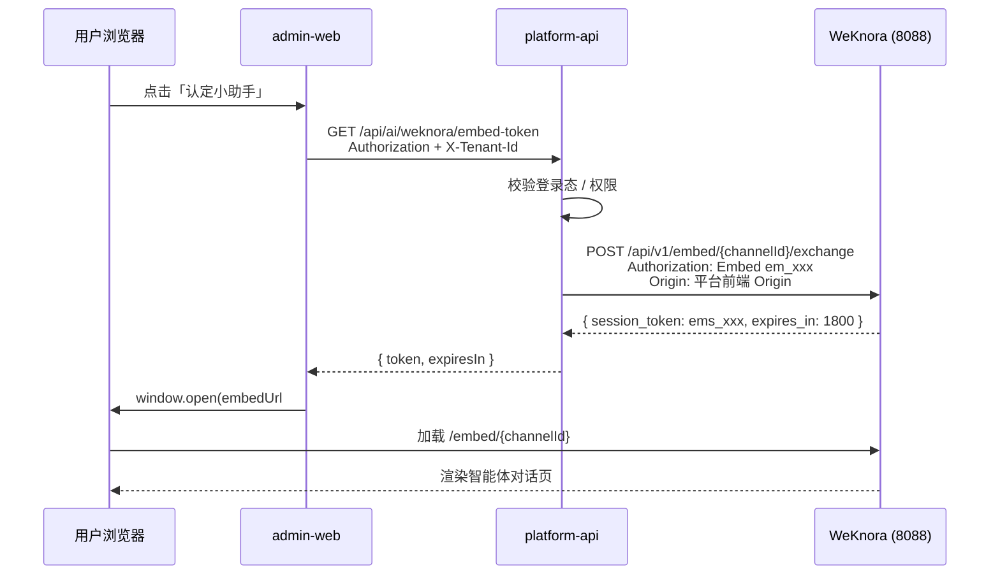

# WeKnora 智能体嵌入云平台 — 执行方案

> **状态**：一期初步联调通过（认定数据面板「认定小助手」）  
> **适用范围**：管理端 `apps/admin-web` 各业务模块局部嵌入 WeKnora 智能体  
> **安全模式**：前端不持有 `em_` 发布密钥，仅通过平台后端换取短时 `ems_` 会话 token

---

## 1. 目标与原则

### 1.1 目标

在云平台任意业务页面右下角（或指定区域）提供智能体入口，用户点击后打开 WeKnora 对话界面，且：

1. 必须走平台登录态与权限体系；
2. `em_` publish token 仅存在于服务端配置，禁止写入前端源码或提交 Git；
3. 其他模块可按本方案复制接入，改动面可控。

### 1.2 设计原则

| 原则 | 说明 |
|------|------|
| 密钥不下发 | 浏览器只拿 `ems_` session token，有效期默认 1800s |
| 后端代换 | 由 `platform-api` 调用 WeKnora `exchange` 接口 |
| 权限收口 | 换 token 接口必须校验平台登录用户；业务页可再加菜单/按钮级权限 |
| 配置外置 | publish token 放本地私有 YAML 或环境变量，不入库 |
| 可复用组件 | 前端统一 `WeKnoraWidget`，页面仅引入组件 |

---

## 2. 端到端链路

### 2.1 时序（当前弹窗模式）



### 2.2 角色分工

| 层级 | 职责 |
|------|------|
| **WeKnora 后台** | 创建 embed channel、配置域名白名单、管理 `em_` publish token |
| **platform-api** | 保管 publish token、代用户 exchange、返回 `ems_` |
| **admin-web** | 触发换 token、拼装 embed URL、打开对话 UI |
| **业务页面** | 引入 `<WeKnoraWidget />`，可选包一层 `PermissionGate` |

### 2.3 Token 类型

| Token | 前缀 | 持有方 | 用途 |
|-------|------|--------|------|
| Publish Token | `em_` | 仅后端 | 调用 `exchange`，长期有效，等同渠道 API Key |
| Session Token | `ems_` | 前端（短时） | 打开 embed 页 `#token=` 或 postMessage 注入 |

---

## 3. 当前实现清单（认定模块试点）

### 3.1 后端（`services/platform-api`）

| 文件 | 说明 |
|------|------|
| `ai/config/WeKnoraProperties.java` | `weknora.*` 配置绑定 |
| `ai/controller/WeKnoraEmbedController.java` | `GET /ai/weknora/embed-token` |
| `ai/service/WeKnoraEmbedApplicationService.java` | 调用 WeKnora exchange |
| `ai/vo/WeKnoraEmbedTokenVO.java` | 返回 `{ token, expiresIn }` |
| `resources/application.yml` | 默认配置（publish-token 留空） |
| `common/exception/ErrorCode.java` | `BAD_GATEWAY` 用于包装 WeKnora 失败 |

**接口合同**

```http
GET /api/ai/weknora/embed-token
Authorization: Bearer {platform_access_token}
X-Tenant-Id: {tenantId}
```

```json
{
  "code": "0",
  "message": "OK",
  "data": {
    "token": "ems_xxx",
    "expiresIn": 1800
  }
}
```

**WeKnora exchange（后端内部调用）**

```http
POST http://{WEKNORA_BASE_URL}/api/v1/embed/{channelId}/exchange
Authorization: Embed {WEKNORA_PUBLISH_TOKEN}
Origin: {WEKNORA_ORIGIN}
```

> **实现要点**：必须使用 `JdkClientHttpRequestFactory` + `java.net.http.HttpClient`。  
> `SimpleClientHttpRequestFactory`（`HttpURLConnection`）会**静默丢弃 `Origin` 请求头**，导致 WeKnora 返回 403。

### 3.2 前端（`apps/admin-web`）

| 文件 | 说明 |
|------|------|
| `src/api/weknora.ts` | `getWeKnoraEmbedToken()` |
| `src/components/ai/WeKnoraWidget.tsx` | 统一浮窗入口组件 |
| `src/pages/certification/CertificationDataPanelPage.tsx` | 认定数据面板（试点） |
| `src/pages/zhixunplatform/DataPanelPage.tsx` | 智训数据面板（试点） |

**当前 UI 模式：弹窗（popup）**

```text
embedUrl = {baseUrl}/embed/{channelId}#token={ems_token}
window.open(embedUrl, ...)
```

原因：WeKnora embed 页响应头含 `X-Frame-Options: SAMEORIGIN`，从 `localhost:5173` 用 iframe 嵌入会白屏。弹窗模式已验证可用。

### 3.3 配置

**仓库内（可提交）**

```yaml
# services/platform-api/src/main/resources/application.yml
weknora:
  base-url: ${WEKNORA_BASE_URL:http://43.138.163.7:8088}
  channel-id: ${WEKNORA_CHANNEL_ID:aa3a676b-a1cb-4719-8e06-6636932d9bb2}
  publish-token: ${WEKNORA_PUBLISH_TOKEN:}
  origin: ${WEKNORA_ORIGIN:http://localhost:5173}
```

**本地私有（禁止提交）**

```text
services/platform-api/config/application.yml   # 已加入 .git/info/exclude
```

```yaml
weknora:
  publish-token: em_xxxxxxxx   # 从 WeKnora 渠道详情复制
```

**环境变量模板**：`infra/env/platform-api.env.example`

---

## 4. 新模块嵌入 — 执行步骤

以下步骤供认定、智训、培训、查证等模块复用。

### Step 0：WeKnora 侧准备（每个智能体/channel 一次）

1. 在 WeKnora 创建 **网页嵌入渠道**，绑定对应智能体；
2. 记录 `channelId`（UUID）；
3. 复制 **Publish Token**（`em_` 开头）到本地私有配置；
4. 在渠道 **域名白名单** 中加入平台前端 Origin（严格字符串匹配）：
   - 开发：`http://localhost:5173`（如需兼容尾斜杠，两条都加）
   - 生产：`https://{你的管理端域名}`
5. 确认 publish token 与 channelId 属于同一渠道。

### Step 1：后端（通常无需改代码）

若新模块复用**同一智能体/channel**：

- 跳过代码改动，仅确认环境配置正确；
- 按需收紧 `WeKnoraEmbedController` 的 `@PreAuthorize`（当前为 `isAuthenticated()`）。

若新模块需要**不同智能体**：

1. 扩展 `WeKnoraProperties` 支持多 channel 配置，或增加 query 参数 `?scene=certification` 映射不同 channelId；
2. 在 `embed-token` 接口按 scene 选择 channel + publish token；
3. **不要**为每个模块复制一套 exchange 逻辑。

推荐后续演进（非一期必须）：

```yaml
weknora:
  channels:
    certification:
      channel-id: aa3a676b-...
      publish-token: ${WEKNORA_CERT_PUBLISH_TOKEN:}
    zhixun:
      channel-id: ...
```

### Step 2：前端 API（已就绪则跳过）

确认 `apps/admin-web/src/api/weknora.ts` 存在：

```typescript
export function getWeKnoraEmbedToken() {
  return unwrap<WeKnoraEmbedToken>(
    apiClient.get('/ai/weknora/embed-token', { silentError: true }),
  );
}
```

### Step 3：页面挂载组件

在目标页面 JSX 末尾（或布局层）引入：

```tsx
import { WeKnoraWidget } from '../../components/ai/WeKnoraWidget';

export function YourBusinessPage() {
  return (
    <PermissionGate code="your.module.view" fallback={...}>
      <div>
        {/* 业务内容 */}
        <WeKnoraWidget />
      </div>
    </PermissionGate>
  );
}
```

**注意**

- `WeKnoraWidget` 使用 `position: fixed`，应挂在页面根容器内，避免被 `overflow: hidden` 裁切；
- 业务页 `PermissionGate` 控制「能否看到页面」；embed-token 接口控制「能否换 token」——两层可并用。

### Step 4：按模块定制（可选）

当前组件内写死了认定试点参数，其他模块复用前建议逐步参数化：

| 参数 | 环境变量（建议） | 说明 |
|------|------------------|------|
| 标题 | `VITE_WEKNORA_TITLE` | 按钮文案、embed 页标题 |
| channelId | `VITE_WEKNORA_CHANNEL_ID` | 不同智能体 |
| baseUrl | `VITE_WEKNORA_BASE_URL` | WeKnora 服务地址 |
| 主色 | `VITE_WEKNORA_PRIMARY_COLOR` | 按钮样式 |

或扩展组件 props：

```tsx
<WeKnoraWidget title="培训助手" channelId="..." primaryColor="#96bbf8" />
```

### Step 5：本地启动验证

**后端**（必须加载私有配置）：

```powershell
$env:JAVA_HOME='D:\Program Files\Java\oracleJdk-21'
mvn.cmd spring-boot:run -DskipTests `
  -f services/platform-api/pom.xml `
  -s scripts/custom-maven-settings.xml `
  "-Dspring-boot.run.arguments=--spring.config.additional-location=file:D:/qianlvguoyu/qianlvguoyu_saas-git/services/platform-api/config/application.yml"
```

**前端**：

```powershell
cd apps/admin-web
npm run dev -- --port 5173
```

### Step 6：验收清单

| # | 检查项 | 预期 |
|---|--------|------|
| 1 | 未登录点击入口 | 不出现 token；AuthGate 拦截 |
| 2 | 登录后点击入口 | 弹出 WeKnora 对话窗，标题/欢迎语正确 |
| 3 | Network：`/api/ai/weknora/embed-token` | 200，`expiresIn=1800` |
| 4 | 再次点击 | 聚焦已有弹窗，不重复开多个 |
| 5 | 浏览器禁弹窗 | 页面显示「浏览器拦截了弹窗」 |
| 6 | 后端日志 | 无 `em_` / `ems_` 明文；仅有 userId/tenantId/status |
| 7 | publish token 错误 | 502 + `unauthorized` 提示 |
| 8 | Origin 白名单错误 | 502 + `forbidden` 提示 |

---

## 5. 已知限制与后续演进

### 5.1 当前限制

| 项 | 说明 | 影响 |
|----|------|------|
| **弹窗模式** | 非页内 iframe 浮层 | UX 与 WeKnora 官方 widget 略有差异 |
| **X-Frame-Options** | embed 页 `SAMEORIGIN` | 跨域 iframe 白屏；已改用 popup |
| **单 channel 配置** | 后端一组 `channel-id` + `publish-token` | 多智能体需扩展配置 |
| **Origin 严格匹配** | 尾斜杠 `http://localhost:5173/` 与无斜杠不等价 | 后端已做一次 alternate 重试 |

### 5.2 页内浮层（iframe / widget.js）前置条件

若下阶段要恢复「页内右下角浮层」，需先满足：

1. **WeKnora 服务端**调整 embed 响应头，例如：
   - 移除 `X-Frame-Options: SAMEORIGIN`，或
   - 使用 CSP：`frame-ancestors http://localhost:5173 https://{生产域名}`
2. **前端**使用 `WeKnora.init()` 编程式初始化（动态插入 `script` 时 `document.currentScript` 为空，data-* 自动初始化无效）；
3. 或通过 **平台同源反向代理** 将 `/embed/**` 代理到 WeKnora 并剥离 `X-Frame-Options`（生产需运维配合）。

### 5.3 生产环境注意

| 项 | 建议 |
|----|------|
| `WEKNORA_ORIGIN` | 设为生产管理端完整 Origin（含协议，无尾斜杠） |
| HTTPS | 平台 HTTPS + WeKnora HTTP 可能 Mixed Content；生产建议统一 HTTPS |
| 密钥轮换 | WeKnora 轮换 publish token 后同步更新私有配置 |
| 权限 | 将 `embed-token` 从 `isAuthenticated()` 收紧为模块级 permission |

---

## 6. 故障排查速查

| 现象 | 可能原因 | 处理 |
|------|----------|------|
| 502 `unauthorized` | publish token 错误或渠道不匹配 | 核对 WeKnora 渠道详情与本地 `publish-token` |
| 502 `forbidden` | Origin 不在白名单 | 在 WeKnora 渠道加入 `WEKNORA_ORIGIN` |
| 502 `not configured` | 未加载私有配置 | 启动参数加 `spring.config.additional-location` |
| 401 embed-token | 平台未登录 / token 过期 | 重新登录 |
| 弹窗白屏 | `ems_` 未带上或已过期 | 检查 URL 是否含 `#token=` |
| iframe 白屏 | `X-Frame-Options` | 使用弹窗模式或调整 WeKnora 响应头 |
| curl 成功、Java 403 | `HttpURLConnection` 丢 Origin | 确认使用 `JdkClientHttpRequestFactory` |

**日志搜索**（`services/platform-api/logs/platform.log`）：

```text
WeKnora exchange
origin=
status=
```

禁止在日志中打印 `em_` / `ems_` 完整串。

---

## 7. 文件与职责总览

```text
云平台嵌入 WeKnora
├── WeKnora 服务 (43.138.163.7:8088)
│   ├── POST /api/v1/embed/{channelId}/exchange   ← 后端 exchange
│   └── GET  /embed/{channelId}#token=ems_xxx     ← 弹窗加载
├── platform-api
│   ├── GET /api/ai/weknora/embed-token           ← 前端唯一入口
│   └── config/application.yml (本地私有)          ← publish-token
└── admin-web
    ├── api/weknora.ts
    ├── components/ai/WeKnoraWidget.tsx            ← 复用组件
    └── pages/**/XxxPage.tsx                       ← <WeKnoraWidget />
```

---

## 8. 关联文档

- OIDC 单点登录（工作台跳转）：`docs/OIDC-SSO-集成方案2.md`
- 项目 AI 规则：`AGENTS.md` →「AI、Agent 与 MCP 规则」
- 环境变量模板：`infra/env/platform-api.env.example`

---

## 9. 变更记录

| 日期 | 说明 |
|------|------|
| 2026-07-07 | 再次替换认定智能体正式渠道：channelId 更新为 `aa3a676b-a1cb-4719-8e06-6636932d9bb2`；publish token 仅写入本地私有配置或环境变量 |
| 2026-07-07 | 替换认定智能体正式渠道：channelId 从上一渠道切换，按钮文案改为「认定小助手」，主色改为 `#96bbf8`；publish token 仅写入本地私有配置或环境变量 |
| 2026-07-03 | 初版：认定数据面板试点；安全 exchange；弹窗模式；排查 HttpURLConnection Origin / X-Frame-Options |
