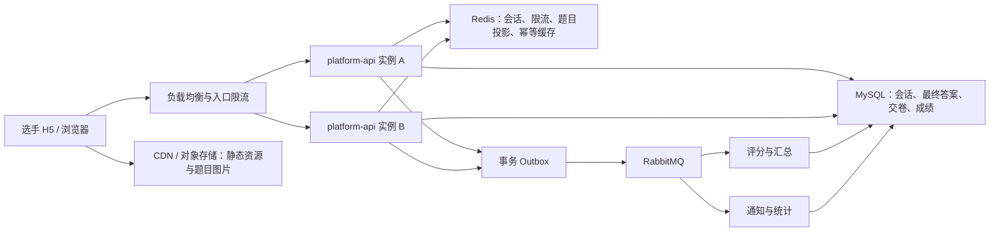

# 竞赛考试并发与赛前刷题容量设计

> 状态：已确定为下一开发优先级；`COMP-SCORE-01～06` 当前成绩闭环完成后立即启动。
> 阶段边界：当前阶段先补齐赛前编排桥接，再完成理论判分、实操评分、裁判流程、成绩、排名和基础端到端验收；随后进入本专项，不再插入奖项、公示仲裁、仿真接入等后置需求。
> 启动时补齐：理论考试会话与选手端范围、最大同时在线人数、生产资源规格和全规模模拟赛日期，并据此冻结容量合同。

## 1. 决策结论

单场数百名选手同时参与理论答题，以及赛前数天的集中刷题，在现有 `platform-api`（Spring Boot）+ MySQL + Redis + RabbitMQ 架构上可实现；一期不因此拆分新的考试微服务。

但当前代码尚无竞赛考试会话、答案批量保存、交卷幂等、选手端限流、正式多实例部署与容量压测，因此任何“支持 300/500/1000 人”的结论都必须在同等生产环境压测和全规模模拟赛后才能确认。

正式考试的原则是“已确认答案零丢失”；赛前练习的原则是“即时反馈优先、进度合并保存”。两者不能共享同一写入频率和降级策略。

## 2. 风险与现状

| 风险点 | 当前情况 | 后续要求 |
| --- | --- | --- |
| 数据库连接 | Druid 默认每实例最大 20 个活跃连接 | 根据多实例总连接数、SQL 耗时和 MySQL 规格压测调优。 |
| Redis | 已具备 Redis 与连接池 | 用于会话、题目投影、限流、幂等缓存；不得作为正式答案唯一存储。 |
| 消息队列 | 已有 RabbitMQ 与竞赛 outbox 能力 | 用于评分、通知和统计削峰；不能替代答案落库。 |
| 多实例 | 当前开发环境未体现 API 多实例与负载均衡 | 正式比赛至少两个无状态 API 实例。 |
| 可观测性 | 当前仅 health/info | 增加 HTTP、数据库、Redis、队列、JVM 和考试业务指标。 |
| 答题接口 | 当前尚未实现 | 必须先实现会话、批量保存、序列号、交卷幂等和自动交卷。 |

## 3. 容量模型

容量以峰值在线和写入频率计算，而不是只看报名人数。

| 变量 | 含义 |
| --- | --- |
| `C_exam` | 正式考试峰值同时在线人数 |
| `C_practice` | 赛前练习峰值同时在线人数 |
| `T_save` | 考试答案合并保存间隔（秒） |
| `A_batch` | 每个保存批次平均修改题数 |
| `F_practice` | 每名选手每秒练习答题/取消次数 |
| `P_submit` | 同一交卷窗口内主动交卷比例 |
| `T_submit` | 集中交卷窗口时长（秒） |

```text
考试保存请求 QPS ≈ C_exam ÷ T_save
答案行更新/秒 ≈ C_exam × A_batch ÷ T_save
集中交卷 QPS ≈ C_exam × P_submit ÷ T_submit
```

假设每 5 秒保存一次、每批平均 2 题：

| 同时在线 | 保存请求 QPS | 答案行更新/秒 | 20 分钟保存请求数 |
| ---: | ---: | ---: | ---: |
| 300 | 60 | 120 | 72,000 |
| 500 | 100 | 200 | 120,000 |
| 1,000 | 200 | 400 | 240,000 |

例如 1,000 人赛前刷题、每人每秒 1.5 次选项操作，原始动作可达 1,500 次/秒。若每次操作都写数据库，压力会高于正式考试；若客户端合并状态、每 5 秒提交进度批次，网络请求可下降到约 200 QPS。是否记录每一次取消/改选历史，会决定数据库行写入量能否同步下降。

## 4. 运行架构与数据边界



- MySQL 是会话、答案、交卷和成绩的主状态。正式考试只有在 MySQL 事务提交后才能返回“已保存”。
- Redis 可缓存不含客户端可见答案的题目投影、判分规则和会话热点状态；题目标准答案不得出现在 CDN、浏览器缓存或选手 API 响应中。
- RabbitMQ 只处理交卷后的判分、成绩汇总、通知和统计。答案保存不能先 ACK 再异步落 MySQL。
- 图片、音视频与前端资源通过对象存储/CDN，不穿透 `platform-api`。
- 所有 API 实例无状态，不能使用 JVM 本地锁、本地会话或本地答案缓存作为一致性保障。

## 5. 正式考试答题与交卷合同

| 能力 | 设计要求 |
| --- | --- |
| 考试会话 | 唯一键为 `tenantId + eventId + stageId + playerId + attemptNo`；服务端保存 `startedAt/endAt/status`，浏览器倒计时仅显示。 |
| 题目投影 | 开考前冻结题集、顺序、分值和题型判分规则；同一会话题序不变。 |
| 批量暂存 | 每项带 `questionId + clientSequence + answer`，同题仅接受更大序列；批次使用 `clientBatchId`。 |
| 改选/取消 | 只更新同一题的最终状态，取消用 `answer=null` 或 `cleared=true` 表示，不做物理删除。 |
| 主动交卷 | 带 `Idempotency-Key`；第一次有效请求锁定会话，重复点击和网络重试返回同一结果。 |
| 自动交卷 | 服务端按 `endAt` 扫描已开始会话，小批量领取并幂等交卷；不为每名选手创建常驻定时线程。 |
| 客观题评分 | 交卷受理后通过 outbox 异步执行；选手先看到“已交卷，评分中”，评分完成后再进入汇总和发布。 |

客户端合并保存规则：每 3–5 秒、切题、切换页面或累计 10–20 个变更时提交；同题在一个批次内只发送最终答案。服务器逐题返回 `acceptedSequence` 和服务端版本，客户端据此删除已同步草稿。断网时客户端保留待同步队列，恢复后按序补传，不能把旧状态覆盖新状态。

## 6. 赛前练习的独立策略

练习拆分为“即时答案检查”和“学习进度沉淀”。即时检查可按业务规则在作答后返回对错与解析；学习进度则合并后保存，避免每次点击写库。

| 模式 | 保存内容 | 适用性 |
| --- | --- | --- |
| 轻量进度模式（一期建议） | 最新答案、累计次数、最近对错、错题、知识点汇总 | 支持继续练习、错题本和学习报告，写入压力低。 |
| 全量作答轨迹模式 | 每次提交/取消、时间、设备和结果 | 适合精细学习分析，但需要批量事件表、归档策略和更高存储容量。 |

初始保护值应通过压测确认，开发期可先采用以下保守建议：

| 接口 | 单选手持续频率 | 突发容量 |
| --- | ---: | ---: |
| 题集加载 | 每分钟 1–2 次 | 3 次 |
| 单题答案检查 | 每秒 1–2 次 | 5 次 |
| 练习进度批量保存 | 每 5–10 秒 1 次 | 3 次 |
| 结束练习 | 每分钟 1 次 | 2 次 |

限流键使用 `tenantId + playerId + endpoint`，同时保留赛事/租户级总量保护。不能只按 IP 限流，因为机房或企业网络可能共享公网 IP。

## 7. 数据模型、索引与写入要求

后续建议新增 `competition_exam_session`、`competition_exam_question_snapshot`、`competition_exam_answer`、`competition_exam_submission`、`competition_practice_session`、`competition_practice_progress`，并按是否需要全量轨迹决定是否新增 `competition_practice_attempt_log`。

关键约束：

- 会话唯一：`(tenant_id,event_id,stage_id,player_id,attempt_no,deleted)`。
- 最终答案唯一：`(tenant_id,session_id,question_id,deleted)`。
- 交卷唯一：`(tenant_id,session_id,deleted)`；幂等键也必须可唯一追溯。
- 状态扫描索引：`(tenant_id,status,end_at,deleted)`。
- 所有实体继承 `BaseEntity`；答案、交卷和成绩通过状态与版本表达作废/重考，不做业务物理删除。

禁止“先查再写”造成竞态；使用数据库唯一约束、条件 upsert、乐观锁与短事务。禁止在保存答案/交卷事务里调用短信、文件、AI、仿真接口、生成 PDF、计算排行榜或做大查询。

## 8. 资源优先级、限流和故障恢复

| 优先级 | 流量 | 过载处理 |
| --- | --- | --- |
| P0 | 考试暂存、主动交卷、自动交卷 | 最后限流，保留线程、连接和数据库资源。 |
| P1 | 登录恢复、会话状态、题目投影 | 优先走缓存，限制重复刷新。 |
| P2 | 赛前练习、排行榜、普通后台查询 | 压力升高时降低频率或返回 429/503。 |
| P3 | 导出、PDF、短信、通知、AI、统计大屏 | 开考窗口暂停、排队或显著限速。 |

建议初始告警线：数据库连接池持续超过约 70% 时先暂停 P3、放缓 P2；持续超过约 85% 或出现锁等待/5xx 时暂停新练习和非必要后台写操作，只保留 P0。最终阈值由压测确定。

| 故障 | 恢复规则 |
| --- | --- |
| 单个 API 实例退出 | 负载均衡切换到其他实例，客户端按幂等键重试。 |
| Redis 故障 | 通过高可用切换；题目投影回源；限流保守降级并告警。Redis 不可用时不能伪造答案已保存。 |
| MySQL 故障 | 客户端保留待同步草稿并显示未同步题数；系统不能返回“已保存/已交卷”。 |
| RabbitMQ 故障 | submission/outbox 留在 MySQL，延迟评分与通知；选手不需重复交卷。 |
| 客户端断网 | 本地队列按序补传，服务端拒绝旧序列覆盖。 |
| 大面积故障 | 补时、暂停或重考必须由授权人员操作并记录审计。 |

## 9. 多实例、连接池与监控

正式赛事至少两个 `platform-api` 实例，经负载均衡访问，不使用粘性会话。MySQL、Redis、RabbitMQ 应使用同地域内网高可用服务。

数据库总连接遵循：

```text
应用实例数 × 每实例 max-active
+ 消费者与定时任务连接
+ 管理/运维保留连接
≤ MySQL max_connections 的 60%–70%
```

不能仅靠增大连接池掩盖慢 SQL。答题 HTTP、评分消费者、PDF/导出、通知和 AI 使用隔离的有界资源；队列满时必须明确拒绝或排队，禁止 `CallerRunsPolicy` 将后台任务退回 HTTP 线程。

正式赛事前需增加 HTTP RPS/P95/P99/429/5xx、考试会话数、答案同步成功率、自动交卷积压、Druid 连接池、MySQL 慢 SQL/锁等待、Redis 延迟、RabbitMQ 积压、JVM/容器指标。指标标签不包含 `playerId/sessionId` 等高基数字段。

## 10. 压测与模拟赛

压测环境应与生产实例数、CPU/内存、数据库、缓存、队列和网络链路相同。业务确认峰值为 `N` 后，正式上线前至少压测 `2N`；无法提供 `2N` 资源时，容量结论必须降为实际验证值。

| 场景 | 验证内容 |
| --- | --- |
| 预登录与同场入场 | Token、资格、会话唯一键、题目缓存、无重复试卷。 |
| 稳态答题 | 5 秒批量保存、答案零丢失、连接池和磁盘稳定。 |
| 重复/乱序/断网补传 | 幂等、序列号、旧答案不覆盖新答案。 |
| 80% 用户 30 秒集中交卷 | 交卷唯一、短事务、评分削峰。 |
| 集中刷题 3–4 小时 | 缓存命中、批量进度保存、限流体验。 |
| 资源竞争和故障注入 | P2/P3 被限制，P0 保持可用；下线单实例不丢确认答案。 |
| 4 小时以上浸泡 | 无内存、连接和消息积压泄漏。 |

建议初始验收目标：已确认答案丢失为 0；重复交卷生成多份有效结果为 0；答题暂存 P95 ≤ 500ms、P99 ≤ 1s；交卷受理 P95 ≤ 1s；服务器 5xx 稳态低于 0.1%；高峰客观题评分时效由业务确认。压测结束必须以客户端最终答案、MySQL 最终答案、submission 摘要与评分明细四方自动对账，不能只看 HTTP 200。

## 11. 下一优先级启动条件与任务

本专项排期已确定，无须再次进行优先级评审。`COMP-SCORE-01～06` 当前成绩闭环开发及基础验收完成后即进入本专项；理论考试与选手端范围、最大同时在线人数、生产资源和全规模模拟赛日期作为 `COMP-PERF-00` 的首批输入完成冻结，不得以这些参数尚未确认将整个专项继续后移。

| 任务 | 交付物 | 门槛 |
| --- | --- | --- |
| COMP-PERF-00：容量合同冻结 | 峰值 `N/2N`、时延、断网、成绩时效、资源规格 | 业务、研发、运维共同确认。 |
| COMP-PERF-01：答题幂等与批量保存 | 会话、答案批次、序列号、交卷、自动交卷 | 并发、重放、乱序和断线测试通过。 |
| COMP-PERF-02：缓存、限流与降级 | Redis、限流、P0–P3、客户端退避 | 练习降级不影响考试。 |
| COMP-PERF-03：监控与运行看板 | 指标、告警、赛事看板 | 模拟赛可定位瓶颈。 |
| COMP-PERF-04：压测与调优 | 可重复脚本、自动对账报告 | 达到冻结 `2N`，零丢答案、零重复有效交卷。 |
| COMP-PERF-05：全规模模拟赛 | 正式客户端、拓扑和值守演练 | 问题关闭并形成最终容量结论。 |
