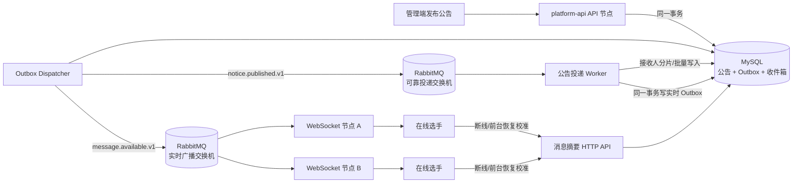
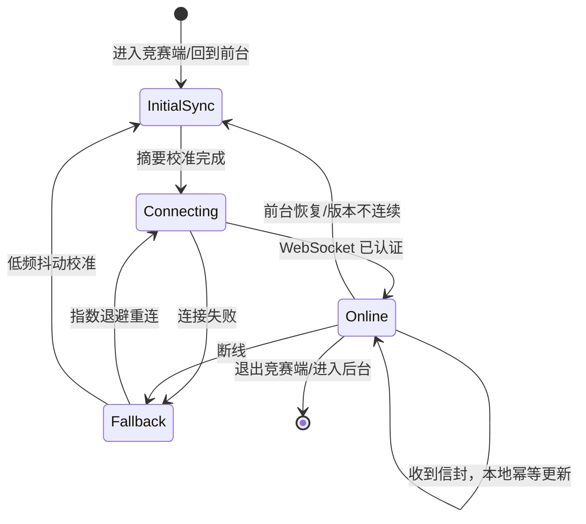

# 竞赛选手端公告性能优化架构方案

> 状态：待评审；日期：2026-09-03；目标容量：单赛事 30,000 台设备在线，并为后续横向扩容保留边界；适用范围：`platform-api` 竞赛公告、RabbitMQ 投递链路、选手端 `_appnext`。

## 1. 决策摘要

公告能力采用以下目标架构：

1. **MySQL 是公告、接收范围和已读状态的唯一事实源**。
2. **保留 MySQL Outbox + RabbitMQ**，负责把“公告已发布”可靠地转化为选手收件箱记录；RabbitMQ 不直接负责刷新 App 页面。
3. **WebSocket 负责在线选手的实时提醒**，推送可直接更新首页的轻量消息摘要；正文和附件仍通过受控 HTTP API 获取。
4. **轮询降级为低频、带随机抖动的兜底校准机制**，不得继续把 15 秒固定轮询作为主链路。
5. **收件箱投递改为接收人快照 + 分片任务 + 批量写入 + 幂等重试**，禁止一次加载后逐条插入 30,000 条记录并长期占用事务。
6. **先在现有 `platform-api` 内按模块和运行角色隔离，不立即拆公告微服务或推送微服务**；达到实测瓶颈后才按既定接口抽离。

RabbitMQ 不是该功能“能否实现”的前提。没有 RabbitMQ，也能用 Outbox + 数据库 Worker 实现可靠投递；但在 30,000 人规模下，RabbitMQ 能隔离发布请求与批量投递、提供削峰、重试和消费者横向扩展，因此本方案保留 RabbitMQ，避免未来重新改造可靠消息链路。

## 2. 背景与现状

当前选手端首页只有进入“信息通知”页面时才能及时看到新公告。临时修复通过首页前台 15 秒轮询消息列表和未读数改善刷新，但不适合作为长期方案。

当前后端已经具备：

- 公告发布事务内写入 `competition_outbox_event`；
- Outbox 调度器将 `competition.notice.published.v1` 发布到 RabbitMQ；
- 消费者根据赛事查询有效选手，并写入 `competition_player_message`；
- 选手端通过消息分页接口和未读数接口读取收件箱。

当前主要问题不是 RabbitMQ 吞吐，而是：

- 前端每轮发起“消息列表 + 未读数”两个请求，在线规模增大后产生持续空请求；
- 设备定时器容易同一时刻触发，形成瞬时请求洪峰；
- 消息列表、总数、附件和未读数会放大为多次数据库查询；
- 公告消费者一次取出全部选手，并在一个事务内逐条插入收件箱，投递耗时、锁持有时间和失败重试成本随人数线性增长；
- 现有固定轮询没有游标、版本、退避和随机抖动，无法作为 30,000 在线设备的长期机制。

## 3. 容量模型

设在线设备数为 `N`，轮询周期为 `T` 秒，每次轮询调用 2 个接口，则稳态 HTTP 请求率为：

```text
HTTP QPS = N × 2 ÷ T
```

以当前 15 秒轮询估算：

| 同时在线设备 | 稳态 HTTP QPS | 每分钟请求 | 定时器同步时的瞬时请求 | 估算 SQL QPS（每轮 2～4 条） |
|---:|---:|---:|---:|---:|
| 300 | 40 | 2,400 | 600 | 40～80 |
| 3,000 | 400 | 24,000 | 6,000 | 400～800 |
| 30,000 | 4,000 | 240,000 | 60,000 | 4,000～8,000 |

以上仍未计入登录、考试、成绩、附件等业务流量。当前数据库连接池默认上限为 20，不能将 30,000 台设备的固定轮询直接建立在数据库实时查询之上。

WebSocket 将持续空轮询变为长连接和按事件发送。30,000 个连接使用 60 秒心跳时，平均约 500 次心跳/秒；心跳必须在网关/内存层完成，不访问 MySQL。发布一条公告时只产生一次集中推送，而不是全天持续产生 4,000 HTTP QPS。

上述数字是容量模型，不代表生产承诺。最终容量必须由与生产拓扑一致的压测确认。

## 4. 目标架构



链路分为两层：

- **可靠层**：公告、Outbox、RabbitMQ、收件箱。即使用户离线、WebSocket 中断或服务重启，消息仍可查询、可重试、可审计。
- **实时层**：实时事件、WebSocket、客户端本地状态。该层允许短暂丢失，客户端通过摘要 API 校准，不能成为业务事实源。

## 5. RabbitMQ 的明确职责

RabbitMQ 只承担后端异步消息总线职责：

- 将公告发布请求与 30,000 人收件箱写入解耦，发布接口无需等待批量投递；
- 在流量突增时排队削峰，保护 HTTP 线程和数据库连接池；
- 通过手动确认、重试和死信队列处理暂时故障；
- 让多个投递 Worker 竞争消费，实现横向扩容；
- 将实时可用事件广播给所有 WebSocket 节点。

RabbitMQ 不承担以下职责：

- 不保存公告最终状态；
- 不保存用户已读状态；
- 不直接连接选手 App；
- 不替代 WebSocket；
- 不替代 MySQL 接收人幂等约束。

如果 RabbitMQ 暂时不可用，公告发布事务仍可成功，Outbox 保留为待发送；恢复后继续投递。不得在 RabbitMQ 失败时把公告错误标记为已送达。

如果未来部署环境明确不能运行 RabbitMQ，可让数据库 Worker 直接认领 Outbox 并执行同样的分片任务，但需要自行实现排队、公平消费、退避、死信和横向抢占。该替代路径功能可行，却会把消息队列能力重新堆进业务数据库，因此不作为 30,000 在线目标的首选架构。

## 6. 公告发布与收件箱投递

### 6.1 发布事务

管理端发布请求只在一个本地事务内完成：

1. 校验权限、租户、赛事和公告状态；
2. 保存公告正式版本；
3. 写入 `competition.notice.published.v1` Outbox 事件；
4. 提交后立即返回公告 ID 和发布状态。

发布接口不查询全部选手、不写 30,000 条收件箱、不等待 RabbitMQ Publisher Confirm。

### 6.2 接收人快照与分片

收到 `notice.published.v1` 后创建投递批次：

- 为本次公告形成确定的接收人快照，避免重试时因当前名单变化造成接收范围漂移；
- 每片建议 200～500 人，分片大小通过配置和压测调整；
- 每个分片独立状态、重试次数、游标和错误摘要；
- RabbitMQ 消息只传 `tenantId/batchId/shardId/requestId` 等定位信息，不传 30,000 个选手 ID；
- Worker 从数据库读取分片，在短事务内批量写入收件箱；
- 依靠唯一键保证重复消费不产生重复有效消息；
- 一个分片失败只重试该分片，不回滚已经成功的全部接收人。

推荐新增批次模型：

| 对象 | 关键字段 | 用途 |
|---|---|---|
| `competition_notice_delivery_batch` | notice_id、event_id、status、recipient_total、success_count、failed_count、started_at、completed_at、last_error | 记录整次投递状态与运营可观测性 |
| `competition_notice_delivery_shard` | batch_id、shard_no、recipient_snapshot、recipient_count、status、attempts、next_retry_at、last_error | 冻结接收人分片并支持独立重试 |

两张表都必须继承/映射完整 `BaseEntity` 字段。`recipient_snapshot` 可保存单片上限内的 ID 数组；如果后续单公告接收人超过既定上限或需要逐人投递审计，再迁移为规范化子表，不应让一个 JSON 字段无限增长。

### 6.3 批量写入和事务边界

- 使用 JDBC/MyBatis 批量插入或受控批量 SQL，禁止 Java 循环逐条提交；
- 单事务只处理一个分片，事务内不得进行网络调用；
- 消息正文只保存在公告主表，收件箱仅保存 notice_id、player_id、read_at、received_at 等轻量字段；
- 分片写入成功后，在同一事务写 `competition.player.message.available.v1` 实时 Outbox，避免“收件箱已提交但实时事件永久未发”的双写问题；
- RabbitMQ 采用至少一次投递，消费者必须保持幂等；
- RabbitMQ 消费确认只能发生在数据库事务提交成功之后；
- Worker 线程通过参数接收 `tenantId/userId/requestId`，自行设置并在 `finally` 中清理 `TenantContextHolder`，禁止读取 `SecurityContext`；
- 线程池使用有界队列和 `AbortPolicy`，队列满时明确告警和退避，禁止 `CallerRunsPolicy` 把工作压回 HTTP 线程。

### 6.4 Outbox 调度

- 事务提交后可发送本机轻量唤醒信号，缩短正常链路延迟；
- 索引化、有限批次的定时扫描仍然保留，负责服务重启和唤醒丢失后的可靠恢复；
- 多节点通过 `FOR UPDATE SKIP LOCKED` 或等价机制竞争认领，不能重复长期占有同一事件；
- 根据事件类型路由到可靠投递交换机或实时广播交换机；
- Publisher Confirm 在数据库事务之外等待，失败只更新 Outbox 重试状态；
- 扫描间隔、认领批量和发送并发由队列延迟、数据库负载和压测结果配置，不写死在业务代码中。

## 7. 实时通知通道

### 7.1 认证与连接

沿用现有实时评分的一次性票据思想，但单独建设选手公告通道，不能复用评分会话注册表：

1. App 使用选手 Token 和 `X-Tenant-Id` 调用 `POST /competition/player/realtime/ticket`；
2. 服务端签发 60 秒有效、一次性、绑定 tenantId/playerId 的票据；
3. App 连接 `wss://<host>/api/ws/competition-player?ticket=<ticket>`；
4. WebSocket 握手消费票据，URL 中不得携带长期 Token；
5. 断线重连必须重新申请票据并重新鉴权；选手停用、资格失效或退出登录时关闭相关会话。

连接策略：

- 30～60 秒协议心跳，心跳不查数据库；
- 指数退避重连，例如 1、2、4、8、15、30 秒，并叠加随机抖动；
- App 回到前台时连接，进入后台后按平台能力暂停或断开；
- 服务器发布或重启时执行连接摘流和优雅关闭，避免全量设备同秒重连；
- 负载均衡器必须支持 WebSocket Upgrade，并将空闲超时配置为大于心跳周期。

### 7.2 多节点广播

每个 WebSocket 节点只维护本机连接映射，禁止把业务状态只放在 JVM 内存中。

- 每个 WebSocket 节点创建独立的临时/自动删除队列并绑定实时广播交换机；
- 每个节点都能收到同一实时分片事件，再按本机 `tenantId + playerId` 会话索引筛选发送；
- 可靠投递队列使用竞争消费，实时队列使用节点级广播，两类队列不得混用；
- Redis 可用于一次性票据、限流和在线状态辅助，但消息和未读数仍以 MySQL 为准；Redis 不可用时应能退化为 HTTP 校准。

内部实时广播事件与发送给客户端的信封不是同一个载荷。内部事件按已提交的投递分片产生，包含一份公共公告摘要和不超过 500 个 `playerId/messageId` 映射；各 WebSocket 节点只匹配本机连接，再为每位选手生成单人信封。这样既不为一条公告创建 30,000 个实时 Outbox 事件，也不会在一条 RabbitMQ 消息中塞入 30,000 个接收人。

### 7.3 推送消息信封

不能只推送“有变化”后让 30,000 台设备同时立即查库，否则会把轮询洪峰改成推送洪峰。实时事件应携带足够更新首页的轻量消息信封：

```json
{
  "type": "competition.player.message.available.v1",
  "eventId": "2084569567062556674",
  "noticeId": "2084569567062556675",
  "messageId": "2084569567062556676",
  "title": "比赛时间调整通知",
  "summary": "理论考试开始时间调整为……",
  "contentType": "MARKDOWN",
  "publishedAt": "2026-09-03T10:00:00+08:00",
  "unreadDelta": 1,
  "version": "20260903100000-2084569567062556676"
}
```

约束：

- 所有雪花 ID 以字符串传输；
- 信封不携带完整正文、附件地址、手机号、证件号等敏感信息；
- 客户端按 `messageId` 幂等去重，同一消息只增加一次未读数；
- `version` 只用于变化检测和校准，不取代数据库已读状态；
- 断线期间缺失的消息由摘要 API 补齐。

## 8. HTTP API 优化

新增首页聚合接口：

```http
GET /competition/player/messages/summary?limit=5&afterVersion=<optional>
```

建议响应：

```json
{
  "code": 0,
  "message": "success",
  "data": {
    "version": "20260903100000-2084569567062556676",
    "unreadCount": 3,
    "latestMessages": [],
    "serverTime": "2026-09-03T10:00:05+08:00"
  }
}
```

要求：

- 一次返回首页所需的未读数和最近 5 条消息，替代两个独立请求；
- 个性化响应使用 `Cache-Control: no-store`，不再用 `Date.now()` URL 参数作为长期缓存策略；
- `afterVersion` 未变化时可返回空变更结果，避免重复传输；
- 每次请求仍实时校验选手状态、租户和赛事资格，前端展示控制不能替代后端授权；
- 首页摘要不查询附件列表，点击详情后再按权限获取正文和附件；
- 消息中心深翻页逐步改为基于 `receivedAt + id` 的游标分页，避免大 OFFSET；
- 查询索引至少分别覆盖“最新消息”和“未读计数”，新增索引前必须用真实数据量执行 `EXPLAIN ANALYZE`。

建议评估的索引方向：

```text
(tenant_id, player_id, deleted, received_at DESC, id DESC)
(tenant_id, player_id, deleted, read_at)
```

不得仅凭字段列表直接上线索引；应与已有索引合并，避免重复索引增加每次批量写入成本。

## 9. 选手端刷新状态机

选手端由统一的 `competition-player-realtime` 管理器维护连接和消息状态，页面不各自创建定时器。



客户端行为：

- 首次进入、登录恢复、前台恢复和 WebSocket 重连成功后调用一次摘要接口；
- 在线时收到信封后直接更新未读数和最近公告，不立即再请求数据库；
- 检测到版本不连续、去重缓存丢失或服务要求重同步时再调用摘要接口；
- WebSocket 不可用时启用 60～300 秒自适应兜底轮询，并添加 0～30 秒随机抖动；
- 页面隐藏后停止轮询；连续无变化时逐步放大间隔，有变化或网络恢复后缩短一次；
- 点击公告后通过受控详情 API 拉取正文和附件；标记已读接口返回最新 unreadCount/version，用于纠正本地状态；
- 本地只缓存最近少量 messageId 用于去重，不能把本地缓存当作已读事实源。

## 10. 分规模实施口径

| 规模 | 可接受临时方式 | 目标方式 | 必须具备 |
|---:|---|---|---|
| 300 在线 | 前台 15～30 秒轮询可短期使用 | 摘要接口 + WebSocket | 停后台轮询、请求合并、基本监控 |
| 3,000 在线 | 固定轮询开始产生明显浪费 | WebSocket 主链路 + 低频兜底 | RabbitMQ、批量写入、重连抖动、至少双节点验证 |
| 30,000 在线 | 禁止固定高频轮询 | 多节点 WebSocket + 分片投递 | 60,000 连接压测、投递批次、过载保护、故障演练、容量告警 |

30,000 台设备本身不是不可承受的容量，但必须把“30,000 个持续请求源”改成“30,000 个轻量连接 + 有事件才发送”，并将一次公告的 30,000 条收件箱记录异步分片写入。

## 11. 部署与扩展边界

一期继续使用现有 `platform-api` 代码库，在包和接口层隔离：

```text
competition/
  notice/       # 公告事实、收件箱、批次/分片
  messaging/    # Outbox、RabbitMQ 发布与消费
  realtime/     # Ticket、WebSocket、节点会话和推送端口
```

同一制品可通过配置划分运行角色并独立扩容，例如：

- API 节点：管理端和选手端 HTTP；
- messaging 节点：Outbox Dispatcher 和投递 Worker；
- realtime 节点：WebSocket 连接和实时广播消费。

这样可在不复制领域代码、不提前拆微服务的前提下独立扩容。只有出现以下实测证据时才抽离独立推送服务：

- WebSocket 连接数或网络发送持续影响普通 API 延迟；
- 单机事件循环、文件描述符或网关连接上限成为主要瓶颈；
- 需要跨区域连接、百万级连接或独立发布节奏。

抽离时保持 `PlayerNoticeRealtimePublisher` 等端口不变，业务层不依赖具体 WebSocket 框架。

## 12. 降级、限流与故障处理

| 故障 | 预期行为 | 禁止行为 |
|---|---|---|
| RabbitMQ 不可用 | Outbox 保持待发送并告警，恢复后续投 | 在事务内同步投递 30,000 人；伪造成功状态 |
| Worker 失败 | 当前分片重试，超过阈值进入 DLQ/人工重放 | 整批从头逐条重跑 |
| WebSocket 不可用 | 客户端退化为低频抖动摘要校准 | 恢复 15 秒双接口固定轮询 |
| Redis 不可用 | 票据/限流按设计降级，MySQL 消息可查 | 从缓存返回虚假的已读状态 |
| MySQL 不可用 | 不确认 Rabbit 消息，退避重试 | ACK 后丢弃投递 |
| 大量设备同时重连 | 服务端限速，客户端指数退避和抖动 | 所有客户端立即无间隔重试 |

公告流量优先级低于考试提交等核心链路。考试高峰时可降低公告 Worker 并发和实时重试频率，但不能丢弃已进入 Outbox 的公告。限流应以 tenantId/playerId/接口为维度，不能只按共享出口 IP 限流。

## 13. 数据增长与保留策略

收件箱行数近似为：

```text
每日新增行数 = 每日公告数 × 接收人数
```

例如 30,000 人、每天 10 条公告，即每天约 300,000 条轻量收件箱记录，90 天约 27,000,000 条。为避免把性能问题推迟成存储技术债：

- 公告正文只存一份，收件箱禁止复制正文和附件；
- 上线前由业务确定在线查询周期、审计保留周期和归档规则；
- 清理/归档采用按主键或时间小批次执行，禁止大事务删除；
- 对活跃表行数、索引大小、增长速度和慢查询建立容量告警；
- 在真实数据达到分区收益阈值前不盲目引入 MySQL 分区；需要分区时先验证唯一键、逻辑删除、多租户插件和归档流程兼容性。

## 14. 可观测性与告警

必须建立以下指标，标签中禁止使用 playerId、手机号等高基数字段：

- Outbox：pending 数、最老事件年龄、重试数、failed 数；
- RabbitMQ：队列深度、入/出速率、consumer lag、unacked、DLQ 数；
- 投递：批次耗时、分片成功/失败/重试数、收件箱写入吞吐、重复冲突数；
- WebSocket：当前连接数、连接/断开速率、认证失败、重连率、节点发送队列、发送失败；
- HTTP：摘要接口 RPS、P95/P99、错误率、空变更率；
- MySQL：连接池 active/wait、慢 SQL、锁等待、收件箱表和索引增长；
- 端到端：`published_at → inbox committed → websocket sent` 延迟分布。

初始告警建议：

- 最老 Outbox 事件超过 60 秒；
- RabbitMQ DLQ 非零；
- 投递批次超过 5 分钟未结束；
- 数据库连接池持续使用率超过 70% 或出现等待；
- WebSocket 节点发送队列持续增长；
- 5 分钟窗口内重连率或摘要接口 QPS 突增超过基线。

阈值须在压测和试运行后固化，不能直接把建议值当作生产 SLA。

## 15. 安全与多租户要求

- 所有 HTTP、投递批次、分片和实时事件都必须携带并校验 tenantId；
- WebSocket 票据一次性、短时有效，日志中不打印票据和 Token；
- Worker 每条异步链显式传递并设置租户上下文，异常和权限失败记录 warn/error；
- WebSocket 信封只包含当前选手有权看到的摘要，正文和附件始终二次鉴权；
- 选手被停用、资格取消或会话注销后，服务端应撤销票据并主动关闭相关连接；
- RabbitMQ 管理端、交换机和队列使用最小权限账号，生产环境启用 TLS/内网隔离；
- 不在指标、普通日志和 DLQ 可见错误中记录敏感正文或接收人列表。

## 16. 压测与验收

### 16.1 功能与一致性

- 公告发布事务回滚时不存在 Outbox 和收件箱；
- RabbitMQ 重复投递不会产生重复有效消息；
- 单分片失败后只重试该分片，批次计数最终一致；
- RabbitMQ、Worker、WebSocket 任一组件重启后消息不丢；
- 选手断线期间的公告在重连摘要校准后可见；
- 重复 WebSocket 信封不会重复增加未读数；
- 跨租户、失效选手和无资格选手无法获取正文、附件或实时摘要；
- 异步线程租户上下文完整设置并清理。

### 16.2 容量场景

目标 30,000 在线时至少执行：

1. 60,000 WebSocket 连接的 `2N` 容量验证；
2. 30,000 连接稳定保持 4 小时；
3. 同时登录、同时前台恢复和服务重启后的重连风暴；
4. 向 30,000 接收人发布 1 条、连续发布 10 条公告；
5. RabbitMQ 短时中断、Worker 重启、WebSocket 节点摘除、MySQL 慢查询注入；
6. 公告流量与考试提交流量叠加，验证考试核心链路不被挤占。

初始验收目标（压测后冻结）：

- 发布接口 P95 不超过 1 秒；
- 正常负载下，99% 接收人在发布后 30 秒内形成收件箱记录；
- 收件箱提交后，在线用户收到实时信封的 P95 不超过 5 秒、P99 不超过 15 秒；
- 有效收件箱零丢失、零重复，失败分片可重放；
- 稳态数据库连接池使用率不超过 70%，无持续等待；
- WebSocket 故障时，摘要兜底不会形成同步请求洪峰。

## 17. 分阶段实施计划

### 阶段 0：基线与决策冻结

- 记录当前接口 QPS、SQL 数、连接池、公告投递耗时和表增长；
- 确认峰值同时在线数、单赛事人数、每日公告量、实时延迟目标和数据保留周期；
- 明确本方案覆盖的公告类型，不把考试强制指令混入普通公告通道。

### 阶段 1：减少拉取成本

- 后端新增消息摘要聚合接口和版本字段；
- 选手端统一消息状态，首页和消息中心共享；
- 保留当前前台轮询作为迁移期兜底，增加抖动和自适应退避；
- WebSocket 上线后移除 15 秒固定双接口轮询和 `Date.now()` 缓存穿透参数。

### 阶段 2：投递链路扩容

- 新增投递批次/分片 Flyway 迁移；
- 将现有“全部选手 + 逐条插入”改为接收人快照和批量写入；
- 增加分片幂等、重试、DLQ 重放和运营查询；
- 根据 `EXPLAIN ANALYZE` 调整消息索引；
- 完成 30,000 接收人单公告投递压测。

### 阶段 3：实时通道

- 建设一次性票据、选手 WebSocket 端点和实时消息信封；
- 建设独立实时交换机和每节点广播队列；
- 选手端接入连接状态机、本地去重和摘要校准；
- 单节点验证后扩到多节点，执行连接、广播和重连压测。

### 阶段 4：生产化与演练

- 配置灰度开关、节点摘流、限流、告警和仪表盘；
- 按租户/赛事灰度，双链路观察但只以 MySQL 状态计数；
- 演练 RabbitMQ、Redis、WebSocket 节点和 Worker 故障；
- 通过 60,000 连接和混合业务压测后再声明支持 30,000 在线。

可使用以下功能开关，便于灰度和回滚：

```text
platform.competition.notice.delivery-batch-enabled
platform.competition.player-realtime.enabled
platform.competition.player-realtime.fallback-poll-min-seconds
platform.competition.player-realtime.fallback-poll-max-seconds
```

回滚路径是“摘要接口 + 低频抖动轮询”，不是恢复 15 秒固定双接口轮询。

## 18. 技术债防线

以下做法列为架构禁区：

1. 在公告发布 HTTP 事务中同步写所有接收人；
2. 用固定高频轮询作为长期实时方案；
3. 收到 WebSocket 事件后让所有设备立即无抖动查询数据库；
4. 把 RabbitMQ、Redis或 JVM 内存当作公告/已读事实源；
5. 在 RabbitMQ 消息中放完整正文、附件或 30,000 个接收人 ID；
6. 消费者逐条插入、无限重试或使用无界线程池；
7. 复制公告正文到每个收件箱行；
8. 在异步线程读取 `SecurityContext` 或遗漏租户上下文清理；
9. 为了 30,000 连接立即拆出多个微服务，却没有压测数据和清晰接口；
10. 未做生产等价压测就承诺确定的在线容量。

## 19. 对既有方案的调整

既有交付计划中“30 秒未读轮询为 R1 首版、稳定后使用 SSE、RabbitMQ 在量级增长后迁移”的结论适用于早期低容量假设。根据现在明确的最高 30,000 台设备在线目标，本方案对公告子域作以下覆盖：

- RabbitMQ 从“后续迁移项”调整为可靠投递主链路；
- 固定轮询只作为迁移期和故障兜底；
- 为同时支持 uni-app 原生端与 H5，统一采用 WebSocket，避免长期维护 SSE/WebSocket 两套客户端协议；
- 保留 MySQL 收件箱和接收范围冻结，不改成查询时动态计算接收人；
- 保持可控服务化，不因实时通道提前拆分业务微服务。

## 20. 最终验收清单

- [ ] 首页可在不进入消息中心的情况下实时出现新公告和未读数；
- [ ] 30,000 设备在线时没有固定 15 秒双请求轮询；
- [ ] 发布接口耗时不随接收人数线性增长；
- [ ] 30,000 接收人使用快照、分片、批量写入和幂等重试；
- [ ] RabbitMQ 与 WebSocket 职责分离，MySQL 保持事实源；
- [ ] WebSocket 事件可直接更新首页，不触发全量设备同步查库；
- [ ] 断线、后台、重启和漏推均可通过摘要接口恢复一致；
- [ ] 异步多租户、权限、ID 字符串化和敏感信息要求通过测试；
- [ ] 指标、告警、DLQ 重放、灰度和回滚路径可用；
- [ ] 通过 60,000 连接及公告/考试混合压测后再发布 30,000 在线容量结论。
