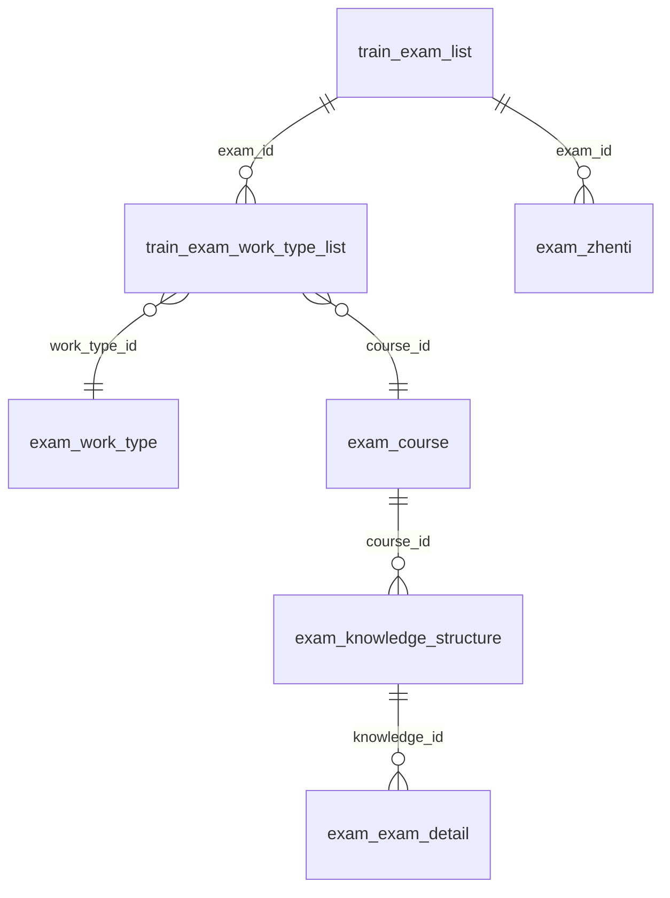

# 数据关系图（考试/培训核心域）

> 关系语义主源 = 本文件；`docs/agent/数据关系速查.md` 只保留最高频 7 行精选 + 链接到本文件。
> 维护触发规则：**新增一对多关系时同步更新本图与写入方/读取方表**（与速查文档同款），两处不得各自漂移。
> 证据来源：各表 DDL 见 `docs/agent/schema-index.<前缀>.json`（`node scripts/agent/schema-index.mjs --generate` 生成）；写入方/读取方经代码搜索核实。

## 1. ER 图（只画已知且稳定的关系；未确认的不画，避免制造第二个错误前提）

> `train_exam_work_type_list` 是 legacy 表（`create_time` 而非 `created_at`、非 BaseEntity 六列），关系成立但不得拿它当新表模板。
> ⚠️ 该表由 PHP 时代遗留：迁移 `V20260521_001` 的 `CREATE TABLE IF NOT EXISTS` 对存量表**空转**（实际列是 int/tinyint 家族 + `user_id`/`sort_number`，与迁移 DDL 完全不同）——legacy 表的列结构一律以 `schema-index.train.json` 实测为准，勿信迁移文件。
> `exam_knowledge_structure` 是树（`parent_id` 自关联），题目挂在 L3 叶子节点上。

## 2. 写入方 / 读取方

| 表 | 写入方 | 读取方 |
|---|---|---|
| `train_exam_list` | `TrainExamListApplicationService` | 考试计划页、同步学、真题 |
| `train_exam_work_type_list` ⚠️legacy | `TrainExamListApplicationService.saveWorkTypeList` | `ReviewQuestionQueryService`、真题 scope |
| `exam_course` | 课程管理 | 考试计划、题库、同步学 |
| `exam_zhenti` | `ZhentiAdminService` / `ZhentiIngestService` | `ZhentiAppService`、`ZhentiAdminService` |
| `exam_knowledge_structure` | 标准导入 / 知识管理 | 题库树、同步学取题链 |
| `exam_exam_detail` | 题库导入 / 生成工作台 | 题库、组卷、同步学、竞赛 |

## 3. 追踪示例：页面"工种选择" → 题目（验收路径）

1. 考试计划页"工种选择"提交的是 `course_id`（不是工种 ID）；
2. `TrainExamListApplicationService.saveWorkTypeList` 由 `exam_course` 反查 `work_type_id`/`level`，写入 `train_exam_work_type_list(exam_id, work_type_id, level, course_id)`；
3. 同步学/真题按 `exam_id` 读关联行 → 拿到 `course_id` 与等级；
4. `exam_knowledge_structure(course_id)` 找到知识树，题目挂 L3 叶子的 `knowledge_id`；
5. `exam_exam_detail(knowledge_id, source, final_check_status)` 取题。

取证入口：`node scripts/agent/schema-find.mjs <表名或字段名> [--db test]`（速查文档 30 秒红线第 0 步）。
