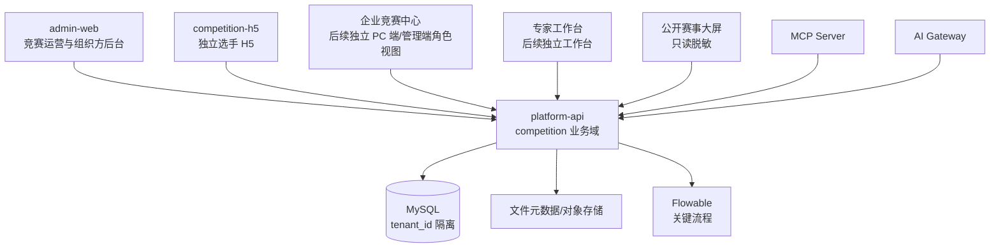

# 竞赛模块架构分析与接入方案

> 文档状态：第一阶段设计结论；不代表已开发接口、数据表或页面。
> 依据：现有 `platform-api`、`admin-web`、`prototypes/competition-full` 静态原型，核查日期 2026-07-14。

## 1. 结论

竞赛是云平台中的业务域，不新建独立业务后端服务。核心业务、权限、租户、审计、文件和流程仍落在 `services/platform-api`；管理人员继续使用 `apps/admin-web`；选手端新建 `apps/competition-h5`。AI Gateway、MCP Server 只能调用平台受控 API，不能访问竞赛表或 MySQL。



本轮原型的“五端”不能被误解为一期要同时建设五个前端：选手 H5 是唯一新增的独立应用；企业中心、专家工作台、公开大屏在后续按权限、公开范围及性能要求单独立项。管理端中的“组织方后台”是 `admin-web` 的竞赛领域页面，而非复制原型的 `admin.html`。

## 2. 现有平台事实与竞赛接入点

| 领域 | 已核查事实 | 竞赛接入要求 |
| --- | --- | --- |
| 后端 | Spring Boot 3 / Java 21 / MyBatis-Plus / Flyway；现有领域以 Controller、ApplicationService、Entity、Mapper、DTO、VO 组织 | 新增 `com.guoyu.platform.competition` 业务域，不拆 `competition-service` |
| 认证 | 管理端 `/api/auth/*` 使用 Sa-Token，桥接至 Spring Security；Principal 从数据库重建角色、权限 | 竞赛 H5 使用新的 player token 类型或登录域，不能让管理端 token 充当选手 token |
| 多租户 | `TenantContextFilter` 强制 `X-Tenant-Id`，MyBatis-Plus 多租户拦截器自动追加 `tenant_id` | H5 仅在受控登录/赛事入口解析租户；后续请求从 token 中校验主体所属租户，禁止相信客户端任意 tenantId |
| 权限与菜单 | 后端下发 `/api/auth/menus`，`admin-web` 用菜单 code 对应 `pageMap` 渲染页面 | 竞赛运营菜单、权限码与 `pageMap` 同步新增；H5 不消费后台菜单树 |
| API | `ApiResponse<T>` 为 `{ code, message, data, traceId }`；列表用 `PageQuery` 与 `PageResponse` | 所有竞赛 API 沿用该响应和分页规范，ID 以字符串安全传递 |
| 数据与审计 | `BaseEntity` 含雪花 ID、tenant_id、创建/更新人和时间、逻辑删除；写操作需审计 | 竞赛业务主表继承相同审计字段；报名、资格、成绩、发布、晋级等写操作记录操作日志 |
| 文件 | 文件模块存元数据、下载地址及访问策略 | 竞赛附件、报名材料、任务成果仅关联 fileId，不在竞赛表存二进制 |
| 工作流 | Flowable 是核心流程状态口径，n8n 仅用于通知、定时、同步 | 报名审核、成绩发布、晋级确认等关键状态进 Flowable 或受控状态机；提醒可交 n8n |

### 后端包与分层建议

```text
services/platform-api/src/main/java/com/guoyu/platform/competition/
  controller/        CompetitionAdminController, CompetitionPlayerController
  application/       CompetitionApplicationService, CompetitionPlayerApplicationService
  domain/            CompetitionDomainService, RankingDomainService
  entity/            *Entity
  mapper/            *Mapper
  dto/               *CreateReq, *UpdateReq, *QueryReq
  vo/                *VO, *DetailVO
  converter/         *Converter
  security/          CompetitionPlayerPrincipal, CompetitionPlayerAuthService
```

Controller 只接收请求、作为 `@PreAuthorize` 入口并返回 VO；ApplicationService 承担事务、跨领域编排和审计；Mapper 返回值必须判空；Entity 不得直接返回给前端。竞赛域可复用已存在的组织、用户、文件、知识库及题库的受控 Application API，但不绕过权限直接调用其 Mapper。

## 3. 三端与五端边界

| 端 | 用户与职责 | 可见数据 | 实现位置与边界 |
| --- | --- | --- | --- |
| 组织方后台 | 平台管理员、赛事运营、赛务、财务等 | 本租户授权赛事、预算、报名、题库、成绩及档案 | `apps/admin-web`；动态菜单和操作权限控制，最终由后端裁决 |
| 选手端 | 企业导入名单后完成身份注册的参赛选手 | 本人资料、本人赛事、本人任务/答卷/成绩；经授权的排行 | **新增** `apps/competition-h5`；独立登录、独立路由、独立状态，不复用培训业务页面 |
| 企业中心 | 企业管理员 | 本企业参赛名单、企业内部赛、初赛、推荐、企业成绩 | 确认为 `admin-web` 中的企业角色视图；企业可创建企业内部赛，但只能管理本企业数据，不能给选手 H5 叠加企业管理功能 |
| 专家工作台 | 命题、审题、裁判、研讨专家 | 明确分派的任务、受限题目/文件/评分 | 后续独立工作台或受控角色视图；须做角色冲突与回避校验 |
| 公开大屏 | 公众/观众 | 审核发布后的脱敏公开数据 | 后续只读发布投影；不可直读内部业务表、报名材料、预算或未发布成绩 |

## 4. 新建 competition-h5 的工程方案

### 技术选择

建议采用 **React 18 + Vite + TypeScript**，与正式管理端保持同一语言、构建工具和 TanStack Query / Zustand 的使用习惯，但作为独立 npm 工程、独立产物和独立部署路径。移动 UI 使用轻量组件及自建样式 token；不得把 `admin-web` 的 PC 布局、Ant Design Pro 表格或原型 HTML 直接复制进来。

```text
apps/competition-h5/
  src/
    api/             # playerApiClient 与按领域拆分的 API
    app/             # QueryClient、错误边界、应用初始化
    components/      # H5 通用组件
    pages/           # auth, home, events, registration, tasks, profile
    router/          # 路由守卫和深链恢复
    stores/          # playerAuthStore、eventContextStore
    types/           # API DTO/VO 类型
    utils/           # token、日期、设备/网络能力封装
    styles/
  public/
  vite.config.ts
```

部署建议为独立域名或 `/competition/` 路径，并由反向代理将 `/api` 指向 `platform-api`。同源优先；若跨域，后端 CORS 白名单、Cookie 策略和回调地址必须单独配置。H5 的 token、localStorage key、请求拦截器、错误页均与 `admin-web` 隔离，避免相互覆盖登录态。

### 选手登录与参赛资格

1. 不开放个人报名。企业管理员先批量导入参赛名单，服务端据此创建 `competition_registration`；选手以身份证号匹配该名单，并完成手机号验证码注册/绑定后才可登录。
2. 新增 `/api/competition/player-auth/*`，只签发 `subjectType=competition_player` 的短期访问令牌。短信验证码仅在名单匹配成功后发送，并配置图形校验、单手机号/身份证/设备频控、冷却时间、日配额和供应商费用监控；短信服务通过 Provider Adapter 对接，以便比价或替换供应商。
3. 登录成功返回选手档案与可访问赛事摘要；Token 仅标识选手身份，不代表可参加任意赛事。身份证号只用于服务端匹配、加密/脱敏保存，绝不在 token、日志或前端持久化中明文保存。
4. 每个赛事读写接口均在服务端校验 `competition_registration` 的企业来源、审核状态、赛事状态、赛段时间和任务授权；前端“已解锁”仅是展示。
5. 令牌过期或 401 时清除 H5 自身 store 并进入登录页；403 展示“无参赛资格/当前阶段不可操作”，不跳转管理端。
6. 在线考试若进入后续阶段，需独立考试会话、一次性开考令牌、服务端计时、自动交卷、幂等提交与异常轨迹；不能沿用原型内浏览器计时和本地答案状态。

## 5. 管理端接入规范

`admin-web` 使用 React、Ant Design、ProComponents、TanStack Query 和 Zustand。`AppShell` 通过 `/auth/menus` 加载后端菜单，以 `MenuVO.code` 匹配 `main.tsx` 的 `pageMap`；因此一个可用的后台竞赛页面必须同时具备：后端菜单种子数据、角色/权限绑定、前端页面组件、`pageMap` 映射和领域 API 类型。

| 事项 | 规范 |
| --- | --- |
| 页面目录 | `apps/admin-web/src/pages/competition/`，按计划、流程、报名、任务、成绩/排名、档案等子域拆分 |
| API 与类型 | `src/api/competition.ts`、`src/types/competition.ts`；通过既有 `apiClient` 调用 |
| 列表与表单 | 列表优先 ProTable，查询和缓存用 TanStack Query；编辑优先 ProForm，详情可用 Drawer/Modal |
| 权限 | 前端根据权限码隐藏入口/按钮，但每个写接口后端必须 `@PreAuthorize`；不可用前端筛选代替数据权限 |
| 请求 | 自动发送 Bearer token、`X-Tenant-Id` 与 `X-Request-Id`；401 清本地登录态、403 提示、500 区分代理与业务错误 |
| 菜单 | 不在前端写死侧栏；建议权限前缀 `competition:*`，例如 `competition:plan:view`、`competition:registration:audit`、`competition:result:publish` |

## 6. API 与数据模型规划

### 管理端 API（规划）

| 域 | 建议接口 | 关键权限 |
| --- | --- | --- |
| 赛事计划 | `GET/POST /competition/events`、`GET/PUT /competition/events/{id}`、`POST /competition/events/{id}/publish`；企业内部赛强制 `scope=enterprise_internal` 和 `owner_org_id` | `competition:event:view/create/update/publish`、`competition:enterprise-event:create` |
| 流程与赛段 | `GET/PUT /competition/events/{id}/stages`、`POST /competition/events/{id}/tasks/generate` | `competition:workflow:configure` |
| 报名资格 | `POST /competition/events/{id}/registrations/import`、`GET /competition/registrations`、`POST /competition/registrations/{id}/audit` | `competition:registration:import/view/audit` |
| 统一题库 | `GET /competition/question-selections`、`POST /competition/events/{id}/question-sets`、`POST /competition/question-sets/{id}/lock` | `competition:question:view/select/lock` |
| 任务与成果 | `GET /competition/tasks`、`POST /competition/tasks/{id}/remind`、`GET /competition/tasks/{id}/submissions` | `competition:task:view/manage` |
| 成绩与晋级 | `GET /competition/results`、`POST /competition/results/publish`、`POST /competition/promotions/confirm` | `competition:result:view/publish`、`competition:promotion:confirm` |

### 选手 API（规划）

| 域 | 建议接口 | 服务端必须校验 |
| --- | --- | --- |
| 登录 | `POST /competition/player-auth/register/verify-identity`、`POST /competition/player-auth/sms/send`、`POST /competition/player-auth/login`、`POST /competition/player-auth/logout`、`GET /competition/player-auth/me` | 企业导入名单匹配、身份证保护、频率、验证码、主体类型、租户 |
| 首页/赛事 | `GET /competition/player/home`、`GET /competition/player/events`、`GET /competition/player/events/{id}` | 本人报名或公开可见权限 |
| 参赛资格 | `GET /competition/player/events/{id}/registration`、`POST /competition/player/registrations/{id}/activate` | 仅企业导入来源；不得创建个人报名，激活时校验身份证匹配、隐私授权和资格状态 |
| 任务 | `GET /competition/player/tasks`、`GET /competition/player/tasks/{id}`、`POST /competition/player/tasks/{id}/check-in`、`POST .../submissions` | 本人、赛段、截止时间、幂等键 |
| 通知/成绩 | `GET /competition/player/notices`、`GET /competition/player/results`、`GET /competition/player/rankings` | 发布状态、排行授权及脱敏 |

所有响应使用 `ApiResponse`；分页用 `PageQuery/PageResponse`（当前字段为 `items,page,pageSize,total`，实施前需统一前端口径，不能假定为 `records,size`）。文件上传先走 `/api/files`，业务表只保存 fileId 和访问策略。

### 首批实体（规划）

| 表/实体 | 作用与核心字段 |
| --- | --- |
| `competition_event` | 赛事主档：name、status、scope（platform/enterprise_internal）、owner_org_id、organizer、work_type_id、报名/比赛时间、地点、公开状态；企业内部赛仅能关联本企业组织 |
| `competition_stage` | 赛段：event_id、type、sort_order、start/end、unlock_rule、status |
| `competition_registration` | 选手报名与资格：event_id、player_id、org_id、source（固定 enterprise_import）、audit_status、privacy_consent_at、reviewer/reason；禁止个人报名来源 |
| `competition_player` | 竞赛选手档案：关联企业导入名单、身份证号加密值/脱敏索引、手机号、状态；避免把管理员账号当选手账号使用 |
| `competition_roster_import` / `competition_roster_item` | 企业名单导入批次与行级校验结果：event_id、org_id、导入人、身份证脱敏索引、手机号、工种/等级、处理状态；保留可追溯导入错误 |
| `competition_question_set` / `competition_question_set_item` | 从统一题库选入赛事的题目集合、题目版本快照、锁定状态和使用赛段；复用课程/题库能力但不直接修改源题 |
| `competition_task` | 从赛段生成的任务：stage_id、assignee_type/id、deadline、completion_rule、status |
| `competition_task_submission` | 任务成果：task_id、player_id、file_id、content、submitted_at、review_status |
| `competition_notice` / `competition_notice_receipt` | 发布通知与已读/送达记录 |
| `competition_result` | 经确认的成绩快照：event/stage/player、理论/实操/加扣分、total_score、publish_status |
| `competition_promotion` | 晋级规则、候选与人工确认记录 |
| `competition_rank_snapshot` | 已发布排行快照与脱敏展示字段，避免公开端直接聚合敏感明细 |
| `competition_audit_log`（可复用系统日志） | 关键状态变化、操作者、租户、请求 ID、前后状态 |

每张业务主表遵循 `BaseEntity` 的 `id BIGINT`、`tenant_id`、`created_at`、`updated_at`、`created_by`、`updated_by`、`deleted`；新增迁移采用新 Flyway 版本，禁止修改历史迁移，使用 snake_case，并为 `(tenant_id, event_id, status)`、`(tenant_id, player_id, event_id)` 等高频条件建立索引。成绩、答卷、发布、晋级需额外保留版本/快照，不能用覆盖更新破坏可追溯性。

## 7. AI、MCP、流程边界

MVP 不实现 AI。后续确认提供**两个独立入口**：“赛事流程助手”只回答当前选手可见的报名、赛段、任务、通知和晋级规则；“专业知识助手”只检索授权的技术文件、课程和知识资料。二者必须使用独立场景、知识范围和权限检查，回答携带来源、模型、生成时间、操作人、请求 ID；不得泄露未公开题目、答案、评审意见、预算或未发布成绩。MCP 首批只开放查询、生成通知草稿、缺项检查等低风险工具，工具声明参数 schema、权限和审计，任何发布、审核、晋级或删除均需人工确认。

## 8. 已确认决策与保留事项

| 主题 | 已确认结论 | 实施约束 |
| --- | --- | --- |
| 选手身份 | 企业名单导入为唯一准入来源；选手以身份证匹配并通过手机号验证码注册/登录 | 短信仅在名单匹配后发送，纳入费用、配额、频控和供应商可替换设计 |
| 企业端 | 放入 `admin-web` 企业角色视图；企业可创建企业内部赛 | 强制组织范围和内部赛事 scope；不能影响平台/其他企业赛事 |
| 题库 | 先建设竞赛统一题库，复用课程模块现有题库能力 | 通过受控 Application API 选题、复制版本快照、锁定赛事题集；不直接复用页面或修改源题 |
| 报名 | 不支持个人报名，统一由企业导入名单 | H5 只做身份注册、资料确认和资格激活，不提供“提交报名” |
| 评分与晋级 | 先采用常规理论/实操/加扣分、复核、发布、排名、晋级流程 | 公式、权重、阈值必须版本化，由赛事配置和人工确认；具体比例仍在赛事规则中定义 |
| 公开大屏 | 内容范围待定 | 不进入 MVP；先保留已发布、脱敏只读投影架构 |
| AI | 两类 AI 助手为两个入口 | 流程助手与专业助手分开路由、知识空间、权限与审计 |
