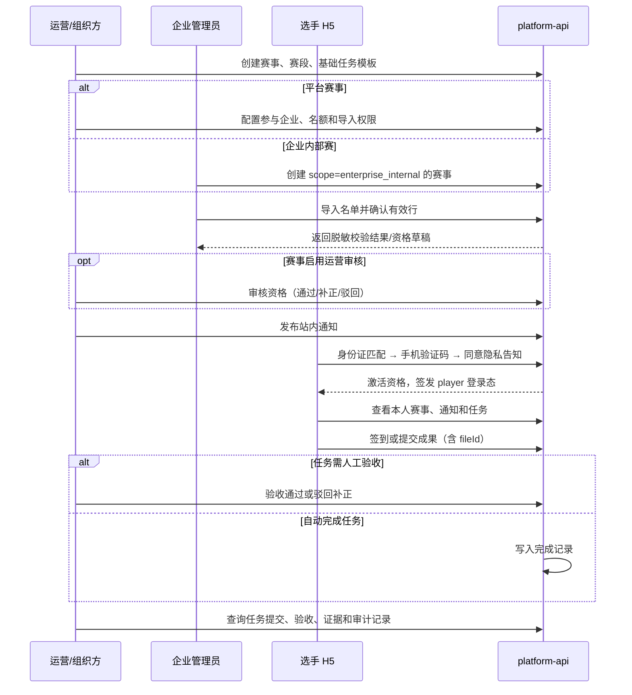
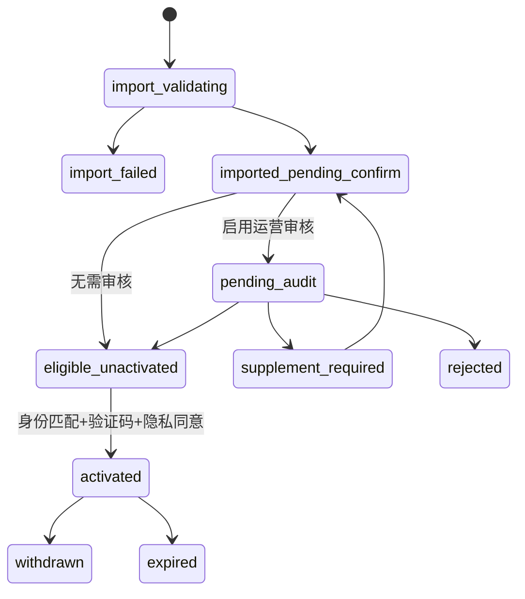
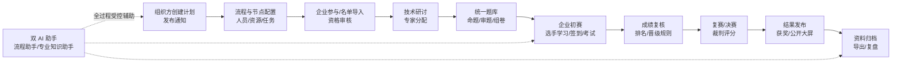
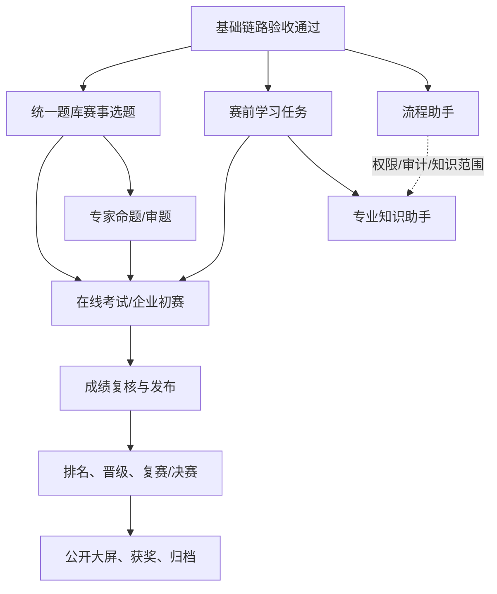

# 竞赛基础链路与完整原型链路对比图

> 原型依据：`prototypes/competition-full`。该原型覆盖组织方后台、企业竞赛中心、选手移动端、专家工作台、外部数据大屏五端，共 102 个业务视图。
> 目的：明确第一条基础链路覆盖什么、刻意不覆盖什么，以及后续能力应从哪里接入，避免把 MVP 做成原型的缩小复制品。

## 1. 一图看懂：基础链路是完整链路的“可运营主干”

```mermaid
flowchart TB
  subgraph F[完整竞赛原型：五端全生命周期]
    F1[组织方：赛事计划/流程/资源/报名/专家/题库/成绩/档案]
    F2[企业：参与赛事/内部赛/名单/初赛/推荐]
    F3[选手：身份/任务/学习/考试/成绩/排名/双 AI]
    F4[专家：研讨/命题/审题/裁判评分]
    F5[公众：赛程/阵容/动态/排名/获奖/媒体]
  end

  subgraph M[先实施：基础链路 MVP]
    M1[赛事、赛段、基础任务模板]
    M2[赛事—企业参与关系\n或企业内部赛]
    M3[企业导入并确认名单]
    M4[资格审核与身份激活]
    M5[通知、我的赛事、基础任务]
    M6[提交/验收/运营追溯]
  end

  M1 --> M2 --> M3 --> M4 --> M5 --> M6
  M6 -. 统一身份、组织、任务和审计基础 .-> F1
  M6 -. 企业参与与名单基础 .-> F2
  M6 -. 选手权限与任务基础 .-> F3
  F1 --> F4
  F1 --> F5

  classDef foundation fill:var(--primary),color:var(--primary-foreground),stroke:var(--primary);
  class M1,M2,M3,M4,M5,M6 foundation;
```

基础链路不是“只做选手端”，而是同时建立组织方、企业管理员和选手之间可审计的最小业务关系。专家、考试、成绩和公开展示均以此为前提。

## 2. 基础链路：角色交接与状态图





资格审核在身份激活之前：企业/组织方先确认“该人是否具备参赛资格”，选手再证明“我是名单中的该人”。这个顺序能防止未审核人员注册后已获得赛事数据或任务。

## 3. 完整原型的全生命周期图



原型中的企业、专家、选手、公开大屏并不是平行且互不关联的五套功能；它们围绕同一赛事、赛段、人员资格、任务、题库版本、成绩版本和发布状态协作。因此后续开发必须沿生命周期逐段接入，而不是按“页面数量”排期。

## 4. 基础链路与完整链路能力对比

| 完整原型能力域 | 基础链路是否覆盖 | 基础阶段形成的可复用资产 | 后续接入条件 |
| --- | --- | --- | --- |
| 赛事计划与赛段 | 覆盖最小版本 | `competition_event`、`competition_stage`、状态和审计 | 扩充流程节点、资源、预算、变更版本 |
| 企业参与与内部赛 | 覆盖 | `competition_event_org`、`scope`、`owner_org_id`、企业数据范围 | 企业初赛、推荐、企业报表 |
| 名单与资格 | 覆盖 | 导入批次、身份证保护、资格状态机、player 身份 | 候补替换、跨系统同步、申诉 |
| 通知与任务 | 覆盖最小版本 | 通知版本/回执、任务模板、提交证据、验收状态 | 催办、任务看板、甘特图、复杂完成条件 |
| 赛前学习 | 不覆盖 | 选手、赛事、任务授权模型 | 复用课程/学习记录的受控 API，映射赛事学习任务 |
| 统一题库、命题、审题 | 不覆盖 | 赛事、工种、赛段、任务与权限模型 | 复用课程题库能力，建立赛事题集快照、专家授权和锁定 |
| 在线考试与初赛监控 | 不覆盖 | 已激活资格、赛段与任务入口 | 考试会话、服务端计时、答卷、监考和异常处理 |
| 成绩、复核、排名、晋级 | 不覆盖 | 提交/验收、审计、赛事参与企业关系 | 常规评分版本、成绩快照、发布、晋级规则与申诉 |
| 专家工作台/技术研讨 | 不覆盖 | 赛事、赛段和组织权限 | 专家身份、回避、文件版本、命题/裁判任务 |
| 公开大屏 | 不覆盖 | 发布状态和审计边界 | 明确公开字段、脱敏规则、缓存与数据刷新策略 |
| 双 AI 助手 | 不覆盖 | 选手身份、赛事范围、通知/任务上下文 | 两个独立入口、知识空间 ACL、引用与调用审计 |
| 归档与复盘 | 不覆盖 | 赛事全程审计、fileId 关联 | 归档清单、版本冻结、导出和复盘模型 |

## 5. 不可跳过的衔接点



最关键的顺序约束是：

1. 题库先于在线考试；赛事题集必须快照和锁定，不能从课程题库实时读取后直接开考。
2. 考试、裁判评分先于成绩发布；成绩必须版本化，发布后选手端和大屏只能读取发布快照。
3. 成绩发布先于排行、晋级和大屏；公开端绝不查询内部成绩明细。
4. 专家任务、AI 和大屏可以后置，但都必须复用基础链路的赛事范围、用户身份、权限和审计。

## 6. 基础链路的完成判定

只有同时满足以下条件，才应认为基础链路完成并进入统一题库专项：

- 平台赛事能限制受邀企业，企业内部赛能限制创建企业；任一企业无法读写其他企业的数据。
- 企业导入名单的校验、确认、撤销、重复处理和身份证脱敏可追溯。
- 选手只可从有效名单完成身份注册和资格激活，且短信成本与异常路径受控。
- 选手只看到自己被授权的赛事、通知和任务；任务提交、补正、验收和逾期有真实服务端状态。
- 运营可按赛事/企业/人员查到资格、通知、任务提交、验收人、时间、fileId 与请求 ID。
- 覆盖正常、越权、重复导入、验证码失败、资格驳回、任务超期和重复提交的端到端验收。
