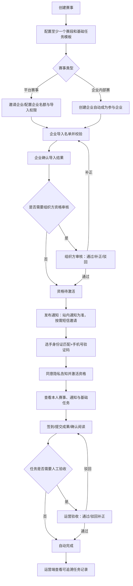

# 竞赛基础链路可行性与缺口分析

> 分析对象：`运营/企业管理员创建赛事和赛段 → 企业导入参赛名单、发布通知 → 选手身份证匹配和手机号验证码注册 → 资格激活/审核 → 选手查看并完成基础任务 → 运营端查看任务完成记录`。
> 结论状态：设计结论，未开发代码。

基础链路与 `competition-full` 五端完整生命周期的图形对比见 [competition-chain-comparison.md](competition-chain-comparison.md)。

可直接实施的实体、接口、权限和页面方案见 [competition-foundation-design.md](competition-foundation-design.md)，分波次开发计划见 [competition-foundation-development-plan.md](competition-foundation-development-plan.md)。

## 1. 总体结论

这条链路**可行，且适合作为竞赛模块的第一条可验收主链路**。它先验证租户、组织、赛事、选手身份、资格、通知、任务、文件和审计的共同底座；后续统一题库、在线考试、成绩、排名、晋级、专家与大屏都可在这条身份与事件链上扩展。

但当前表述中的“资格激活/审核”和“完成基础任务”仍不够精确。若不先补齐以下三个基础对象，后续很容易返工：

1. **赛事—企业参与关系**：平台赛事必须明确哪些企业被邀请、名额多少、由谁导入名单；企业内部赛则自动限定到创建企业。
2. **资格状态机**：导入、审核、身份激活、补正、撤销的先后顺序必须唯一，不能把“激活”和“审核”作为任意顺序的两个按钮。
3. **任务完成证据**：选手“提交”不等于运营“确认完成”；需区分提交、审核通过、驳回和逾期。

补足后，MVP 不需要题库、在线考试、成绩、排名或 AI，也能形成真实可运营闭环。

## 2. 建议收敛后的主链路



### 平台赛事与企业内部赛的最小边界

| 场景 | 创建人 | 可导入名单的企业 | 数据范围 | 必须新增的关系 |
| --- | --- | --- | --- | --- |
| 平台赛事 | 运营/组织方 | 仅被赛事邀请且处于有效状态的企业 | 赛事下被授权企业及其名单 | `competition_event_org`：event_id、org_id、quota、status、import_permission |
| 企业内部赛 | 企业管理员 | 创建企业自身 | 当前企业及其成员 | 赛事 `scope=enterprise_internal`、`owner_org_id`；可同时创建默认 `competition_event_org` |

没有 `competition_event_org` 时，企业无法被可靠地限制在“可参与的赛事”，平台也无法做名额、企业导入权限、参与状态和后续推荐的审计。

## 3. 各节点的可行性、前置与缺口

| 节点 | 可行性 | 必要前置 | 现在必须补齐的设计 | 后续可扩展点 |
| --- | --- | --- | --- | --- |
| 创建赛事和赛段 | 可行 | 租户、组织、运营/企业角色、赛事基本信息 | 赛事 scope、owner_org、状态（draft/published/closed）、至少一个可执行赛段、时区/开始结束时间 | 多赛段并行、Flowable 分支、预算资源 |
| 配置基础任务 | 可行 | 已有赛段 | 任务模板、指派对象、完成条件、截止时间、是否人工验收、所需文件类型 | 学习、考试、线下设备与裁判任务 |
| 企业导入名单 | 可行 | 企业已获赛事授权；受控导入模板 | 列字段、重复规则、身份证保护、行级错误、确认导入、撤销/替换 | 多批次、跨系统同步、名额候补 |
| 发布通知 | 可行 | 赛事/赛段已发布、接收范围可计算 | 站内通知为事实记录；短信仅为附加触达；版本、附件、已读/送达记录 | 定时、催办、n8n 通知 |
| 身份注册 | 可行 | 名单中存在有效、未撤销记录 | 身份证匹配、手机号绑定、验证码 Provider Adapter、风控、隐私告知版本 | 企业 SSO、实名服务、人脸核验 |
| 资格审核/激活 | 可行 | 名单导入已完成 | 唯一状态机；审核节点是否启用由赛事配置决定 | 多级审核、申诉、黑名单 |
| 选手任务 | 可行 | 已激活资格、任务已指派且赛段有效 | 仅返回本人任务；服务端校验截止/解锁；提交幂等 | 课程学习、考试会话、线下扫码 |
| 运营查看记录 | 可行 | 任务事件和审计已留存 | 提交与验收分离、筛选导出、证据 fileId、操作者/时间/请求 ID | 看板、统计、成绩联动 |

## 4. 必须冻结的状态机

### 4.1 参赛资格状态

建议使用以下状态，而不是笼统的“激活/审核”：

```text
import_validating → imported_pending_confirm → pending_audit（可选）
→ eligible_unactivated → activated

补充路径：import_failed / supplement_required / rejected / withdrawn / expired
```

- `import_validating`：上传后逐行校验，未产生有效资格。
- `imported_pending_confirm`：企业确认本批有效名单；允许撤销或修正导入错误。
- `pending_audit`：仅赛事配置启用组织方审核时进入。
- `eligible_unactivated`：已具备资格，但尚未由本人完成身份匹配、手机号验证和隐私同意。
- `activated`：可进入赛事与任务。选手不能自行将 `rejected`、`withdrawn`、`expired` 改回可用状态。

### 4.2 基础任务状态

```text
not_started → in_progress → submitted → accepted
                         └→ overdue
submitted → rejected_for_supplement → submitted
```

对于“阅读通知”“自动校验签到”等不需人工验收的任务，可由服务端直接进入 `accepted`，但仍须留下完成时间、完成方式和请求 ID。运营端不能把 `submitted` 统计为“已完成”，必须分别展示“已提交”和“已验收”。

## 5. 数据模型最低补充

在既有赛事、赛段、选手、报名资格、通知和任务规划之外，基础链路至少需要以下模型或字段：

| 模型 | 关键字段/约束 | 目的 |
| --- | --- | --- |
| `competition_event_org` | event_id、org_id、quota、status、import_permission；唯一 `(tenant_id,event_id,org_id,deleted)` | 平台赛事参与企业和企业数据范围 |
| `competition_roster_import` | event_id、org_id、batch_no、status、source_file_id、summary、confirmed_at/by | 导入批次与可追溯性 |
| `competition_roster_item` | batch_id、employee_no、name、id_card_ciphertext、id_card_hash、phone、work_type、level、validation_status、error_message | 行级校验；身份证采用加密存储和不可逆检索摘要，日志/导出一律脱敏 |
| `competition_registration` | event_id、player_id、org_id、roster_item_id、source=enterprise_import、status、audit_reason、activated_at | 资格事实记录；一个有效名单项只对应一个有效资格 |
| `competition_player` | tenant_id、masked_identity、identity_hash、phone、status、bound_at | 选手账号与身份绑定；禁止明文身份证出现在 token/日志 |
| `competition_task_template` | stage_id、task_type、completion_rule、requires_review、deadline_rule、allowed_file_types | 生成稳定任务，避免运营手工写自由文本规则 |
| `competition_task_submission` | task_id、player_id、submission_no、content、file_id、status、submitted_at、reviewed_at/by/reason | 提交证据与验收记录；唯一幂等键防重复提交 |
| `competition_notice_receipt` | notice_id、player_id 或 registration_id、delivered_at、read_at、channel | 通知范围和送达/已读记录 |

所有表沿用 `tenant_id`、雪花 ID、审计字段和逻辑删除；导入批次、资格、任务提交应保留不可覆盖的状态历史或复用系统审计日志。

## 6. 权限与数据安全底线

| 身份 | 可做的事 | 必须拒绝 |
| --- | --- | --- |
| 平台运营 | 管理授权赛事、邀请企业、审核资格、验收任务、看汇总 | 未授权租户、非授权赛事、越权查看企业身份证明细 |
| 企业管理员 | 仅为本企业和授权赛事导入/修正名单，创建并管理本企业内部赛，查看本企业任务 | 给其他企业导入/查看名单；创建平台范围赛事；查看其他企业选手提交 |
| 选手 | 激活本人资格、读本人可见赛事和通知、提交本人任务 | 创建报名、查询其他人、提交过期/未解锁任务、篡改验收状态 |
| 系统任务 | 校验导入、到期、发送通知、生成任务 | 绕过人工确认发布成绩、晋级或删除核心数据 |

身份证号属于高敏感个人信息：导入文件、备份、错误报告和操作日志均不应保存明文；访问原文件需额外权限和下载审计。短信验证码不记录明文，校验后立即失效；开发/测试环境应使用 mock provider，不调用真实付费短信接口。

## 7. MVP 接口最小集

| 主体 | API 能力 | 说明 |
| --- | --- | --- |
| 管理端 | 赛事/赛段 CRUD 与发布、企业参与配置 | 发布前校验至少一个赛段和可执行任务模板 |
| 企业管理员 | 名单模板下载、导入预检、确认导入、导入结果查询 | 仅授权赛事和本企业；导入采用异步批次，不能阻塞 HTTP 请求 |
| 运营 | 资格审核、通知发布、任务记录/提交证据查看与验收 | 所有状态改变审计；批量操作逐条产生结果 |
| 选手 | 身份匹配、短信发送/验证、登录、当前资格、我的赛事/通知/任务、提交/签到 | 将 `registrationId` 从 token/当前上下文推导，不接受任意选手 ID |

不应为了 MVP 实现：个人报名提交接口、题目/答案接口、考试会话、成绩计算、排行榜、AI 真实调用或大屏查询接口。

## 8. 最小验收与异常路径

### 正向验收

1. 平台运营创建平台赛事、赛段与任务模板，邀请企业 A；企业 A 成功导入 2 名符合条件的选手。
2. 企业 A 确认导入，运营审核通过（若该赛事启用审核），发布通知。
3. 选手甲以导入身份证匹配，完成验证码、隐私同意和资格激活；只看见本人赛事、通知和任务。
4. 选手甲上传任务成果或完成签到；运营端可同时看到“已提交”和验收后的“已完成”，并可追溯证据和操作者。
5. 企业管理员创建企业内部赛，只能导入本企业名单；平台运营按权限可查看，其他企业不可见。

### 必测拒绝与恢复路径

- 未被赛事邀请的企业不能导入名单；企业 B 不能读取或下载企业 A 的任何名单/提交。
- 导入文件存在重复身份证、无效格式、超过名额、已撤销人员时逐行返回脱敏错误，并允许修正后重新提交。
- 身份证未匹配、手机号不一致、验证码过期/超限、资格驳回/撤销/过期均不能登录该赛事或获取任务。
- 短信 provider 异常时不创建激活账号；向用户返回可重试的业务错误，记录不含验证码的失败日志。
- 选手重复提交、截止后提交、替换 fileId、访问其他 taskId、伪造 tenantId/registrationId 均必须被后端拒绝。
- 运营驳回任务后，选手只能在允许的补正期限重提；不能由前端直接改为“已完成”。

## 9. 建议调整后的交付顺序

1. 冻结 `competition_event_org`、资格状态机、任务状态机、导入模板和隐私告知版本。
2. 完成赛事/赛段/任务模板与平台赛事、企业内部赛的角色权限。
3. 完成企业参与配置、名单导入预检/确认、资格审核与审计。
4. 完成选手身份证匹配、短信 provider adapter（含 mock）、验证码限流、激活与 H5 会话。
5. 完成通知、我的赛事/任务、签到/成果提交与运营验收记录。
6. 以本文件第 8 节完成 API、前端和端到端验收后，再进入统一题库赛事选题专项。

## 10. 仍待产品/运营确认，但不阻塞架构设计

- 短信供应商、单条成本、月预算、发送场景（注册、登录、提醒）和超额策略。
- 导入名单的法定字段、身份证采集授权、保留期限、是否允许手机号后补及企业 HR 数据来源。
- 哪些赛事启用运营审核、审核 SLA、是否允许候补/替换人员。
- 基础任务最小类型（建议先限定：阅读确认、签到、文件成果提交）和每类验收责任人。
- 平台赛事是否允许一个选手通过多个企业名单出现；默认应拒绝同一赛事的重复有效资格并提示运营处理。
