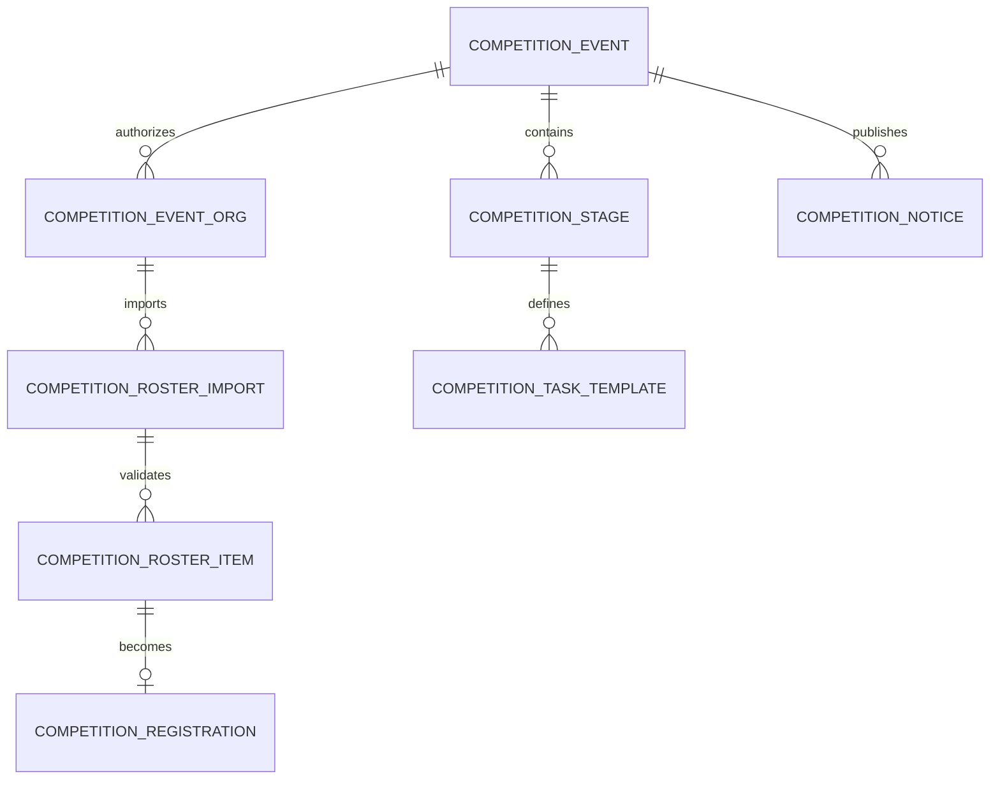
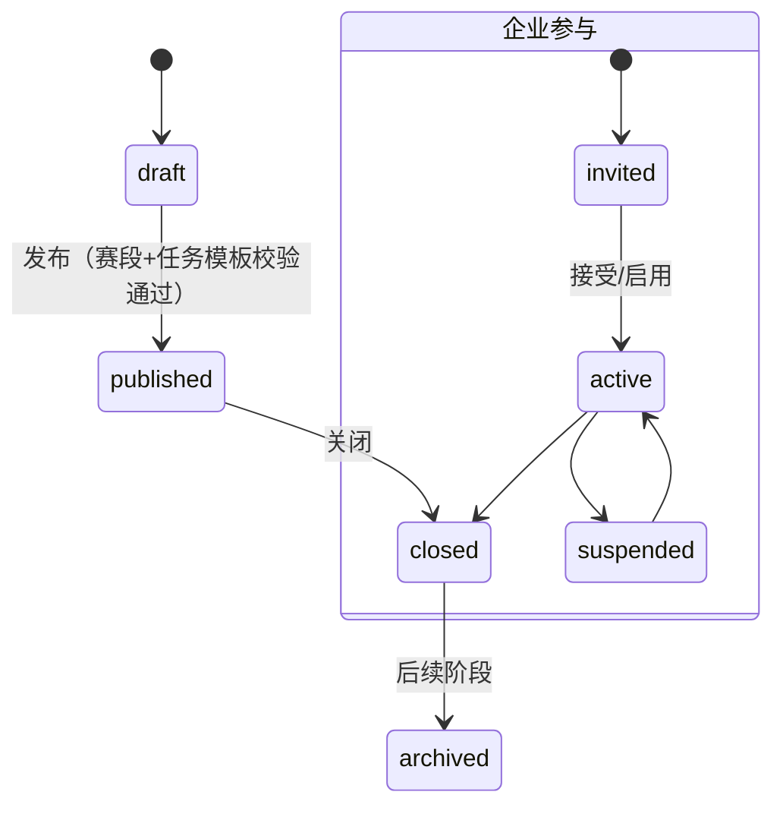
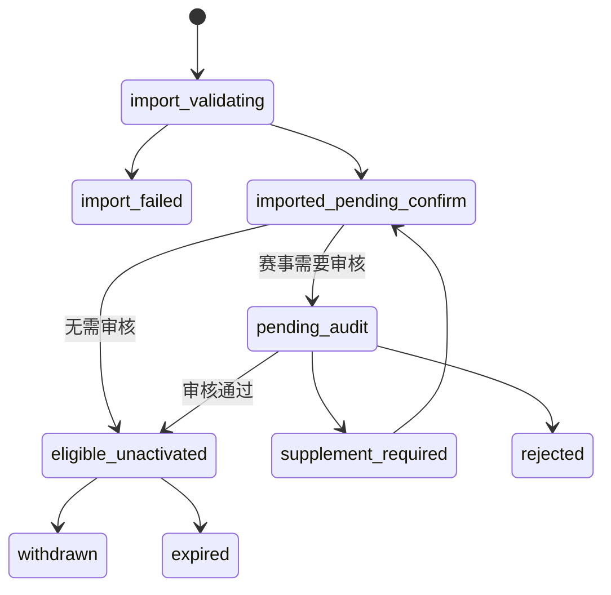

# 竞赛基础链路详细设计方案

> 目标：为竞赛模块首个可运营闭环定义可实施的领域模型、状态、接口、权限和前端边界。
> 本文只覆盖基础链路；统一题库、考试、成绩、排名、专家、大屏和 AI 不在本次实现范围。

## 1. 目标与范围

### 1.1 当前实施范围（基础链路 A）

```text
平台/企业管理员创建赛事、赛段和基础任务模板
→ 平台赛事配置参与企业，或企业创建企业内部赛
→ 企业导入并确认参赛名单
→ 按赛事配置审核资格
→ 发布通知草稿/站内通知
→ 运营端查看赛事、企业、名单、资格和任务模板记录
```

这一阶段交付的是可运营的后台基础。原始目标链路中的“选手身份激活 → H5 任务 → 文件成果提交/验收”定义为**基础链路 B**，待短信、身份证和文件设计恢复后再实施；当前不以模拟登录、假选手或假文件冒充该闭环已经完成。

### 1.2 明确不做

- 个人报名、候补替换、跨系统 HR 同步、企业 SSO。
- 短信 Provider、身份证采集/匹配/加密、选手身份注册、player token、H5 登录。
- 文件上传、任务文件成果、文件预览、任务提交与人工验收。
- 课程学习、统一题库选题、命题审题、在线考试、评分、成绩、排名、晋级。
- 专家工作台、技术研讨、公开大屏、AI/MCP 实际调用、归档。

### 1.3 设计原则

- 竞赛为 `platform-api` 内的 `competition` 领域，不拆新的业务服务。
- 企业导入名单是唯一准入来源；选手只能激活已存在且有效的资格，不能创建报名。
- 状态的判断和变更只在后端完成；前端只展示和触发受控命令。
- 任何跨租户、跨企业、跨赛事的数据访问必须拒绝；身份证和验证码不得出现在 token、日志和普通列表中。
- 文件通过已有文件模块上传，竞赛任务只保存 fileId 与访问规则。

## 2. 参与方、角色与数据范围

| 身份 | 角色建议 | 可做操作 | 数据范围 |
| --- | --- | --- | --- |
| 平台运营 | `competition_operator` | 创建平台赛事、配置赛段/任务、邀请企业、审核资格、发布通知、验收任务 | 本人被授权的租户/赛事 |
| 企业管理员 | `competition_enterprise_admin` | 创建企业内部赛、导入/确认本企业名单、查看本企业资格与任务 | 本企业，且仅获授权的平台赛事 |
| 选手 | `competition_player`（基础链路 B） | 身份注册、资格激活、查看本人赛事/通知/任务、签到/提交成果 | 本人已激活资格；当前阶段不实施 |
| 系统作业 | 系统身份 | 导入校验、任务生成、到期计算、通知投递 | 受系统作业范围限制，不得替代人工审核/验收 |

建议最小权限码：

```text
competition:event:view/create/update/publish
competition:enterprise-event:create
competition:event-org:manage
competition:roster:import/confirm/view
competition:registration:audit
competition:notice:publish/view
competition:task:template:manage/view
```

选手激活、任务提交和验收权限在基础链路 B 冻结后再定义。企业管理员创建企业内部赛时，后端强制写入其 `orgId` 作为 `owner_org_id`，客户端传入的组织 ID 不可作为裁决依据。

## 3. 领域模型



| 实体 | 核心字段 | 关键约束 |
| --- | --- | --- |
| `competition_event` | name、code、scope、owner_org_id、status、registration_audit_required、start_at、end_at | `scope` 仅为 `platform` 或 `enterprise_internal`；企业内部赛必须有 owner_org_id |
| `competition_event_org` | event_id、org_id、quota、status、import_permission | 平台赛事须先存在有效关系才允许该企业导入；唯一 `(tenant_id,event_id,org_id,deleted)` |
| `competition_stage` | event_id、name、stage_type、sort_order、start_at、end_at、status | 一个赛事至少一个有效赛段后才可发布 |
| `competition_task_template` | stage_id、task_type、title、completion_rule、requires_review、deadline_rule、allowed_file_types | MVP 仅允许 `notice_ack`、`check_in`、`file_submission` 三类 |
| `competition_roster_import` | event_id、org_id、batch_no、source_file_id、status、confirmed_by/at、summary | 导入预检与确认分离；批次不可覆盖 |
| `competition_roster_item` | batch_id、employee_no、name、work_type、level、validation_status、error_message | 当前只保存企业名单基础字段；同一企业/赛事内以 employee_no 去重，不采集身份证或手机号 |
| `competition_registration` | event_id、org_id、roster_item_id、source、status、audit_reason | `source` 固定 `enterprise_import`；当前不绑定 player，不存 activated_at |
| `competition_task` | 基础链路 B 再创建 | 依赖选手身份激活与任务指派，不在当前迁移中提前落表 |
| `competition_task_submission` | 基础链路 B 再创建 | 依赖文件服务绑定、提交和验收规则 |
| `competition_notice` | event_id、title、content、version、published_at | 当前提供站内通知发布；附件和选手回执在基础链路 B 再接入 |

所有实体使用 `BaseEntity` 公共审计字段和 `tenant_id`，ID 为 `BIGINT`。新表和索引只通过新 Flyway 迁移创建；所有列为 snake_case。建议至少索引：`event_org(event_id,org_id)`、`registration(event_id,org_id,status)`、`registration(event_id,identity_hash,status)`、`task(registration_id,status,deadline_at)`、`roster_item(batch_id,validation_status)`。

## 4. 状态与命令

### 4.1 赛事与企业参与



平台赛事只能由运营创建，并显式配置 `competition_event_org`；企业内部赛创建时同时生成该企业的 `active` 参与关系。企业无权把自身设为平台赛事参与企业。

### 4.2 资格（当前阶段截至待激活）



导入校验失败行不生成资格；企业确认有效行后才生成资格。若赛事启用审核，只有运营审核通过才进入 `eligible_unactivated`。基础链路 B 恢复后，再从 `eligible_unactivated` 通过身份激活进入 `activated`，并生成选手任务。

### 4.3 任务（当前只配置模板）

当前仅配置 `competition_task_template`，用于验证赛段和运营规则；不生成选手任务、不接收提交、不做验收。任务实例、文件成果和 `submitted → accepted` 状态机在基础链路 B 实施时补充。

## 5. 后端接口设计

路径均以 `/api/competition` 为前缀，响应统一为 `ApiResponse<T>`；后台列表使用 `PageQuery/PageResponse`。示例请求对象仅表达合同，不代表已实现。

### 5.1 后台与企业角色 API

| 方法 | 路径 | 用途 | 权限/范围 |
| --- | --- | --- | --- |
| `POST` | `/events` | 创建平台赛事或企业内部赛 | 运营；企业只能 internal |
| `GET` | `/events` | 赛事分页 | 角色与赛事范围过滤 |
| `GET/PUT` | `/events/{eventId}` | 详情、更新草稿 | 赛事范围 |
| `POST` | `/events/{eventId}/publish` | 发布赛事 | 校验赛段、模板、企业参与关系 |
| `GET/PUT` | `/events/{eventId}/stages` | 赛段列表/配置 | 运营或内部赛企业管理员 |
| `GET/POST/PUT` | `/stages/{stageId}/task-templates` | 基础任务模板 | 运营或内部赛企业管理员 |
| `GET/POST` | `/events/{eventId}/organizations` | 查询/配置参与企业 | 仅平台运营 |
| `POST` | `/events/{eventId}/roster-imports/precheck` | 上传已存 fileId 后预检 | 企业范围、授权赛事 |
| `POST` | `/roster-imports/{batchId}/confirm` | 确认有效名单 | 导入企业范围 |
| `GET` | `/roster-imports/{batchId}` | 批次和脱敏行结果 | 导入企业/运营 |
| `GET` | `/registrations` | 资格分页 | 按赛事、企业和角色过滤 |
| `POST` | `/registrations/{id}/audit` | 通过/补正/驳回 | 运营；仅 pending_audit |
| `POST` | `/events/{eventId}/notices` | 创建并发布站内通知 | 赛事范围；写审计；当前不发短信、不带附件 |

### 5.2 延后到基础链路 B 的 API

身份证匹配、短信验证、player token、选手 H5、通知回执、签到、任务实例、文件提交和验收 API 均不在当前合同中实现。恢复该范围时，需先重新确认身份证采集授权、短信供应商/预算和文件访问策略，再补充独立 API 设计。

## 6. 延后范围：短信、身份证与文件

根据当前决定，本章不进入设计细化和开发：不确定短信供应商/成本策略前，不建设 Provider Adapter；不确定身份证采集授权、保留期限与匹配规则前，不新增身份证字段；不确定文件类型、访问策略和验收规则前，不建设文件成果提交。

这些能力恢复时必须作为一个独立子阶段重新进入设计评审，且不能通过临时明文字段、真实付费短信调用或前端模拟文件状态替代。

## 7. 后台与 H5 页面设计

| 端 | 页面/组件 | 最小行为 |
| --- | --- | --- |
| admin-web | 赛事列表/编辑 | 区分平台赛事和企业内部赛；企业用户不可选任意 owner_org |
| admin-web | 赛段与任务模板 | 配置时间、基础任务类型、完成条件、是否验收；发布前校验 |
| admin-web | 参与企业 | 平台运营设置企业、名额、导入权限、参与状态 |
| admin-web | 名单导入 | 模板下载、上传预检、脱敏错误表、确认导入、批次状态 |
| admin-web | 资格审核 | 筛选 pending_audit，批量/单条审核、补正原因、审计入口 |
| admin-web | 通知管理 | 创建、编辑、发布站内通知；当前无附件、短信与选手回执 |
| competition-h5 | 基础链路 B | 身份注册、登录、赛事/通知/任务、提交与个人中心均延后 |

## 8. 审计、错误处理与可观测性

下列操作必须记录操作人/主体、tenantId、eventId、orgId、对象 ID、前后状态、requestId 和时间：赛事发布、企业参与配置、导入确认、资格审核、通知发布、撤销。身份激活、任务提交和任务验收在基础链路 B 再加入审计范围。

- 401：当前阶段仅按既有后台登录态处理；H5 player token 在基础链路 B 再引入。
- 403：明确提示“当前无赛事或企业数据范围”，不自动跳转。
- 409：状态已变化、导入确认重复、激活并发、幂等键冲突。
- 422：导入行、验证码、文件类型、时间窗口等业务校验失败。
- 5xx/Provider 异常：不改变资格或任务状态；返回可重试错误，记录不含敏感值的 error 日志。

## 9. 最小验收合同

### 当前阶段正向链路

1. 运营创建平台赛事、赛段和基础任务模板，邀请企业 A。
2. 企业 A 预检并确认名单；赛事需要审核时，运营审核通过。
3. 运营发布站内通知。
4. 运营按赛事/企业/人员查到资格、通知、状态历史和 requestId。
5. 企业管理员创建企业内部赛，不能访问企业 B 的数据。

### 拒绝路径

- 未获授权企业导入、超名额、重复身份、无效/撤销资格、跨企业读取均拒绝。
- 不建设选手身份、验证码、文件提交和任务验收接口，避免因未定规则产生不可控实现。

## 10. 后续扩展契约

基础链路 B 将先补齐身份证/短信/文件、player 身份、任务实例及提交验收；之后统一题库通过 `event_id + stage_id + question_set_version` 接入，在线考试再基于 `activated registration` 创建会话。后续扩展不得改变本设计中的赛事—企业关系、名单来源、资格审核和审计边界。
