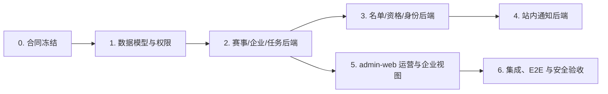

# 竞赛基础链路开发计划

> 当前执行目标：交付“创建赛事 → 企业导入名单 → 资格审核 → 发布站内通知”的后台基础闭环。
> 原则：任务按依赖顺序执行；同一 Flyway 主干、Controller 或页面同一时间仅由一个开发任务修改。

## 1. 开始条件与完成定义

### 开始条件

- 采用 [基础链路详细设计](competition-foundation-design.md) 的实体、状态、接口和权限口径。
- 短信、身份证和文件设计当前不进入开发，不创建 mock/provider、相关字段、H5 登录或任务提交接口。
- 明确不含身份证和手机号的导入模板字段、基础任务模板类型和是否启用资格审核的默认值。

### 完成定义

```text
平台运营创建并发布平台赛事
→ 邀请企业 A → 企业 A 确认名单
→ 运营审核（若开启）→ 发布站内通知
→ 可按赛事/企业/名单/资格审计与查询
```

该完成定义不等同于原始的选手端到端闭环；后者必须在基础链路 B（短信、身份证、文件恢复后）另行验收。所有当前步骤需经真实 API 和前端操作跑通；不可用静态页面、前端假状态或手改数据库代替。

## 2. 实施波次



## 3. 工作包与验收门槛

| 编号 | 工作包 | 依赖 | 交付物 | 最低验收 |
| --- | --- | --- | --- | --- |
| FND-00 | 合同冻结 | 无 | OpenAPI 草案、状态迁移表、导入模板、权限矩阵、错误码 | 产品/技术确认无个人报名；状态机无歧义 |
| FND-01 | 数据模型与 Flyway | FND-00 | 竞赛实体、Mapper、Converter、新迁移、索引、菜单/权限种子规划 | 空库 Flyway 成功；迁移不修改历史文件 |
| FND-02 | 赛事/赛段/任务模板 API | FND-01 | 平台/企业内部赛事、参与企业、赛段、模板、发布校验 | MockMvc 覆盖发布前置、企业数据范围与审计 |
| FND-03 | 名单导入与资格审核 API | FND-01、FND-02 | 模板、预检、批次确认、资格生成、审核/补正/撤销 | 重复身份、超名额、跨企业、批次重复确认测试通过 |
| FND-04 | 站内通知 API | FND-02、FND-03 | 站内通知创建、发布、后台查询及审计 | 不带附件、短信和选手回执；仅授权赛事可发布 |
| FND-05 | admin-web 运营与企业视图 | FND-02、FND-03、FND-04 | 菜单、类型、赛事/赛段/参与企业/导入/审核/通知页面 | `npm run build`；企业角色不可看其他企业；写按钮权限验证 |
| FND-06 | 后台集成与安全验收 | FND-05 | API/前端集成、部署/启动说明、验收记录 | 平台赛事和企业内部赛的后台闭环及越权场景通过 |

## 4. 推荐任务顺序与文件所有权

| 顺序 | 任务 | 主要目录 | 并行限制 |
| --- | --- | --- | --- |
| 1 | FND-00、FND-01 | `docs/`、`services/platform-api/.../competition/`、`db/migration/` | Flyway 由单任务独占 |
| 2 | FND-02 | `services/platform-api/.../competition/event/` | 与 FND-03 可在表结构完成后并行，但不得同时修改共同 Controller/权限种子 |
| 3 | FND-03 | `services/platform-api/.../competition/roster/` | 导入/资格目录独占 |
| 4 | FND-04 | `services/platform-api/.../competition/notice/` | 只处理站内通知，不引入短信/回执 |
| 5 | FND-05 | `apps/admin-web/src/pages/competition/` | 一个页面文件只一个任务 |
| 6 | FND-06 | 测试目录、部署说明 | 不顺手修改业务代码；失败项回派原功能任务 |

## 5. 每个工作包的测试要求

### 后端

- JUnit 5 / Mockito：状态迁移、权限范围、导入校验和通知发布规则。
- MockMvc：401、403、422、409、成功路径及统一 `ApiResponse`。
- MySQL/Flyway：空库执行新旧全部迁移；列表索引与唯一约束验证。
- 当前不覆盖文件和短信测试；相应接口、字段及外部调用均不创建。

### 前端

- admin-web：菜单/权限、表单发布校验、导入错误显示、资格审核、任务验收。
- 当前不创建 `competition-h5`；选手 H5、身份激活和任务页面在基础链路 B 另行立项。
- Playwright：从运营创建平台赛事到企业确认名单、资格审核和通知发布的后台主链路；企业 B 越权场景必须失败。

## 6. 发布前验收清单

1. 后端 `mvn compile -DskipTests`、竞赛相关单测、空库 Flyway 均通过。
2. `apps/admin-web` 与 `apps/competition-h5` 构建零错误。
3. 平台赛事与企业内部赛均完成数据范围验证。
4. 导入身份证、手机号、错误报告、token、日志和审计中的敏感字段均符合脱敏/加密规则。
5. 不存在身份证/手机号字段、短信 Provider、player token、文件提交、任务实例或任务验收接口；这些均标记为基础链路 B。
6. 不存在个人报名入口、题目接口、成绩接口、排行接口或真实 AI/短信费用调用。

## 7. 不应在基础链路期间合并的需求

- 将课程题库页面复制为竞赛题库，或在考试未设计前暴露题目/答案。
- 用浏览器倒计时、前端状态或静态原型模拟考试/成绩/资格；也不得以假选手登录模拟未实现的身份激活。
- 企业越权创建平台赛事或导入其他企业人员。
- 把专家、公开大屏、AI 助手与基础链路放在同一个发布批次。

当前后台基础验收完成后，先完成“基础链路 B：短信、身份证、文件、选手 H5 与任务提交/验收”，再进入“统一题库赛事选题专项”。
