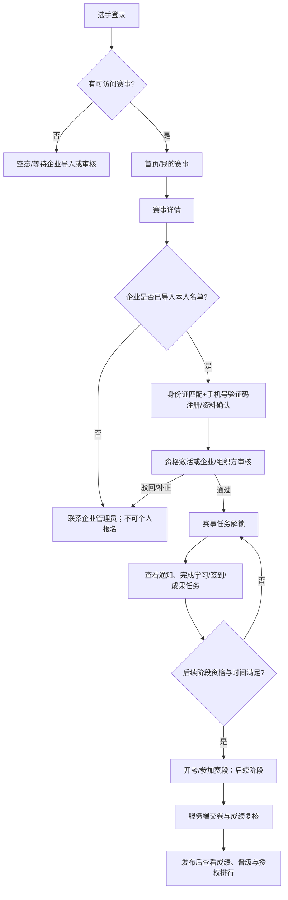

# 竞赛原型分析：选手 H5 页面、流程与数据映射

> 依据：`prototypes/competition-full/player.html`、`player.js`、`README.md`。原型是已确认的产品设计依据，但所有数据、上传、AI、考试计时和刷新均为静态模拟，不能直接当作代码或 API 合同。

## 1. 原型范围判读

`competition-full` 共 102 个独立视图：组织方 54、企业 13、选手移动端 18、专家 10、公开大屏 7。本文件聚焦 18 个选手 H5 视图；其余四端代表后续角色能力和数据边界，不能并入选手 H5 的导航或权限。

## 2. 选手 H5 页面清单与映射

| 原型视图 | 业务能力 | 主要数据 | 建议 API | MVP |
| --- | --- | --- | --- | --- |
| 登录/身份注册 | 企业名单身份证匹配、手机号验证码、隐私入口 | 名单匹配状态、登录方式、授权文案 | `player-auth/register/verify-identity`、`sms/send`、`login`、`me` | 是 |
| 首页 | 当前赛事、当前赛段、积分、排名、待办快捷入口 | 赛事摘要、赛段、任务统计、本人摘要 | `player/home` | 是 |
| 我的赛事 | 已报名、历史赛事列表 | 本人赛事、报名/赛事状态 | `player/events` | 是 |
| 赛事详情 | 赛事信息、赛程、可操作入口 | 赛事详情、赛段、资格、可见通知 | `player/events/{id}` | 是 |
| 参赛资格激活 | 已导入名单的资料确认、隐私同意、激活状态 | 企业名单、选手档案、资格/审核状态 | `player/events/{id}/registration`、`player/registrations/{id}/activate` | 是 |
| 通知与须知 | 考前须知、技术文件、审核通知 | 已发布通知、附件、已读状态 | `player/notices` | 是 |
| 我的任务 | 报名、学习、签到、报到等状态 | 任务、截止时间、完成条件、解锁规则 | `player/tasks` | 是 |
| 任务详情/签到弹层 | 本人任务说明、签到/成果提交 | 任务详情、本人状态、签到记录 | `player/tasks/{id}`、`check-in`、`submissions` | 是（通用任务） |
| 赛前学习 | 课程、章节、学习进度 | 赛事学习资源、进度 | 后续复用受控学习 API | 否 |
| 开考说明 | 时间、规则、次数、风险提示 | 赛段考试规则、资格、考试会话状态 | `player/exams/{stageId}/briefing` | 否 |
| 在线答题 | 试题、答案暂存、答题卡、倒计时 | 考试会话、题目投影、作答、剩余时间 | `player/exam-sessions/*` | 否 |
| 超时自动交卷 | 自动交卷凭据、未答题数 | 服务端交卷结果 | `player/exam-sessions/{id}/status` | 否 |
| 我的成绩 | 分项成绩、排名、晋级候选状态 | 已发布成绩、发布说明 | `player/results` | 否 |
| 排行榜 | 授权公开的排名 | 已发布排行快照、脱敏字段 | `player/rankings` | 否 |
| 流程助手 | 赛事规则、报名/任务/晋级问答 | 允许访问的赛事知识、引用审计 | 后续 AI 受控接口 | 否 |
| 专业知识助手 | 技术文件/学习资料问答 | 授权资料、引用、生成审计 | 后续 AI 受控接口 | 否 |
| 消息中心 | 报名、提醒、成绩消息 | 消息、已读状态、跳转目标 | `player/messages` | 否（通知可先覆盖） |
| 我的/账号隐私 | 选手档案、公开授权、退出 | 个人资料、隐私授权、会话 | `player/profile`、`logout` | 是 |

注：原型中“任务详情”“答题卡”“来源详情”等采用弹层，不单列为 hash 页面；实现时仍需成为可访问、可测试的组件与 API 场景。

## 3. 用户主流程

MVP 在 H 节点止步：支持任务的查看、签到或成果提交；不把在线考试、排行、AI 问答作为“页面先行、后端补齐”的假能力。

## 4. 页面到后端数据依赖

| 数据聚合 | 消费页面 | 最小字段 | 服务端来源与规则 |
| --- | --- | --- | --- |
| `PlayerHomeVO` | 首页 | currentEvent、currentStage、taskCounts、rankSummary、promotionStatus | 仅本人有权赛事；聚合查询，避免首页串行请求 |
| `PlayerEventDetailVO` | 赛事/赛事详情 | event、stages、registrationStatus、entryActions、publishedNotices | 按报名、审核、赛段窗口计算 actions，不能由前端猜状态 |
| `RegistrationVO` | 资格激活页 | importedRosterStatus、profileDefaults、status、reviewReason、privacyConsent | 仅企业导入名单可激活；身份证匹配和手机号验证后保留审核轨迹，禁止个人新增报名 |
| `PlayerTaskVO` | 任务/任务详情 | id、stage、title、deadline、status、completionRule、submission/checkin | 只返回 assignee=当前选手，过期/解锁由服务端判定 |
| `NoticeVO` | 通知、首页 | title、content、fileIds、publishedAt、readAt | 只返回发布且在可见范围内的通知 |
| `ExamSessionVO` | 开考/答题/自动交卷 | status、serverNow、endAt、attemptNo、questionProjection | 仅后续；答案和标准答案绝不下发到前端 |
| `ResultVO` / `RankVO` | 成绩/排行 | scoreBreakdown、publishedAt、promotionStatus；rank、displayName、region | 仅发布后可读；排行遵循选手授权与脱敏策略 |
| `AiAnswerVO` | 两个 AI 页面 | answer、citations、model、generatedAt、requestId | 仅后续；按资料 ACL、赛事状态及题库保护过滤 |

## 5. 原型与实现之间的必要转换

| 原型表现 | 正式实现要求 |
| --- | --- |
| 浏览器 hash 切页和模拟登录 | React Router 深链；实际登录态、路由守卫和 401 处理 |
| 选手自行提交报名 | 改为企业批量导入名单后，选手以身份证匹配、手机号验证并确认本人资料；敏感字段最小化展示 |
| 客户端倒计时与“模拟超时” | 服务端为唯一计时依据；自动交卷为幂等后台动作 |
| 前端直接显示分数、排名和晋级 | 成绩确认、发布、排行榜授权和脱敏后才投影给选手 |
| 模拟上传与成果状态 | 先走文件服务，再绑定 fileId；校验大小、类型、访问范围与任务截止时间 |
| AI 模拟来源与审计 | 后端受控检索并持久化调用审计；不提供题目答案或未公开资料 |

## 6. 原型反映的产品待确认项

1. 已确认两个独立 AI 入口；赛事流程资料与专业知识资料必须隔离。
2. 已确认优先使用竞赛统一题库，并通过受控能力复用课程模块题库；赛事选题必须快照和锁定。
3. 已确认只允许企业批量导入名单；选手只完成身份证匹配、手机号验证、资料确认和资格激活，不得个人报名。
4. 线上考试防作弊、身份核验、断网续答、监考和申诉要求仍待专项确认；这些决定考试是否进入下一阶段范围。
5. 排行展示实名、匿名编号、企业/赛区信息的授权与撤回规则仍待确认。
