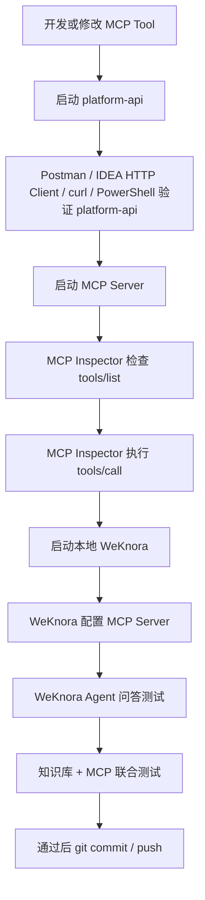

# 本地 AI / MCP 联调流程

本文用于在本地验证 `platform-api`、`services/mcp-server`、MCP Inspector 和本地 WeKnora 的联调链路。目标是以后每新增或修改一个 MCP Tool，都能先在本地完成验证，再提交代码和部署。

> **生产环境踩坑记录**：见 [`mcp-pitfalls-20260709.md`](./mcp-pitfalls-20260709.md)（WeKnora + Docker 网络 + SSRF + JAR 版本等）。

## 0. 当前仓库扫描结论

扫描时间：2026-07-09。

当前仓库中已存在：

| 类型 | 实际路径 | 结论 |
| --- | --- | --- |
| 平台后端 | `services/platform-api` | 已实现 Spring Boot 主服务，`server.servlet.context-path=/api` |
| MCP Server | `services/mcp-server` | 已有 TypeScript MCP Server 代码，不是空目录 |
| 管理端 | `apps/admin-web` | 已有 React/Vite 管理端 |
| WeKnora 嵌入方案 | `docs/05_decisions/WeKnora嵌入网页集成执行方案.md`、`docs/OIDC-SSO-集成方案2.md` | 已有嵌入与 SSO 相关方案 |
| 本地 HTTP 模板 | `docs/http` | 本次新增 |
| Postman Collection | `docs/postman` | 本次新增 |
| AI/MCP 本地脚本 | `scripts/dev` | 本次新增 |

当前 `platform-api` 已存在的 MCP 查询接口如下，均需要 `Authorization: Bearer <token>` 和 `X-Tenant-Id`：

| 用途 | 实际接口 | 权限 |
| --- | --- | --- |
| 认定任务列表查询 | `GET /api/certification/mcp/tasks` | `certification.dashboard.view` |
| 认定任务概览 | `GET /api/certification/mcp/tasks/{taskId}/overview` | `certification.dashboard.view` |
| 信息采集进度聚合 | `GET /api/certification/mcp/tasks/{taskId}/collection-progress` | `certification.dashboard.view` |
| 实操评分进度聚合 | `GET /api/certification/mcp/tasks/{taskId}/practical-score-progress` | `certification.dashboard.view` |

当前 `services/mcp-server` 已注册的 MCP Tool：

| 当前工具名 | 上游 platform-api |
| --- | --- |
| `certification.searchTasks` | `GET /api/certification/mcp/tasks` |
| `certification.getTaskOverview` | `GET /api/certification/mcp/tasks/{taskId}/overview` |
| `certification.getCollectionProgress` | `GET /api/certification/mcp/tasks/{taskId}/collection-progress` |
| `certification.getPracticalScoreProgress` | `GET /api/certification/mcp/tasks/{taskId}/practical-score-progress` |

本次需求示例中的以下接口路径当前未在 Controller 中发现，不能当作已实现接口使用：

```text
GET /api/certification/tasks/{taskId}/status
GET /api/certification/tasks/{taskId}/candidates/{candidateId}/collection-status
GET /api/certification/tasks/{taskId}/examiner-group/status
GET /api/certification/tasks/{taskId}/score-table/status
```

当前可用于本地诊断的相近接口：

| 需求目标 | 当前可用接口 | 说明 |
| --- | --- | --- |
| 查询考生采集状态 | `GET /api/certification/practical-collection/detail/{taskId}/{candidateId}` | 单个考生采集详情，非 MCP 专用聚合接口 |
| 查询考评员配置状态 | `GET /api/certification/preparation/tasks/{taskId}/assessor-groups` | 返回小组列表，未聚合成 status |
| 查询评分表配置状态 | `GET /api/certification/practical-scoring/tasks/{taskId}/setup` | 返回实操评分配置视图，未聚合成 score-table status |

注意：当前 Java Controller 中 `taskId`、`candidateId` 是 `Long`，不是 `T001` 这样的业务编号。使用 `T001` 前，需要先通过任务列表或数据库映射到数字 ID。

## 1. 总体链路

```text
Postman / IDEA HTTP Client / curl / PowerShell
   ↓
platform-api
   ↓
数据库

MCP Inspector
   ↓
MCP Server
   ↓
platform-api

本地 WeKnora
   ↓
MCP Server
   ↓
platform-api
```

完整流程：



## 2. 第一层：platform-api

测试工具：

```text
Postman / IDEA HTTP Client / curl / PowerShell
```

验证目标：

```text
业务接口本身是否可用
参数是否正确
token 是否有效
tenantId 是否有效
权限是否正常
数据库返回是否正确
```

建议顺序：

1. 启动数据库、Redis 等依赖。
2. 启动 `platform-api`。
3. 调用健康检查：`GET http://localhost:8080/api/actuator/health`。
4. 登录获取平台 token。
5. 在 Postman 或 IDEA HTTP Client 中填入 `baseUrl`、`token`、`tenantId`、`taskId`、`candidateId`。
6. 先测实际 Controller 已存在的接口，再测待补齐接口的设计。

Windows 本地可参考：

```powershell
$env:JAVA_HOME = "D:\Program Files\Java\oracleJdk-21"
& "C:\Program Files\Java\apache-maven-3.9.11\bin\mvn.cmd" spring-boot:run -f services/platform-api/pom.xml -s scripts/custom-maven-settings.xml
```

如已有预构建 JAR：

```powershell
java -jar services/platform-api/target/platform-api-0.1.0-SNAPSHOT.jar
```

如果端口不是 `8080`，将测试变量 `baseUrl` 改成实际端口，例如 `http://localhost:18080`。

## 3. Postman 安装与配置

推荐安装 Postman Desktop：

```powershell
winget install -e --id Postman.Postman
```

安装后验证：

```powershell
winget list Postman
```

启动：

```powershell
Start-Process "Postman"
```

如果 `Start-Process "Postman"` 无法启动，请从 Windows 开始菜单搜索 Postman 打开。

如果 `winget` 不可用，使用手动安装：

1. 打开 Postman 官方下载页。
2. 下载 Windows 64-bit Desktop 版。
3. 双击安装。
4. 安装完成后打开 Postman。

本仓库已新增 Collection：

```text
docs/postman/qianlvguoyu-platform-api-local.postman_collection.json
```

导入后填写变量：

| 变量 | 默认值 | 说明 |
| --- | --- | --- |
| `baseUrl` | `http://localhost:18080` | 如果后端在 8080，改成 `http://localhost:8080` |
| `token` | `your_token_here` | 登录后填入真实 token，不要提交 |
| `tenantId` | `your_tenant_id_here` | 当前租户 ID，不要提交真实环境文件 |
| `taskId` | `1` | 当前 Controller 需要数字 ID |
| `candidateId` | `1` | 当前 Controller 需要数字 ID |

统一 Header：

```text
Authorization: Bearer {{token}}
X-Tenant-Id: {{tenantId}}
```

不要把真实 token、tenantId、数据库密码、API Key 写入仓库。Collection 只能提交变量和占位符。

## 4. IDEA HTTP Client

本仓库已新增：

```text
docs/http/platform-api-local-test.http
```

使用方式：

1. 用 IDEA 打开该文件。
2. 修改顶部变量。
3. 先执行健康检查和任务列表。
4. 再执行任务概览、考生采集详情、考评员小组列表、实操评分配置。

## 5. 第二层：MCP Server

测试工具：

```text
MCP Inspector
```

验证目标：

```text
tools/list 是否能看到工具
工具 name 是否正确
description 是否清晰
inputSchema 是否正确
tools/call 是否能返回结构化 JSON
异常参数是否返回可读错误
```

当前 MCP Server 路径：

```text
services/mcp-server
```

本地环境变量参考：

```text
services/mcp-server/.env.example
```

必须配置但不要提交真实值：

| 变量 | 说明 |
| --- | --- |
| `PORT` | MCP Server 端口，默认 `3001` |
| `MCP_BEARER_TOKEN` | WeKnora 或 Inspector 访问 MCP Server 的入站 Bearer token |
| `PLATFORM_API_BASE_URL` | 例如 `http://localhost:8080/api` |
| `PLATFORM_API_TOKEN` | platform-api 登录 token 或受控服务身份 token |
| `PLATFORM_TENANT_ID` | 当前租户 ID |
| `PLATFORM_REQUEST_TIMEOUT_MS` | 调平台接口超时时间 |

启动：

```powershell
cd services/mcp-server
npm install
npm run build
npm start
```

健康检查：

```text
GET http://localhost:3001/health
```

当前传输方式：

| 模式 | 地址 |
| --- | --- |
| Streamable HTTP | `http://localhost:3001/mcp` |
| SSE | `http://localhost:3001/sse` |
| SSE messages | `http://localhost:3001/messages` |

## 6. MCP Inspector

本仓库已新增启动脚本：

```powershell
.\scripts\dev\start-mcp-inspector.ps1
```

等价基础命令：

```powershell
npx @modelcontextprotocol/inspector
```

### 情况 A：stdio 模式

如果某个 MCP Server 是 Node stdio 模式，可使用类似命令：

```bash
npx @modelcontextprotocol/inspector node build/index.js
```

当前 `services/mcp-server` 不是 stdio 模式，不要强行使用上面的命令。

### 情况 B：HTTP / SSE / Streamable HTTP 模式

当前项目属于这种情况：

1. 先启动 `platform-api`。
2. 再启动 `services/mcp-server`。
3. 启动 MCP Inspector。
4. 在 Inspector UI 中选择对应 transport。
5. 填写 MCP Server 地址，例如：
   - `http://localhost:3001/mcp`
   - `http://localhost:3001/sse`
   - `http://host.docker.internal:3001/mcp`
6. 配置 `Authorization: Bearer <MCP_BEARER_TOKEN>`。
7. 进入 Tools 面板。
8. 检查 `tools/list`。
9. 手动填写参数执行 `tools/call`。
10. 查看返回 JSON、MCP Server 日志和 platform-api 日志。

MCP Inspector 只用于本地调试，不要暴露到公网。

## 7. 第三层：WeKnora

测试工具：

```text
本地 WeKnora Web UI / Agent 对话窗口
```

验证目标：

```text
WeKnora 是否能连接 MCP Server
Agent 是否能识别何时调用 MCP Tool
Agent 是否能解释 MCP 返回数据
Agent 是否能结合知识库和 MCP 回答问题
```

不要把 WeKnora 源码合并进当前业务仓库。建议 clone 到仓库外部目录：

```text
D:/qianlvguoyu/tools/WeKnora
```

基础部署步骤：

```bash
git clone https://github.com/Tencent/WeKnora.git D:/qianlvguoyu/tools/WeKnora
cd D:/qianlvguoyu/tools/WeKnora
cp .env.example .env
docker compose up -d
```

需要根据本地模型、API Key、Embedding 配置修改 `.env`。不要把真实 `.env` 提交到当前业务仓库。

启动后查看服务：

```bash
docker compose ps
```

然后按 compose 暴露端口访问 WeKnora Web UI。具体端口以 WeKnora 仓库的 `.env` 和 `docker compose ps` 输出为准。

本地部署 WeKnora 的目的不是修改 WeKnora 源码，而是做 MCP 联调。如果只测试 MCP Tool 调用，第一阶段先优先跑通：

1. WeKnora 启动。
2. 模型可用。
3. MCP Server 可连接。
4. Agent 能调用工具。

## 8. Docker 中的 localhost 注意事项

如果 WeKnora 跑在 Docker 容器中，而 MCP Server 跑在 Windows 主机上，那么在 WeKnora 容器里配置：

```text
http://localhost:3001/mcp
```

通常是错误的。这个 `localhost` 指的是 WeKnora 容器自己，不是 Windows 主机。

### 方案一：WeKnora 和 MCP Server 都在同一个 Docker Compose 网络中

使用服务名访问：

```text
http://mcp-server:3001/mcp
```

### 方案二：WeKnora 在 Docker，MCP Server 在 Windows 主机

使用：

```text
http://host.docker.internal:3001/mcp
```

### 方案三：WeKnora 在远程服务器，本地 MCP Server 在本机

远程 WeKnora 无法直接访问本机 localhost。开发阶段不建议把本地 MCP Server 暴露到公网，建议本地部署 WeKnora 做联调。

## 9. WeKnora 问答测试问题模板

只测知识库：

```text
实操评分表导入后下一步应该做什么？
```

预期：

```text
WeKnora 走知识库检索，不一定调用 MCP。
```

只测 MCP：

```text
T001 这个认定任务现在处于什么阶段？
```

预期：

```text
WeKnora 调用任务状态类 MCP Tool。
```

知识库 + MCP 联合测试：

```text
T001 这个任务现在能不能开始平板评分？如果不能，原因是什么，下一步做什么？
```

预期：

```text
1. WeKnora 调 MCP 查询任务当前状态。
2. WeKnora 查知识库中的平板评分启动规则。
3. 模型综合判断是否能开始。
4. 返回原因和下一步操作。
```

注意：当前后端接口使用数字 `taskId`。如果用户说的是 `T001`，Agent 或 MCP Tool 需要先通过任务列表按业务编号查询，再拿数字 ID 调详情接口。

## 10. 4 个 MCP Tool 注册成功标准

4 个工具不以“代码存在”为注册成功标准，而以 MCP Inspector 和 WeKnora 可识别为准。

满足以下条件才算注册成功：

```text
1. MCP Inspector 的 Tools 面板能看到工具。
2. 工具名称是预期 name。
3. 工具 description 正确显示。
4. inputSchema 正确显示。
5. 手动输入参数后能执行成功。
6. 返回 JSON 字段稳定。
7. WeKnora 能识别并调用该工具。
8. WeKnora 能理解工具返回结果并生成正确回答。
```

业务目标第一批工具建议为：

```text
get_certification_task_status
get_candidate_collection_status
get_examiner_group_status
get_score_table_config_status
```

当前 MCP Server 实际已注册工具名是：

```text
certification.searchTasks
certification.getTaskOverview
certification.getCollectionProgress
certification.getPracticalScoreProgress
```

如果最终要求 WeKnora 使用 snake_case 工具名，需要后续在 `services/mcp-server/src/tools.ts` 中改名或增加兼容别名，并重新用 MCP Inspector 验证。

## 11. 本地完整启动顺序

```text
1. 启动数据库 / Redis / 依赖服务
2. 启动 platform-api
3. 使用 Postman / IDEA HTTP Client 测 platform-api
4. 启动 MCP Server
5. 使用 MCP Inspector 测 tools/list 和 tools/call
6. 启动本地 WeKnora
7. 在 WeKnora 配置 MCP Server
8. 用 WeKnora Agent 做问答测试
```

提示式脚本：

```powershell
.\scripts\dev\start-local-mcp-test.ps1
```

## 12. 排错路径

| 现象 | 优先检查 |
| --- | --- |
| Postman 401 | `token` 是否过期，Header 是否是 `Authorization: Bearer {{token}}` |
| Postman 403 | 当前账号是否有对应权限码，如 `certification.dashboard.view` |
| Postman 404 | `baseUrl` 是否包含正确端口，路径是否是当前 Controller 实际路径 |
| `taskId` 参数错误 | 当前 Controller 需要数字 ID，不接受 `T001` |
| MCP Inspector 连接失败 | MCP Server 是否启动，地址是否是 `/mcp` 或 `/sse`，Bearer token 是否正确 |
| `tools/list` 为空 | MCP Server 是否成功注册工具，启动日志是否报错 |
| `tools/call` 返回平台错误 | `PLATFORM_API_BASE_URL`、`PLATFORM_API_TOKEN`、`PLATFORM_TENANT_ID` 是否正确 |
| WeKnora 连接本机 MCP 失败 | 容器中使用 `host.docker.internal`，不要用容器内的 `localhost` |
| 模型回答编造 | 检查 Agent 提示词、知识库引用、工具返回结构和无依据回答策略 |

## 13. 验收清单

### 环境层

- Docker 可用。
- Docker Compose 可用。
- Git 可用。
- Node / npm 可用。
- Java / Maven 可用。
- winget 可用，或已说明手动安装方式。
- Postman 已安装。
- MCP Inspector 可启动。
- WeKnora 可启动。
- platform-api 可启动。
- MCP Server 可启动。

### platform-api 层

- 任务状态接口可访问。
- 考生采集状态接口可访问。
- 考评员配置接口可访问。
- 评分表配置接口可访问。
- token 校验正常。
- tenantId 校验正常。
- 权限校验正常。
- 异常响应结构清晰。

### MCP Server 层

- `tools/list` 能看到预期工具。
- 每个工具都有清晰 name。
- 每个工具都有清晰 description。
- 每个工具 inputSchema 正确。
- `tools/call` 正常返回结构化 JSON。
- 异常参数返回可读错误。
- platform-api 异常时 MCP Server 不崩溃。
- 日志能定位调用过程。

### WeKnora 层

- 本地 WeKnora Web UI 可访问。
- 模型配置可用。
- 知识库可创建。
- 测试文档可上传。
- Agent 可配置 MCP Server。
- Agent 能识别何时调用 MCP Tool。
- Agent 能结合知识库和 MCP 返回回答。
- Agent 不应对知识库没有依据的内容胡编乱造。

## 14. 安全要求

必须遵守：

1. 不要把真实 API Key 写入仓库。
2. 不要把真实数据库密码写入仓库。
3. 不要把真实 token 写入仓库。
4. 不要把真实 `.env` 提交到仓库。
5. 只提交 `.env.example` 或说明文档。
6. MCP Inspector 只用于本地调试，不要暴露到公网。
7. 本地 WeKnora 不要连接生产数据库。
8. MCP Tool 第一阶段只做只读查询。
9. 不要开发删除、提交、修改类工具。
10. 所有工具返回必须有明确错误结构。
