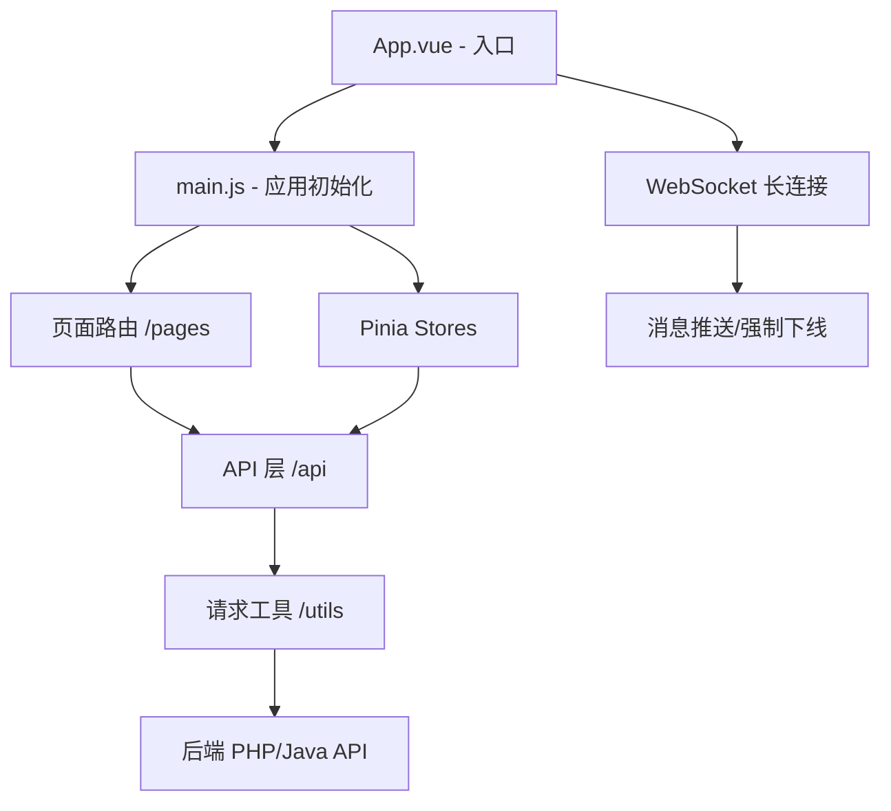

# 工匠基地平台 — 项目概述

<cite>
**参考文件**
- [package.json](file://package.json)
- [manifest.json](file://manifest.json)
- [main.js](file://main.js)
- [App.vue](file://App.vue)
- [pages.json](file://pages.json)
</cite>

## 1. 项目简介

**工匠基地平台**（gjjd_appnext）是一款基于 UniApp 框架构建的跨平台移动应用，面向技能竞赛与职业培训场景。App 名称"工匠基地"体现了"工匠精神"与"技能人才培养"的核心定位。

- **版本**：3.3.8（versionCode: 338）
- **类型**：跨平台 App（Android / iOS / H5 / 小程序）
- **框架**：UniApp（Vue 3 为主，兼容 Vue 2）
- **状态管理**：Pinia（Vue 3 推荐的状态管理库）

## 2. 技术栈

| 类别 | 技术选型 | 说明 |
|------|---------|------|
| 前端框架 | UniApp + Vue 3 | 一套代码多端发布（App、H5、小程序） |
| 状态管理 | Pinia ^3.0.4 | 轻量级 Vue 状态管理，替代 Vuex |
| 构建工具 | HBuilderX / CLI | UniApp 标准构建方式 |
| 图标字体 | iconfont | 阿里矢量图标库 |
| 第三方组件 | lime-circle, uni-* 系列 | 环形进度条、日历、倒计时等 uni_modules |
| 图表组件 | qiun-data-charts | 数据可视化（成绩排行等） |
| 富文本 | uv-parse | 文章/资讯内容渲染 |

**来源**: [package.json](file://package.json#L1-L6), [manifest.json](file://manifest.json#L1-L117)

## 3. 应用架构

### 3.1 目录结构概览

```
gjjd_appnext/
├── api/           # API 接口层
├── pages/         # 业务页面（9大模块）
├── store/         # Pinia 状态管理
├── utils/         # 工具函数
├── styles/        # 全局 CSS 样式
├── static/        # 静态资源（图标、图片、TabBar）
├── uni_modules/   # 第三方 uni-app 插件
├── App.vue        # 应用入口（WebSocket 管理）
├── main.js        # 入口 JS（Vue 3 SSR + Pinia）
└── pages.json     # 路由配置（70+ 页面）
```

### 3.2 前端分层



### 3.3 双后端架构

此项目对接**两套独立后端服务**：

- **PHP 后台**（主后台，端口 8080）：处理传统业务接口（用户、考试、提升等）
- **Java 后台**（竞赛专用，端口 8081）：处理竞赛模块的高性能接口

两者通过 `utils/util.js` 中的 `runMode` 统一切换开发/生产环境。

**来源**: [utils/util.js](file://utils/util.js#L1-L30), [utils/java.js](file://utils/java.js#L1-L52)

## 4. 核心功能模块

### 4.1 导航结构

底部 TabBar 包含 4 个主入口：

| Tab | 路径 | 说明 |
|-----|------|------|
| 发现 | pages/index/index | 首页内容发现与搜索 |
| 团队 | pages/team/index | 团队管理与技能大师工作室 |
| 提升 | pages/promote/index | 学习培训与技能提升 |
| 我的 | pages/user/index | 用户中心 |

### 4.2 模块详解

**① 发现模块（Index）**
- 首页信息流展示
- 全局搜索功能

**② 团队模块（Team）**
- 技能大师工作室列表与评分
- 我的团队管理
- 数据图表展示

**③ 提升模块（Promote）** — 核心学习模块
- 学习路径与学习地图
- 培训任务与任务进度条
- 课件学习与文章学习
- 错题库管理
- 复习考试
- 学习矩阵（能力评估）

**④ 考试模块（Exam）**
- 顺序练习 / 随机练习
- 模拟考试（含历史记录）
- 成绩查看与答题详情
- 考试列表

**⑤ 竞赛模块（Competition）** — 核心互动模块
- 竞赛首页与详情
- 个人竞技（PK答题）/ 组队竞技
- 大冒险答题闯关
- 课件资料学习
- 模拟考试
- 社群问答
- 竞赛资讯与通知
- 签到与积分
- 报名功能

**⑥ 用户模块（User）**
- 个人资料与档案
- 订单管理与收货地址
- 消息通知与留言板
- 证书与专利
- 钱包与签到
- 客服与设置
- 分享管理

**⑦ 任务模块（Task）**
- 细目表审核
- 题库审核（理论/实操/主观题）

**⑧ 报名模块（Registration）**
- 报名中心
- 自主报名预约
- 活动详情

**⑨ 商城模块（Shop）**
- 积分商城
- 奖励兑换

**⑩ 计划模块（Plan）**
- 学习计划

**来源**: [pages.json](file://pages.json#L1-L937)

## 5. 状态管理（Pinia）

项目采用 **Pinia** 进行状态管理，当前有两个 Store：

### 5.1 User Store（用户状态）
- **状态**: userId, userInfo, token, clientId（WebSocket 客户端 ID）
- **关键操作**: login、logout、checkLogin
- **计算属性**: isLoggedIn、userName、userAvatar
- **持久化**: 通过 `uni.setStorageSync` 同步到本地存储

**来源**: [store/user.js](file://store/user.js#L1-L121)

### 5.2 Competition Store（竞赛状态）
- **状态**: currentMatchId, competitionList, registrationData, participationData 等
- **关键操作**: fetchCompetitionHome（从后端加载竞赛首页数据）
- **计算属性**: hasMatchId、competitionName、registrationCount

**来源**: [store/competition.js](file://store/competition.js#L1-L142)

## 6. API 层

API 层采用按模块拆分的文件结构：

- `api/index.js` — 统一导出入口
- `api/competition.js` — 竞赛相关接口（30+ 个接口：首页、PK、大冒险、课件、文章、错题、模拟考、社群问答等）
- `api/promote.js` — 提升相关接口（培训任务、培训计划、竞赛任务）

所有接口通过 `utils/index.js`（PHP 后台）或 `utils/java.js`（Java 竞赛后台）封装的 `request` 函数发起 HTTP 请求，自动附加 token 认证。

**来源**: [api/index.js](file://api/index.js#L1-L17), [api/competition.js](file://api/competition.js#L1-L363)

## 7. 样式系统

项目采用**功能类优先**的 CSS 方案，按功能分类到 4 个文件：

| 文件 | 作用 | 示例 |
|------|------|------|
| colors.css | 颜色类（背景色/文字色） | `.bg-73a9fa` `.color-007aff` |
| layout.css | 布局类（Margin/Padding/Flex/Grid/定位） | `.dis-flex` `.gap-10` `.grid-2` |
| typography.css | 文字类（字号/对齐/行高/省略） | `.font-s14` `.text-C` `.ellipsis-no` |
| utilities.css | 工具类（边框/圆角/阴影/遮罩） | `.radius-10` `.shadow-sm` `.mask-dark` |

**来源**: [styles/colors.css](file://styles/colors.css), [styles/layout.css](file://styles/layout.css), [styles/typography.css](file://styles/typography.css), [styles/utilities.css](file://styles/utilities.css)

## 8. 网络通信

### 8.1 HTTP 请求
- 封装在 `utils/index.js`（PHP 后台）和 `utils/java.js`（Java 后台）
- Content-Type: application/json
- 自动拼接 token（`itoken`）到 URL 参数
- 统一错误处理（网络失败提示 toast）

### 8.2 WebSocket 长连接
- 在 `App.vue` 的 `onLaunch` 中自动建立连接
- 心跳机制：每 15 秒发送 ping 维持连接
- 消息处理：绑定 clientId、异地登录强制下线（`type: 'logout'`）
- 断线自动重连

**来源**: [App.vue](file://App.vue#L17-L107), [utils/index.js](file://utils/index.js#L1-L50)

## 9. 开发与运行

- **开发模式**: `runMode: 'dev'`，连接本地 PHP（:8080）+ Java（:8081）后台
- **生产模式**: `runMode: 'pro'`，连接线上服务器 `gjjdp.gjjd168.com`
- **配置文件**: `utils/util.js` 中的 `domain`、`java`、`wss` 等配置项
- **环境要求**: 开发需启动对应后端服务；生产需部署至正式服务器

**来源**: [utils/util.js](file://utils/util.js#L1-L30)